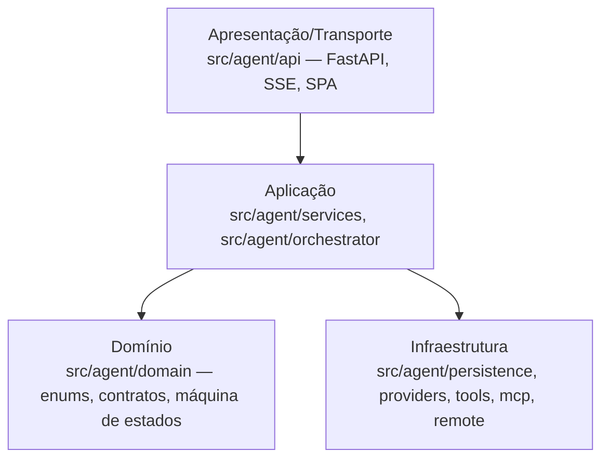

# AGENTS.md — Regras de Engenharia do Callidus

As regras de engenharia que todo agente segue ao escrever código.

> **Fonte canônica** das regras de desenvolvimento do Callidus: código, testes, documentação e
> verificação. As regras específicas de ferramenta (Cursor, hooks, scripts) apenas **referenciam**
> ou **complementam** este arquivo — não o repetem.
>
> Regras de produto e de processo que já vivem em [`docs/regras/`](/docs/regras/README.md)
> continuam lá; este arquivo concentra o **como escrever e manter código** do Callidus.

---

## Sumário

0. [Comece toda sessão aqui](#0-comece-toda-sessão-aqui)
1. [Princípio geral](#1-princípio-geral)
2. [Camadas e dependências](#2-camadas-e-dependências)
3. [Cabeçalho obrigatório dos arquivos](#3-cabeçalho-obrigatório-dos-arquivos)
4. [Documentação de classes, funções e métodos](#4-documentação-de-classes-funções-e-métodos)
5. [Comentários internos](#5-comentários-internos)
6. [SOLID pragmático](#6-solid-pragmático)
7. [Design patterns](#7-design-patterns)
8. [Organização modular](#8-organização-modular)
9. [Contratos que não podem quebrar](#9-contratos-que-não-podem-quebrar)
10. [Testes](#10-testes)
11. [Documentação hierárquica](#11-documentação-hierárquica)
12. [Documentação é parte da implementação](#12-documentação-é-parte-da-implementação)
13. [Sincronização obrigatória](#13-sincronização-obrigatória)
14. [Checklist de execução](#14-checklist-de-execução)
15. [Referência rápida de comandos](#15-referência-rápida-de-comandos)
16. [Inegociáveis](#16-inegociáveis)
17. [Decisões do dono](#17-decisões-do-dono)
18. [Agentes em paralelo](#18-agentes-em-paralelo)
19. [Roadmap e documentos de progresso](#19-roadmap-e-documentos-de-progresso)
20. [Receitas](#20-receitas)

---

## 0. Comece toda sessão aqui

O agente não depende de memória: o estado e a fila estão escritos. Em toda sessão:

1. Leia [`ROADMAP.md`](/ROADMAP.md) e a fila ranqueada em [`docs/progresso/gaps.md`](/docs/progresso/gaps.md).
   Sem tarefa do usuário, pegue o **maior rank em que consiga avançar**.
2. Leia `plan/STATUS.md` (onde parou, próximo passo, decisões pendentes, quem mexe em quê), a
   tarefa em `plan/execution-plan.md` §3 e o checklist da atividade em
   [`internal/tarefas/`](/docs/regras/checklists-tarefas.md). `plan/` é local e está no `.gitignore`.
3. Leia o [hub de regras](/docs/regras/README.md) e só os ramos que a tarefa pede.
4. Siga o protocolo de `plan/execution-plan.md` §7: orientar → planejar → implementar + testar →
   verificar (`python scripts/ci.py`) → registrar → comitar e publicar. **Não pare para perguntar**,
   exceto nas decisões do [§17](#17-decisões-do-dono).

---

## 1. Princípio geral

**Preservar a identidade e o funcionamento do Callidus; melhorar a implementação interna.**

- O Callidus é um **agente de desenvolvimento local**: o estado canônico está no SQLite, a
  verificação é independente de quem executa, e o modelo é uma peça substituível.
- Uma refatoração é aceitável quando **reduz o custo de manutenção** sem mudar contrato
  observável (endpoint, status HTTP, formato de payload, evento, estado, nome público).
- Mudança de contrato só é aceitável quando **inevitável**: justificada, migrada, testada e
  documentada. Elegância teórica não justifica quebra de compatibilidade.
- **Nunca** destructivamente apague, reinicialize ou migre um banco real para facilitar uma
  mudança. Use banco temporário/isolado nos testes.

---

## 2. Camadas e dependências

O Callidus tem quatro camadas. A dependência aponta **sempre para dentro**.



| Camada | Pasta | Pode depender de | Não pode |
|--------|-------|------------------|---------|
| Domínio | `src/agent/domain` | nada interno | FastAPI, SQLAlchemy, HTTP, `os` |
| Aplicação | `src/agent/services`, `src/agent/orchestrator` | domínio, contratos | urllib/httpx direto, SQLAlchemy Session fora dos services |
| Infraestrutura | `src/agent/persistence`, `providers`, `tools`, `mcp`, `remote` | domínio | regras de negócio |
| Apresentação | `src/agent/api` | serviços/orquestrador | regra de negócio inline na rota |

Regras práticas:

- **Rotas não concentram regra de negócio**: a rota valida, delega e serializa. Lógica de
  decisão fica em `services/` ou `orchestrator/`.
- **Domínio não depende de infraestrutura**: enums, schemas e a máquina de estados são
  importáveis sem `fastapi` e sem `sqlalchemy`.
- **Dependências de aplicação são contratos**: o orquestrador fala com `TaskService`,
  `AttemptService`, `ToolRegistry`, `LLMProvider` — não com tabelas ou `httpx` cru.
- **Import local dentro da função** é aceitável quando evita ciclo de import ou custo de
  arranque; comente o porquê quando não for óbvio.

---

## 3. Cabeçalho obrigatório dos arquivos

**Todo arquivo de código tem cabeçalho**, com os campos abaixo, na ordem, sem datas nem nomes
de responsáveis (metadado que envelhece).

### 3.1 Python

Use a **docstring de módulo** (é o que as IDEs e o `help()` mostram):

```python
"""
Arquivo: src/agent/orchestrator/runner.py
Nome: runner.py
Propósito: coordenar o ciclo de execução de um run — planejar, executar, verificar, consolidar.
Responsabilidade: camada de aplicação — orquestração do ciclo; delega a execução de uma tarefa.
Componentes: RunOrchestrator (step, planejamento, estagnação, pausa), helpers de fluxo.
Dependências: agent.services.task_service, agent.services.attempt_service, agent.providers.registry, agent.persistence.models.
Observações: o SQLite é a fonte da verdade; a verificação é independente de quem executa.
"""
```

Regras do cabeçalho em Python:

- A docstring de módulo é a **primeira instrução** do arquivo. Comentários de `shebang`,
  `# -*- coding -*-`, licenças e `from __future__ import annotations` continuam válidos.
- Se o módulo já tem uma docstring narrativa, **preserve o texto**: os campos vêm primeiro e a
  narrativa continua abaixo, separada por linha em branco.
- Ao mover ou renomear o arquivo, **atualize o campo `Arquivo:`** e o campo `Nome:`.

### 3.2 TypeScript / JavaScript

Comentário de bloco no topo do arquivo (o projeto usa JavaScript com módulos ES):

```javascript
/**
 * Arquivo: web/static/assets/app/api.js
 * Nome: api.js
 * Propósito: talking with the Callidus API (JSON + SSE).
 * Responsabilidade: frontend/transport — thin client of the HTTP API.
 * Componentes: api(), apiStream(), helpers of headers and errors.
 * Dependências: global fetch and EventSource; server /api/*.
 * Observações: never shows the credential; the error carries the original response.
 */
```

### 3.3 CSS, HTML, shell e SQL

Comentário válido da linguagem, com os mesmos campos:

```css
/*
 * Arquivo: web/static/assets/app/style.css
 * Nome: style.css
 * Propósito: design system of the interface — tokens, themes, layout.
 * Responsabilidade: frontend/visual — styles of the SPA.
 * Dependências: CSS custom properties; prefers-color-scheme and prefers-reduced-motion.
 * Observações: the palette adapts to light and dark theme.
 */
```

### 3.4 Formatos sem comentário

JSON estrito, YAML de dados, `.env` e arquivos de lock **não** recebem cabeçalho inválido.
Documente a finalidade no índice do módulo ou no `README.md` da pasta.

### 3.5 O que **não** recebe cabeçalho

Código gerado, bibliotecas de terceiros, binários, artefatos de build, arquivos de dependência
bloqueada. Não force cabeçalho inválido nem comentário inútil em arquivo que não aceita comentário.

### 3.6 Testes e scripts

Também são código: têm cabeçalho, com `Propósito` e `Responsabilidade` indicando que
**verificam** um comportamento (não descrevem implementação).

---

## 4. Documentação de classes, funções e métodos

Toda classe, função e método tem descrição **útil** (PEP 257, estilo Google):

```python
def update_status(self, task_id: uuid.UUID, status: TaskStatusUpdate) -> TaskModel:
    """Move a tarefa para um novo estado, validando a transição.

    Args:
        task_id: identificador da tarefa a mover.
        status: novo estado e o motivo (opcional) da mudança.

    Returns:
        A tarefa atualizada, já persistida.

    Raises:
        InvalidTransitionError: quando a transição pedida não é válida.
        LookupError: quando a tarefa não existe.

    Observações:
        A transição é validada pela máquina de estados; o registro da mudança
        acontece no mesmo commit da alteração do status.
    """
```

Regras:

- **Explique o contrato**, não traduza a linha seguinte. "Executa a operação" não serve.
- Diga **o que** faz, **por que** existe, **o que devolve**, **o que pode levantar** e
  **quais efeitos colaterais** tem, quando aplicável.
- Anote tipos de entrada e saída (PEP 484) quando o módulo já é tipado.
- Use `Args`, `Returns`, `Raises` e `Observações` **quando couberem**; não force seções vazias.
- Métodos privados e funções auxiliares também são documentados quando têm comportamento ou
  decisão não óbvia.
- Em JavaScript, prefira JSDoc com `@param`, `@returns`, `@throws`.

---

## 5. Comentários internos

Comentário interno existe para explicar **o porquê**:

- invariantes e regras de negócio;
- decisão não óbvia e alternativa descartada;
- restrições de concorrência e de estado;
- tratamento de falha e por que a falha é absorvida.

**Não** comente o óbvio ("incrementa o contador"), **não** narre o código, **não** escreva
comentário que envelhece (referência a Issue, data, nome de autor).

---

## 6. SOLID pragmático

| Princípio | Como o Callidus aplica |
|-----------|------------------------|
| **S** — Responsabilidade única | Um módulo, um tema: `orchestrator/closing.py` só fecha; `verification/runner.py` só verifica. |
| **O** — Aberto/fechado | Novo provedor = novo arquivo em `providers/` + registro; novo gatilho = novo arquivo em `automation/triggers/`. |
| **L** — Substituição de Liskov | Todo `LLMProvider` respeita `chat`/`stream`/capacidades; todo `Trigger` respeita `due_at`. |
| **I** — Segregação de interfaces | Contrato do verificador só exige o que o verificador usa; `ToolContext` só carrega o que as ferramentas pedem. |
| **D** — Inversão de dependência | O orquestrador depende de `LLMProvider`, `ToolRegistry` e serviços — não de `httpx` ou SQLAlchemy. |

**Regra de custo:** não crie interface artificial, classe ou pasta sem benefício concreto.
Não transforme cada função em classe. Prefira composição a herança.

---

## 7. Design patterns

Já existentes e reutilizáveis — **não duplique mecanismos**:

| Padrão | Onde vive | Regra |
|--------|-----------|-------|
| Strategy | `providers/*` (intercambiáveis por configuração) | nova implementação = novo arquivo, sem tocar o núcleo |
| Registry | `tools/registry.py`, `skills/discovery.py`, `automation/triggers` | registro por id; a descoberta é extensível |
| Adapter | `providers/openai_compatible.py`, `automation/service/*`, `remote/ssh.py` | normaliza API externa ao contrato interno |
| State Machine | `domain/state_machine.py` | transições válidas em **um** lugar; `InvalidTransitionError` |
| Repository | `services/*_service.py` | a API nunca fala com a Session para regra de negócio |
| Observer / Event Bus | `observability/bus.py` + `emit` | desacopla progresso de execução |
| Facade | `api/main.py`, `orchestrator/runner.py` | entrada única para o sistema |
| Command | `automation/actions/*` | ação = contrato explícito, testável sem LLM |
| Template Method | `automation/service/*` | mesmo núcleo, três adapters de SO |
| Decorator | `providers/observed.py` | streaming/observabilidade sem tocar o provedor |

Ao adotar um padrão novo, registre a **decisão** (problema, alternativas, custo) em
[`docs/architecture/`](/docs/architecture/README.md).

---

## 8. Organização modular

- Um diretório = **um tema**. Pasta nova só quando há vários arquivos do mesmo assunto.
- Nomes previsíveis: `kebab-case` em Python/JS, `snake_case` em arquivo Python.
- **Nada de "utils", "common", "misc"**: quem não sabe onde está, não encontra.
- Movimento de arquivo é permitido quando houver ganho de coesão, isolamento, testabilidade ou
  evolução independente — e **nunca** por estética.
- Ao mover: atualize imports, rotas, testes, comandos, empacotamento, documentação e o
  campo `Arquivo:` do cabeçalho.

---

## 9. Contratos que não podem quebrar

Preservados sem alteração em refatorações:

| Contrato | Onde |
|----------|------|
| Endpoints, métodos HTTP, códigos de status e formato de payload | `src/agent/api` |
| Eventos de streaming e o envelope do EventBus | `src/agent/observability` |
| Nomes públicos: classes, funções, colunas, variáveis de ambiente, aliases | projeto inteiro |
| Estados e transições válidas de tarefa/run/agente | `src/agent/domain` |
| Formato das evidências e do histórico de tentativas | `src/agent/persistence` |
| Comandos de instalação e execução (`callidus-api`, `agente-api`, `callidus-supervisor`) | `pyproject.toml` |
| Caminhos de dados (`data/`, `data/agent.db`, `data/providers.yaml`, `data/mcp.json`) | `src/agent/config.py` |

---

## 10. Testes

- **Proporcional ao risco**: uma função pura pede teste unitário; o caminho feliz do orquestrador
  pede integração; contrato HTTP pede teste de rota.
- **Teste comportamento, não existência**: asserção sobre o efeito observável.
- Cubra, quando aplicável: caminho normal, entrada vazia/inválida, dependência que falha,
  transição inválida, rollback/recuperação, permissão negada, concorrência, timeout/cancelamento.
- **Isolamento**: banco temporário por teste, filesystem temporário, provedor falso. Nunca
  dependa de credencial real, serviço externo ou dado pessoal.
- **Nenhum teste novo quebra o determinismo**: sem rede, sem relógio real, sem ordem implícita.

```bash
source .venv/bin/activate && python -m pytest -q          # suíte completa
python -m pytest tests/test_e2e_orchestrator.py -v         # um arquivo
```

---

## 11. Documentação hierárquica

Divulgação progressiva: **resumo → índice → tópico → detalhe**.

| Nível | Onde | Quem entra |
|-------|------|-----------|
| 0 | [`README.md`](/README.md) | entrada: o que é, como rodar, o que há de importante |
| 1 | [`docs/README.md`](/docs/README.md) | índice geral: onde está cada assunto |
| 2 | [`docs/architecture/`](/docs/architecture/README.md), [`docs/regras/`](/docs/regras/README.md) | guias por tema |
| 3 | `README.md` da pasta do módulo | contrato do módulo: propósito, limites, como testar, como estender |

Regras:

- Índice com **tabela** (documento → finalidade → quando consultar) e **links relativos válidos**.
- Prefira diagrama Mermaid a texto longo; mantenha o diagrama **alinhado com o código**.
- Decisão estrutural relevante vira **ADR** (contexto, problema, alternativas, decisão,
  consequências, estado) em [`docs/architecture/`](/docs/architecture/README.md).
- Verifique link, caminho e nome citado antes de publicar.

---

## 12. Documentação é parte da implementação

**Toda alteração de código atualiza a documentação correspondente.** Documento desatualizado
não é dívida menor: é o que faz o próximo agente (e a próxima pessoa) decidir sobre um
sistema que já não existe. A revisão documental é **critério de conclusão**, junto com a
validação técnica.

### O que revisar antes de encerrar

1. **Fatos**: algum documento ficou errado (contagens, nomes, caminhos, endpoints, campos)?
2. **Navegação**: índices, diagramas, sumários e links ficaram obsoletos?
3. **Novidade**: entrou alguma funcionalidade ou contrato que merece registro?
4. **Obras**: o que foi removido ou renomeado — some a referência obsoleta e preserve o
   histórico (ADR, `resume.md`) quando ainda tiver valor.

### Onde fica cada tipo de informação

| Informação | Dono do texto |
|------------|---------------|
| Panorama, como rodar, para onde ir | `README.md` |
| Onde está cada assunto | `docs/README.md` e o hub de regras |
| Componentes, fronteiras, relações | `docs/architecture/` (+ ADR quando for decisão) |
| Responsabilidade, fluxo, contratos, testes de um módulo | `README.md` do módulo |
| Consulta precisa (endpoint, campo, formato) | Referência técnica |
| Contrato e decisão local | Comentário e docstring no código |
| Como executar, alterar, validar e manter | `AGENTS.md` e `docs/regras/` |

Quando a explicação completa já existe, use **link contextual + resumo de uma linha** —
não copie o texto.

### Padrão de forma

O padrão completo está em
[docs/regras/documentacao.md](/docs/regras/documentacao.md): estrutura de página, marcadores
visuais, precisão factual e checklist de publicação. Em resumo:

- H1 único, sem salto de nível, sumário quando o documento é longo.
- Cabeçalho enxuto: título, uma frase de propósito e a volta para o hub — **sem** ícone.
- Emoji de categoria nas seções H2 (quando o documento não usar âncoras).
- Bloco de código com linguagem; tabela para comparação; diagrama quando explicar um fluxo.
- Números, nomes e comandos **verificados no código** antes de serem escritos.

### Verificação documental

```bash
python scripts/check_docs.py        # links e âncoras
python scripts/check_references.py  # arquivos e símbolos citados existem
python scripts/check_markdown.py    # estrutura do Markdown
```

## 13. Sincronização obrigatória

Code, test, index, diagram and documentation move **juntos**. Ao encerrar a tarefa:

- [ ] imports, referências e comandos quebrados: nenhum
- [ ] arquivo órfão: nenhum (nem duplicado, nem abstrato em paralelo)
- [ ] cabeçalho com caminho antigo: nenhum
- [ ] README de pasta: atualizado quando o módulo mudou de propósito
- [ ] `resume.md` sincronizado: `python3 scripts/resume.py check`
- [ ] `docs/architecture/` coerente com o código
- [ ] `AGENTS.md` e `docs/regras/` sem contradição
- [ ] documentos de progresso atualizados ([§19](#19-roadmap-e-documentos-de-progresso))
- [ ] `python scripts/ci.py` verde

---

## 14. Checklist de execução

```markdown
- [ ] Etapa A — diagnóstico (o que existe, o que falha, o que é risco)
- [ ] Etapa B — convenções (cabeçalho, docstring, regras)
- [ ] Etapa C — refatoração (módulos movidos, imports, testes)
- [ ] Etapa D — padronização (cabeçalhos, docstrings, nomes)
- [ ] Etapa E — testes (novos, regressão, suíte completa)
- [ ] Etapa F — auditoria final (docs, links, consistência, commit)
- [ ] Documentação revisada: fatos, índices, diagramas, links e regras
```

O estado da tarefa vive em [`internal/tarefas/`](/internal/tarefas/) (modelo:
[`_modelo-checklist.md`](/internal/tarefas/_modelo-checklist.md)).

---

## 15. Referência rápida de comandos

| Comando | O que faz |
|---------|-----------|
| `source .venv/bin/activate` | ativa o ambiente |
| `python scripts/ci.py` | **comando único de verificação**: lint, cabeçalhos, docs, `resume.md`, interface e suíte Python |
| `python scripts/ci.py --rapido` | o mesmo, sem a suíte Python |
| `pip install -e ".[dev]"` | instala o pacote `callidus` em modo editável |
| `python -m pytest -q` | suíte de testes completa |
| `python -m pytest tests/<arquivo>.py -v` | um arquivo de teste |
| `python -m ruff check src tests` | lint (se o ruff estiver instalado) |
| `callidus-api` | sobe a API + interface em `http://127.0.0.1:8765` |
| `python scripts/resume.py check` | confere o `resume.md` contra o código |
| `python scripts/resume.py faltando` | mostra o que falta descrever no `resume.md` |
| `python scripts/check_docs.py` | confere links e âncoras da documentação |
| `python scripts/check_references.py` | confere arquivos e símbolos citados nos documentos |
| `python scripts/check_markdown.py` | confere a estrutura dos documentos Markdown |

---

## 16. Inegociáveis

Regras que nenhuma tarefa justifica quebrar. Cada uma diz **por quê** e **qual verificação a
pega**; regra sem fiscal está marcada e tem gap aberto. Se uma tarefa exigir quebrar uma delas,
pare e diga.

| Regra | Por quê | Fiscal |
|-------|---------|--------|
| Contratos do [§9](#9-contratos-que-não-podem-quebrar) não mudam sem migração, teste e documentação | a UI, os scripts e os dados do usuário dependem deles | testes de rota e de contrato (`tests/test_agent_api.py`, `tests/test_api.py`, `tests/test_tool_contracts.py`) no `scripts/ci.py` |
| Nunca apagar, reinicializar ou migrar à força o banco real (`data/agent.db`) | é o estado canônico do usuário | testes em banco temporário (`tests/conftest.py`); **sem fiscal automático** — [G6](/docs/progresso/gaps.md#g6-fiscais-automáticos-das-regras-de-engenharia) |
| Quem executa não aprova o próprio resultado | evita conclusão falsa | `tests/test_independent_verification.py`, `tests/test_global_acceptance.py` |
| Falha vira mensagem, nunca travamento, erro 500 ou perda de dados | entradas do modelo e de provedores não são confiáveis | `tests/test_project_delete.py` (409), `tests/test_providers_api.py` (`ok: false`), `tests/test_failures.py` |
| Camadas do [§2](#2-camadas-e-dependências): domínio sem FastAPI/SQLAlchemy | o domínio precisa ser testável sozinho | revisão; **sem fiscal automático** — [G6](/docs/progresso/gaps.md#g6-fiscais-automáticos-das-regras-de-engenharia) |
| Cabeçalho obrigatório ([§3](#3-cabeçalho-obrigatório-dos-arquivos)) | navegação por humanos e agentes | passo "cabeçalhos" do `scripts/ci.py` |
| Testes determinísticos: sem rede, sem credencial real, sem relógio real ([§10](#10-testes)) | a suíte precisa dar o mesmo resultado em qualquer máquina | revisão; **sem fiscal automático** — [G6](/docs/progresso/gaps.md#g6-fiscais-automáticos-das-regras-de-engenharia) |
| Documentação e `resume.md` mudam junto com o código ([§12](#12-documentação-é-parte-da-implementação)–[§13](#13-sincronização-obrigatória)) | documento velho faz o próximo agente decidir sobre um sistema que não existe | passos de links, referências, Markdown e `resume.md` do `scripts/ci.py` |
| Lint limpo, sem silenciar erro para passar | erro silenciado vira defeito invisível | passo "lint (ruff)" do `scripts/ci.py` |

**Portões de qualidade** antes de todo commit:

```bash
python scripts/ci.py            # todos os portões
python scripts/ci.py --rapido   # sem a suíte Python, durante o trabalho
```

**Commits** seguem [commits.md](/docs/regras/commits.md): português, uma mudança coerente por
commit, o gap citado no corpo (`Parte do G3.`) e o `Co-Authored-By:` do modelo quando o autor é
um agente.

---

## 17. Decisões do dono

O agente trabalha sem pedir licença, **exceto** nestas decisões — aqui ele para, prepara o
material e pergunta:

- Quebrar um inegociável do [§16](#16-inegociáveis) ou um contrato do [§9](#9-contratos-que-não-podem-quebrar).
- Apagar, reinicializar ou migrar de forma incompatível o banco real ou outro dado do usuário em `data/`.
- Adicionar dependência nova (de execução ou com licença diferente das atuais).
- **Trocar o provedor ou o modelo padrão** — `data/providers.yaml`, padrões de configuração em
  `src/agent/config.py` e o modelo de referência da avaliação (`gpt-oss:20b` em `lab/avaliar.py`).
- Segredos, credenciais e `.env`.
- Escopo do produto e critérios de estágio (beta, 1.0) em [roadmap.md](/docs/progresso/roadmap.md).
- Licença, número de versão e publicação de versão; ligar CI remoto.

O commit e o push na branch atual ao concluir **já estão autorizados** pela preferência
"Publicar ao concluir" ([commits.md](/docs/regras/commits.md)).

---

## 18. Agentes em paralelo

Mais de um agente (Cursor, Claude, sessões em paralelo) pode trabalhar no repositório ao mesmo
tempo. Para não pisar no trabalho do outro:

- **Anote a posse antes de começar** na tabela "Quem mexe em quê" de `plan/STATUS.md` (pasta ou
  arquivos) e libere ao terminar.
- **Edite só o que possui.** Precisa mexer em arquivo de outra sessão? Registre em
  `plan/STATUS.md` e espere a liberação, ou trabalhe em outro gap.
- **Arquivos compartilhados** (`resume.md`, `.cursor/resume-inventario.json`, `AGENTS.md`,
  `docs/progresso/`): releia imediatamente antes de gravar, faça a menor edição possível e nunca
  reescreva o arquivo inteiro a partir de uma cópia antiga.
- **Escrita atômica** para arquivos gerados: grave num temporário e renomeie.
- **Commit só do que é seu:** `git add <caminhos>`, nunca `git add -A` com trabalho de outra sessão
  na árvore.
- **Saídas separadas:** experimentos em `lab/out/<label>` com rótulo próprio; nunca use o
  `data/agent.db` do usuário para avaliar (o `lab/avaliar.py` já isola o banco).

---

## 19. Roadmap e documentos de progresso

Formato em [progresso.md](/docs/regras/progresso.md). Quando uma tarefa entra, atualize **na
mesma entrega**:

- a área em [avaliacao.md](/docs/progresso/avaliacao.md) (nota, faltando, horas, evidência);
- o gap em [gaps.md](/docs/progresso/gaps.md) (Faltando / Feito e o rank);
- o checklist da dimensão em [checklists/](/docs/progresso/checklists/README.md);
- o marco em [roadmap.md](/docs/progresso/roadmap.md);
- [ROADMAP.md](/ROADMAP.md) se um número principal mudou — e a seção Status do
  [README](/README.md) igual a ele;
- `plan/STATUS.md`.

Avalie por comportamento, erre para baixo e marque cada número como *medido* ou *estimado*.

---

## 20. Receitas

Tarefas recorrentes, passo a passo. O detalhe está no README do módulo.

| Tarefa | Passos |
|--------|--------|
| Novo provedor de modelo | adaptador em `src/agent/providers/` seguindo [providers/README.md](/src/agent/providers/README.md) → teste `tests/test_<nome>_provider.py` com servidor falso → registrar em [provedores.md](/docs/architecture/provedores.md) |
| Nova ferramenta | implementação em `src/agent/tools/` + entrada no catálogo ([tools/README.md](/src/agent/tools/README.md)) → contrato e política → teste em `tests/test_tools.py` ou `tests/test_tool_contracts.py` → [ferramentas.md](/docs/architecture/ferramentas.md) |
| Nova rota HTTP | rota fina em `src/agent/api/` que delega a um serviço → teste de rota → [api/README.md](/src/agent/api/README.md) |
| Mudança de comportamento do agente | teste determinístico → `python lab/avaliar.py` antes e depois com o mesmo modelo → resultado em [avaliacao.md](/docs/architecture/avaliacao.md) |
| Fechar um gap | checklist em `internal/tarefas/` → implementar + testar → `python scripts/ci.py` → [§19](#19-roadmap-e-documentos-de-progresso) → commit citando o gap |

---

## Links cruzados

- [Hub de regras](/docs/regras/README.md) · [Princípios](/docs/regras/principios.md)
- [Documentação](/docs/regras/documentacao.md) · [Organização de arquivos](/docs/regras/organizacao-arquivos.md)
- [Validações e testes](/docs/regras/validacoes-testes.md) · [Verificação final](/docs/regras/verificacao-final.md)
- [Arquitetura](/docs/architecture/README.md) · [Visão geral](/docs/architecture/visao-geral.md)
- [ROADMAP](/ROADMAP.md) · [Gaps](/docs/progresso/gaps.md) · [Documentos de progresso](/docs/regras/progresso.md)