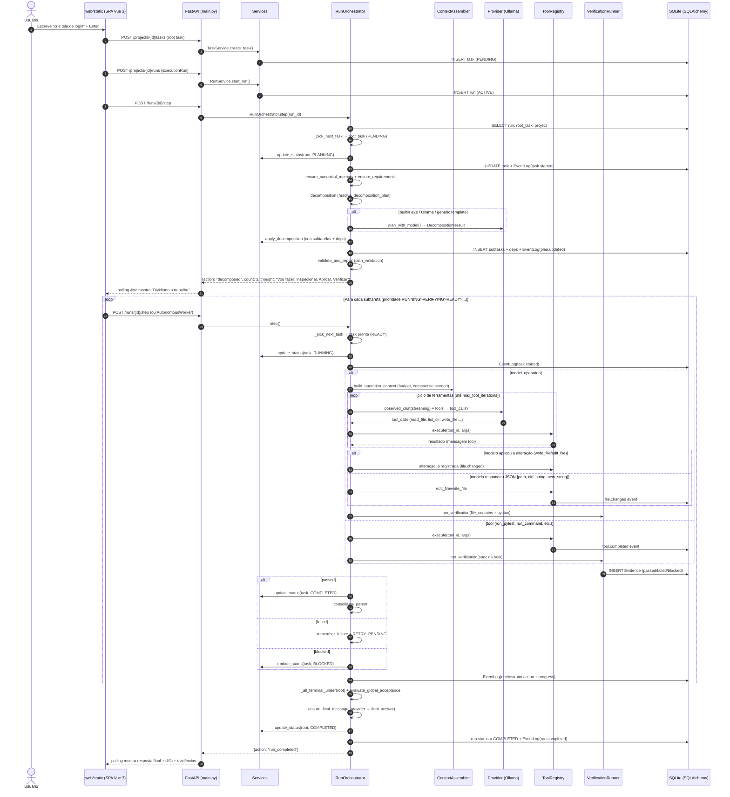
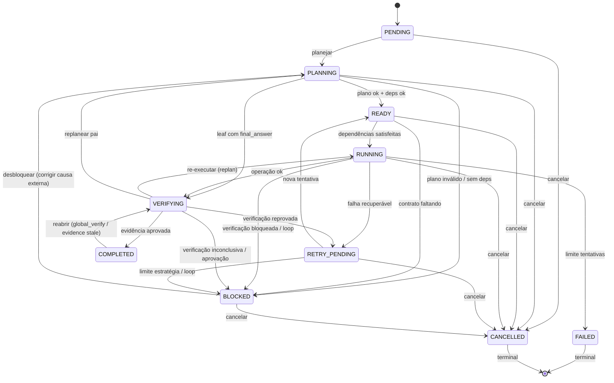
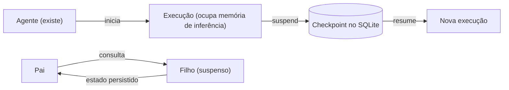

<p align="center">
  
</p>

# Callidus

> **Um agente de programação que roda na sua máquina** — você pede, ele planeja, divide em tarefas pequenas, chama um modelo local (Ollama/llama.cpp), executa ferramentas determinísticas, verifica o resultado e devolve a resposta final.

[](https://www.python.org/)
[](https://fastapi.tiangolo.com/)
[](https://www.sqlalchemy.org/)
[](https://www.sqlite.org/)
[](https://docs.pydantic.dev/)
[](https://ollama.com/)
[](https://github.com/ggerganov/llama.cpp)
[](https://modelcontextprotocol.io/)
[](LICENSE)

---

## 📌 Visão Geral & Proposta de Valor

### O que é
Um **agente de desenvolvimento autônomo** que opera 100% local (sem nuvem obrigatória). Você escreve um pedido no chat (ex.: "crie uma tela de login") e o agente:
1. **Planeja** e **decompõe** o objetivo em tarefas atômicas verificáveis
2. **Chama um modelo local** (Ollama, llama.cpp, ou mock para testes)
3. **Executa ferramentas determinísticas** (ler/escrever arquivos, rodar comandos, testes, git, navegador, MCP)
4. **Verifica** cada etapa com critérios objetivos (pytest, file_contains, syntax, command)
5. **Consolida** resultados, replaneja falhas e escreve a **resposta final** para o usuário

### Por que existe
Modelos locais pequenos têm **janela de contexto limitada** e **erram com facilidade**. A solução não é "prompt maior" — é **arquitetura explícita**:

| Problema Tradicional | Abordagem deste Projeto |
|---------------------|------------------------|
| Tudo no prompt do LLM | Complexidade na **arquitetura** (orquestrador, decomposição, verificação, persistência) |
| Estado efêmero na conversa | **Estado verdadeiro no SQLite** — retoma após falhas, reinícios, pausas |
| LLM "alucina" ferramentas | **Ferramentas determinísticas** registradas, com schemas e aprovação |
| Sem verificação real | **Verificação independente** — quem executa não aprova o próprio resultado |
| Falha = reiniciar tudo | **Pausa/retomada** com diagnóstico, limites operacionais, replanejamento dirigido |

---

## 🏗️ Arquitetura e Engenharia do Sistema

### Diagrama Macro (Pontas a Pontas)

```mermaid
flowchart TB
  subgraph UI["Interface (Web Static)"]
    CHAT["chat → cria task raiz + run"]
    POLL["polling /live, /events, /tasks"]
    DIFF["diff, árvore, tentativas, evidências"]
  end

  subgraph API["FastAPI (src/agent/api)"]
    ROUTES["Rotas: projects, conversations, tasks, runs, memory, knowledge, mcp, observability"]
    DEPS["deps: DB session, Settings, ToolRegistry"]
    STATIC["Sirve web/static (SPA)"]
  end

  subgraph SERVICES["Services — Regras de Negócio"]
    PROJ["ProjectService"]
    CONV["ConversationService (+ branches)"]
    TASK["TaskService (CRUD, deps, transições)"]
    RUN["RunService (start/pause/resume/cancel)"]
    CONTR["ContractService (inputs/outputs/invariants)"]
    MEM["MemoryStore (project + conversation)"]
    KG["KnowledgeGraphService (symbols, imports)"]
    METR["MetricsService"]
    AUTO["AutonomousWorker (background loop)"]
    SCHED["Scheduler (cron runs)"]
    ATT["AttemptService (dedup, fingerprint)"]
  end

  subgraph ORCH["Orchestrator — Ciclo de Execução"]
    RUNNER["RunOrchestrator.step() → _step_body()"]
    PICK["_pick_next_task (prioridade: RUNNING>VERIFYING>READY>...)"]
    PLAN["planner + decomposition + atomizer"]
    CTX["context.assembler + budget (compactação)"]
    PROV["providers: Ollama / llama.cpp / mock"]
    TOOLS["tools.registry → builtins (17 ferramentas)"]
    VERIF["verification.runner (pytest, script, file_contains, syntax)"]
    CONSOL["consolidation (parent ← children)"]
    REPLAN["replan_under + stagnation diagnosis"]
    LIMITS["limit_reached + _pause_run + resume"]
    GLOBAL["global_verify (aceite por requisito)"]
    CLOSE["closing (final_answer)"]
  end

  subgraph PERSIST["Persistence — SQLite + SQLAlchemy 2"]
    MODELS["Models: Project, Task, Run, Attempt, EventLog, Memory, Evidence, KG, Contract, ContextSnapshot"]
    DB["database.py: engine, session_factory, migrations manuais"]
  end

  subgraph DOMAIN["Domain — Contratos & Máquina de Estados"]
    ENUMS["TaskStatus, RunStatus, TaskKind, MemoryKind, AttemptKind"]
    SM["state_machine.py (transições válidas + InvalidTransitionError)"]
    SCHEMAS["Pydantic schemas (API boundaries)"]
    FAIL["Failure, FailureCategory, FailureCause (classificação)"]
  end

  CHAT --> ROUTES
  ROUTES --> SERVICES
  ROUTES --> ORCH
  SERVICES --> ORCH
  SERVICES --> PERSIST
  ORCH --> DOMAIN
  ORCH --> PROV
  ORCH --> TOOLS
  ORCH --> VERIF
  ORCH --> CONTR
  ORCH --> MEM
  ORCH --> KG
  ORCH --> PERSIST
  POLL --> ROUTES
  DIFF --> ROUTES
```



### Tese do Projeto: **Complexidade na Arquitetura, não no Prompt**

1. **O LLM é peça substituível** — interface comum `LLMProvider` (Ollama, llama.cpp, mock). Trocar de modelo não quebra o orquestrador.
2. **Estado canônico no SQLite** — cada tarefa, run, tentativa, evidência, evento é persistido. A conversa com o modelo **não** é fonte da verdade.
3. **Uma operação por vez** — concorrência controlada só para subtarefas independentes (futuro). Isso elimina race conditions e simplifica depuração.
4. **Verificação proporcional ao risco** — escrita de arquivo → `file_contains` + `syntax`; testes → `pytest`/`script`/`command`; aceite global → etapa `Verificação global` por requisito.
5. **Retomada real** — pausa por limites (`max_steps_without_progress`, `max_model_calls`, etc.) grava **diagnóstico + próxima ação**; `resume` reativa o run e **reinicia os contadores**, sem refazer o que já foi comprovado.

---

## 🔄 O Caminho de uma Requisição (Fluxo Amostra)



---

## 📊 Tabela de Módulos e Componentes (Mapeamento Completo)

| Diretório/Arquivo | Propósito | Quando Executa | Conexões (Entrada → Saída) |
|-------------------|-----------|----------------|----------------------------|
| **`src/agent/api/main.py`** | API HTTP + SSE + SPA estática | Inicialização (`callidus-api`) + cada request | HTTP JSON → Services/Orchestrator → DB + EventBus → HTTP JSON / SSE |
| **`src/agent/api/observe_routes.py`** | Rotas SSE, histórico, snapshot | Conexão SSE `/events`, `/live`, `/snapshot` | EventBus (memória) + DB (event_logs) → SSE stream |
| **`src/agent/api/deps.py`** | Dependências FastAPI (DB, Settings) | Cada request | `.env` + `Settings` → `Session`, `ToolRegistry`, `McpManager` |
| **`src/agent/config.py`** | Configuração central (pydantic-settings) | Startup + cada `get_settings()` | `.env` → `Settings` (data_dir, DB URL, Ollama, limites, observabilidade) |
| **`src/agent/domain/enums.py`** | Enums de domínio | Import time (constantes) | `TaskStatus`, `RunStatus`, `TaskKind`, `MemoryKind`, `AttemptKind` |
| **`src/agent/domain/state_machine.py`** | Transições válidas de `TaskStatus` | Toda mudança de status (`TaskService.update_status`) | `TaskStatus` atual → `TaskStatus` alvo → `bool` / `raise InvalidTransitionError` |
| **`src/agent/domain/schemas.py`** | Contratos Pydantic (API boundaries) | Serialização/validação request/response | JSON HTTP ↔ Modelos SQLAlchemy |
| **`src/agent/domain/failures.py`** | Classificação de falhas (categoria, causa) | `AttemptService.record`, `RunOrchestrator._remember_failure` | Exceção/resultado bruto → `Failure` estruturado (signature, strategy) |
| **`src/agent/persistence/models.py`** | Modelos SQLAlchemy (tabelas) | Migração/criação tabelas + runtime ORM | 14 tabelas: projects, tasks, runs, attempts, events, memory, evidence, kg_nodes/edges, contracts, context_snapshots, branches, deps, scheduled_runs |
| **`src/agent/persistence/database.py`** | Engine, session_factory, init_db | Startup (`get_engine`) + testes | `Settings.resolved_database_url()` → `Engine` + `sessionmaker` |
| **`src/agent/services/project_service.py`** | CRUD projetos + memória + knowledge graph | API `/projects/*`, `/memory/*`, `/knowledge/*` | DB → ProjectModel, MemoryRecord, KgNode/Edge |
| **`src/agent/services/conversation_service.py`** | CRUD conversas + branches + fork | API `/conversations/*`, `/projects/{id}/conversations/*` | DB → ConversationModel, BranchModel |
| **`src/agent/services/task_service.py`** | CRUD tarefas + dependências + transições | API `/tasks/*`, Orchestrator (promoção, status) | DB → TaskModel, TaskDependencyModel + validação `state_machine` |
| **`src/agent/services/run_service.py`** | CRUD runs + pause/resume/cancel | API `/runs/*`, AutonomousWorker | DB → ExecutionRunModel + `RunStatus` |
| **`src/agent/services/autonomous_worker.py`** | Loop background: step() runs autônomos | `enable_background_worker=true` (startup) | `RunOrchestrator.step()` a cada 2s para runs `ACTIVE` + `autonomous=true` |
| **`src/agent/services/contract_service.py`** | Contratos de tarefa (inputs/outputs/invariants/acceptance) | API `/tasks/{id}/contract`, Orchestrator (validate_for_run) | DB → TaskContractModel |
| **`src/agent/services/attempt_service.py`** | Tentativas: dedup (prompt_fp), fingerprint, contadores | `RunOrchestrator._execute_task`, `_finalize_verification` | DB → OperationAttemptModel |
| **`src/agent/services/metrics_service.py`** | Métricas de projeto/run | API `/projects/{id}/metrics`, `/runs/{id}/metrics` | DB → agregações (tasks por status, tokens, tentativas, evidências) |
| **`src/agent/services/inbox.py`** | Projeto "inbox" (sem pasta escolhida) | Criação de tarefas/conversas sem project_id | Resolve pasta do usuário (`Path.home()`) |
| **`src/agent/services/fs_browse.py`** | Navegação de pastas (API `/fs/browse`, `/fs/pick-folder`) | UI escolhe pasta do projeto | `os.listdir` + `pick_folder_native` (macOS `osascript`) |
| **`src/agent/orchestrator/runner.py`** | **Coração**: `RunOrchestrator.step()` + `run_until_idle` | Cada `POST /runs/{id}/step` + AutonomousWorker | Lê DB → escolhe task → planeja/executa/verifica/consolida → escreve DB + EventBus |
| **`src/agent/orchestrator/planner.py`** | Memória canônica do objetivo | Início do run (root task PLANNING) | `ProjectService.add_memory(MemoryKind.CANONICAL)` |
| **`src/agent/orchestrator/decomposition.py`** | Decomposição hierárquica (modelo + templates + atomizer) | Task `PLANNING` sem filhos | `provider` + `profile` + `objective` + `requirements` → `DecompositionResult` → `apply_decomposition` |
| **`src/agent/orchestrator/atomizer.py`** | Decomposição adaptativa (recursiva) da etapa interna | `atomize=True` (tarefa complexa) ou tentativas ≥ 2 | Objetivo + `lead_specialty` → `SubTaskSpec` (diagnóstico → correção → verificação) |
| **`src/agent/orchestrator/strategy.py`** | Abordagem profissional (estratégia executável) | Raiz da run vira `PLANNING` | Objetivo → `ProfessionalStrategy` (domínio, complexidade, especialidades, requisitos, riscos, sequência) → `metadata.professional_strategy` |
| **`src/agent/orchestrator/plan_validation.py`** | Validação determinística do plano | Após cada `apply_decomposition` + antes de executar step | Plano (subtasks, covers, deps) → `PlanValidation` (veredito + fixes + blocked) |
| **`src/agent/orchestrator/consolidation.py`** | Consolida pai ← filhos concluídos | Após `VERIFYING` → `COMPLETED` de folha | `children_of` + `settled` + `verification_evidence_ok` → `consolidated_result_json` do pai |
| **`src/agent/orchestrator/global_verify.py`** | Aceite global por requisito | Run sem tasks prontas + root `COMPLETED` | `requirements_report` → `evaluate_global_acceptance` → `reopen_verification_gaps` / `correct_requirement_gaps` |
| **`src/agent/orchestrator/requirements.py`** | Requisitos rastreáveis (derive/contrato + cobertura) | `ensure_requirements` (root) + `effective_covers` (cada task) | `task_contracts.acceptance_json.requirements` ↔ `task.metadata_json.covers` |
| **`src/agent/orchestrator/progress.py`** | Progresso real (não atividade) | Cada `orchestrator.action` event | `progress_state` (verified, pending, blocked) → `made_progress` (bool) |
| **`src/agent/orchestrator/stagnation.py`** | Diagnóstico de estagnação (assinatura normalizada) | `_check_stagnation` (após step com falha repetida) | `failures` (signature + strategy) → `diagnose` (kind, probable_cause, action, automatic) |
| **`src/agent/orchestrator/replan.py`** | Replanejamento dirigido por diagnóstico | `stagnation_replan` + `replan_under` | `Failure` + `coverage` → novo plano (substitui pendentes, mantém concluídos) |
| **`src/agent/orchestrator/closing.py`** | Resposta final (markdown + fontes) | Task `final_answer` + `VERIFYING` → `COMPLETED` | `stages` (filhos) → provider `final_answer` → `compose_final_markdown` |
| **`src/agent/orchestrator/usage.py`** | Acúmulo de tokens (prompt + completion) | `remember_usage` (provider) + `_apply_provider_usage` | `provider.last_usage` → `task.metadata_json.usage` |
| **`src/agent/context/assembler.py`** | Monta componentes do prompt da operação | `OperationContextBuilder.build_for_task` | `ContextComponent[]` (required + optional) → `BudgetResult` (messages + tokens) |
| **`src/agent/context/budget.py`** | Orçamento de tokens + compactação | `assemble_messages` + `compact_text` | `ModelProfile` + components → `messages` dentro de `input_budget` (erra `ContextBudgetError`) |
| **`src/agent/context/operation_builder.py`** | Constrói contexto específico da task | `RunOrchestrator._execute_task` (model_operation) | `project_id, task, profile, run_id` → `BudgetResult` + `ContextSnapshotModel` |
| **`src/agent/providers/base.py`** | Interface `LLMProvider` + `ModelProfile` + `ProviderCapabilities` + erros tipados | Factory `_select_provider` + `profile_from_run_config` | `ChatCompletionRequest` → `ChatCompletionResponse` (streaming opcional, `tool_calls`, capacidades declaradas) |
| **`src/agent/providers/http.py`** | Transporte HTTP comum (timeout, TLS, erros, redação, retry) | Todo provedor HTTP | `HttpClientConfig` → `httpx` → erros tipados (`timeout`, `conexão`, `401`, `429`, `5xx`) |
| **`src/agent/providers/registry.py`** | Configuração declarativa + fábrica de provedores | `_select_provider` + API `/providers` | Arquivo YAML/JSON + `${VAR}` → `ProviderSpec` → instância do provedor |
| **`src/agent/providers/ollama.py`** | Provider Ollama (`/api/chat`, streaming) | `default_provider=ollama` | HTTP `httpx` → Ollama local ou remoto → tokens estimados (`prompt_eval_count`, `eval_count`) |
| **`src/agent/providers/llamacpp.py`** | Provider llama.cpp (OpenAI-compat `/v1`) | `default_provider=llamacpp` | HTTP `httpx` → llama-server local ou remoto → tokens (`usage.prompt_tokens`, `usage.completion_tokens`) |
| **`src/agent/providers/openai_compatible.py`** | Adaptador reutilizável de API compatível com OpenAI | `type: openai_compatible` | HTTP `httpx` → gateway/provedor compatível → `chat/completions` (stream ou não) |
| **`src/agent/providers/openrouter.py`** | Provider OpenRouter | `type: openrouter` | Herda o compatível com OpenAI + `X-Title`/`HTTP-Referer` → catálogo de modelos da API |
| **`src/agent/providers/anthropic.py`** | Provider Anthropic (Messages API nativa) | `type: anthropic` | HTTP `httpx` → `api.anthropic.com/v1/messages` → blocos de conteúdo e `usage` |
| **`src/agent/providers/gemini.py`** | Provider Gemini (`generateContent` nativo) | `type: gemini` | HTTP `httpx` → `generativelanguage.../generateContent` → `contents`/`parts` e `usageMetadata` |
| **`src/agent/providers/mock.py`** | Provider mock (keyword_map) | Testes / `ALLOW_MOCK_FALLBACK` | `keyword_map` → resposta canned |
| **`src/agent/providers/observed.py`** | Wrapper `observed_chat` (emite eventos de streaming) | Toda chamada a provider no Orchestrator | `provider.chat/stream` → EventBus (`agent.started`, `agent.output.delta`, `agent.output.completed`) |
| **`src/agent/tools/registry.py`** | Registro central + execução + aliases | `build_default_registry()` + `RunOrchestrator._tools.execute` | `ToolSpec` + `ToolHandler` → `canonical_tool_id` → execução + eventos (`tool.started/completed/failed`) |
| **`src/agent/tools/builtins.py`** | 17 ferramentas prioritárias | Registry registra todas | `ToolContext(project_root, run_id, task_id, memory_saver, browser_mode)` → resultado dict |
| **`src/agent/tools/browser.py`** | Navegador (Playwright CDP) | `browser_mode=headless|visible` + tool `browser` | `browser_call(action, args, headed)` → snapshot/click/type/scroll/search |
| **`src/agent/tools/diffing.py`** | Diff unificado (linhas added/removed) | `write_file`, `edit_file`, `move_file` | `unified_diff_text(path, before, after)` → `{added, removed, diff}` |
| **`src/agent/verification/runner.py`** | Verificações determinísticas | `_finalize_verification` + API `/verification` (futuro) | `spec.type` (pytest/script/command/file_contains/syntax/file_exists/static_analysis) → `VerificationResult` + `EvidenceModel` |
| **`src/agent/verification/recovery.py`** | Ciclo diagnóstico → correção → re-verificação | Verificação reprovada | `VerificationResult` → `RecoveryDiagnosis` (causa + ação) → retry com orientação ou bloqueio |
| **`src/agent/verification/fingerprint.py`** | Hash de artefatos (valida evidência na retomada) | `EvidenceModel.detail_json.artifacts` | `snapshot(root, spec, tool_args)` → `{"path": hash_sha256}` |
| **`src/agent/observability/bus.py`** | EventBus em memória (ring, assinantes, operations) | `emit()` + SSE subscribers | `EventBus.publish(env)` → ring (seq) + queues (subscribers) + live outputs/operations |
| **`src/agent/observability/emitter.py`** | `emit(type, data, task_id, commit)` | Todo componente (orchestrator, tools, verification) | `EventBus.publish` + `EventLogModel` (se `commit`) |
| **`src/agent/observability/sanitize.py`** | Sanitização de paths sensíveis | `_file_event` + `emit` | `is_sensitive_path(path)` → remove diff de segredos |
| **`src/agent/observability/batching.py`** | `DeltaBatcher` (agrupa fragmentos streaming) | `_run_command` + `observed_chat` | `on_delta` → buffer por intervalo/tamanho → `emit` |
| **`src/agent/observability/snapshot.py`** | Snapshot do estado da run (para `/snapshot`) | API `/runs/{id}/snapshot` | DB + EventBus → `{run, tasks, events, outputs, operations, seq}` |
| **`src/agent/observability/contracts.py`** | Tipos de eventos (TypedDict) | `emit` + subscribers | `EventEnvelope`, `AgentStarted`, `ToolStarted`, etc. |
| **`src/agent/memory/store.py`** | Extração + gravação de memória | `extract_memory_request` (criar task) + `memory_saver` (tool `remember`) | Texto → `MemoryCreate` → `ProjectService.add_memory` |
| **`src/agent/knowledge/graph_service.py`** | Grafo de conhecimento (símbolos, imports, arquivos) | `kg_reindex` + `touch_file` (após write/edit) + API `/knowledge/*` | `reindex(project_root)` → `KgNode/Edge`; `search(q)` / `neighbors(ref, depth)` |
| **`src/agent/knowledge/indexer.py`** | Indexador Python (ast) | `KnowledgeGraphService.reindex` | `ast.parse` → symbols (class, def, import) → upsert nodes/edges |
| **`src/agent/guides/discover.py`** | Guias de capacidade por modelo | `capability_line(profile.model_id)` + `guide_digest(project_root, objective)` | `model_id` → linha de capacidade; pasta → resumo de `AGENTS.md`/READMEs |
| **`src/agent/mcp/manager.py`** | MCP stdio (servers + tools) | API `/mcp/*` + tool `mcp_tool` | `mcp.json` → `McpManager` → `list_servers/tools` + `call_tool` (stdio subprocess) |
| **`src/agent/mcp/stdio_transport.py`** | Transporte stdio JSON-RPC | `McpManager.call_tool` | `subprocess.Popen` + `stdin/stdout` JSON-RPC 2.0 |
| **`src/agent/mcp/config_models.py`** | Modelos Pydantic do `mcp.json` | `McpManager` load | `McpConfig` (servers: command, args, env) |
| **`src/agent/security/paths.py`** | Resolução segura sob `project_root` | Toda ferramenta de arquivo | `resolve_under_root(root, raw)` → `Path` absoluto + `PathSecurityError` |
| **`src/agent/vision/context.py`** | Referências de imagem para contexto | `OperationContextBuilder` (futuro) | `image_refs` → base64/data URI no prompt |
| **`src/agent/util/json_parse.py`** | Parse JSON tolerante (extração de objeto) | `parse_json_object` (model output) | Texto bruto → `dict` ou `(None, error)` |
| **`src/agent/i18n/locale.py`** | Detecção + instrução de idioma | `detect_language(objective)` + `language_instruction(locale)` | `pt`/`en`/`es` → instrução no prompt |
| **`src/agent/skills/models.py`** | Contrato `SkillSpec` (critérios, procedimentos, validação, riscos) | Descoberta e seleção de skills | Catálogo → `SkillSpec` validado + bloco de prompt condensado |
| **`src/agent/skills/catalog/loader.py`** | Catálogo de skills em Markdown (fonte de verdade) | `SkillRegistry.reload()` | `skills/*.md` → `SkillSpec` (frontmatter + seções) |
| **`src/agent/skills/discovery.py`** | Registro central de skills | `get_skill_registry(project_root)` | Built-ins + catálogo do repo + skills do projeto → catálogo priorizado |
| **`src/agent/skills/selector.py`** | Seleção de skills sob demanda | `OperationContextBuilder` | Objetivo + tipo + ferramentas → `SkillMatch[]` → bloco no prompt (dentro do orçamento) |
| **`web/static/assets/app/`** | SPA **Vue 3** (chat, plano, diff, acompanhamento, provedores, ajustes) | Navegador em `http://127.0.0.1:8765/` | Fetch API → `/api/*` + SSE `/runs/{id}/stream` → DOM updates |
| **`web/static/assets/app/style.css`** | Sistema visual: tokens, tema claro/escuro, responsivo e animações | Carregado pelo `index.html` | CSS custom properties + grid/flex + `prefers-reduced-motion` |

---

## 🛠️ Guia de Instalação, Configuração e Execução Rápida

### Requisitos de Sistema
- **Python 3.11+** (testado em 3.11, 3.12, 3.13)
- **Ollama** rodando localmente (`ollama serve`) — modelo padrão `llama3.2`
- **Opcional**: `llama.cpp` server (`llama-server -m model.gguf --port 8080`)
- **Opcional**: Playwright (`playwright install chromium`) para navegador visível

### Variáveis de Ambiente (`.env`)

| Variável | Descrição | Valor Padrão | Obrigatória |
|----------|-----------|--------------|-------------|
| `AGENT_DATA_DIR` | Pasta de dados (SQLite, mcp.json) | `./data` | Não |
| `DATABASE_URL` | URL SQLite customizada | `sqlite:///data/agent.db` | Não |
| `OLLAMA_BASE_URL` | Endpoint HTTP do Ollama | `http://127.0.0.1:11434` | Não |
| `OLLAMA_TIMEOUT_SEC` | Timeout de inferência (seg) | `600` | Não |
| `LLAMACPP_BASE_URL` | Endpoint llama.cpp (OpenAI compat) | `http://127.0.0.1:8080` | Não |
| `LLAMACPP_TIMEOUT_SEC` | Timeout de inferência llama.cpp (seg) | `120` | Não |
| `PROVIDERS_CONFIG_PATH` | Arquivo de provedores (YAML/JSON) | — | Não |
| `PROVIDER_TIMEOUT_SEC` | Timeout padrão dos provedores do arquivo (seg) | `120` | Não |
| `PROVIDER_MAX_RETRIES` | Tentativas extras em falha transitória | `1` | Não |
| `PROVIDER_ALLOW_PRIVATE_HOSTS` | Permitir host que resolve para endereço interno | `true` | Não |
| `PROVIDER_VERIFY_TLS` | Verificação de TLS (manter ligado) | `true` | Não |
| `DEFAULT_PROVIDER` | Provedor padrão (`ollama` \| `llamacpp` \| `mock` \| nome do arquivo) | `ollama` | Não |
| `DEFAULT_MODEL_ID` | Modelo padrão na decomposição | `llama3.2` | Não |
| `DEFAULT_CONTEXT_LIMIT` | Limite de contexto do modelo | `8192` | Não |
| `DEFAULT_INPUT_BUDGET` | Orçamento de entrada (tokens) | `6000` | Não |
| `DEFAULT_OUTPUT_RESERVE` | Reserva de saída (tokens) | `1024` | Não |
| `USE_GENERIC_DECOMPOSITION_TEMPLATE` | Usar template genérico se modelo falhar | `true` | Não |
| `ALLOW_MOCK_FALLBACK` | Permitir fallback para mock | `false` | Não |
| `API_HOST` | Host da API | `127.0.0.1` | Não |
| `API_PORT` | Porta da API | `8765` | Não |
| `MAX_ATTEMPTS_PER_TASK` | Tentativas máximas por tarefa | `8` | Não |
| `MAX_ORCHESTRATOR_STEPS` | Passos máximos do orquestrador por run | `100` | Não |
| `MAX_TREE_DEPTH` | Proteção recursão: profundidade máx da árvore | `16` | Não |
| `MAX_TASKS_PER_RUN` | Proteção recursão: tarefas máx por run | `400` | Não |
| `ENABLE_BACKGROUND_WORKER` | Liga worker autônomo no startup | `true` | Não |
| `STATIC_WEB_DIR` | Pasta da SPA estática (override) | `web/static` | Não |
| `MCP_CONFIG_PATH` | Caminho do `mcp.json` | `data/mcp.json` | Não |

### Execução Passo a Passo

```bash
# 1. Clone/entre no repositório
cd "~/Documents/Projetos/Callidus"

# 2. Crie e ative venv
python3 -m venv .venv && source .venv/bin/activate

# 3. Instale em modo editável (inclui dev deps: pytest)
pip install -e ".[dev]"

# 4. (Obrigatório no Python 3.14+) Aponte o .pth para src/
python scripts/fix-python314-editable.py

# 5. (Opcional) Copie .env.example → .env e ajuste
cp .env.example .env

# 6. Rode os testes para validar o ambiente
pytest

# 7. Suba a API (servidor + UI)
callidus-api
# → http://127.0.0.1:8765/  (interface)
# → http://127.0.0.1:8765/docs  (Swagger)

# 8. (Opcional) Configure MCP
cp data/mcp.example.json data/mcp.json
curl -X POST http://127.0.0.1:8765/mcp/discover
```

> O script `agente-api` continua disponível como alias do `callidus-api`.

### Python 3.14+ (editable install fix)
```bash
python scripts/fix-python314-editable.py
# ou atalho: PYTHONPATH=src callidus-api
```

O Python 3.14 ignora `.pth` com nome iniciado em `_` e também `.pth` ocultos (`UF_HIDDEN`, comum no macOS). O script grava `callidus-src.pth` e cria o link `site-packages/agent` → `src/agent`, que o importador sempre lê.

---

## 🔌 Provedores de Inferência

O Callidus fala com modelos por **provedores** configuráveis. O provedor e o modelo são escolhidos
por configuração (ambiente ou arquivo de provedores) — o núcleo do agente não muda.

| Provedor | `type` | URL padrão | Autenticação | Streaming | Ferramentas | JSON estruturado |
|----------|--------|------------|--------------|-----------|-----------|------------------|
| Ollama (local/remoto) | `ollama` | `http://127.0.0.1:11434` | `Bearer` (opcional) | ✅ | ✅ | ✅ |
| llama.cpp (local/remoto) | `llamacpp` | `http://127.0.0.1:8080` | `Bearer` ou arquivo | ✅ | ✅ | ✅ |
| OpenRouter | `openrouter` | `https://openrouter.ai/api/v1` | `Bearer` | ✅ | ✅ | ✅ |
| OpenAI-compatível | `openai_compatible` | (obrigatória) | `Bearer` | ✅ | ✅ | ✅ |
| OpenAI | `openai` | `https://api.openai.com/v1` | `Bearer` | ✅ | ✅ | ✅ |
| Anthropic | `anthropic` | `https://api.anthropic.com` | `x-api-key` | ✅ | ✅ | ❌ |
| Gemini | `gemini` | `https://generativelanguage.googleapis.com/v1beta` | `x-goog-api-key` | ✅ | ✅ | ✅ |
| Mock | `mock` | — | — | ❌ | ❌ | ❌ |

### Configuração por arquivo (recomendado para vários provedores)

```bash
cp providers.example.yaml providers.yaml
export PROVIDERS_CONFIG_PATH=./providers.yaml
export OPENROUTER_API_KEY=...   # credenciais ficam no ambiente
```

```yaml
default_provider: ollama_remote

providers:
  ollama_local:
    type: ollama
    base_url: http://localhost:11434
    model: llama3.2

  ollama_remote:
    type: ollama
    base_url: ${CALLIDUS_OLLAMA_URL}
    model: qwen3:8b
    api_key_env: CALLIDUS_OLLAMA_API_KEY

  openrouter:
    type: openrouter
    base_url: https://openrouter.ai/api/v1
    model: autor/modelo-disponivel
    api_key_env: OPENROUTER_API_KEY
```

- `${VAR}` e `${VAR:-padrão}` são interpolados do ambiente; variável ausente sem padrão é erro de
  configuração.
- Segredos **nunca** vão para o arquivo versionado: use `api_key_env` (ou `api_key_file`).
- Cada run pode escolher o provedor (`config["provider"]`) sem reiniciar nada.
- Não há fallback automático entre provedores: a falha é visível. O mock só entra com
  `ALLOW_MOCK_FALLBACK=true`.

### Feed da execução em tempo real

No chat, o que o agente está fazendo aparece em tempo real e em português: pensamento, chamadas
ao modelo, ferramentas (leitura, escrita, listagem), comandos com a saída em tempo real, testes e
arquivos alterados — com diff das edições e opção de recolher/abrir os detalhes. Cada mensagem tem
a sua própria atividade. Quando a execução pausa por um limite, o chat mostra o motivo e o botão
**Retomar**; mensagem enviada durante a execução fica agendada e entra assim que ela terminar.

### Projetos em computador remoto

Um projeto pode rodar em outro computador por SSH (servidor Linux/macOS ou Windows com
PowerShell): em **Ajustes → Projetos → ícone de servidor** configure host, porta, usuário, chave
SSH, a pasta do projeto no servidor e o sistema. A partir daí, comandos, leituras, escritas e
listagens do projeto são executados no servidor.

### Automações persistentes (trabalhos que rodam sozinhos)

Uma automação é uma **definição aprovada** — gatilho, ação, dependências,
permissões e política de recuperação — gravada no banco. Ela sobrevive ao
encerramento da interface e do processo, e é recuperada pelo supervisor nativo.

Na aba **Automações** da interface você cria, ativa, suspende, executa uma vez,
testa, cancela e remove automações. O runtime faz o resto.

- **Gatilhos**: data e hora específicas, recorrência (cron), intervalo e eventos
  internos do Callidus (tarefa/run concluído ou falho).
- **Ações**: tarefa do Callidus (pelo caminho normal do orquestrador) ou script
  determinístico — **sem depender de um LLM**.
- **Fuso explícito**: o horário local é respeitado (inclusive a virada do horário de
  verão); o carimbo persistido é UTC.
- **Disparos perdidos**: a política é da própria automação (`run_once`,
  `catch_up`, `group`, `skip`).
- **Dependências**: pasta, interpretador, script, computador remoto, provedor,
  ferramenta, MCP e credencial são verificados antes de executar; só dependências
  **autorizadas** e com mecanismo configurado são iniciadas automaticamente.
- **Idempotência**: a chave do disparo é única no banco — reprocessar não cria
  uma segunda execução.

Para funcionar **sem a interface**, instale o serviço nativo do sistema:

```bash
callidus-supervisor install                # por usuário (sem privilégio administrativo)
callidus-supervisor install --scope system # nível de sistema (exige administrador)
callidus-supervisor status                 # runtime + serviço nativo
callidus-supervisor diagnose               # automações, próximos disparos, pendências
callidus-supervisor uninstall
```

macOS usa `launchd`, Linux usa `systemd` (serviço de usuário ou de sistema) e
Windows usa o Agendador de Tarefas. O mesmo núcleo roda nas três.

Detalhes: [docs/architecture/automacoes.md](/docs/architecture/automacoes.md) ·
código: [src/agent/automation/README.md](/src/agent/automation/README.md).

### Configurar pela interface web

A aba **Provedores** (`http://127.0.0.1:8765/`) cria, edita e testa provedores sem editar arquivo:

- cria e remove provedores, define o padrão, lista os modelos do servidor e testa a conexão;
- grava a credencial em `data/secrets/<provedor>.key` com permissão `0600` (fora do repositório) ou
  deixa a chave vir do ambiente (`api_key_env`);
- a configuração fica em `data/providers.yaml` (ou no arquivo de `PROVIDERS_CONFIG_PATH`).

### Conferir conectividade

```bash
curl http://127.0.0.1:8765/providers                      # catálogo (sem segredos)
curl http://127.0.0.1:8765/providers/ollama_remote/models  # modelos do servidor
curl http://127.0.0.1:8765/providers/ollama_remote/health  # diagnóstico (sem inferência)
```

Detalhes (incluindo como registrar um novo adaptador): [docs/architecture/provedores.md](/docs/architecture/provedores.md) ·
código: [src/agent/providers/README.md](/src/agent/providers/README.md).

---

## ⚡ Máquina de Estados e Resiliência

### Diagrama de Estados da Tarefa (`TaskStatus`)



### Estados do Run (`RunStatus`)
| Estado | Significado |
|--------|-------------|
| `ACTIVE` | Rodando (worker ou steps manuais) |
| `PAUSED` | Limite operacional atingido — **retomável** (`POST /runs/{id}/resume`) |
| `COMPLETED` | Objetivo aceito (evidências + global_verify) |
| `FAILED` | Estagnado sem recuperação automática (`run_stalled`) |
| `CANCELLED` | Interrompido pelo usuário |

### Hierarquia de Agentes: Quem Existe × Quem Executa

O Callidus coordena uma **hierarquia recursiva** de agentes (avô → pai → filho → neto
→ …), em que os três conceitos são separados:

| Conceito | Onde vive | Sobrevive a |
|----------|-----------|-------------|
| **Agente lógico** | `agents` | fim da tarefa e da execução |
| **Tarefa** | `tasks` | fim da execução |
| **Execução** | `agent_executions` | nada — termina com a execução |
| **Consulta** | `agent_queries` | fim da resposta |

**Regra de recursos:** *um modelo selecionado e, no máximo, **uma** inferência ativa por
vez*. A exclusividade está no contrato do provedor ([`LLMProvider.chat`](/src/agent/providers/base.py)),
não na convenção de quem chama — vale para o runner, o ciclo de ferramentas, a
decomposição, o worker autônomo e a API. Limite configurável em
`MAX_CONCURRENT_INFERENCES` (padrão `1`); em servidor potente, basta subir o número.



- **Suspender** persiste o estado estruturado e libera a execução; o agente continua
  existindo e consultável.
- **Retomar** reconstrói a execução a partir do checkpoint, sem repetir trabalho.
- **Consultas sob demanda**: o pai pergunta por identificador de tarefa/agente; a
  resposta vem do estado persistido quando ele já contém a evidência (sem inferência) e
  desce pela descendência quando a evidência está no neto.
- **Descarte** libera o estado recuperável, mas **preserva** resultado, evidência e
  artefato.

**Escopo da exclusividade**: uma inferência por vez para todas as sessões e threads do
**processo**. Dois processos do Callidus contra o mesmo servidor de inferência inferem
em paralelo — serializar exigiria trava externa, não justificada na instalação local.

**Medições reais** (Ollama com `llama3.2:3b`, hierarquia de 3 níveis):

| Métrica | Valor |
|---------|-------|
| Consulta respondida do estado persistido | 0,006 s, **0 inferências** |
| Consulta com inferência | 1,9 – 3,6 s, **1 inferência** |
| Contexto enviado ao modelo | 95 – 149 caracteres |
| Redução de contexto vs. relatório completo | **93,4 %** |
| Concorrência máxima observada | **1** (limite 1) |
| RSS do Ollama antes → depois | 3 948 → 3 959 MB (modelo **não** recarregado) |
| Casamento lexical (gabarito com adversariais) | 13/15, **0 falsos positivos** |

Detalhe completo: [`docs/architecture/hierarquia-agentes.md`](/docs/architecture/hierarquia-agentes.md).

### Persistência e Recuperação de Falhas
- **Fonte da verdade = SQLite** — cada passo grava `EventLog` (seq monotônico por run), `OperationAttempt`, `Evidence`, `ContextSnapshot`.
- **Interrupção entre passos** deixa estado consistente; próximo `step()` retoma da task selecionada.
- **Pausa por limite** (`_pause_run`): run → `PAUSED`, **nenhuma task muda de estado**, grava `metadata.pause` na root com: limite, valor, máximo, motivo, próxima ação, progresso, pendências, requisitos, diagnóstico.
- **Retomada** (`resume_run`): run → `ACTIVE`, move pausa para `metadata.pauses`, **reinicia contadores** dos limites, registra `run.resumed`. Com `retry_blocked=true`, tasks `BLOCKED` voltam a `PLANNING`.
- **Evidências desatualizadas**: na retomada, `verification/fingerprint.py` compara hash dos arquivos; se mudou, evidência vira `desatualizada` e tarefa reabre para verificar de novo (**nunca apaga evidência**).
- **Replanejamento dirigido**: `stagnation` diagnostica causa (contexto, implementação, ferramenta, config, dependência, verificação) e `replan_under` cria plano corrigido só para o que falta.

### Limites Operacionais (configuráveis por run em `config.limits`)

| Chave | Settings | Padrão | Descrição |
|-------|----------|--------|-----------|
| `attempts_per_strategy` | `max_attempts_per_strategy` | 3 | Mesma assinatura + mesma estratégia → estagnação |
| `steps_without_progress` | `max_steps_without_progress` | 60 | Passos sem `made_progress` → pausa |
| `seconds` | `max_run_seconds` | 14400 (4h) | Tempo de parede do run → pausa |
| `model_calls` | `max_model_calls_per_run` | 400 | Chamadas ao LLM → pausa |
| `tool_calls` | `max_tool_calls_per_run` | 600 | Execuções de ferramenta → pausa |
| `tokens` | `max_tokens_per_run` | 5.000.000 | Tokens estimados de contexto → pausa |
| `replans` | `max_replans_per_run` | 80 | Replanejamentos + decomposições → pausa |

> `0` desliga o limite. `max_attempts_per_task` (padrão 8) continua valendo por tarefa.

---

## 🧪 Verificação, Testes e Qualidade

### Rodar Testes
```bash
# Todos
pytest

# Com cobertura
pytest --cov=agent --cov-report=term-missing

# Arquivo específico
pytest tests/test_e2e_orchestrator.py -v

# Observabilidade (muitos testes de streaming/SSE)
pytest tests/test_observability_*.py -v
```

### Estrutura de Testes (`tests/`)
| Arquivo | Escopo |
|---------|--------|
| `test_state_machine.py` | Transições `TaskStatus` |
| `test_persistence.py` | SQLite + SQLAlchemy |
| `test_api.py` | Rotas HTTP + schemas |
| `test_tools.py` | Ferramentas builtins |
| `test_e2e_orchestrator.py` | Fluxo completo com mock |
| `test_decomposition.py` | Planos (modelo + template) |
| `test_plan_validation.py` | `validate_and_repair` |
| `test_global_acceptance.py` | `global_verify` + requisitos |
| `test_independent_verification.py` | Verificação não auto-aprovada |
| `test_stagnation_limits.py` | Estagnação + pausa + retomada |
| `test_observability_*.py` | SSE, ring, snapshot, streaming |
| `test_requirements.py` | Derivação + cobertura + status |
| `test_progress_metrics.py` | `progress_state` + `made_progress` |

### Regras de Verificação do Sistema
1. **Nenhum resultado inventado** — sem execução não há linha de `Evidence`.
2. **Evidência nunca apagada** — só a mais recente vale, e só se `passed=true` + não `desatualizado` + arquivos inalterados.
3. **Verificador ≠ executor** — resposta do modelo ("pronto") **não** é evidência.
4. **Requisito de mudança** só é `satisfied` com evidência de verificador aprovado e atual.
5. **Pytest sem testes** não recomeça se projeto já tem entrega (HTML, CSS, script).
6. **Mesma verificação falhando 2x** → `BLOCKED` (não repete até o limite).
7. **Timeout de inferência** → registrado como tentativa falha (com motivo), conta no limite.

---

## 🗺️ Navegação pelo Código e Leitura Recomendada

### Ordem Sugerida para Entender o Projeto

| Ordem | Arquivo | Por que ler |
|-------|---------|-------------|
| 1 | [`README.md`](README.md) | Este arquivo — visão geral completa |
| 2 | [`docs/architecture/visao-geral.md`](docs/architecture/visao-geral.md) | Arquitetura em camadas + fases + ADRs |
| 3 | [`docs/architecture/maquina-estados.md`](docs/architecture/maquina-estados.md) | Estados + transições + conclusão |
| 4 | [`docs/architecture/modelo-dados.md`](docs/architecture/modelo-dados.md) | 17 tabelas + campos essenciais |
| 5 | [`docs/architecture/execucao-local.md`](docs/architecture/execucao-local.md) | Instalação + padrões + conversas + memória + UI |
| 6 | [`docs/architecture/requisitos-verificacao-progresso.md`](docs/architecture/requisitos-verificacao-progresso.md) | Requisitos rastreáveis + validação + verificação + progresso real + paus/retomada |
| 7 | [`docs/architecture/skills-estrategia.md`](docs/architecture/skills-estrategia.md) | Skills sob demanda + estratégia profissional + decomposição recursiva + recuperação |
| 8 | [`docs/architecture/hierarquia-agentes.md`](docs/architecture/hierarquia-agentes.md) | **Hierarquia de agentes** — executor compartilhado, ciclo de vida, consultas sob demanda, escalonador |
| 9 | [`src/agent/config.py`](src/agent/config.py) | Todas as configurações + `resolved_database_url()` |
| 9 | [`src/agent/domain/state_machine.py`](src/agent/domain/state_machine.py) | Transições válidas (código executável) |
| 10 | [`src/agent/persistence/models.py`](src/agent/persistence/models.py) | Modelos SQLAlchemy (tabelas reais) |
| 11 | [`src/agent/orchestrator/runner.py`](src/agent/orchestrator/runner.py) | **Coração** — `step()`, `_step_body()`, `_execute_task()`, `_finalize_verification()` |
| 12 | [`src/agent/orchestrator/decomposition.py`](src/agent/orchestrator/decomposition.py) | Como o plano nasce (modelo → template → mock) |
| 13 | [`src/agent/orchestrator/plan_validation.py`](src/agent/orchestrator/plan_validation.py) | Regras determinísticas que aceitam/bloqueiam planos |
| 14 | [`src/agent/verification/runner.py`](src/agent/verification/runner.py) | Verificadores determinísticos (pytest, file_contains, syntax, static_analysis) |
| 15 | [`src/agent/tools/builtins.py`](src/agent/tools/builtins.py) | 17 ferramentas reais + `TOOL_CATALOG` que o modelo vê |
| 16 | [`src/agent/providers/ollama.py`](src/agent/providers/ollama.py) | Integração HTTP + streaming real com Ollama |
| 17 | [`src/agent/services/autonomous_worker.py`](src/agent/services/autonomous_worker.py) | Loop background que roda sozinho |
| 18 | [`web/static/assets/app/`](web/static/assets/app/) | SPA Vue 3: chat, plano, diff, acompanhamento, paleta de comandos, provedores e ajustes (responsivo) |
| 19 | [`tests/test_e2e_orchestrator.py`](tests/test_e2e_orchestrator.py) | Teste E2E completo (mock provider) |

### READMEs dos Subdiretórios (Índices Navegáveis)

- **Raiz**: [`README.md`](README.md) ← **Você está aqui**
- **Código**: [`src/README.md`](src/README.md) → [`src/agent/README.md`](src/agent/README.md)
- **Arquitetura**: [`docs/architecture/README.md`](docs/architecture/README.md)
- **Documentação**: [`docs/README.md`](docs/README.md) → [`docs/regras/README.md`](docs/regras/README.md)
- **Testes**: [`tests/README.md`](tests/README.md) → [`tests/fixtures/README.md`](tests/fixtures/README.md)
- **Interface**: [`web/README.md`](web/README.md)
- **Scripts**: [`scripts/README.md`](scripts/README.md)
- **Interno**: [`internal/README.md`](internal/README.md)
- **Dados (runtime)**: [`data/README.md`](data/README.md)

---

## 📂 Estrutura do Repositório (Resumo)

```text
Callidus/
├── .cursor/              # Regras do Cursor (hooks, skills, memory)
├── .venv/                # Virtualenv local (gitignored)
├── backups/              # Backups manuais do SQLite
├── data/                 # Runtime (gitignored): agent.db, mcp.json, logs
├── docs/
│   ├── architecture/     # 16 docs técnicos (visão, estados, modelo, execução, requisitos, skills, automações, etc.)
│   ├── regras/           # Como agentes trabalham (readmes-pastas, commits, checklists, etc.)
│   ├── project-context.md
│   └── README.md
├── internal/             # Trabalho interno (checklists, evidências)
├── media/                # Fonte de verdade da marca (SVGs do CorelDRAW)
│   ├── Callidus Logo.svg                # Símbolo (C hexagonal + estrela)
│   ├── Callidus Name.svg                # Wordmark
│   ├── Callidus Name + Logo Horizontal.svg
│   ├── Callidus Name + Logo Vertical.svg
│   └── icons/           # SVGs usados nos docs (projeto.svg, organizacao.svg, etc.)
├── scripts/
│   ├── backup-data.sh
│   └── fix-python314-editable.py
├── src/
│   └── agent/            # Pacote instalável `callidus`
│       ├── api/          # FastAPI + SSE + SPA
│       ├── domain/       # Enums, state_machine, schemas, failures
│       ├── persistence/  # SQLAlchemy models (20 tabelas) + database + migrações
│       ├── automation/   # Automações: contratos, gatilhos, ações, dependências, supervisor, CLI
│       ├── services/     # 15 services (CRUD + worker + scheduler + metrics)
│       ├── orchestrator/ # 13 módulos (runner, planner, decomposition, validation, etc.)
│       ├── tools/        # Registry + 17 builtins + browser + diffing
│       ├── providers/    # Ollama, llama.cpp, OpenRouter, OpenAI-compatível, Anthropic, Gemini, mock + registry/http
│       ├── context/      # Budget, assembler, operation_builder
│       ├── verification/ # Runner + fingerprint
│       ├── observability/# EventBus, emitter, batching, snapshot, sanitize, contracts
│       ├── memory/       # Store (extração + gravação)
│       ├── knowledge/    # Graph service + indexer (AST)
│       ├── guides/       # Discover (capability_line, guide_digest)
│       ├── mcp/          # Manager + stdio_transport + config_models
│       ├── security/     # Paths (resolve_under_root)
│       ├── vision/       # Context (image refs)
│       ├── util/         # json_parse
│       ├── i18n/         # locale (detect + instruction)
│       ├── skills/       # Skills sob demanda (models, catalog, discovery, selector)
│       ├── brand.py      # Identidade do produto (nome, símbolo, aliases legados)
│       ├── config.py     # Settings (pydantic-settings)
│       └── __init__.py   # __version__ = "0.1.0"
├── skills/               # Catálogo editável de skills (fonte de verdade)
├── tests/                # 50+ arquivos pytest (unit + integração + E2E)
├── web/
│   └── static/           # SPA Vue 3 servida pela API
│       ├── index.html    # shell que monta o app
│       └── assets/
│           ├── app/      # código da interface (store, api, componentes, style.css)
│           ├── vendor/   # vue.global.prod.js (versionado, funciona offline)
│           └── brand/    # callidus-mark.svg, callidus-lockup.svg, favicon.svg (gerados por scripts/build_brand_assets.py)
├── .env                  # Config local (gitignored)
├── .env.example          # Template
├── providers.example.yaml # Exemplo de configuração de provedores (sem credenciais)
├── pyproject.toml        # Projeto Python + scripts `callidus-api` e `callidus-supervisor`
├── resume.md             # Resumo vivo do projeto (atualizado por hooks)
├── test_server.py        # Teste rápido da API
└── test_step.py          # Teste rápido do step do orquestrador
```

---

## 🔗 Links Úteis Rápidos

- **API Docs (Swagger)**: `http://127.0.0.1:8765/docs`
- **Health Check**: `GET /health`
- **Listar Ferramentas**: `GET /tools`
- **Modelos Ollama**: `GET /providers/ollama/models`
- **MCP Servers**: `GET /mcp/servers` + `POST /mcp/discover` + `POST /mcp/call`
- **Backup SQLite**: `./scripts/backup-data.sh`
- **Automações (API)**: `GET /automations` + `GET /automations/supervisor/status`
- **Supervisor**: `callidus-supervisor status` / `diagnose`

---

*Documentação gerada e mantida automaticamente a cada tarefa via `resume.md` + hooks. Para contribuir, siga [`docs/regras/commits.md`](docs/regras/commits.md) e [`docs/regras/readmes-pastas.md`](docs/regras/readmes-pastas.md).*