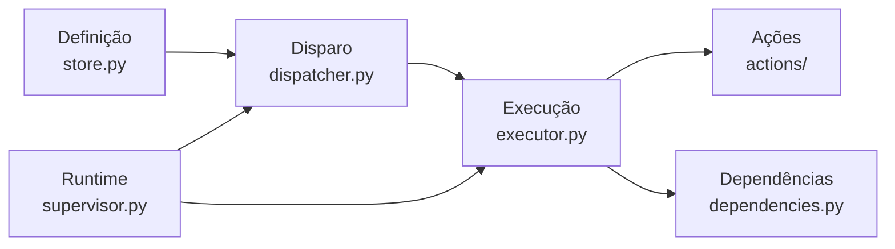

# Automações persistentes e autônomas

{width=48}

Voltar ao [Hub](/docs/architecture/README.md) · [Modelo de dados](/docs/architecture/modelo-dados.md) · [Execução autônoma](/docs/architecture/execucao-autonoma.md)

O Callidus executa tarefas automáticas: conforme horários, recorrências,
condições e eventos — mesmo com a interface fechada e depois de reiniciar a
máquina.

---

## Sumário

1. [1. O problema do agendamento anterior](#1-o-problema-do-agendamento-anterior)
2. [2. As quatro responsabilidades](#2-as-quatro-responsabilidades)
3. [3. A definição da automação](#3-a-definição-da-automação)
4. [4. Gatilhos](#4-gatilhos)
5. [5. Ações](#5-ações)
6. [6. Dependências](#6-dependências)
7. [7. O supervisor e a inicialização nativa](#7-o-supervisor-e-a-inicialização-nativa)
8. [8. Máquina controladora × destino](#8-máquina-controladora--destino)
9. [9. Confiabilidade](#9-confiabilidade)
10. [10. Segurança](#10-segurança)
11. [11. API](#11-api)
12. [12. Limitações conhecidas](#12-limitações-conhecidas)

---

## 1. O problema do agendamento anterior

O repositório tinha um protótipo de scheduler (`ScheduledRunModel` + APScheduler).
Ele **não** funcionava, e a auditoria reproduziu as falhas antes de mexer em
qualquer coisa:

| Falha | Efeito |
|-------|--------|
| Criava `ExecutionRunModel` sem `root_task_id` | Violava o contrato do banco: **todo** disparo falhava com `NOT NULL constraint failed` |
| `session.get(ScheduledRunModel, "<uuid>")` com string | `AttributeError` — ativar/desativar um agendamento quebrava |
| O ciclo de vida da API nunca chamava `start_scheduler()` | Nenhum agendamento disparava, mesmo com a linha no banco |
| `_stop_event` criado no import, sem loop | `stop_scheduler()` nunca liberava a espera: o processo não encerrava |
| Sem chave de idempotência | Reprocessar um disparo criava execuções duplicadas |
| Sem fuso, sem política de disparos perdidos, sem dependências | Não sobrevivia a reinício nem a indisponibilidade |

A correção **não** foi um segundo agendador: o núcleo virou
[`agent.automation`](/src/agent/automation/README.md) e
[`services/scheduler.py`](/src/agent/services/scheduler.py) virou a fachada que a
API já conhecia. As linhas antigas de `scheduled_runs` são convertidas em
automações pela migração (a tabela antiga **não** é apagada).

---

## 2. As quatro responsabilidades



| Responsabilidade | Onde | Contrato |
|------------------|------|----------|
| Definição | `store.py`, `contracts.py` | Contrato pydantic versionado (`contract_version`) gravado em JSON |
| Disparo | `dispatcher.py` | Linha de disparo com chave de idempotência única |
| Runtime e supervisor | `supervisor.py`, `service/` | Tique: recuperar → disparar → executar → reconciliar |
| Execução | `executor.py`, `actions/` | Dependências → ação → evidência → estado |

A máquina de estados, os critérios de conclusão e os mecanismos de verificação do
orquestrador continuam sendo a **fonte de verdade** para o trabalho executado pelo
agente: a ação Callidus entrega um run ao worker autônomo, e o run passa pelo
ciclo de estados já existente.

---

## 3. A definição da automação

| Parte | Onde fica | Exemplo |
|-------|-----------|---------|
| Identidade | `automations.name` | "Relatório da madrugada" |
| Vínculo | `project_id`, `conversation_id`, `task_id` | projeto do Callidus |
| Gatilho | `trigger_json` | `{"kind": "cron", "cron": "0 3 * * *", "timezone": "America/Sao_Paulo"}` |
| Ação | `action_json` | `{"kind": "script", "command": ["./backup.sh"]}` |
| Destino | `target_kind` | `local` ou `remote` |
| Fuso | `timezone` | `America/Sao_Paulo` |
| Disparos perdidos | `missed_policy` | `run_once`, `catch_up`, `group`, `skip` |
| Dependências | `dependencies_json` | interpretador, script, remoto, provedor, ferramenta, MCP, credencial |
| Permissões | `permissions_json` | allowlist de comandos, diretórios autorizados, recursos aprovados |
| Recuperação | `policy_json` | tentativas, timeout, backoff, causas que justificam nova tentativa |
| Estado | `state` | `enabled`, `suspended`, `disabled` |
| Próximo disparo | `next_run_at` (UTC) | derivado do gatilho |

Nada é obrigatório sem razão: um script determinístico não declara provedor nem
modelo; uma automação de evento não declara cron.

### Objetivo versionado × versão mais recente

Quando a automação está ligada a uma conversa ou tarefa, `objective_mode` decide:

- `frozen` — o objetivo é **congelado na aprovação**. Alterações posteriores na
  conversa não mudam uma automação já aprovada.
- `latest` — o objetivo é lido da tarefa/conversa a cada disparo. Só quando o
  usuário pede explicitamente.

---

## 4. Gatilhos

| Tipo | Quando dispara | Observação |
|------|----------------|------------|
| `once` | Em um instante determinado | Instante único, em UTC |
| `cron` | Por expressão cron (5 ou 6 campos) | Hora de parede do fuso escolhido |
| `interval` | A cada N segundos | Contado a partir da referência |
| `event` | Quando um evento interno acontece | `task.completed`, `run.failed`, `automation.*`… |

### Fuso e horário de verão

O fuso vive na definição; o carimbo persistido é sempre UTC. A expressão cron é
avaliada no **relógio local** e só depois convertida:

- hora local **inexistente** (o relógio pulou): o disparo acontece no primeiro
  instante existente depois do buraco;
- hora local **ambígua** (a hora se repetiu): vence o primeiro instante, o mais cedo.

### Disparos perdidos

O que acontece com as ocorrências que passaram enquanto o runtime estava fora do ar
é a **política da própria automação**:

| Política | Efeito |
|----------|--------|
| `run_once` | Um disparo só, carregando as ocorrências perdidas |
| `catch_up` | Um disparo por ocorrência, limitado por `max_catch_up` |
| `group` | Um disparo agrupado com a lista de ocorrências |
| `skip` | Registra que foram ignoradas (nada executa) |

A escolha fica gravada na automação — não é uma heurística do runtime.

### Eventos

Duas fontes, ambas persistidas (portanto recuperáveis):

- `event_logs` — o que o Callidus já grava (`task.completed`, `run.failed`…);
- `automation_events` — eventos duráveis publicados por adaptadores (webhook,
  watcher de arquivo).

A entrega é idempotente: a chave do disparo inclui o identificador do evento.

Fontes que dependem de observação contínua (arquivo, webhook) **precisam** de um
listener ativo, de entrega durável externa ou de reconciliação após a retomada.
O Callidus não promete receber um evento de arquivo com todos os processos
encerrados.

### Extensão

Novos tipos entram por registro, sem tocar na lógica central:

```python
from agent.automation.triggers import register_trigger
register_trigger("arquivo", FileTrigger)
```

---

## 5. Ações

### Ação Callidus

Cria a tarefa raiz pelo `TaskService` e o run pelo `RunService` — **com**
`root_task_id`, agente na raiz e evento de início. Um `ExecutionRunModel` pela
metade não existe. O run é entregue ao worker autônomo.

### Ação de script

Execução determinística, **sem depender de um LLM**:

- comando e diretório validados contra as permissões da definição aprovada;
- ambiente controlado (herdado do processo + o que a definição diz), nunca gravado
  na evidência;
- timeout, códigos de saída aceitos e critério opcional por expressão regular;
- **recibo** (`receipt_path`): se o arquivo existir com a mesma chave, o script não
  é repetido — o efeito anterior já aconteceu.

### Novos tipos de ação

```python
from agent.automation.actions import register_action
register_action("ferramenta", ToolAction)
```

---

## 6. Dependências

O verificador é **read-only** por padrão: ele responde "está pronto?". A estratégia
de inicialização só age quando o mecanismo está configurado **e** autorizado.

| Tipo | Verifica |
|------|----------|
| `project_dir` / `workdir` | A pasta existe |
| `os` | A família do destino (posix/windows) é a exigida |
| `interpreter` | O interpretador existe (local ou no destino remoto) |
| `script` | O script existe e é executável |
| `remote` | O computador remoto responde |
| `provider` | O provedor responde ao health check |
| `tool` | A ferramenta está no registro |
| `mcp` | O servidor MCP está configurado e habilitado |
| `credential` | A credencial existe — **sem revelar o valor** |

Mecanismos de inicialização: `command`, `service` (nativo da plataforma) e
`mcp_restart`. Nenhum modelo é baixado e nenhuma instalação é alterada sem
autorização. Para provedores externos que o Callidus não controla, a tentativa é
**restabelecer a comunicação**, não prometer reinício.

Dependência crítica indisponível → o disparo vai para `waiting_dependency`, a
tentativa é reagendada com backoff e **nenhuma inferência é consumida** para o
trabalho impossível. Quando a dependência volta, o disparo retoma sozinho.

---

## 7. O supervisor e a inicialização nativa

O supervisor é o runtime: um **tique** que recupera, dispara, executa e reconcilia.
Ele roda em dois lugares com o mesmo núcleo:

- dentro da API (`enable_automation_supervisor`), para as automações funcionarem
  com a interface aberta;
- num processo próprio (`callidus-supervisor run`), instalado como serviço nativo
  do sistema — aí as automações funcionam **sem a interface**.

| Plataforma | Adaptador | Instalação por usuário | Nível de sistema |
|------------|-----------|------------------------|------------------|
| macOS | `launchd` | `~/Library/LaunchAgents` (sobe no login) | — |
| Linux | `systemd` | `~/.config/systemd/user` (sobe no login) | `/etc/systemd/system` (sobe no boot; exige `sudo`) |
| Windows | Agendador de Tarefas | `ONLOGON` | `ONSTART` (exige administrador) |

```bash
callidus-supervisor install                # por usuário, sem privilégio
callidus-supervisor install --scope system # nível de sistema (exige administrador)
callidus-supervisor status
callidus-supervisor diagnose
```

**O que o Callidus não promete:** execução enquanto a máquina estiver desligada.
A retomada depois de ligar o aparelho é uma capacidade diferente da execução
contínua, e depende do sistema operacional e do hardware (acordar do sono exige
configuração do próprio sistema).

---

## 8. Máquina controladora × destino

A automação declara o destino: `local` ou `remote`. Para o destino remoto, o
Callidus usa o mecanismo de projeto remoto por SSH que já existia
([`agent.remote.ssh`](/src/agent/remote/README.md)):

- a conectividade é verificada **antes** da execução;
- o comando usa o shell e os caminhos do destino (POSIX ou PowerShell);
- a saída e o erro reais do remoto são capturados — uma execução local bem-sucedida
  nunca é confundida com uma remota concluída;
- destino temporariamente indisponível → a tentativa é reagendada.

Tarefa que depende de planejamento por IA precisa de runtime e provedor disponíveis.
Script autossuficiente roda direto no destino, sem depender do modelo.

Duas estratégias existem para executar com o Callidus controlador encerrado —
instalar um executor/supervisor no destino ou registrar uma tarefa nativa no
sistema remoto. **Esta entrega implementa a verificação de conectividade e a
execução remota pelo controlador**; a instalação de serviço remoto exige
configuração, permissões e conectividade adequadas e **não é feita silenciosamente**.

---

## 9. Confiabilidade

| Garantia | Como |
|----------|------|
| Recuperação dos jobs persistidos | O supervisor carrega o banco ao iniciar e retoma os disparos interrompidos |
| Proteção contra disparo duplicado | Chave de idempotência única no banco (savepoint em caso de corrida) |
| Proteção contra execução duplicada | O estado do disparo é atualizado antes da ação; a reconciliação olha o run real |
| Retentativas | Backoff exponencial com limite, configurável por automação |
| Disparos perdidos | Política por automação (`run_once`, `catch_up`, `group`, `skip`) |
| Códigos de saída e resultados | Persistidos na evidência do disparo |
| Registro de progresso | Eventos `automation.*` em `event_logs`, com o mesmo canal de observabilidade |
| Efeitos parciais | Recibo do script; dependências e conectividade reavaliadas antes de repetir |

O banco existente e os mecanismos locais continuam sendo a solução padrão — não
há plataforma distribuída nova.

---

## 10. Segurança

As permissões são decididas **antes** do disparo e validadas de novo a cada
execução. O modelo não amplia nada em tempo de execução.

- Scripts exigem `allow_scripts` **e** executável na allowlist de comandos.
- Caminhos passam por [`resolve_under_root`](/src/agent/security/README.md) — nada
  escapa do escopo autorizado.
- Falha de autorização **bloqueia** a execução; não é contornada por replanejamento.
- Segredos não entram nos logs nem na evidência (a sanitização existente é usada).
- A definição aprovada registra quais recursos foram autorizados.
- Instalar e remover serviço exige permissões adequadas; a instalação em nível de
  sistema é recusada sem privilégio, com a explicação do motivo.

---

## 11. API

| Rota | O que faz |
|------|-----------|
| `POST /automations` | Cria (nasce desabilitada, salvo `activate`) |
| `GET /automations` | Lista |
| `GET /automations/{id}` | Detalhe: gatilho, próximo disparo, dependências, últimos disparos, eventos |
| `PATCH /automations/{id}` | Edita a definição |
| `DELETE /automations/{id}` | Remove |
| `POST /automations/{id}/enable\|suspend\|disable` | Muda o estado |
| `POST /automations/{id}/run` | Executa uma vez (disparo manual, chave própria) |
| `POST /automations/{id}/test` | Verifica a prontidão; com `execute`, dispara um teste |
| `POST /automations/{id}/cancel` | Cancela os disparos pendentes |
| `GET /automations/{id}/firings` | Histórico de disparos |
| `GET /automations/supervisor/status` | Situação do runtime e do serviço nativo |
| `GET /automations/supervisor/diagnose` | Diagnóstico detalhado |
| `POST /automations/validate` | Valida a definição sem gravar |

A interface tem um painel **Automações** com o formulário de criação, a lista com
gatilho/próximo disparo/estado, as ações e a situação do supervisor e do serviço
nativo.

---

## 12. Limitações conhecidas

- **Máquina desligada**: nada executa. A retomada depende do arranque nativo.
- **Escopo do usuário**: a instalação por usuário só sobe no login (macOS, Linux) ou
  no logon (Windows). Quem precisa de boot sem login usa `--scope system`, que exige
  administrador.
- **Eventos externos**: webhook e watcher de arquivo precisam de listener ativo ou de
  entrega durável externa.
- **Serviço remoto**: a instalação de um executor no destino não é feita pelo
  Callidus; o que existe é a execução remota pelo controlador, com verificação de
  conectividade.
- **Provedor local**: o Callidus usa os mecanismos de gerenciamento já configurados
  do provedor; não baixa modelos grandes nem altera instalações.

---

## Links cruzados

- [Hub da arquitetura](/docs/architecture/README.md)
- [Modelo de dados](/docs/architecture/modelo-dados.md)
- [Execução autônoma](/docs/architecture/execucao-autonoma.md)
- [Execução remota](/docs/architecture/execucao-remota.md)
- [Módulos das automações](/src/agent/automation/README.md)
