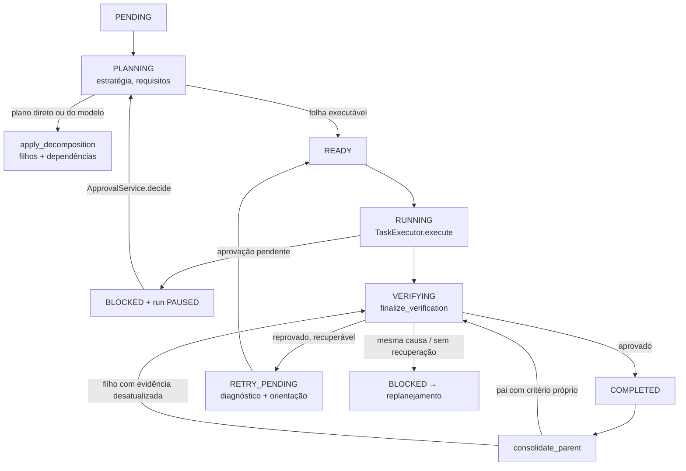
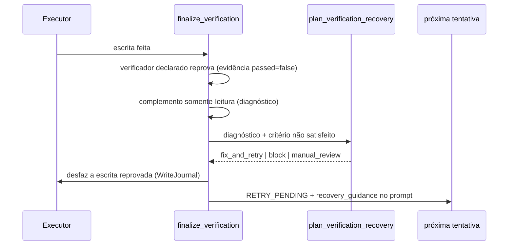

# Confiabilidade da execução e decomposição

Como uma tarefa sai do pedido, passa pelo portão de verificação, se recupera de falhas, retoma depois de uma queda e é consolidada pelo pai. Volta para o [índice de arquitetura](/docs/architecture/README.md).

## Sumário

- [🎯 Escopo](#-escopo)
- [🔎 Auditoria: o que existia e o que faltava](#-auditoria-o-que-existia-e-o-que-faltava)
- [🔀 Fluxo real de uma tarefa](#-fluxo-real-de-uma-tarefa)
- [🚪 Portão de verificação único](#-portão-de-verificação-único)
- [🩹 Recuperação depois da reprovação](#-recuperação-depois-da-reprovação)
- [🔐 Aprovação granular](#-aprovação-granular)
- [♻️ Retomada idempotente](#️-retomada-idempotente)
- [↩️ Rollback que preserva o trabalho de terceiros](#️-rollback-que-preserva-o-trabalho-de-terceiros)
- [🌳 Decomposição e tarefas simples](#-decomposição-e-tarefas-simples)
- [🧩 Consolidação, resumos e arquivos compartilhados](#-consolidação-resumos-e-arquivos-compartilhados)
- [🧪 Cenários de integração](#-cenários-de-integração)
- [⚠️ Limitações](#️-limitações)

## 🎯 Escopo

Etapa 1 (confiabilidade) e Etapa 2 (decomposição) do Callidus. Nada aqui troca a arquitetura:
o SQLite continua sendo a fonte da verdade, a inferência continua serializada e os estados de
tarefa são os mesmos da [máquina de estados](/docs/architecture/maquina-estados.md).

## 🔎 Auditoria: o que existia e o que faltava

| Componente | Implementação existente | Problema encontrado | Ação |
|---|---|---|---|
| Estados | `domain/state_machine.py`, `TaskService.update_status` | adequados; `COMPLETED` só vem de `VERIFYING` | preservados |
| Verificação | `TaskExecutor.finalize_verification` (caminho real) e `verification/gate.py` (só em testes) | duas implementações; a do gate aprovava a etapa quando um verificador mais fraco passava depois do principal reprovar (verde falso) e podia rodar `pip install` como "verificação" | gate virou fachada do caminho real; alternativas viraram diagnóstico somente-leitura |
| Conclusão sem verificador | `completed_without_verification` | concluía sem deixar registro da limitação | resultado marcado `verified: None` + `verification_absent` + evento `verification.skipped` |
| Recuperação | `plan_verification_recovery`, `recovery_guidance` no prompt | diagnóstico sem o critério não satisfeito | `unmet_criterion`, diagnóstico persistido e complemento somente-leitura na orientação |
| Aprovação | flag `approve_risky_tools` por run | `approval_required` virava `RETRY_PENDING` e repetia às cegas até `FAILED`; sem decisão por operação | `ToolApprovalModel` + `ApprovalService` + portão no registro + pausa do run + rotas |
| Retomada | runs ativos redescobertos pelo worker; etapa `RUNNING` reexecutada | operação não repetível (apagar, mover, comando) seria repetida às cegas após uma queda | marcador `inflight_operation` gravado antes do efeito; reencontrado, pede confirmação |
| Rollback | `WriteJournal.restore` | sobrescrevia o arquivo mesmo se outra mão o alterou depois da escrita da etapa | hash do que a etapa gravou (`settle`); arquivo divergente fica intocado e entra em `conflicts` |
| Consolidação | `consolidate_parent` | pai concluía sem rodar o **próprio** critério; evidência desatualizada por irmã fazia a etapa **reexecutar** e sobrescrever a irmã; aprovação apagava o resultado da etapa | pai com critério para em `VERIFYING`; filho desatualizado é **reverificado**; veredito se soma ao resultado |
| Contexto da resposta final | `write_final_answer` | recebia só título e estado das etapas, não o que elas descobriram | trecho do resultado de cada etapa, com orçamento fixo |
| Decomposição simples | `direct_answer_plan` | "leia X e explique" caía no modelo genérico com etapa de alteração | `read_explain_plan`: N leituras + resposta |
| Resumos de subtarefa | `child_summary` (texto) | sem formato estruturado | `subtask_summary.structured_summary` + `GET /tasks/{id}/summary` |
| Dependências, limites, replanejamento, consulta sob demanda | `TaskService` (ciclo), `_recursion_guard`, `replan.py`, `QueryService` | adequados | preservados (o replanejamento não substitui etapa que só espera aprovação) |

## 🔀 Fluxo real de uma tarefa

- **Quem muda o estado:** só `TaskService.update_status`, validado pela máquina de estados.
- **Onde ocorre a inferência:** planejamento (`resolve_decomposition_plan`), operação de modelo
  (`ModelOperation`) e resposta final (`write_final_answer`) — todas pelo executor serializado.
- **Onde fica o resultado:** `consolidated_result_json` da tarefa, tentativas em
  `operation_attempts`, evidências em `evidences`, eventos em `event_logs`.

## 🚪 Portão de verificação único

Toda conclusão de etapa passa por `TaskExecutor.finalize_verification`; o
[`VerificationGate`](/src/agent/verification/gate.py) é a fachada nomeada dele (devolve
`GateResult` com estágio, diagnóstico e plano de recuperação). O mesmo caminho vale para a
raiz, os filhos e os pais com critério próprio.

| Natureza da etapa | Verificação aplicada |
|---|---|
| Declara `verification` | o verificador declarado (pytest, file_contains, syntax, stages, ...) |
| Escreveu arquivo sem declarar | implícita: o trecho gravado está no arquivo, a sintaxe é válida e, se o arquivo já existia com 20+ linhas, a escrita não apagou mais da metade dele |
| `write_file` sobre arquivo existente com 150+ linhas | recusado pela própria ferramenta, sem tocar o disco: a mudança vai por `edit_file` (reescrever de memória alterava o que não devia mudar) |
| Rodou a suíte de testes (`run_pytest`) e passou | implícita: `pytest` no mesmo caminho, gravado como evidência |
| Inspeção que o ambiente responde (`git_status` fora de repositório) | a resposta vira a descoberta da etapa, sem repetir a chamada |
| Só leu / explicou / operação externa | nenhuma automática: conclui com `verified: None` e `verification_absent` (a aceitação por requisito continua exigindo prova na raiz) |

Uma verificação reprovada **nunca** é aprovada por outra mais fraca. O complemento
(`diagnostic_complement`, verificadores `syntax`, `static_analysis`, `file_exists`) só serve para
dizer o que está certo e estreitar a causa.

## 🩹 Recuperação depois da reprovação

- O orçamento é `verification_max_recoveries`; a **mesma assinatura** de falha duas vezes bloqueia
  (troca de abordagem), em vez de gastar o orçamento repetindo.
- A causa é classificada pela taxonomia de [`domain/failures.py`](/src/agent/domain/failures.py)
  (configuração, indisponível, entrada da ferramenta, estratégia, limite operacional).

## 🔐 Aprovação granular

| Peça | Papel |
|---|---|
| `ToolApprovalModel` (`tool_approvals`) | pedido por etapa + `operation_key` (SHA-256 de ferramenta + argumentos); estados `pending → approved/denied → consumed` |
| `ToolContext.approval_gate` | o registro consulta na **hora da execução**, só quando a chamada exige aprovação |
| `ApprovalService.check` | consome aprovação concedida (uso único), mantém um pedido por operação, respeita a negação |
| `TaskExecutor.await_approval` | etapa vai a `BLOCKED` com `awaiting_approval`; nada de repetir a recusa |
| `RunOrchestrator._await_approval` | run `PAUSED` com `pause.kind = approval`; o replanejamento não contorna o pedido |
| `ApprovalService.decide` | aprovado: etapa volta a `PLANNING` e o run é retomado; negado: etapa fica bloqueada com `approval_denied` |

Rotas: `GET /runs/{run_id}/approvals`, `POST /approvals/{id}/approve`, `POST /approvals/{id}/deny`.
A flag `approve_risky_tools` continua valendo como aprovação ampla explícita do run.

## ♻️ Retomada idempotente

O estado inteiro vem do SQLite (o worker abre uma sessão por passo). O que já concluiu com
evidência não volta a rodar. Para operações não repetíveis (as que exigem aprovação ou mexem em
configuração), o executor grava `inflight_operation` **e confirma no banco** antes do efeito; a
chamada que volta apaga o marcador. Se a retomada reencontra o marcador, a operação pode já ter
acontecido: abre-se um pedido de confirmação ligado a ela, e só a confirmação a repete.

## ↩️ Rollback que preserva o trabalho de terceiros

`WriteJournal` guarda o original antes da primeira escrita (`remember`) e o hash do que a etapa
deixou depois de cada escrita (`settle`). No rollback, arquivo com conteúdo diferente do que a
etapa gravou não é tocado e vai para `conflicts` (`rollback_conflicts` no desfecho). Arquivos
criados pela etapa não são apagados.

## 🌳 Decomposição e tarefas simples

Ordem de `resolve_decomposition_plan`: plano embutido → automação → pergunta curta
(`direct_answer_plan`) → **leitura e explicação** (`read_explain_plan`: uma leitura verificada por
arquivo citado que existe + resposta) → plano do modelo → modelo genérico. Os limites de
profundidade (`max_tree_depth`), tamanho (`max_tasks_per_run`), replanejamentos
(`max_replans_per_run`), tentativas e orçamento de tokens continuam em `config.py`. Dependências
cíclicas são recusadas em `TaskService.add_dependency`; uma etapa só é escolhida com as
dependências concluídas.

A resposta final recebe, além do título e do estado de cada etapa, o que ela descobriu (até
1 500 caracteres por etapa e 4 500 no total) — o suficiente para um modelo de 8B responder sobre
o arquivo lido sem receber o histórico inteiro.

## 🧩 Consolidação, resumos e arquivos compartilhados

`consolidate_parent` junta os filhos com `structured_summary` (objetivo, descobertas, arquivos
analisados e alterados, decisões, resultado, verificações, evidências, problemas, pendências,
riscos, próximas ações — cada item com referência `attempt:`/`evidence:`/`task:`) e lista em
`shared_files` os arquivos alterados por mais de uma irmã.

Quando uma irmã reescreve um arquivo que outra já verificou, a evidência anterior fica
desatualizada (hash) e a etapa anterior é **reverificada** contra o disco atual. Só se o critério
dela reprovar é que ela volta a executar — reexecutar direto sobrescreveria a irmã.

## 🧪 Cenários de integração

| Cenário | Teste | Resultado |
|---|---|---|
| 1 — ferramenta falha | `tests/test_etapas_cenarios.py::test_cenario1_*` | falha persistida, uma nova tentativa, conclusão só com evidência |
| 2 — verificação reprova | `tests/test_etapas_cenarios.py::test_cenario2_*` | escrita desfeita, critério identificado, orientação no prompt, aprovação na segunda |
| 3 — queda no meio | `tests/test_etapas_cenarios.py::test_cenario3_*`, `tests/test_granular_approval.py::test_resume_after_crash_*` | retomada em sessão nova; nada concluído é reexecutado; operação em voo pede confirmação |
| 4 — dependências | `tests/test_etapas_cenarios.py::test_cenario4_e_6_*` | B só roda depois de A; pai com resumos estruturados |
| 5 — modelo pequeno | `lab/avaliar.py` com `qwen3-vl:8b` e `gpt-oss:20b` | 6/6 aceites e 0 conclusões falsas nos dois; `bug` passou a fechar nos dois depois das correções; `arquivo_grande` ainda instável (etapa "executar testes" presa ao protocolo de escrita); ver [avaliacao.md](/docs/architecture/avaliacao.md#-etapas-1-e-2--confiabilidade-e-decomposição-02112026) |
| 6 — conflito de arquivo | `tests/test_etapas_cenarios.py::test_cenario4_e_6_*` | arquivo compartilhado listado; A reverificada, não reexecutada; trabalho de B preservado |
| 7 — operação de alto risco | `tests/test_granular_approval.py` | pausa, decisão persistida, retomada só aprovada, uso único |
| 8 — tarefa simples | `tests/test_etapas_cenarios.py::test_cenario8_*` | 2 etapas (ler + responder), nenhuma escrita |

## ⚠️ Limitações

- A interface ainda não mostra os pedidos de aprovação; a decisão é pela API ([G4](/docs/progresso/gaps.md#g4-aprovação-granular-de-ferramentas-arriscadas-na-ui)).
- O marcador de operação em voo cobre a ferramenta do plano; uma chamada de ferramenta feita pelo
  modelo dentro do ciclo de ferramentas não grava marcador (ela passa pela aprovação granular,
  mas uma queda no meio dela não é distinguida de uma chamada que nunca começou).
- Etapas sem verificador automático (explicação, pesquisa) concluem com a limitação registrada;
  o aceite por requisito é quem continua decidindo se o objetivo está comprovado.
- Etapa cujo objetivo é rodar testes, quando vira operação de modelo, ainda exige uma escrita como entrega e é recusada como inválida — visto no `arquivo_grande`.
- `qwen3:8b` não estava instalado na máquina de avaliação; o modelo pequeno medido foi o
  `qwen3-vl:8b`.
