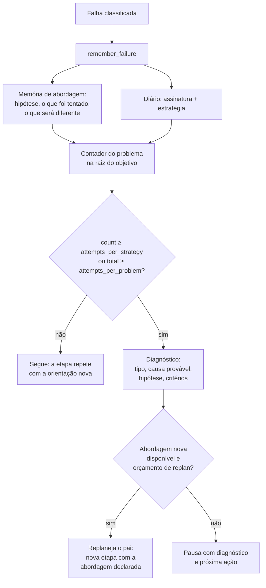

# Estratégia de resolução — como o Callidus decide o que fazer quando falha

> **Propósito:** explicar como o agente reconhece estagnação, escolhe uma abordagem diferente, aplica
> limites coerentes e registra o que aprendeu.
> **Voltar ao hub:** [docs/architecture/README.md](/docs/architecture/README.md) · [README raiz](/README.md)

O Callidus executa tarefas com modelos locais relativamente pequenos (`gpt-oss:20b` via Ollama é o
caso de referência). Modelos assim não falham de forma aleatória: eles **repetem**. A estratégia de
resolução existe para que a repetição seja reconhecida como repetição — e não confundida com
trabalho.

---

## 1. O problema que existia

Três falhas se somavam, e as três apareciam nos registros reais do ambiente:

1. **O contador de repetição morria no replanejamento.** A contagem vivia em
   `task.metadata_json["failures"]`, ou seja, na etapa. O replanejamento criava uma **etapa nova**,
   e a etapa nova começava a contagem do zero. O mesmo erro — a mesma assinatura — voltava três
   vezes, o sistema planejava de novo, e o erro voltava as três vezes. No histórico local isso
   aparece como `run.stagnation` com a **mesma** assinatura `ac42d998b5427f8d` (resposta vazia) 11
   vezes, e `3bf56f988634e642` (provedor recusando o pedido com HTTP 400) 11 vezes.

2. **O replanejamento não exigia mudança de abordagem.** O objetivo da etapa nova dizia apenas
   *"Use outra abordagem para essa parte"*. Não havia hipótese, não havia alternativa concreta, e
   não havia critério de sucesso. O modelo local recebia uma frase vazia e fazia a mesma coisa.

3. **A assinatura de estratégia incluía o texto do objetivo.** Como o replanejamento reescreve o
   objetivo a cada vez, a assinatura mudava a cada replanejamento — o que fazia o contador parecer
   zerado mesmo sem a etapa ter sido recriada.

Some-se a isso dois desvios de classificação:

- **Provedor que recusa o pedido (HTTP 4xx) era tratado como "ferramenta"**, com a ação
  *"trocar de ferramenta ou corrigir os argumentos"*. Um pedido recusado não se resolve repetindo a
  mesma requisição.
- **Falhas gravadas pelo aceite global** (`global_verify.py`) não levavam assinatura nem estratégia,
  e por isso **não contavam** para a detecção de repetição.

---

## 2. O que existe hoje



### 2.1 Memória de abordagem — [`approach.py`](/src/agent/orchestrator/approach.py)

Vive em `task.metadata_json["approach"]` e responde, de forma estruturada, às sete perguntas que
a missão exige antes de uma nova tentativa:

| Chave | Pergunta respondida |
|-------|---------------------|
| `problem` | O que travou |
| `hypothesis` | Qual hipótese explica a falha |
| `tried` | O que foi tentado e o que aconteceu |
| `current_change` | A abordagem em vigor na tentativa que falhou |
| `next_change` | O que será diferente na próxima tentativa |
| `success_criterion` | Que resultado diz que a nova abordagem resolveu |
| `failure_criterion` | Que resultado diz que a hipótese também está errada |

A **hipótese e as alternativas são determinísticas**: vêm da causa da falha, não do humor do
modelo. O modelo continua decidindo *como* executar dentro da alternativa escolhida — que é o
espaço em que ele agrega valor; ele não decide *se* há alternativa. A lista de alternativas por
causa está em `ALTERNATIVES_BY_CAUSE`; ela é ordenada da mais próxima à mais radical (dividir,
reduzir, pedir ajuda).

O bloco entra no prompt da etapa seguinte por
[`operation_builder.py`](/src/agent/context/operation_builder.py), junto das falhas anteriores. Sem
ele, o modelo recebe a lista do que já falhou e repete a mesma operação.

### 2.2 O contador do problema — [`stagnation.py`](/src/agent/orchestrator/stagnation.py)

A contagem **não vive na etapa**: vive na **raiz do objetivo** (`metadata_json["problem_ledger"]`),
que sobrevive ao replanejamento e à retomada. A chave é
`problem_key(objetivo da raiz, assinatura do erro)` — o mesmo erro, no mesmo objetivo.

Dois contadores, porque são duas perguntas diferentes:

| Contador | Pergunta | Reinicia quando |
|----------|----------|-----------------|
| `count` | Quantas vezes **a mesma abordagem** falhou com o mesmo erro? | Há mudança material |
| `total` | Quantas vezes o problema foi atacado, com qualquer abordagem? | **Nunca** |

**Mudança material** = a operação mudou (`strategy`), **ou** a abordagem mudou (`approach`),
**ou** o disco mudou (`workspace`). A impressão do disco vem de
[`verification/fingerprint.py::workspace_state`](/src/agent/verification/fingerprint.py), que percorre
a raiz do projeto pulando caches e dependências.

Consequência prática: a mesma ferramenta pode ser executada de novo quando a causa foi corrigida
(cenário legítimo), e não pode ser reexecutada à toa quando nada mudou (cenário de loop).

### 2.3 O replanejamento que muda de verdade — [`replan.py`](/src/agent/orchestrator/replan.py)

O replanejamento escolhe a **próxima alternativa** da lista da causa e a leva declarada para a
etapa nova: o objetivo passa a dizer o que travou, a hipótese, o que será diferente, e os critérios
de sucesso e de fracasso. A etapa nova nasce com `metadata["approach"]["current_change"]` preenchido
— é esse registro que a detecção de repetição lê para saber que houve mudança real.

O replanejamento é **recusado** quando:

- a falha precisa de ação de fora (credencial, executável ausente, aprovação);
- o orçamento de replanejamento da linhagem acabou;
- o replanejamento anterior não trouxe progresso e ainda existe alternativa conhecida;
- a lista de alternativas já foi seguida por uma investigação do estado, e essa investigação
  também não abriu caminho.

Esgotar a lista determinística **não** declara o problema insolúvel. A política em
[`recovery_policy.py`](/src/agent/orchestrator/recovery_policy.py) autoriza uma investigação
material (`open_investigation`). A raiz sem pai usa o mesmo critério e volta a `PLANNING`
uma vez (`root_recovery`). Quando o orçamento do problema acaba sem essa prova, o run
**pausa** com diagnóstico e próxima ação, retomável por `POST /runs/{id}/resume`.

### 2.4 Limites coerentes

Os limites vêm de `Settings` e podem ser sobrescritos por run em `config.limits`.

| Chave | Settings | Padrão | Papel |
|-------|----------|--------|-------|
| `attempts_per_strategy` | `max_attempts_per_strategy` | 3 | Repetição da mesma abordagem no mesmo problema |
| `attempts_per_problem` | `max_attempts_per_problem` | 6 | Teto do problema, com qualquer abordagem |
| `steps_without_progress` | `max_steps_without_progress` | 60 | Travamento (conta no trecho atual) |
| `seconds` | `max_run_seconds` | 14400 | Tempo do run |
| `model_calls` | `max_model_calls_per_run` | 400 | Chamadas ao modelo |
| `tool_calls` | `max_tool_calls_per_run` | 600 | Execuções de ferramenta |
| `tokens` | `max_tokens_per_run` | 5M | Tokens estimados |
| `replans` | `max_replans_per_run` | 80 | Replanejamentos |

Os limites externos (tempo, chamadas, tokens) são **cumulativos**: a retomada não devolve o que já
foi gasto. O que a retomada concede é uma **cota nova** — `resume_limit_allowance` (1) unidade do
limite base por retomada. Os passos sem progresso são a exceção: contam no **trecho** atual, porque
detectam travamento, e um trecho novo merece a chance de destravar.

A política é **aninhada**, não multiplicada: o teto do problema (6) é o externo, o teto por
abordagem (3) é o interno, e o run inteiro tem os limites de recurso. Uma camada não consegue
multiplicar a cota da outra.

### 2.5 Classificação de falha de provedor — [`domain/failures.py`](/src/agent/domain/failures.py)

`classify_provider_error` passou a olhar o **tipo** da exceção antes do texto:

| Situação | Causa | Categoria | Política |
|----------|-------|-----------|----------|
| Tempo esgotado | `TIMEOUT` | `OPERATIONAL_LIMIT` | Reduzir o pedido |
| Conexão recusada | `PROVIDER_UNAVAILABLE` | `EXTERNAL_UNAVAILABLE` | Repetir (transitória), sem replanejar |
| Limite de uso (429) | `PROVIDER_RATE_LIMIT` | `RECOVERABLE` | Repetir |
| Erro do servidor (5xx) | `PROVIDER_ERROR` | `RECOVERABLE` | Repetir |
| **Pedido recusado (4xx)** | `PROVIDER_REJECTED` | `CHANGE_STRATEGY` | **Reformular o pedido** — repetir devolve a mesma recusa |
| Credencial inválida (401/403) | `PROVIDER_CREDENTIALS` | `CONFIGURATION` | Ação de fora |

---

## 3. Como investigar uma falha futura

O run guarda tudo o que a decisão usou. Em ordem de leitura:

1. **Evento `run.stagnation`** — carrega `signature`, `strategy`, `count`, `total`, `kind`,
   `probable_cause`, `hypothesis`, `next_change`, `success_criterion`, `failure_criterion`,
   `changed` e `replan_refused`. É o resumo da decisão.
2. **`task.metadata_json["stagnation"]`** — o mesmo registro na etapa que parou.
3. **`task.metadata_json["approach"]`** — a memória completa: o que foi tentado, com resultado.
4. **`root.metadata_json["problem_ledger"]`** — a contagem por problema, com o total e o motivo da
   última mudança material.
5. **`root.metadata_json["pause"]["diagnosis"]`** — quando o run pausou, o diagnóstico que motivou
   a pausa e a próxima ação sugerida.
6. **Evento `run.paused` / `run.resumed`** — o consumo acumulado no momento da pausa e da retomada.

Exemplo de leitura de uma estagnação:

```json
{
  "kind": "implementação",
  "count": 3,
  "total": 6,
  "repeated": true,
  "exhausted": true,
  "probable_cause": "o mesmo erro se repetiu 3 vezes com a mesma estratégia: JSON inválido",
  "hypothesis": "o modelo não entendeu o formato pedido e devolveu outra coisa: JSON inválido",
  "next_change": "reler o trecho exato do arquivo antes de responder de novo",
  "success_criterion": "a resposta do modelo é a entrega pedida, no formato pedido",
  "failure_criterion": "a resposta volta a não ser a entrega pedida"
}
```

### O que cada campo significa em campo

| Campo | Onde | Como ler |
|-------|------|-----------|
| `signature` | falhas, `stagnation` | Impressão do erro normalizado (sem números, ids ou aspas) — dois erros com a mesma assinatura são o mesmo erro |
| `strategy` | falhas, `stagnation` | Impressão de **como** a etapa age: ferramenta, argumentos, verificação, modo. Não inclui o objetivo |
| `approach` | `approach`, `stagnation` | Impressão da abordagem declarada (causa + mudança em vigor) |
| `workspace` | `problem_ledger` | Impressão do disco quando a falha ocorreu |
| `changed` | `problem_ledger`, `stagnation` | `true` quando houve mudança material: a tentativa não é repetição |

---

## 4. Limites conhecidos

- **A memória de abordagem é determinística, não aprendida.** A hipótese vem da causa
  classificada. Para causas não mapeadas, `alternatives_for` devolve lista vazia; a política
  então autoriza uma investigação do estado antes de pausar. Não há, nesta versão, uma
  chamada extra ao modelo para inventar uma estratégia fora dessa investigação.
- **A impressão do disco é por arquivo** (nome, tamanho, mtime). Uma mudança que preserve os três
  não é detectada — o que é aceitável para escrita de código, mas não para arquivos de conteúdo
  arbitrário.
- **O replanejamento ainda é por linhagem**, com orçamento próprio (`REPLAN_BUDGET = 3`). O teto do
  problema é o limite externo, mas o replanejamento em si continua restrito.
- **A retomada concede cota por retomada.** Não há tetos absolutos por run além de `max_replans_per_run`
  e dos limites de recurso; um run retomado muitas vezes acumula cota. O consumo acumulado fica
  gravado em cada `run.resumed` para auditoria.
- **A avaliação comparativa mediu o efeito em falhas injetadas e em tarefas reais simples.** Não
  mediu tarefas longas de produção — ver [avaliacao.md](/docs/architecture/avaliacao.md) e o
  relatório da missão.

---

**Relacionados:** [avaliacao.md](/docs/architecture/avaliacao.md) ·
[requisitos-verificacao-progresso.md](/docs/architecture/requisitos-verificacao-progresso.md) ·
[skills-estrategia.md](/docs/architecture/skills-estrategia.md) ·
[maquina-estados.md](/docs/architecture/maquina-estados.md)
