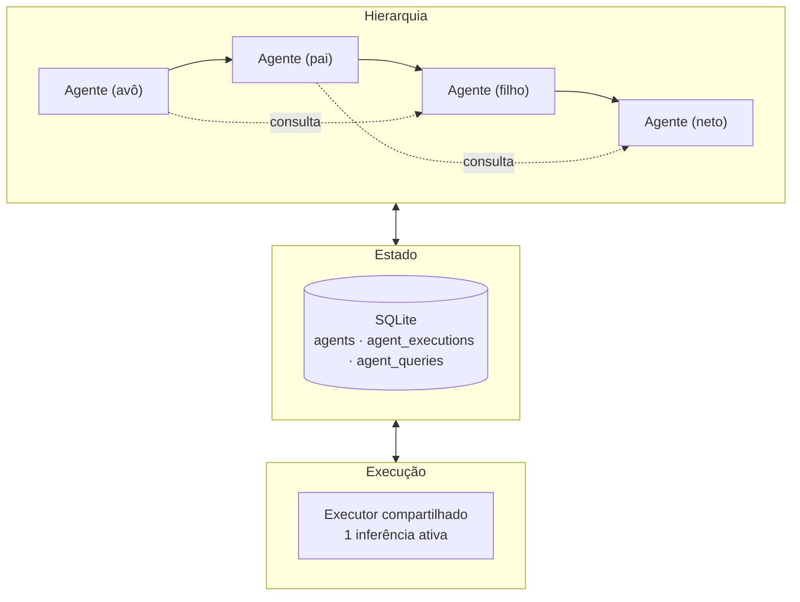
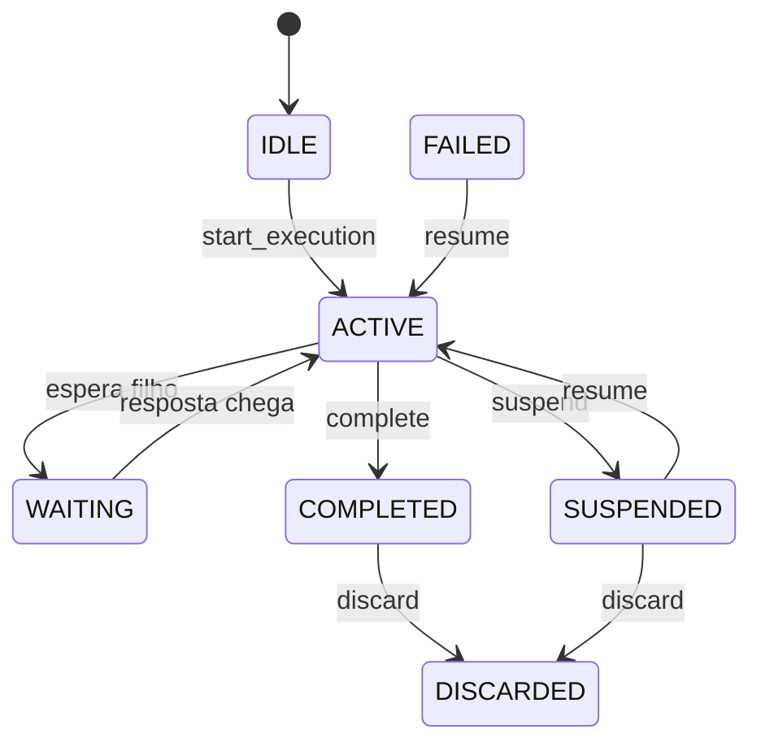
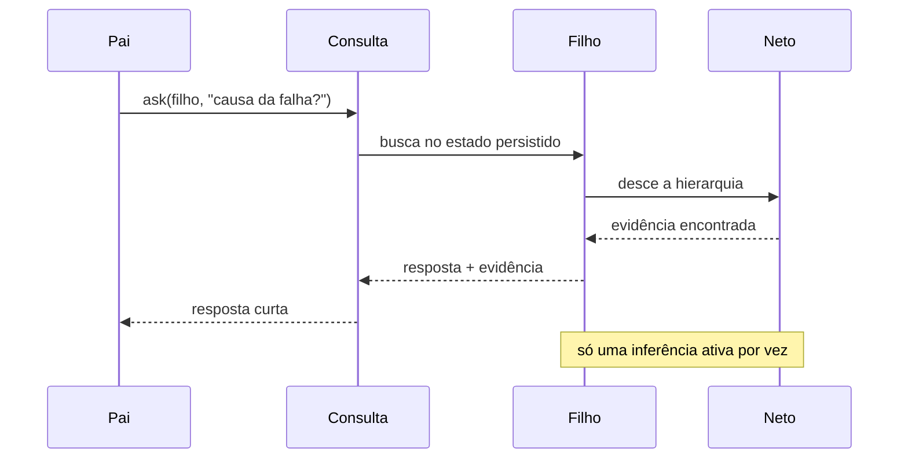

# Hierarquia de agentes, executor compartilhado e consultas sob demanda

{width=48}

Voltar ao [Hub](/docs/architecture/README.md) · [Visão geral](/docs/architecture/visao-geral.md) · [Provedores](/docs/architecture/provedores.md)

## Sumário

1. [O problema](#o-problema)
2. [Três conceitos, três entidades](#três-conceitos-três-entidades)
3. [Executor compartilhado](#executor-compartilhado)
4. [Ciclo de vida do agente](#ciclo-de-vida-do-agente)
5. [Consultas sob demanda](#consultas-sob-demanda)
6. [Escalonador](#escalonador)
7. [Descarte e retenção](#descarte-e-retenção)
8. [O que cada backend permite](#o-que-cada-backend-permite)
9. [Métricas](#métricas)
10. [Limitações conhecidas](#limitações-conhecidas)

---

## O problema

Uma hierarquia recursiva de agentes cria uma tentação: manter todos os agentes vivos
ao mesmo tempo. O resultado é um processo que precisa de muita RAM/VRAM e um modelo que
atende várias inferências simultâneas — exatamente o que uma máquina modesta não tem.

O Callidus resolve isso separando **quem existe** de **quem está executando**:

- existem muitos agentes (barato: linhas em uma tabela);
- executa **um por vez** (caro: inferência).

O agente que não está executando não perde nada: o que ele aprendeu fica em estado
estruturado no banco, e ele pode ser consultado, suspenso, retomado ou descartado.



---

## Três conceitos, três entidades

| Conceito | Tabela | O que é | Sobrevive a |
|----------|--------|---------|-------------|
| **Agente lógico** | `agents` | identidade, papel, instruções, permissões, pai | fim da tarefa e da execução |
| **Tarefa** | `tasks` (existente) | objetivo, estado, progresso, dependências, resultado | fim da execução |
| **Execução** | `agent_executions` | instância ativa: modelo, contexto, ferramentas | nada — termina com a execução |
| **Consulta** | `agent_queries` | pergunta entre agentes, com correlação e tentativas | fim da resposta |

Código: [models.py](/src/agent/persistence/models.py) · Serviço:
[agent_service.py](/src/agent/services/agent_service.py) · Estados:
[agent_enums.py](/src/agent/domain/agent_enums.py) e
[agent_lifecycle.py](/src/agent/domain/agent_lifecycle.py)

### A hierarquia

`agents.parent_id` aponta para outro agente: a profundidade não é fixa. A árvore de
agentes acompanha a árvore de tarefas — cada subtarefa criada pela decomposição ganha
um agente filho ([decomposition.py](/src/agent/orchestrator/decomposition.py)), e o run
cria o agente da raiz ([run_service.py](/src/agent/services/run_service.py)).

O limite de profundidade (`MAX_AGENT_DEPTH`, padrão 16) protege contra árvores que
crescem sem fim. Não é critério de decomposição: tarefas legítimas podem ir fundo.

---

## Executor compartilhado

**Regra:** um modelo selecionado e, no máximo, **uma** inferência ativa por vez.

A exclusividade está no contrato do provedor
([base.py](/src/agent/providers/base.py)), não na convenção de quem chama:

```python
class LLMProvider(ABC):
    async def chat(self, request):        # ponto único de admissão
        slot = await executor.acquire(...)   # espera o slot
        try:
            return await self._chat(request)  # o provedor implementa só isto
        finally:
            executor.release(slot=slot)
```

Como todas as rotas de chamada usam `provider.chat` — o runner, o ciclo de ferramentas,
a decomposição, o worker autônomo, o endpoint de depuração — nenhuma delas consegue
disparar uma segunda inferência em paralelo. O limite é configurável
(`MAX_CONCURRENT_INFERENCES`, padrão 1); em servidor potente, basta subir o número.

O executor ([executor.py](/src/agent/services/executor.py)) mede o que é real:
inferências iniciadas, concluídas, falhas, cancelamentos, tempo de espera e
concorrência máxima observada.

### Escopo real da exclusividade

A exclusividade é garantida no **processo**, e só nele:

| Recurso | Uma inferência por vez? | Por quê |
|---------|------------------------|---------|
| Várias sessões do SQLite | sim | o executor é um singleton do processo |
| Vários threads, laços de eventos diferentes | sim | o contador é global, protegido por `threading.Lock` |
| Vários threads, mesmo laço | sim | idem |
| **Vários processos** | **não** | o controle vive na memória do processo |

A medição que motivou o desenho atual: com um semáforo do `asyncio` (que pertence ao
laço de eventos que o criou), três threads com laços separados rodaram **três**
inferências ao mesmo tempo apesar do limite 1. Hoje o controle é um contador global
com despertar seguro entre threads (`call_soon_threadsafe`), e o teste
[`test_executor_scope.py`](/tests/test_executor_scope.py) é a trava contra essa
regressão.

Serializar entre processos exigiria uma trava externa (banco, socket, arquivo com
lock), que não se justifica para a instalação local de um usuário só — mas é o que
teria de ser adicionado caso o Callidus passasse a rodar com várias instâncias da API
contra o mesmo servidor de inferência. Esse é o limite conhecido e declarado.

### O que não é descarregado

O Callidus **não** descarrega nem recarrega os pesos do modelo. Os backends locais
(Ollama, llama.cpp) são servidores: o modelo fica residente lá, e o que o Callidus
libera é o *contexto de execução* (as mensagens em memória), não o modelo.

O único backend com capacidade nativa de Residency é o Ollama (`keep_alive`). Ele é
enviado apenas quando configurado em `generation.keep_alive` — o padrão do servidor
continua valendo.

---

## Ciclo de vida do agente

Estados do agente lógico: `IDLE`, `ACTIVE`, `WAITING`, `SUSPENDED`, `COMPLETED`,
`FAILED`, `DISCARDED`.

Estados da execução: `PENDING`, `RUNNING`, `SUSPENDING`, `SUSPENDED`,
`WAITING_FOR_CHILD`, `RESUMING`, `COMPLETED`, `FAILED`, `CANCELLED`, `DISCARDED`.



Transições inválidas levantam `InvalidAgentTransition`: estado inconsistente é erro,
nunca "correção" silenciosa.

### Suspender

1. A execução passa a `SUSPENDING` e o estado operacional vai para `checkpoint_json`.
2. O checkpoint é copiado para os metadados do agente — ele precisa responder mesmo
   sem execução viva.
3. A execução passa a `SUSPENDED`; o agente fica `SUSPENDED`, mas **continua existindo
   e consultável**.

### Retomar

1. A execução volta para `RESUMING` e depois `RUNNING`, com contador de tentativa
   maior (a tentativa anterior fica no histórico).
2. O checkpoint é devolvido intacto: a retomada continua do ponto exato.
3. A tentativa anterior **não** é repetida por conta própria — quem retoma decide o
   próximo passo.

### O que fica persistido

Identificador do agente, da tarefa e do pai; objetivo e subtarefas; instruções;
estado e progresso; etapa do planejamento; descobertas, decisões e perguntas em
aberto; referências a arquivos e artefatos; ferramentas usadas; testes executados;
artefatos produzidos; dependências e bloqueios; erros e tentativas; datas e
versões.

> Estado **estruturado**, não transcrição. A transcrição bruta continua nos eventos
> ([`events`](/src/agent/persistence/models.py)), que são a trilha de auditoria. O
> checkpoint é limitado por `MAX_AGENT_CHECKPOINT_CHARS`: acima do limite, fica a
> essência (etapa, plano, pendências) e o resto é recuperável por consulta.

### Efeitos externos

Processo de terminal, sessão de navegador ou transação externa **não** voltam com o
histórico do agente. Por isso eles são registrados à parte
(`record_external_effect`), com a informação de que precisam ser verificados antes de
a ação ser repetida. Na retomada, o checkpoint ganha `verify_before_repeat`: quem
continua o trabalho sabe o que precisa conferir em vez de assumir que o processo
anterior continua.

```python
agents.record_external_effect(
    agent.id,
    description="rodou `pytest -q` e reescreveu a migração",
    effect_id="cmd-1",
    resumable=False,          # o processo acabou; não dá para retomar
    verify_hint="checar se a migração foi alterada",
)
```

---

## Consultas sob demanda

O filho devolve um resultado **conciso**; o pai pergunta quando precisa de detalhe.



### O protocolo

Cada consulta tem identificador, origem, destino, tarefa relacionada, estado, limite
de tentativas e `correlation_id` — o que impede que uma resposta seja associada à
tarefa errada ([query_service.py](/src/agent/services/query_service.py)).

Perguntas relacionadas podem ser agrupadas em uma única consulta: uma inferência em
vez de várias.

### Caminho de resolução

1. **Estado persistido do alvo.** Busca lexical entre as descobertas. Se houver
   evidência pertinente, a resposta sai **sem inferência** — nem o filho é reativado.
2. **Descendentes do alvo.** A busca desce pela hierarquia, em ordem de profundidade.
   Quem tem a evidência responde, e a resposta indica quem respondeu
   (`answered_by_agent_id`).
3. **Inferência.** Só quando nada foi encontrado. O filho é reativado
   (`resume`), recebe um contexto mínimo e limitado — **o estado dele e o de sua
   descendência**, com atribuição de quem descobriu o quê — e responde pelo executor
   compartilhado.
4. **Verificação de lastro.** A resposta do modelo é comparada com o contexto que
   ele recebeu. Se não houver sobreposição, a resposta é marcada
   `[sem evidência no estado persistido]` e ganha uma incerteza explícita: ela não é
   descartada, mas o pai sabe que ela não tem lastro.
5. **Persistência.** A resposta e as novas descobertas são gravadas; o contexto
   temporário é liberado.

### Reconhecimento de ausência

O prompt pede `SEM_EVIDENCIA`, mas modelo pequeno tokeniza mal o sentinela: um 3B
respondeu **"SEMA INFORMAÇÃO FALTA"**. Por isso o reconhecimento é por intenção, com
um padrão que aceita `sem evidência`, `sem informação`, `sema informação`, `não há
informações`, `não consta`, `não foi possível`, `não encontrei`. O modelo responde
"não há informação" → o Callidus devolve **"Sem evidência no estado persistido"**,
com o texto original preservado na incerteza.

### Duas forças de casamento

| Força | Critério | Exemplo |
|-------|----------|---------|
| `direct` | 2+ palavras em comum e ≥34 % da pergunta coberta | "causa da falha" ↔ "A causa da falha foi…" |
| `weak` | 1 palavra distintiva (6+ letras) cobrindo ≥50 % da pergunta | "onde foi o deploy?" ↔ "O deploy foi…" |

O casamento fraco existe porque a medição mostrou perguntas diretas legítimas sendo
descartadas. O limite de cobertura é o que segura o risco: sem ele, "qual framework de
testes foi adotado?" casaria com "Os testes executados foram…" — e isso é inventar
resposta.

### Regras de segurança

| Regra | Como é garantida |
|-------|-------------------|
| Ciclo de consultas | o alvo não pode ser ancestral do solicitante |
| Espera indefinida | `max_attempts` por consulta; excesso vira `FAILED` |
| Excesso de pendências | `MAX_PENDING_QUERIES_PER_AGENT` |
| Reexecução indevida | a mesma pergunta é respondida do estado, sem nova inferência |
| Resposta fora de contexto | a resposta é correlacionada por `correlation_id` e `task_id` |

---

## Escalonador

O [escalonador](/src/agent/services/agent_scheduler.py) escolhe a próxima operação
elegível e a executa **uma por vez**.

| Garantia | Como |
|----------|------|
| Exclusividade | o executor compartilhado serializa as inferências |
| Sem espera que gasta token | a fila dorme em evento; nenhuma inferência procura trabalho |
| Sem bloqueio coletivo | operação bloqueada ou com erro é registrada; a fila segue |
| Sem duplicidade | a chave da operação impede entradas repetidas |
| Sem fome | prioridade decide; empate vai para a operação mais antiga |
| Persistência das transições | o executor de cada agente grava o estado no banco |

Quem produz trabalho **notifica**: fim de uma tarefa, consulta criada, run novo. O
worker autônomo ([autonomous_worker.py](/src/agent/services/autonomous_worker.py))
descobre runs e consultas pendentes por consulta ao SQLite — nunca por inferência — e
entrega tudo na mesma fila.

---

## Descarte e retenção

Operações distintas, deliberadamente separadas:

| Operação | Efeito | Onde |
|----------|--------|------|
| `suspend` | libera a execução, guarda o checkpoint | `AgentService.suspend` |
| `cancel_execution` | encerra a execução em curso | `AgentService.cancel_execution` |
| `complete_execution` | concludes a execução | `AgentService.complete_execution` |
| `discard` | descarta o estado recuperável, **preserva** resultados e artefatos | `AgentService.discard` |
| `discard(purge=True)` | apaga as linhas persistidas do agente | idem |

Antes de descartar, `discard_checks` verifica: consultas pendentes, descendentes
vivos, tarefas que dependem do resultado do agente e artefatos registrados. Havendo
bloqueio, o descarte é recusado com `DiscardBlockedError` (409 na API), a menos que
`force=True`.

**Preservação por padrão:** tarefa, evidência, resultado consolidado e artefatos
nunca são apagados pelo descarte de um agente.

---

## O que cada backend permite

| Capacidade | Ollama | llama.cpp | OpenAI-compatível | Anthropic | Gemini | mock |
|------------|--------|-----------|-------------------|-----------|--------|------|
| Inferência | ✔ | ✔ | ✔ | ✔ | ✔ | ✔ |
| Streaming real | ✔ | ✔ | ✔ | ✔ | ✔ | ✖ |
| Manter o modelo residente | ✔ (`keep_alive`) | — | — | — | — | — |
| Cancelamento imediato | parcial (só o pedido HTTP) | parcial | parcial | parcial | parcial | ✔ |
| Descarregar o modelo | ✖ | ✖ | ✖ | ✖ | ✖ | — |

Nenhum backend oferece descarregamento sob demanda ou retomada de inferência. A
estratégia do Callidus é não depender dessas capacidades: o modelo fica carregado, e o
que se libera é o contexto de execução. A limitação é documentada em
[limitacoes.md](/docs/architecture/limitacoes.md).

O estado lógico do agente **não** reside no backend: o modelo pode estar em outra
máquina e o Callidus continua sabendo quem é quem.

---

## Métricas

`GET /metrics/resources` devolve o que o Callidus sabe medir de verdade:

```json
{
  "executor": {"inferences_started": 12, "max_active": 1, "waits": 3, "wait_seconds": 1.2},
  "executor_limit": 1,
  "agents": {"total": 7, "by_status": {"SUSPENDED": 4}, "max_depth": 3},
  "executions": {"by_status": {"SUSPENDED": 4}, "suspended": 4},
  "queries": {"by_status": {"ANSWERED": 3}, "answered_from_state": 2}
}
```

`answered_from_state` é a métrica que mostra o ganho das consultas sob demanda: quantas
respostas vieram do estado persistido, sem gastar inferência.

### Reprodução

[`scripts/medir-hierarquia.py`](/scripts/medir-hierarquia.py) mede o mesmo cenário nos
dois caminhos — relatório completo e consulta dirigida — sem rede e sem credencial:

```bash
python scripts/medir-hierarquia.py          # ou --json
```

Resultado da medição (3 níveis, mesmo estado persistido nos dois caminhos):

| Caminho | Caracteres levados ao pai | Inferências |
|---------|---------------------------|-------------|
| relatório completo | 2 422 | 0 |
| consulta dirigida | 160 | 0 |

Redução de contexto: **93,4 %**. Quando a pergunta não tem evidência persistida, a
consulta gasta **1** inferência e a concorrência máxima observada no executor é **1**
(limite 1) — a exclusividade é medida, não declarada.

[`scripts/avaliar-consultas.py`](/scripts/avaliar-consultas.py) mede a qualidade do
casamento lexical com gabarito, incluindo perguntas adversariais:

```bash
python scripts/avaliar-consultas.py
```

| Classe | Resultado |
|--------|-----------|
| `direta` | 3/3 |
| `indireta` | 1/3 |
| `ambigua` | 2/2 |
| `sem_evidencia` (com adversariais) | 7/7 |
| **Total** | **13/15 (86,7 %)**, **0 falsos positivos** |

O número que importa não é o total: são os **0 falsos positivos**. Uma resposta errada
com confiança é pior do que uma resposta que admite a ausência de evidência — e as
perguntas não casadas caem no caminho de inferência, que verifica o lastro.

[`scripts/medir-ollama.py`](/scripts/medir-ollama.py) mede com um **modelo local real**
(Ollama), sem alterar a configuração do Callidus:

```bash
python scripts/medir-ollama.py --model llama3.2:3b
```

| Métrica (llama3.2:3b, 3 execuções) | Valor |
|------------------------------------|-------|
| Consulta respondida do estado | 0,005 – 0,008 s, **0 inferências** |
| Consulta com inferência | 1,88 – 3,58 s, **1 inferência** |
| Contexto enviado | 95 – 149 caracteres |
| Concorrência máxima observada | **1** |
| RSS do Ollama (antes → depois) | 3 948 → 3 959 MB (modelo **não** recarregado) |
| VRAM informada pelo Ollama | 4 049 988 484 bytes (~4,05 GB) |
| Resposta apresentada sem lastro | **0 em 3 execuções** |

O ganho é de ~90× no tempo da consulta e o modelo permanece residente — não há
recarregamento de pesos entre as etapas.

> Tokens, RAM e VRAM do **Callidus** não aparecem aqui: o backend não os informa. O
> que é real está medido: latência, chamadas, contexto, concorrência e a memória do
> servidor de inferência.

---

## Limitações conhecidas

- **Exclusividade por processo, não por máquina.** Dois processos do Callidus contra o
  mesmo servidor de inferência inferem em paralelo (medido). Serializar exigiria uma
  trava externa — não se justifica para a instalação local de um usuário só.
- **Busca lexical na resposta.** O casamento entre pergunta e descoberta é por
  palavras; perguntas realmente indiretas ("qual arquivo estava com problema?") caem
  no caminho de inferência, que é o lugar honesto — mas custa uma inferência.
- **Descarte não apaga em cascata.** Descartar um agente não descarta a descendência
  automaticamente — cada um é verificado individualmente.
- **Sem roteamento sofisticado.** A estratégia é *direcionada*: a consulta vai ao alvo
  e desce pela descendência. Não há grafo de roteamento nem broker.
- **A verificação de lastro é lexical.** Uma resposta sintetizada a partir do estado
  pode ser marcada como sem lastro se não compartilhar nenhum vocábulo com ele. É o
  preço de não depender de embeddings — e o lado conservador do erro.

---

## Links cruzados

- [Hub de arquitetura](/docs/architecture/README.md)
- [Visão geral](/docs/architecture/visao-geral.md)
- [Modelo de dados](/docs/architecture/modelo-dados.md)
- [Máquina de estados](/docs/architecture/maquina-estados.md)
- [Provedores](/docs/architecture/provedores.md)
- [Execução autônoma](/docs/architecture/execucao-autonoma.md)
- [Limitações](/docs/architecture/limitacoes.md)
- [Código dos agentes](/src/agent/README.md)
