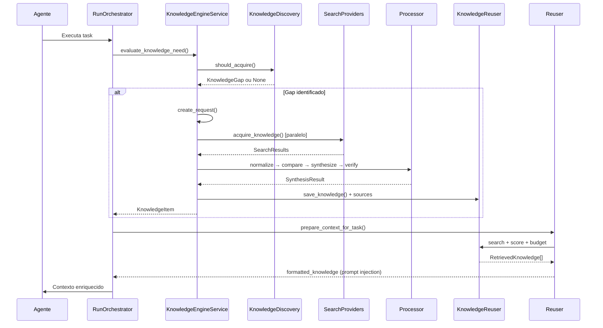

# Knowledge Engine Architecture

**Versão:** 1.0
**Data:** 2026-10-31
**Status:** Implementado

---

## Visão Geral

O Knowledge Engine é um subsistema do Callidus que permite aos agentes adquirirem, processarem, armazenarem e reutilizarem conhecimento externo de forma autônoma. Ele transforma o Callidus em um sistema capaz de identificar lacunas de conhecimento, pesquisar informações na internet, consultar modelos de IA externos, validar respostas, armazenar descobertas e reutilizá-las em execuções futuras.

### Princípios Fundamentais

1. **Conhecimento pertence ao Callidus** - Descobertas persistem além de execuções individuais
2. **Modelos locais pequenos** - O Knowledge Engine permite que modelos locais trabalhem com conhecimento externo
3. **Validação objetiva** - Não confia cegamente em fontes; verifica evidências
4. **Economia de contexto** - Injeta apenas conhecimento relevante, controlado por orçamento de tokens
4. **Recuperação resiliente** - Checkpoints e recuperação automática após falhas

---

## Arquitetura

### Camadas

```text
┌─────────────────────────────────────────────────────────────┐
│                    APRESENTAÇÃO                              │
│  API Routes (/projects/{id}/knowledge/*)                    │
└─────────────────────┬───────────────────────────────────────┘
                      │
┌─────────────────────▼───────────────────────────────────────┐
│                    APLICAÇÃO                                 │
│  KnowledgeEngineService (orquestrador central)              │
│  KnowledgeDiscovery (identifica lacunas)                    │
│  KnowledgeReuser (recuperação contextual)                   │
│  LearningTracker/PatternDetector (aprendizado contínuo)     │
└─────────────────────┬───────────────────────────────────────┘
                      │
┌─────────────────────▼───────────────────────────────────────┐
│              PROCESSAMENTO (knowledge/processing/)           │
│  Normalize → Compare → Synthesize → Verify                  │
└─────────────────────┬───────────────────────────────────────┘
                      │
┌─────────────────────▼───────────────────────────────────────┐
│              AQUISIÇÃO (knowledge/providers/)                │
│  SearchProvider (DuckDuckGo, GitHub, Documentation)         │
│  BrowserSession + AIServiceManager (ChatGPT, Gemini, Claude)│
└─────────────────────┬───────────────────────────────────────┘
                      │
┌─────────────────────▼───────────────────────────────────────┐
│              MEMÓRIA (knowledge/memory/)                     │
│  KnowledgeMemoryStore (SQLite + FTS5)                       │
│  KnowledgeReuser (recuperação contextual + orçamento)       │
└─────────────────────┬───────────────────────────────────────┘
                      │
┌─────────────────────▼───────────────────────────────────────┐
│           CONFIABILIDADE (knowledge/reliability/)           │
│  CircuitBreaker + RetryPolicy + ResourceLimiter             │
│  CheckpointManager + RecoveryManager                        │
│  InputSanitizer + AccessControl + AuditLogger               │
└──────────────────────────────────────────────────────────────┘
```

### Componentes Principais

| Componente | Localização | Responsabilidade |
|------------|-------------|------------------|
| **KnowledgeEngineService** | `knowledge/service.py` | Orquestrador central - coordena discovery, request, acquisition, processing, memory |
| **KnowledgeDiscovery** | `knowledge/request.py` | Avalia se agente precisa de conhecimento externo |
| **KnowledgeDiscovery.should_acquire()** | `knowledge/request.py` | Critérios: confiança baixa, contexto insuficiente, falhas repetidas, info desatualizada, docs especializadas, complexidade alta |
| **SearchProvider** | `knowledge/providers/base.py` | Interface comum para provedores de busca (Strategy pattern) |
| **DuckDuckGoProvider** | `knowledge/providers/duckduckgo.py` | Busca web via HTML scraping |
| **GitHubProvider** | `knowledge/providers/github.py` | GitHub API (repos, code, issues) |
| **DocumentationProvider** | `knowledge/providers/docs.py` | Busca em sites de documentação (ReadTheDocs, MDN, Python.org, etc.) |
| **BrowserSession** | `knowledge/browser/session.py` | Sessão Playwright persistente com perfis isolados |
| **AIServiceManager** | `knowledge/browser/ai_services.py` | Gerencia ChatGPT, Gemini, Claude via navegador autenticado |
| **ContentExtractor** | `knowledge/browser/extraction.py` | Extração semântica de conteúdo web |
| **ResultNormalizer** | `knowledge/processing/normalize.py` | Normaliza resultados de diferentes provedores |
| **SourceComparator** | `knowledge/processing/compare.py` | Compara fontes: consenso, divergências, contradições |
| **KnowledgeSynthesizer** | `knowledge/processing/synthesize.py` | Síntese final com citações e confiança |
| **CodeVerifier/DocVerifier/VersionChecker** | `knowledge/processing/verify.py` | Verificação de código, docs, versões |
| **KnowledgeMemoryStore** | `knowledge/memory/store.py` | CRUD, busca FTS5, deduplicação, versionamento |
| **KnowledgeReuser** | `knowledge/memory/reuse.py` | Recuperação contextual com orçamento de tokens |
| **CircuitBreaker** | `knowledge/reliability/circuit_breaker.py` | Previne cascata de falhas em provedores |
| **RetryPolicy** | `knowledge/reliability/retry.py` | Retry com backoff exponencial + jitter |
| **ResourceLimiter** | `knowledge/reliability/limits.py` | Concorrência, storage, memory, rate limiting |
| **CheckpointManager** | `knowledge/reliability/recovery.py` | Checkpoints periódicos + recuperação automática |
| **InputSanitizer** | `knowledge/reliability/security.py` | Sanitização de inputs (API keys, passwords, etc.) |

---

## Fluxo de Aquisição de Conhecimento



---

## Modelos de Dados (SQLite)

### Tabelas Principais

| Tabela | Descrição |
|--------|-----------|
| `knowledge_items` | Itens de conhecimento (title, content, kind, technology, confidence, validation_status) |
| `knowledge_sources` | Fontes de cada item (source_kind, url, credibility, raw_content) |
| `knowledge_requests` | Solicitações de aquisição (question, status, result_item_id) |
| `knowledge_validations` | Validações (validation_kind, passed, method, evidence) |
| `knowledge_relations` | Relações entre itens (source_id, target_id, relation_type) |
| `knowledge_usage` | Histórico de uso (item_id, task_id, outcome, success) |
| `knowledge_versions` | Versionamento de itens (title, content, change_reason) |

### Índices e Busca

- **FTS5** em `knowledge_items_fts` para busca full-text (title, content, summary, technology, tags)
- Índices compostos: `(project_id, kind)`, `(project_id, technology, version)`, `confidence`, `created_at`
- Busca por tags de contexto via `LIKE` no JSON

---

## Ferramentas do Modelo

O Knowledge Engine expõe 7 ferramentas para uso pelos modelos:

| Ferramenta | Descrição |
|------------|-----------|
| `search_knowledge` | Busca itens por query, tecnologia, kind, confiança mínima |
| `get_knowledge` | Detalhes completos de um item (conteúdo, fontes, validações) |
| `acquire_knowledge` | Solicita aquisição externa (provedores, profundidade, tempo máx) |
| `save_knowledge` | Salva descoberta manual do agente |
| `validate_knowledge` | Valida item (passed/failed, método, evidências) |
| `reuser_knowledge` | Recupera conhecimento relevante para task atual (com orçamento) |
| `knowledge_stats` | Estatísticas do projeto (total, validados, por tipo, uso) |

---

## Orçamento de Contexto

O `BudgetAwareInjector` controla a injeção de conhecimento no prompt:

```python
injector = BudgetAwareInjector(max_tokens=2000)  # Default: 2000 tokens
injected, formatted = injector.inject(knowledge_items, current_tokens=500)
```

- **Reserva**: 10% do orçamento para margem de segurança
- **Priorização**: Itens validados > alta confiança > match tecnologia > word overlap > uso prévio > recência
- **Corte**: Para de injetar quando orçamento excedido

---

## Confiabilidade e Segurança

### Circuit Breaker
- **CLOSED**: Normal, conta falhas
- **OPEN**: Bloqueia chamadas após `failure_threshold` (default 5)
- **HALF_OPEN**: Testa recuperação com `success_threshold` (default 2)

### Retry Policy
- Backoff exponencial: `base_delay * exponential_base^attempt`
- Jitter: ±10% para evitar thundering herd
- Timeout total configurável por operação

### Resource Limiter
| Recurso | Limite Default |
|---------|----------------|
| Buscas concorrentes | 3 |
| Sessões browser | 1 |
| Queries IA concorrentes | 2 |
| Storage por projeto | 500 MB |
| Tokens de contexto | 4000 |
| Requisições/minuto | 30 |

### Security
- **InputSanitizer**: Remove API keys, passwords, tokens, IPs, emails, cartões de crédito
- **CredentialManager**: Criptografia Fernet (opcional, requer `cryptography`)
- **AccessControl**: Roles (admin, user, agent) com permissões granulares
- **AuditLogger**: Log de auditoria em `logs/knowledge_audit.log`

---

## Recuperação Automática

### Checkpoints
- Intervalo: 5 minutos (configurável)
- Salva: requests pendentes/in-progress, acquisitions recentes
- Limpeza: Mantém últimos 10 checkpoints

### Recuperação na Inicialização
1. Carrega checkpoint mais recente por projeto
2. Recupera requests travados (`in_progress` > 10 min → failed)
3. Recupera acquisitions stale (>2h, sem sources ou baixa confiança)
4. Limpa checkpoints antigos

---

## Configuração

### Limites Personalizáveis (`ResourceLimits`)

```python
limits = ResourceLimits(
    max_concurrent_searches=5,
    max_storage_mb=1000,
    max_context_tokens=8000,
    requests_per_minute=60,
)
limiter = ResourceLimiter(limits, storage_root=Path("data/knowledge"))
```

### Políticas de Retry por Provedor

```python
SEARCH_PROVIDER_POLICY = RetryPolicy(max_attempts=3, base_delay=1.0, max_delay=10.0, timeout=30.0)
BROWSER_POLICY = RetryPolicy(max_attempts=2, base_delay=2.0, max_delay=30.0, timeout=120.0)
AI_SERVICE_POLICY = RetryPolicy(max_attempts=2, base_delay=5.0, max_delay=60.0, timeout=180.0)
GITHUB_API_POLICY = RetryPolicy(max_attempts=3, base_delay=1.0, max_delay=15.0, timeout=30.0)
```

---

## Testes

### Cobertura
- **Unitários**: 67 testes (discovery, providers, processing, memory, reliability)
- **Integração**: Mock providers para testar falhas, timeouts, recuperação
- **E2E**: 7 cenários (conhecimento novo, reuso, divergência, browser indisponível, reinicialização, contexto limitado, solução malsucedida)

### Execução
```bash
# Testes unitários do Knowledge Engine
pytest tests/test_knowledge_engine.py tests/test_knowledge_providers.py tests/test_knowledge_processing.py tests/test_knowledge_memory.py -v

# Suite completa
pytest tests/ -v
```

---

## Integração com Agentes

### RunOrchestrator Integration
```python
# Em RunOrchestrator._step_body()
knowledge_need = ke_service.evaluate_knowledge_need(
    project_id=project.id,
    task_id=task.id,
    model_confidence=context.confidence,
    context_has_answer=context.has_answer,
    repeated_failures=task.failure_count,
    requires_updated_info=task.requires_fresh_info,
    needs_specialized_docs=task.needs_specialized_docs,
    complexity_score=task.complexity_score,
    objective=task.objective,
)
if knowledge_need:
    request = ke_service.create_request(knowledge_need)
    # Processar assincronamente ou aguardar
```

### ContextAssembler Integration
```python
# Em ContextAssembler.build_for_task()
reuser = KnowledgeReuser(store)
result = reuser.prepare_context_for_task(
    project_id=task.project_id,
    task_objective=task.objective,
    task_technology=task.technology,
    current_context_tokens=current_token_count,
    max_items=3,
)
if result.knowledge_items:
    context_parts.append(reuser.format_for_prompt(result))
```

---

## Próximos Passos

1. **Interface Web**: Painel de Knowledge Library, activity tracking, settings
2. **Embeddings**: Busca semântica opcional com `sentence-transformers`
3. **Mais Provedores**: Google Search API, Bing, StackOverflow, arXiv
4. **Métricas Avançadas**: Dashboards de uso, qualidade, gaps de conhecimento
5. **Multi-projeto**: Compartilhamento de conhecimento entre projetos autorizados

---

## Referências

- [AGENTS.md](../../AGENTS.md) - Regras de engenharia do Callidus
- [Architecture Overview](./visao-geral.md)
- [Database Schema](./modelo-dados.md)
- [Providers](./provedores.md)