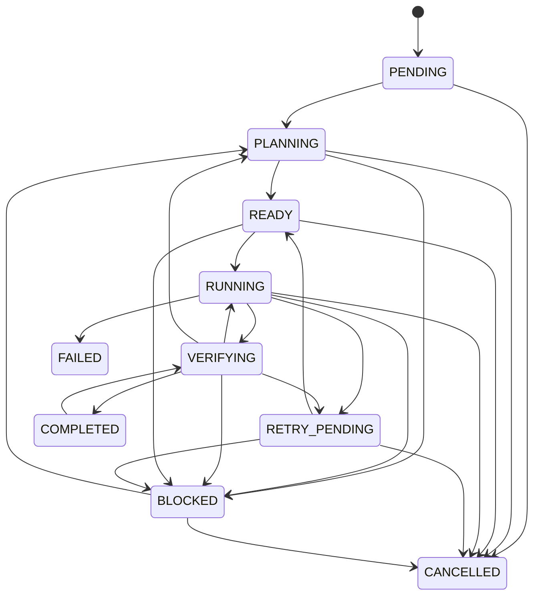

# Máquina de estados das tarefas

Estados (`TaskStatus`):

| Estado | Significado |
|--------|-------------|
| `PENDING` | Criada, ainda não planejada |
| `PLANNING` | Decomposição/planejamento em curso |
| `READY` | Dependências satisfeitas, pronta para executar |
| `RUNNING` | Operação em andamento |
| `VERIFYING` | Verificações pós-operação |
| `RETRY_PENDING` | Falha recuperável; aguarda nova tentativa |
| `BLOCKED` | Impedimento real documentado |
| `COMPLETED` | Critérios satisfeitos com evidência |
| `FAILED` | Falha não recuperável dentro dos limites |
| `CANCELLED` | Interrompida pelo usuário |

## Transições permitidas (implementação: `domain/state_machine.py`)

Transições inválidas levantam `InvalidTransitionError` — nunca silenciosamente.

## Conclusão

`VERIFYING → BLOCKED`: verificação que não pôde rodar (executável ausente, aprovação pendente) ou inconclusiva; não é falha da implementação.

`COMPLETED` exige passagem por `VERIFYING` (exceto tarefas marcadas como `no_verification` no metadata, uso restrito a testes).

O orquestrador (fases posteriores) não promove para `COMPLETED` só porque subtarefas retornaram texto.
