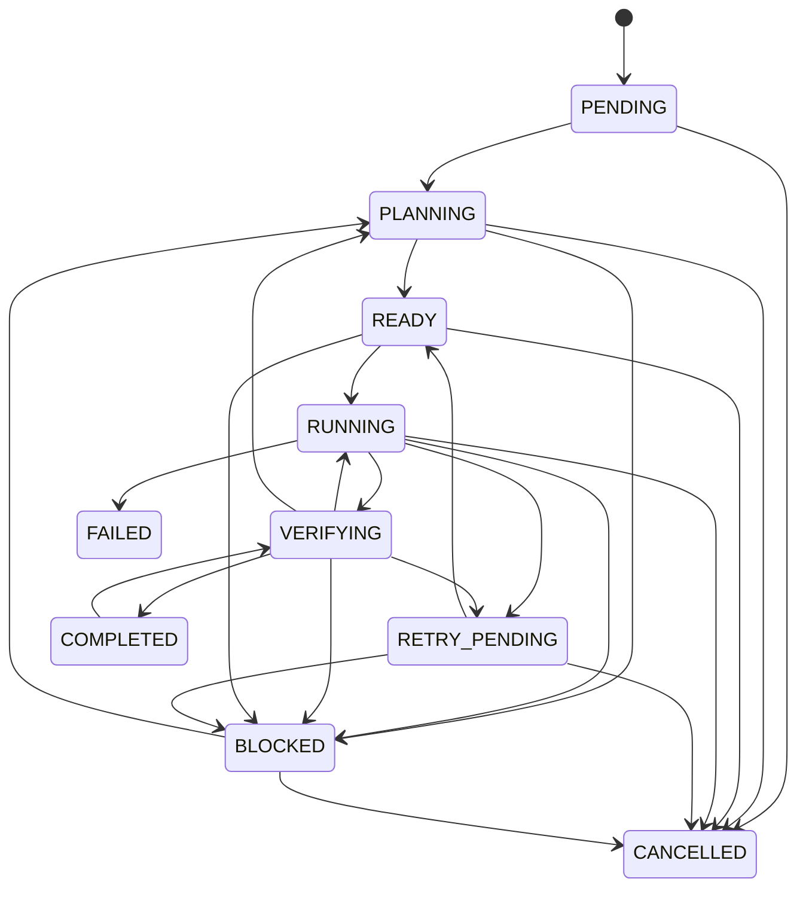
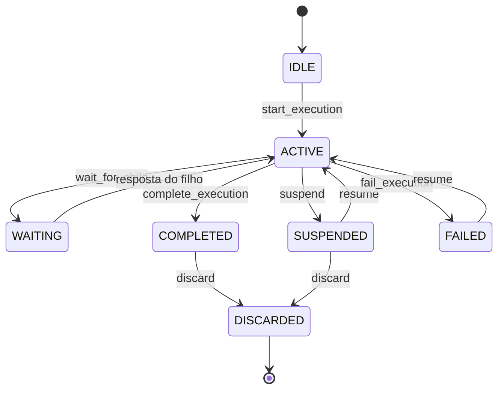

# Máquina de estados das tarefas

{width=48}

Os estados de tarefa, run e agente e as transições válidas entre eles.

Estados (`TaskStatus`):

| Estado | Significado |
|--------|-------------|
| `PENDING` | Criada, ainda não planejada |
| `PLANNING` | Decomposição/planejamento em curso |
| `READY` | Dependências satisfeitas, pronta para executar |
| `RUNNING` | Operação em andamento |
| `VERIFYING` | Verificações pós-operação |
| `RETRY_PENDING` | Falha recuperável; aguarda nova tentativa |
| `BLOCKED` | Impedimento real documentado |
| `COMPLETED` | Critérios satisfeitos com evidência |
| `FAILED` | Falha não recuperável dentro dos limites |
| `CANCELLED` | Interrompida pelo usuário |

## 🔄 Transições permitidas (implementação: `domain/state_machine.py`)

Transições inválidas levantam `InvalidTransitionError` — nunca silenciosamente.

## 🔄 Agente lógico e execução

A tarefa tem a máquina acima; o **agente lógico** e a **execução** têm as suas
(implementação: `domain/agent_lifecycle.py`).

| Estado | Significado |
|--------|-------------|
| `IDLE` | O agente existe, sem execução ativa |
| `ACTIVE` | Execução em curso (ocupa memória de inferência) |
| `WAITING` | Aguarda resposta de descendente |
| `SUSPENDED` | Estado recuperável, sem execução ativa |
| `COMPLETED` | A tarefa do agente terminou; o agente continua existindo |
| `FAILED` | Falha não resolvida — retomável |
| `DISCARDED` | Estado recuperável descartado (resultados preservados) |

Estados da execução: `PENDING`, `RUNNING`, `SUSPENDING`, `SUSPENDED`,
`WAITING_FOR_CHILD`, `RESUMING`, `COMPLETED`, `FAILED`, `CANCELLED`, `DISCARDED`.

Transições inválidas levantam `InvalidAgentTransition`: estado inconsistente é erro,
nunca correção silenciosa. Detalhes:
[hierarquia-agentes.md](/docs/architecture/hierarquia-agentes.md).

## 🎯 Conclusão

`VERIFYING → BLOCKED`: verificação que não pôde rodar (executável ausente, aprovação pendente) ou inconclusiva; não é falha da implementação.

`COMPLETED` exige passagem por `VERIFYING` (exceto tarefas marcadas como `no_verification` no metadata, uso restrito a testes).

O orquestrador (fases posteriores) não promove para `COMPLETED` só porque subtarefas retornaram texto.