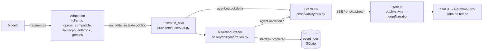

# Narração do agente em tempo real

Como a fala do agente sai da própria inferência e chega, fragmento a fragmento, à linha do tempo da conversa. Volta para o [índice de arquitetura](/docs/architecture/README.md).

## Sumário

- [🎯 O que é](#-o-que-é)
- [🔀 Fluxo de ponta a ponta](#-fluxo-de-ponta-a-ponta)
- [📜 Contrato dos eventos](#-contrato-dos-eventos)
- [🧹 O que vira narração e o que não vira](#-o-que-vira-narração-e-o-que-não-vira)
- [🔌 Responsabilidade dos adaptadores](#-responsabilidade-dos-adaptadores)
- [💾 Persistência e interrupção](#-persistência-e-interrupção)
- [🔁 Reconexão sem perda nem duplicação](#-reconexão-sem-perda-nem-duplicação)
- [🖥️ Interface](#️-interface)
- [🧭 Compatibilidade dos provedores](#-compatibilidade-dos-provedores)
- [📏 Medidas](#-medidas)
- [🧪 Testes](#-testes)
- [⚠️ Limitações](#️-limitações)

## 🎯 O que é

A narração é o **texto público** que o modelo escreve na mesma resposta em que pede uma ferramenta
("Vou ler o componente dos gráficos para ver o formato esperado"). Ela aparece na **Atividade do
agente**, entre as ferramentas, crescendo conforme os fragmentos chegam do provedor.

- **Nenhuma inferência extra**: a fala é filtrada dos fragmentos que `observed_chat` já recebe.
- **Nenhuma simulação**: não há temporizador revelando caracteres; o ritmo é o do modelo.
- **Nada inventado**: resposta só JSON não gera narração. Resposta que só pede ferramentas ganha
  uma frase de reserva montada a partir das chamadas ([`describe_tool_calls`](/src/agent/observability/narration.py):
  "Vou ler `app.py`."), marcada com `source: tool_calls` — descreve a ação pedida, nunca o resultado.
- **Separada do sistema**: as frases do orquestrador (`work.explained`, `agent.thought`) continuam
  sendo eventos de sistema, acoplados ao item operacional; a narração é só texto do modelo.

O pedido de narração está no formato de saída da operação
([`NARRATION_HINT`](/src/agent/context/operation_builder.py)): uma frase curta antes da ferramenta,
sem afirmar resultado ainda não visto.

## 🔀 Fluxo de ponta a ponta



1. O adaptador recebe o stream do servidor e chama `on_delta` **só com o texto público**.
   Chamadas de ferramenta e raciocínio são acumulados à parte e voltam na resposta completa.
2. `observed_chat` publica o fragmento bruto (`agent.output.delta`, como antes) e o entrega ao
   `NarrationStream`, que filtra e publica `agent.narration.delta` (lote pelo `DeltaBatcher`).
3. O barramento entrega aos assinantes SSE da run; a interface acrescenta o trecho à linha da
   narração, sem recriar a lista.
4. No fim da resposta (ou na falha/cancelamento), `agent.narration.completed` grava o texto e o estado.

## 📜 Contrato dos eventos

Declarados em [`contracts.py`](/src/agent/observability/contracts.py), no mesmo envelope dos demais
(`run_id`, `task_id`, `parent_task_id`, `agent`, `seq`, `ts`).

| Evento | Gravado | Campos | Quando |
|--------|---------|--------|--------|
| `agent.narration.started` | sim | `narration_id`, `output_id`, `purpose`, `streamed`, `source?` | primeiro texto público da resposta (ou a reserva, no fim) |
| `agent.narration.delta` | não (efêmero) | `narration_id`, `output_id`, `text`, `offset` | cada lote de texto novo |
| `agent.narration.completed` | sim | `narration_id`, `output_id`, `content`, `status`, `chars`, `truncated`, `duration_ms`, `source`, `error?` | fim da resposta, cancelamento ou falha |

- `text` traz **só o trecho novo**; `offset` é o total já publicado, em code points.
- `status`: `completed`, `interrupted` (cancelamento) ou `failed` (erro do provedor).
- `output_id` liga a narração à inferência (`agent.started`/`agent.output.completed`).
- `task_id` do envelope identifica quem fala: numa execução hierárquica, a etapa filha.

## 🧹 O que vira narração e o que não vira

O filtro ([`NarrationFilter`](/src/agent/observability/narration.py)) é incremental: retém só o
mínimo para decidir (o começo de uma linha até o primeiro caractere visível, ou um `<` que pode
abrir uma tag) e libera o resto na hora.

| Entrada do modelo | Resultado |
|-------------------|-----------|
| Prosa | narração, na ordem e com os fragmentos como vieram |
| `<think>…</think>` (mesmo partido entre fragmentos) | descartado |
| `<tool_call>`, `<function-call>`, `<\|…` | encerra a narração da resposta |
| Linha começando com `{`, `[`, ```` ``` ```` ou uma tag `<nome>` | encerra (carga JSON, código, template) |
| Campos `thinking`, `reasoning_content`, `thinking_delta`, partes `thought` | nunca chegam a `on_delta` |
| Argumentos de ferramenta | nunca chegam a `on_delta` |
| Finalidade `final_answer` ou `agent_query` | sem narração (a resposta já aparece na conversa) |

## 🔌 Responsabilidade dos adaptadores

Cada adaptador normaliza o próprio protocolo para o contrato comum: `on_delta(texto público)` durante
o stream e `ChatCompletionResponse` (texto, `tool_calls`, `reasoning`, uso) no fim. Nenhum detalhe de
provedor chega à interface.

| Adaptador | Formato do stream | Texto público | Ferramentas no stream | Raciocínio |
|-----------|-------------------|---------------|-----------------------|------------|
| `ollama` | NDJSON (`/api/chat`) | `message.content` | `message.tool_calls` (e blocos no texto) | `message.thinking`, `<think>` |
| `openai_compatible` / `openrouter` | SSE `data:` | `delta.content` | `delta.tool_calls[]` remontado por `index` | `delta.reasoning_content` / `reasoning` |
| `llamacpp` | SSE `data:` | `delta.content` | `delta.tool_calls[]` remontado por `index` | `delta.reasoning_content` |
| `anthropic` | SSE de eventos | `text_delta` | `tool_use` + `input_json_delta` | `thinking_delta` |
| `gemini` | SSE (`alt=sse`) | `parts[].text` | `parts[].functionCall` | partes com `thought: true` |

A remontagem OpenAI vive em [`OpenAIDeltaAccumulator`](/src/agent/providers/http.py). Antes desta
mudança, os streams de `openai_compatible`, `llamacpp`, `anthropic` e `gemini` **descartavam** as
chamadas de ferramenta — com streaming ligado, o ciclo de ferramentas desses provedores perdia o
pedido do modelo.

## 💾 Persistência e interrupção

- Só `started` e `completed` vão para `event_logs`; fragmentos ficam no anel do barramento.
- `completed` grava até `NARRATION_PERSIST_CHARS` (8 000) caracteres, com `chars` (total) e
  `truncated`. Narração é prosa curta; acima disso é entrega em prosa, que já está na inferência.
- Cancelamento (`asyncio.CancelledError`) e erro do provedor gravam `completed` com o texto
  parcial e `status` `interrupted`/`failed`, no mesmo commit do `agent.output.failed`.
- Processo encerrado no meio da geração (sem chance de gravar o fim): o histórico tem `started`
  sem `completed`; a interface mostra a linha como **interrompida** quando a mensagem já não está
  em execução.
- Ao recarregar a página, `replayFeedFromRun` reaplica os eventos gravados: a narração volta com o
  texto do `completed`, na mesma posição da linha do tempo.

## 🔁 Reconexão sem perda nem duplicação

- O barramento guarda as narrações em curso (`EventBus.live()["narrations"]`, com o texto já
  publicado); a foto vai na rota `/runs/{id}/observe` e no evento SSE `live`.
- Ao conectar, a interface semeia a linha com esse texto (`seedLiveNarrations` em `store.js`).
- O anel reenvia os fragmentos depois do cursor; `mergeNarration` usa o `offset` para ignorar o que
  já tem e para marcar um buraco (que o texto do `completed` fecha).
- Deslocamentos em **code points** dos dois lados: um emoji não abre buraco.

## 🖥️ Interface

| Arquivo | Papel |
|---------|-------|
| [`ui.js`](/web/static/assets/app/ui.js) | `describeActivity` traduz `agent.narration.*`; `mergeNarration` atualiza a linha no lugar; `integrateNarrative` mantém a narração como linha própria, entre as ferramentas |
| [`components/narration.js`](/web/static/assets/app/components/narration.js) | `NarrationEntry`: único leitor de `entry.text` — cada fragmento redesenha só esta linha; cursor de geração ativa; estados concluída, interrompida e com falha; nome da etapa filha que fala |
| [`components/chat.js`](/web/static/assets/app/components/chat.js) | Linha do tempo; botão "Novas atividades" quando chega conteúdo com o usuário lendo mais acima |
| [`store.js`](/web/static/assets/app/store.js) | `pushActivity` e `seedLiveNarrations` |
| [`style.css`](/web/static/assets/app/style.css) | `.narration*`: tokens do tema (claro e escuro), `prefers-reduced-motion`, ajuste em telas estreitas |

A rolagem segue o fim só enquanto o usuário está lá (`chat-scroll.js`, via `ResizeObserver` da
mensagem); subindo para ler, a posição é preservada e o botão de rolar mostra "Novas atividades".

## 🧭 Compatibilidade dos provedores

- **Com streaming**: narração em fragmentos reais.
- **Sem streaming** (`MockProvider`, provedor que não implementa `_chat_streaming`): o estado
  operacional continua `waiting_full_response`; a fala aparece **inteira** quando a resposta chega
  (`started.streamed = false`, um único trecho). Nada é fatiado para parecer digitação.
- **`stream: false`** na run ou na etapa: o mesmo caminho sem streaming.

## 📏 Medidas

Medido com [`lab/medir_narracao.py`](/lab/medir_narracao.py) (Ollama local, banco isolado, uma
chamada da operação com ferramentas de inspeção). *Medido* em 2026-11-02:

| Modelo | 1º fragmento do modelo | 1º trecho de narração entregue | Lotes | Narração | Pico de memória Python |
|--------|------------------------|--------------------------------|-------|----------|------------------------|
| `qwen3-vl:8b` | 353 ms | 355 ms | 19 em 3,2 s | uma frase contextual antes de `list_dir` | ~3,8 MiB |
| `gpt-oss:20b` | — | — | 0 | nenhuma: o Ollama devolve só `thinking` e `tool_calls` | ~3,7 MiB |

- Latência acrescentada pela narração: ~2 ms entre o fragmento bruto e o trecho de narração.
- Atualizações da interface: uma por lote (`stream_delta_interval_ms`, 120 ms por padrão), não por token.
- Persistência: dois eventos por narração, independentemente do tamanho.

## 🧪 Testes

| Teste | Arquivo |
|-------|---------|
| Filtro (raciocínio partido, ferramenta, JSON, código, tags reais do qwen3, `<` comum) | [`tests/test_narration_stream.py`](/tests/test_narration_stream.py) |
| A — fragmentos entregues antes do fim da resposta | idem |
| B — Ollama real | [`lab/medir_narracao.py`](/lab/medir_narracao.py) (fora da suíte: precisa do Ollama) |
| C — resposta longa: só início e fim gravados, teto e total | idem |
| D — narração → ferramenta → narração → ferramenta, na ordem | idem |
| E — cancelamento preserva o texto parcial como `interrupted` | idem |
| F — foto ao vivo + anel reconstroem o texto sem repetir | idem e [`tests/web/live-narration.test.mjs`](/tests/web/live-narration.test.mjs) |
| G — runs simultâneas isoladas | [`tests/test_narration_stream.py`](/tests/test_narration_stream.py) |
| H — `thinking`, `reasoning_content`, `thinking_delta`, `thought` e argumentos fora da narração; ferramentas remontadas nos streams | idem |
| I — provedor sem streaming, resposta final e resposta só JSON | idem |
| J — reserva a partir das chamadas de ferramenta, fala do modelo acima da reserva, provedor que declara streaming e não envia fragmentos | idem |
| J — linha principal fora dos detalhes, sem temporizador, tokens de tema, movimento reduzido | [`tests/web/live-narration.test.mjs`](/tests/web/live-narration.test.mjs) |

## ⚠️ Limitações

- **Depende do modelo**: a fala com o *porquê* só existe quando o modelo escreve prosa junto da
  ferramenta. O `gpt-oss:20b` pelo Ollama não escreve (o preâmbulo vai para o canal de raciocínio,
  que não é exposto); o `qwen3-vl:8b` escreve, mas nem sempre. Nesses casos aparece a reserva, que
  diz o *quê* (a ação pedida) mas não o *porquê*.
- **Texto parcial sem checkpoint**: se o processo morrer no meio da geração, o texto já transmitido
  não é gravado (fica `started` sem `completed`). Narrações são curtas; o custo de gravar
  checkpoints não se pagou.
- **Linha que abre com tag HTML** (`<b>…`) é tratada como carga e encerra a narração.
- **Avaliação de comportamento**: medida antes/depois com `gpt-oss:20b`, sem regressão (uma
  rodada por lado, [avaliacao.md](/docs/architecture/avaliacao.md#-narração-em-tempo-real--antes-e-depois-02112026-gpt-oss20b));
  com esse modelo, nenhuma narração foi emitida.
