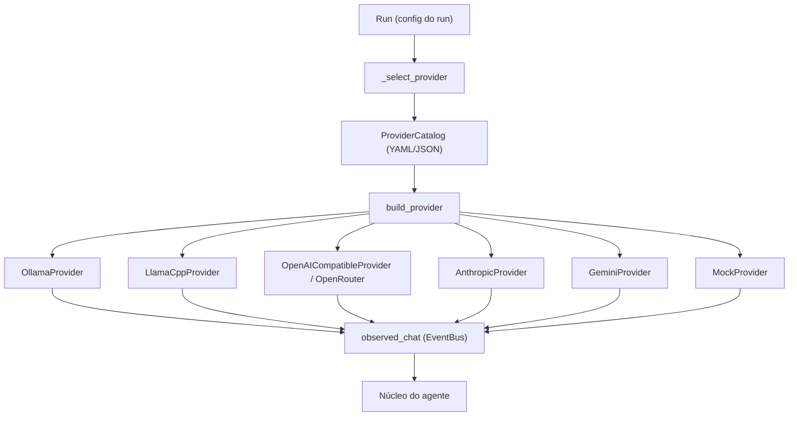

# Provedores de inferência

{width=48}

Voltar ao [Hub](/docs/architecture/README.md) · Código: [`src/agent/providers/`](/src/agent/providers/README.md)

O Callidus fala com modelos por **provedores**: Ollama, llama.cpp, OpenRouter, qualquer serviço
compatível com OpenAI, Anthropic, Gemini e um mock determinístico. Trocar de provedor é
configuração — o núcleo do agente (skills, ferramentas, memória, ciclo de execução) não muda.

## Sumário

1. [Arquitetura](#arquitetura)
2. [Provedores suportados](#provedores-suportados)
3. [Configuração](#configuração)
4. [Variáveis de ambiente](#variáveis-de-ambiente)
5. [Seleção e troca de provedor](#seleção-e-troca-de-provedor)
6. [Segurança e confiabilidade](#segurança-e-confiabilidade)
7. [Validar a conectividade](#validar-a-conectividade)
8. [Como registrar um novo adaptador](#como-registrar-um-novo-adaptador)
9. [Limitações conhecidas](#limitações-conhecidas)
10. [Resolução de problemas](#resolução-de-problemas)

---

## Arquitetura



| Peça | Responsabilidade |
|------|------------------|
| `base.py` | Contrato: `list_models`, `chat`, `chat_streaming`, `capabilities`, `health_check`; erros tipados; `ToolCall`; `ProviderCapabilities` |
| `http.py` | Política HTTP comum: tempo limite, TLS, sem redirecionamento, mapa de erros, redação de segredos, retry só em falha transitória, validação de URL |
| `registry.py` | Configuração declarativa (`ProviderSpec`, `ProviderCatalog`), interpolação `${VAR}`, fábrica por tipo |
| Adaptadores | Um arquivo por família de API; cada um fala o dialeto do seu serviço |
| `observed.py` | Emite `agent.started` / `agent.output.delta` / `agent.output.completed` / `agent.output.failed` no EventBus |

Regras de projeto:

- A camada de provedores **não** conhece skills, memória, ferramentas nem o ciclo do agente.
- Recurso que a API não oferece é **declarado** em `capabilities()` e nunca simulado.
- Parâmetro não suportado é traduzido de forma explícita ou rejeitado — nunca descartado em silêncio.

## Provedores suportados

| Provedor | `type` | URL padrão | Autenticação | Recursos |
|----------|--------|------------|--------------|----------|
| Ollama | `ollama` | `http://127.0.0.1:11434` | `Authorization: Bearer` (opcional) | streaming, ferramentas, JSON estruturado, visão, lista de modelos |
| llama.cpp | `llamacpp` | `http://127.0.0.1:8080` | `Authorization: Bearer` ou arquivo de chave | streaming, ferramentas, JSON estruturado, visão, lista de modelos |
| OpenAI-compatível | `openai_compatible` | (obrigatória) | `Authorization: Bearer` | streaming, ferramentas, JSON estruturado, visão, lista de modelos |
| OpenAI | `openai` | `https://api.openai.com/v1` | `Authorization: Bearer` | igual ao compatível com OpenAI |
| OpenRouter | `openrouter` | `https://openrouter.ai/api/v1` | `Authorization: Bearer` | igual ao compatível com OpenAI + `X-Title`/`HTTP-Referer` |
| Anthropic | `anthropic` | `https://api.anthropic.com` | `x-api-key` + `anthropic-version` | streaming, ferramentas, visão; **sem** JSON estruturado |
| Gemini | `gemini` | `https://generativelanguage.googleapis.com/v1beta` | `x-goog-api-key` | streaming, ferramentas, JSON estruturado, visão |
| Mock | `mock` | — | — | determinístico, offline, sem streaming |

Detalhes por provedor: [README dos provedores](/src/agent/providers/README.md).

### Ollama local e remoto

A integração usa a **API nativa** do Ollama (`/api/chat`, `/api/tags`) — não a API compatível com
OpenAI. Para um servidor remoto (por exemplo um VPS), basta apontar a URL e, se o servidor exigir
chave, informá-la:

```yaml
providers:
  ollama_remote:
    type: ollama
    base_url: ${CALLIDUS_OLLAMA_URL}   # ex.: https://vps.exemplo:11434
    model: qwen3:8b
    api_key_env: CALLIDUS_OLLAMA_API_KEY
```

O servidor remoto precisa expor a porta do Ollama com TLS ou atrás de um proxy; o Callidus não
transfere pesos de modelo — a inferência acontece onde o servidor está.

### llama.cpp local e remoto

O `llama-server` expõe a API compatível com OpenAI em `/v1`; o adaptador usa
`/v1/chat/completions` e `/v1/models`. Modelo é o identificador do servidor (o `llama-server` ignora
o campo, mas o chamador continua mandando). **Não é preciso baixar o GGUF localmente** quando a
inferência roda em um servidor remoto:

```yaml
providers:
  llama_cpp_remote:
    type: llamacpp
    base_url: ${CALLIDUS_LLAMA_CPP_URL}   # ex.: https://gpu.exemplo:8080
    model: modelo-servidor
    api_key_env: CALLIDUS_LLAMA_CPP_KEY
```

Se o servidor usa `--api-key-file`, aponte `api_key_file` para o caminho do arquivo.

### OpenRouter

```yaml
providers:
  openrouter:
    type: openrouter
    base_url: https://openrouter.ai/api/v1
    model: autor/modelo-disponivel
    api_key_env: OPENROUTER_API_KEY
    referer: https://callidus.local   # opcional (HTTP-Referer)
```

- O modelo é o identificador do catálogo do OpenRouter (`autor/modelo`), escolhido pelo operador.
- A lista de modelos vem da API (`/api/v1/models`) e fica em cache de 5 minutos — não é fixada no
  código nem consultada a cada inferência.
- Recursos variam entre modelos do catálogo: a configuração declara a intenção, o modelo decide.

### Provedores compatíveis com OpenAI

Exemplo genérico, sem depender de um fornecedor específico:

```yaml
providers:
  meu_gateway:
    type: openai_compatible
    base_url: https://meu-gateway.exemplo/v1
    model: modelo-do-gateway
    api_key_env: MEU_GATEWAY_KEY
    timeout: 90
    headers:
      X-Ambiente: producao
    max_retries: 2
```

O adaptador cobre o que a API compatível com OpenAI realmente padroniza: `POST /chat/completions`
(com e sem streaming), `GET /models`, `tools`, `tool_choice` e `response_format`
(`{"type": "json_schema", ...}`). **Não** se presume suporte universal: o que o serviço não devolve
simplesmente não aparece na resposta, e o serviço pode recusar campos que não conhece.

### Anthropic e Gemini

APIs com formato próprio ganharam adaptadores próprios (não é "OpenAI-compatible"):

- **Anthropic** — `POST /v1/messages`, `x-api-key`, `anthropic-version`, prompt de sistema em campo
  próprio, resposta em blocos (`text`, `tool_use`), uso em `input_tokens`/`output_tokens`.
- **Gemini** — `POST /v1beta/models/{model}:generateContent`, `x-goog-api-key`, `contents`/`parts`,
  `generationConfig` (`responseMimeType`/`responseSchema` para JSON estruturado), uso em
  `usageMetadata`.

## Configuração

O arquivo de provedores é YAML ou JSON, apontado por `PROVIDERS_CONFIG_PATH`:

```yaml
default_provider: ollama_remote

providers:
  ollama_local:
    type: ollama
    base_url: http://localhost:11434
    model: llama3.2
  ollama_remote:
    type: ollama
    base_url: ${CALLIDUS_OLLAMA_URL}
    model: qwen3:8b
    api_key_env: CALLIDUS_OLLAMA_API_KEY
```

| Chave | Significado |
|-------|-------------|
| `default_provider` | Provedor usado quando o run não escolhe um |
| `providers` | Mapa `nome → descrição do provedor` |

Opções aceitas por provedor: `type`, `base_url`, `model`, `api_key_env`, `api_key_file`, `api_key`,
`timeout`, `headers`, `max_retries`, `allow_private_hosts`, `verify_tls`, `models_cache_ttl`,
`referer`, `title`. Chave desconhecida é erro de configuração (falha cedo, sem surpresas em runtime).

Exemplo completo: [`providers.example.yaml`](/providers.example.yaml).

## Variáveis de ambiente

| Variável | Padrão | Efeito |
|----------|--------|--------|
| `PROVIDERS_CONFIG_PATH` | — | Caminho do arquivo de provedores (YAML ou JSON) |
| `DEFAULT_PROVIDER` | `ollama` | Provedor padrão quando não há `default_provider` no arquivo |
| `DEFAULT_MODEL_ID` | `llama3.2` | Modelo padrão quando o provedor não define `model` |
| `OLLAMA_BASE_URL` | `http://127.0.0.1:11434` | Ollama embutido |
| `OLLAMA_TIMEOUT_SEC` | `600` | Tempo limite do Ollama embutido (seg) |
| `LLAMACPP_BASE_URL` | `http://127.0.0.1:8080` | llama.cpp embutido |
| `LLAMACPP_TIMEOUT_SEC` | `120` | Tempo limite do llama.cpp embutido (seg) |
| `PROVIDER_TIMEOUT_SEC` | `120` | Tempo limite padrão dos provedores do arquivo |
| `PROVIDER_MAX_RETRIES` | `1` | Tentativas extras em falha transitória |
| `PROVIDER_ALLOW_PRIVATE_HOSTS` | `true` | `false` recusa host que resolve para endereço interno |
| `PROVIDER_VERIFY_TLS` | `true` | Verificação de TLS (desligar não é recomendado) |
| `ALLOW_MOCK_FALLBACK` | `false` | Permite o mock quando o provedor configurado falha |

Credenciais (nunca no arquivo versionado):

| Origem | Quando usar |
|--------|-------------|
| `api_key_env: NOME_DA_VARIAVEL` | Padrão. O valor vem do ambiente |
| `api_key_file: /caminho/chave.txt` | Servidores que guardam a chave em arquivo (`llama-server --api-key-file`) |
| `api_key: valor` | Último recurso; fica no arquivo, então use só em ambiente descartável |

## Seleção e troca de provedor

```python
# src/agent/orchestrator/runner.py
def _select_provider(settings: Settings, run_config: dict) -> LLMProvider:
    name = str(run_config.get("provider") or _default_provider_name(settings) or "ollama")
    ...
```

| Nível | Onde | Efeito |
|-------|-------|--------|
| Run | `config["provider"]` no run (UI ou API) | Provedor deste run |
| Arquivo | `default_provider` do arquivo de provedores | Provedor padrão da instalação |
| Ambiente | `DEFAULT_PROVIDER` | Provedor padrão final |
| Modelo | `config["model_id"]` > `model` do provedor > `DEFAULT_MODEL_ID` | Modelo usado |

Trocar de provedor é mudar o `provider` do run: nenhuma linha do núcleo do agente muda. Nome
desconhecido é erro explícito — **não** há fallback silencioso para outro provedor, porque isso
mudaria custo, privacidade, privacidade das respostas e qualidade. O mock só é usado como
fallback com `ALLOW_MOCK_FALLBACK=true` (opt-in explícito) ou quando o run pede `mock`.

## Segurança e confiabilidade

| Medida | Comportamento |
|--------|---------------|
| Credenciais | Nunca em logs, erros, dumps ou eventos; `redact()` remove a chave de qualquer mensagem |
| TLS | Verificação ligada por padrão; desligar é exceção explícita e documentada |
| Redirecionamento | Desligado por padrão (evita SSRF por redirect) |
| URL base | Esquema `http`/`https`, host obrigatório, sem usuário/senha na URL |
| Hosts privados | Permitidos por padrão (Ollama/llama.cpp locais); `allow_private_hosts=false` recusa endereço interno |
| Timeout | Por requisição, configurável por provedor |
| Erros | Tipados (conexão, tempo, autenticação, limite de uso, resposta inválida) e legíveis |
| Retry | Só em conexão recusada e 429; nunca em timeout ou 5xx (risco de inferência cobrada em dobro) |
| Limites de uso | 429 vira `ProviderRateLimitError`, com a mensagem do provedor |

## Validar a conectividade

```bash
# pela API
curl http://127.0.0.1:8765/providers
curl http://127.0.0.1:8765/providers/ollama_remote/models
curl http://127.0.0.1:8765/providers/ollama_remote/health

# direto no servidor
curl http://127.0.0.1:11434/api/tags
curl http://127.0.0.1:8080/v1/models
```

`/health` e `/models` não executam inferência: apenas listam o que o servidor oferece.

## Como registrar um novo adaptador

1. **Arquivo** `src/agent/providers/<nome>.py`, classe que herda de `LLMProvider`.
2. **Contrato**: implemente `list_models()` e `chat()`; `chat_streaming()` apenas se o serviço
   transmitir de verdade. Declare `capabilities()` com o que a API oferece.
3. **Transporte**: reutilize `HttpClientConfig`, `client_kwargs`, `get_json`, `post_json` e
   `stream_lines` — tempo limite, erros, redação e retry vêm de graça.
4. **Registro**: acrescente o tipo em `PROVIDER_TYPES` e no `build_provider()`
   ([`registry.py`](/src/agent/providers/registry.py)).
5. **Testes**: `httpx.MockTransport`, sem rede e sem credencial real
   (veja [`tests/conftest.py`](/tests/conftest.py) e os testes de `openai_compatible`).
6. **Documentação**: atualize a tabela de recursos em
   [`src/agent/providers/README.md`](/src/agent/providers/README.md) e esta página.

## Limitações conhecidas

1. **Compatibilidade não é universal** — “compatível com OpenAI” cobre `chat/completions`,
   `models`, streaming SSE, `tools` e `response_format`. Reaproveitamento de `embeddings`,
   `audio`, `batch` e afins não existe.
2. **Ferramentas ainda não são executadas em laço** — os adaptadores devolvem `tool_calls` na
   resposta, mas o ciclo de ferramentas do agente continua sendo o atual (JSON de operação).
3. **Anthropic** não tem JSON estruturado nativo: a resposta estruturada continua dependendo de
   instrução no prompt.
4. **Cache de modelos** existe para OpenRouter, Gemini e compatível com OpenAI; Ollama e llama.cpp
   listam sempre (são locais e baratos).
5. **Sem fallback automático**: falha de provedor vira falha visível da tarefa, com diagnóstico.
6. **Chave literal em `api_key`** fica no arquivo de configuração — use `api_key_env`.
7. **Sem verificação de que o modelo suporta ferramentas/JSON**: a tentativa é feita e o erro do
   provedor é repassado.

## Resolução de problemas

| Sintoma | Causa provável | O que fazer |
|---------|----------------|-------------|
| `provedor 'X' desconhecido` | nome fora do arquivo de provedores | declare em `providers:` ou use `ollama`/`llamacpp`/`mock` |
| `variável de ambiente 'X' não está definida` | credencial ausente | exporte a variável ou use `api_key_file` |
| `falha de autenticação (HTTP 401)` | chave inválida ou header errado | confira `api_key_env` e o tipo de autenticação do serviço |
| `Ollama indisponível` | servidor fora do ar ou URL errada | `curl` na URL; confira porta e proxy |
| `llama.cpp server indisponível` | `llama-server` sem `/v1` ou porta errada | suba com `--host 0.0.0.0` e confira a porta |
| `tempo esgotado` | modelo lento ou timeout curto | aumente `timeout` do provedor |
| `limite de uso atingido (HTTP 429)` | cota do plano | aguarde ou troque de provedor explicitamente |
| `a transmissão terminou antes do fim` | servidor caiu no meio do streaming | repita a operação; o erro fica registrado |
| Resposta sem ferramentas | o modelo não suporta tool calling | use outro modelo ou prompt explícito |

## Links cruzados

- [Hub de arquitetura](/docs/architecture/README.md)
- [README dos provedores](/src/agent/providers/README.md)
- [Execução local](/docs/architecture/execucao-local.md)
- [Limitações conhecidas](/docs/architecture/limitacoes.md)
