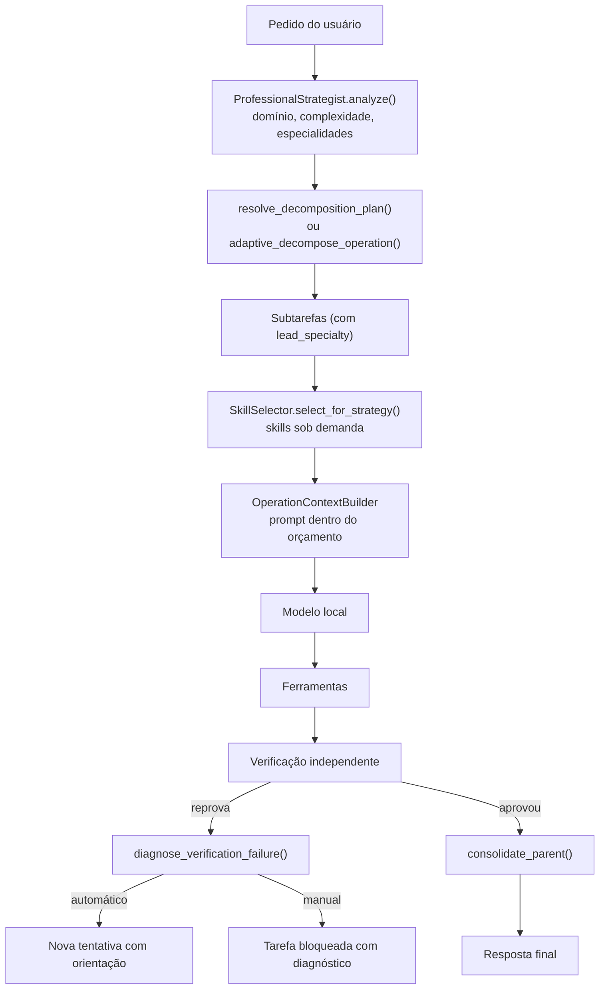
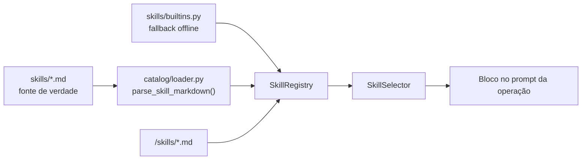

# Skills, Estratégia e Decomposição Recursiva

Voltar ao [Hub da arquitetura](/docs/architecture/README.md) · Regras: [princípios](/docs/regras/principios.md) · [validações](/docs/regras/validacoes-testes.md)

**O que é:** o conjunto de peças que faz o agente **agir como um profissional** diante de um pedido:
as **Skills** (competências reutilizáveis), a **abordagem profissional** (estratégia executável), a
**decomposição recursiva** (subdivisão adaptativa da etapa interna) e o **ciclo de recuperação** da
verificação (diagnóstico → correção → re-verificação).

**Por que:** modelos locais pequenos perdem o fio do pedido quando a estratégia mora no prompt. A
complexidade — decisão, ordem, critério de parada — precisa estar na arquitetura, com estado no SQLite.

**Quando/onde:** na raiz de cada run (a estratégia é formulada uma vez), na decomposição de cada tarefa
(as skills orientam o prompt da operação) e na verificação (a recuperação decide se há nova tentativa).
O contrato de qualidade, a disposição seletiva e o evento `work.explained` estão em
[orquestracao-qualidade.md](/docs/architecture/orquestracao-qualidade.md).

---

## Sumário

1. [Fluxo geral](#fluxo-geral)
2. [Skills](#skills)
3. [Estratégia profissional](#estratégia-profissional)
4. [Decomposição recursiva e adaptativa](#decomposição-recursiva-e-adaptativa)
5. [Integridade da execução](#integridade-da-execução)
6. [Verificação e recuperação](#verificação-e-recuperação)
7. [Orçamento de contexto](#orçamento-de-contexto)
8. [Observabilidade](#observabilidade)
9. [Configuração](#configuração)
10. [Limites conhecidos](#limites-conhecidos)

---

## Fluxo geral

| Peça | Onde | Artefato |
|------|------|----------|
| Estratégia | `src/agent/orchestrator/strategy.py` | `task.metadata_json["professional_strategy"]` |
| Catálogo de skills | `skills/*.md` + `src/agent/skills/catalog/loader.py` | `SkillSpec` |
| Seleção | `src/agent/skills/selector.py` | `SkillMatch` → bloco de prompt |
| Decomposição adaptativa | `src/agent/orchestrator/atomizer.py` | `DecompositionResult` |
| Recuperação | `src/agent/verification/recovery.py` | `task.metadata_json["verification_recovery"]` |

---

## Skills

**Skill** é uma competência reutilizável: um conjunto de critérios de ativação, proibições, procedimentos,
regras de validação, riscos, ferramentas autorizadas e palavras-chave. A ideia é que o modelo **não precise
saber de antemão** como fazer cada tipo de trabalho — a competência entra no prompt só quando é relevante.

### Contrato

| Campo | Tipo | Para quê |
|-------|------|----------|
| `id` | `str` | Identificador estável (`debugging_root_cause`) |
| `name` / `description` | `str` | Nome legível e resumo da finalidade |
| `activation_criteria` | `list[str]` | Quando a skill se aplica |
| `prohibited_criteria` | `list[str]` | Quando **não** se aplica (evita o uso errado) |
| `required_tools` | `list[str]` | Ferramentas compatíveis (sinalizações na seleção) |
| `procedures` | `list[str]` | Passos operacionais injetados no prompt |
| `validation_rules` | `list[str]` | Como comprovar que a execução foi bem-sucedida |
| `risk_factors` | `list[str]` | Riscos que a execução deve respeitar |
| `keywords` | `list[str]` | Termos que ativam a skill no texto do objetivo |
| `applies_to_kinds` | `list[str]` | Tipos de tarefa compatíveis (`MODEL_OPERATION`, `VERIFICATION`…) |

### Catálogo (fonte de verdade)

O catálogo editável fica em [`/skills/`](/skills/README.md): um arquivo `.md` por skill, com frontmatter
(`id`, `name`, `description`, `version`, `keywords`, `required_tools`, `applies_to_kinds`) e seções
Markdown (`Critérios de ativação`, `Quando não utilizar`, `Procedimentos operacionais`,
`Critérios de validação`, `Riscos`).

Precedência na descoberta (`SkillRegistry.reload()`):

1. **Skills embutidas** — `agent.skills.builtins`, sempre presentes (o pacote funciona instalado sem o repositório);
2. **Catálogo do repositório** — `skills/*.md` na raiz do projeto, que **sobrescreve** a embutida de mesmo `id`;
3. **Skills do projeto** — `<project_root>/skills/*.md`, que sobrescrevem as anteriores.

Um arquivo inválido (sem `id`, sem `name`, sem descrição ou sem procedimentos) **nunca derruba a execução**:
fica registrado em `SkillRegistry.list_invalid()` e o agente segue com o resto do catálogo.

### Seleção sob demanda

`SkillSelector.select(objective, task_kind=…, available_tools=…, max_skills=…)` pontua cada skill:

| Sinal | Peso | Motivo |
|-------|------|--------|
| Palavra-chave casa no objetivo | `+2` por termo | Relevância textual |
| Tipo da tarefa na lista | `+1,5` | Compatibilidade de fase |
| Ferramenta em comum | `+0,5` por ferramenta | Viabilidade prática |
| Critério de ativação atendido | `+1` | Regra declarada pela própria skill |
| Especialidade líder da estratégia | `+10` | Time montado pela estratégia |
| Especialidade revisora | `+5` | Segunda opinions da revisão |

O casamento usa **palavra inteira** (`api` não casa dentro de `rapido`) e os critérios de não-ativação
são avaliados antes: um pedido de leitura pura não recebe skills de escrita de código.

`select_for_strategy()` usa a estratégia como entrada e devolve o time de skills correspondente.

---

## Estratégia profissional

`ProfessionalStrategist.analyze(objective)` devolve uma `ProfessionalStrategy` com a **intenção original
preservada** (o texto do pedido nunca é reescrito) e o que o agente precisa para executá-lo:

| Campo | Conteúdo |
|-------|----------|
| `original_request` | o pedido, literal |
| `complexity` | `simple`, `moderate` ou `complex` |
| `domain` | `consultation`, `quality_assurance`, `debugging_and_root_cause`, `refactoring`, `documentation`, `software_engineering` |
| `lead_specialty` | a skill líder do time |
| `review_specialties` | as skills revisoras |
| `extracted_requirements` | requisitos explícitos do pedido |
| `assumptions` / `risks` | o que o agente supõe e o que pode dar errado |
| `acceptance_criteria` | como o resultado será julgado |
| `execution_sequence` | a ordem de execução proposta |
| `verification_strategy` | o tipo de verificação esperado |

Dois derived properties controlam o resto do fluxo:

- **`complexity_rank`** (`0` simples, `1` moderado, `2` complexo) — dimensiona a decomposição;
- **`needs_atomization`** (`rank ≥ 2`) — habilita a subdivisão recursiva da etapa interna.

A estratégia é gravada em `task.metadata_json["professional_strategy"]` da raiz da run e **herdada pelos
filhos** (`lead_specialty` e `atomize`), e é reidratável com `ProfessionalStrategy.from_dict()`.

---

## Decomposição recursiva e adaptativa

Quando a estratégia é complexa, os filhos recebem `atomize: True` — o gatilho da decomposição interna.
Nessa hora o orquestrador usa `adaptive_decompose_operation()` em vez do plano do modelo, escolhendo a
trilha pelo domínio:

| Domínio | Trilha | Etapas |
|---------|--------|--------|
| `debugging_root_cause` | depuração | reproduzir e diagnosticar → corrigir na causa raiz → verificar não-regressão |
| `refactoring_clean_code` | refatoração | inspecionar estrutura → refatorar incrementalmente → validar paridade |
| `technical_writing` | documentação | inspecionar referências → escrever → validar integridade |
| demais | engenharia | inspecionar contexto → implementar → verificar |

### Limites

| Proteção | Onde | Efeito |
|----------|------|--------|
| Profundidade | `max_tree_depth` (16) | abaixo do limite, a decomposição recursiva para em uma etapa atômica |
| Volume | `max_tasks_per_run` (400) | a árvore para de crescer |
| Ciclos | `depth_guard()` + `plan_copies_siblings()` | plano que repete título/objetivo de um ancestral vira folha |
| Auto-dependência | `apply_decomposition()` | dependência inválida ou circular é ignorada, sem quebrar o plano |

---

## Integridade da execução

### Obrigatório × opcional

Uma subtarefa marcada com `metadata.optional = true` (ou `severity = "optional"`) é **opcional**:

| Situação | Consequência |
|----------|--------------|
| Falhou (opcional) | o pai **conclui com ressalvas** (`with_caveats`, `caveats[]`, `completed_with_caveats`) |
| Falhou (obrigatório) | o pai **não conclude**; fica em `pending` para replanejamento |
| Dependência opcional falhou | a tarefa dependente **avança** (`TaskService.dependencies_satisfied`) |
| Dependência obrigatória falhou | a tarefa dependente **espera** |

### Conclusão orientada a requisitos

O aceite do run é avaliado por requisito (`requirements.py` + `global_verify.py`): cada requisito deriva
do contrato/objetivo, as tasks declaram quais cobrem (`covers`) e o run só fecha com todos os requisitos
obrigatórios em `satisfied`. Sub-tarefas opcionais que falharam entram na resposta final como ressalvas
explícitas, nunca como sucesso silencioso.

---

## Verificação e recuperação

Verificação reprovada não é fim de caminho. `diagnose_verification_failure()` classifica a causa e
`plan_recovery()` decide o próximo passo:

| Causa | Ação | Automática |
|-------|------|-----------|
| `syntax_error` | `fix_syntax` | sim |
| `test_failure` | `fix_tests` | sim |
| `missing_artifact` | `regenerate_artifact` | sim |
| `timeout` | `retry` (escopo menor) | sim |
| `missing_dependency` | `install_dependency` | não |
| `environment` | `manual_review` | não |
| `unknown` | `manual_review` | não |

O ciclo é: **diagnóstico → correção → re-verificação**. A orientação (`recovery_guidance`) entra no prompt da
próxima tentativa (`OperationContextBuilder._failures_block`) e a assinatura da falha
(`recovery_signature`) ignora números, paths e hashes — a mesma causa não vira laço diferente.

O número de recuperações é limitado por `verification_max_recoveries` (2); ao estourar, a tarefa é
**bloqueada com diagnóstico**, não reprovada em silêncio.

Verificadores disponíveis: `pytest`, `command`, `script`, `file_contains`, `syntax`, `file_exists`,
`static_analysis` (AST) e `acceptance_manual`.

---

## Orçamento de contexto

As skills entram no prompt como **componente opcional** (`prioridade 75`), entre as regras do projeto e o
contexto técnico. Como componentes opcionais, são **descartadas** — nunca quebram — quando o orçamento do
modelo aperta; o que é obrigatório (objetivo, regras globais, critérios, formato de saída) **nunca** é
cortado: se não couber, o contexto estoura com `ContextBudgetError` e a task é divided.

O bloco de skills é limitado por uma fração do orçamento de entrada do modelo (até 12%), e a quantidade de
skills por operação é configurável (`skills_max_per_operation`, padrão 2).

---

## Observabilidade

| Evento | Quando | Payload |
|--------|--------|---------|
| `strategy.formulated` | raiz da run planificada | estratégia completa |
| `skill.selected` | contexto da operação montado | `skills` (ids) |
| `decomposition.recursive` | tarefa decomposta | `depth`, `source`, `count`, `titles` |
| `work.explained` | decisão ou resultado já ocorrido | `category`, `text`, `phase` |
| `verification.recovery_planned` | verificação reprovada | `cause`, `action`, `retry` |

Todos entram no barramento em memória (ring buffer + SSE) e os duráveis vão para `event_logs`.

---

## Configuração

| Setting | Padrão | Efeito |
|---------|--------|--------|
| `skills_max_per_operation` | `2` | quantas skills entram no prompt da operação |
| `verification_max_recoveries` | `2` | quantas vezes a verificação pode ser recuperada |
| `max_tree_depth` | `16` | profundidade máxima da árvore de tarefas |
| `max_tasks_per_run` | `400` | limite de tarefas por run |

---

## Limites conhecidos

- A seleção por palavra-chave é lexical: um pedido muito indireto pode não ativar a skill ideal.
- O catálogo é lido do disco a cada `reload()`; não há cache por modification time.
- A estratégia classifica por domínios fixos — pedidos híbridos ficam no domínio mais próximo.
- A recuperação reexecuta o mesmo verificador; não há estratégia de verificação alternativa ainda.

---

## Links cruzados

- [Hub da arquitetura](/docs/architecture/README.md) · [Contexto e orçamento](/docs/architecture/context-builder.md)
- [Requisitos, verificação e progresso](/docs/architecture/requisitos-verificacao-progresso.md)
- [Execução autônoma](/docs/architecture/execucao-autonoma.md) · [Limitações](/docs/architecture/limitacoes.md)
- [Catálogo de skills](/skills/README.md) · [README do pacote de skills](/src/agent/skills/README.md)
- [Regras: princípios](/docs/regras/principios.md) · [validações e testes](/docs/regras/validacoes-testes.md)