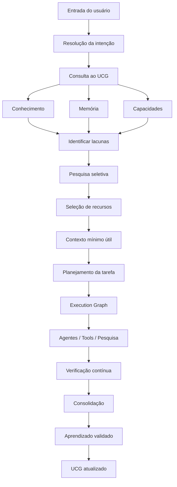

# Unified Cognitive Graph (UCG)

O Unified Cognitive Graph (UCG) é a camada de integração e consulta que conecta conhecimento, memória, capacidades, pesquisa, tarefas, agentes, decisões, execuções, qualidade e estratégias do Callidus em um único grafo tipado.

## Propósito

Evitar que o modelo redescubra o que a arquitetura já sabe. Cada etapa de uma execução recebe somente o necessário, reutilizando resultados ainda válidos e pesquisando somente lacunas reais.

## Sumário

| Documento | Finalidade | Quando consultar |
|-----------|------------|------------------|
| [auditoria.md](auditoria.md) | Inventário da arquitetura vigente, problemas e evolução proposta | Antes de modificar qualquer componente |
| [decisoes.md](decisoes.md) | Decisões arquiteturais do UCG: modelo de nó, relacionamentos, proveniência, escopo | Durante a implementação de novas fases |
| [roadmap.md](roadmap.md) | Ordem de implementação, critérios de conclusão e checkpoint por fase | Acompanhamento do progresso |

## Domínios lógicos do UCG

O UCG não corresponde a dez bancos ou dez serviços. São separações conceituais sobre as mesmas tabelas existentes (`kg_nodes`, `kg_edges`, `memory_records`, `tasks`, `evidence`, etc.):

1. **Knowledge Graph** — conhecimento geral e técnico do projeto.
2. **Memory Graph** — memórias operacionais e duráveis.
3. **Capability Graph** — skills, MCPs, ferramentas e competências.
4. **Research Graph** — fontes, descobertas, evidências e lacunas.
5. **Task Graph** — tarefas, subtarefas e dependências.
6. **Agent Graph** — agentes, especialidades, capacidades e disponibilidade.
7. **Decision Graph** — hipóteses, decisões, alternativas e evidências.
8. **Execution Graph** — operações, checkpoints, resultados e retomadas.
9. **Quality Graph** — requisitos, critérios, testes e evidências.
10. **Strategy Graph** — estratégias, desempenho histórico e aprendizado.

Os grafos compartilham referências tipadas e relações controladas. Nunca duplicam o registro de um fato sem política de sincronização explícita.

## Princípios obrigatórios

- **Não reescrever desnecessariamente:** o código vigente prevalece sobre esta especificação. O UCG é uma camada sobre os componentes existentes, não um mecanismo paralelo.
- **Armazenamento simples:** Python, SQLAlchemy, SQLite e índices relacionais. Nenhum Neo4j, Redis, Kafka ou banco vetorial sem benchmark que justifique.
- **Operações determinísticas primeiro:** consulta e índice antes de regra, regra antes de modelo de linguagem.
- **Compatível com modelos pequenos:** contexto limitado, uma inferência ativa por vez, provedor substituível, execuções interrompíveis.
- **Evolução incremental:** cada fase tem escopo, contrato, testes, critérios de conclusão e documentação.

## Fluxo cognitivo integrado



## Estado da implementação

Ver [roadmap.md](roadmap.md) para a ordem de fases e o checkpoint mais recente.

## Verificação

```bash
source .venv/bin/activate && python scripts/ci.py --rapido
python -m pytest tests/test_ucg*.py -q
```

## Links cruzados

- [Visão geral da arquitetura](../visao-geral.md)
- [Grafo de conhecimento](../knowledge-graph.md)
- [Orçamento de contexto](../orcamento-contexto.md)
- [Hub de regras](../../regras/README.md)
