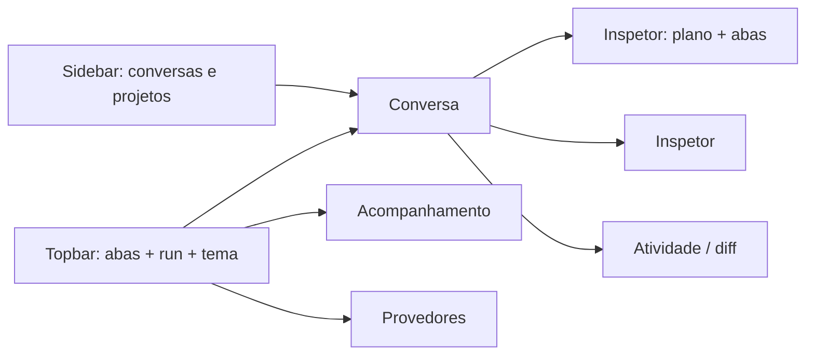

# Análise UX/UI e princípios da plataforma

Comparativo inspirado em **Cursor**, **Hermes** e IDEs agentic — adaptado ao nosso diferencial: **árvore verificável**, não chat monolítico.

Voltar: [frontend.md](/docs/architecture/frontend.md) · [visao-geral.md](/docs/architecture/visao-geral.md)

## 📚 Referências estudadas

A interface atual segue padrões que já se provaram em ferramentas de agente de código:

| Ferramenta | Padrão aproveitado |
|------------|--------------------|
| **Cursor 3** (Agents Window) | Janela centrada no agente: lista de conversas à esquerda, conversa ao centro, detalhes à direita; cor de status por agente; botão de “rolar para o fim”; paleta de comandos |
| **Google Antigravity** (Side Panel) | Barra de contexto **acima** do campo de envio (status, tarefa atual, artefatos alterados); seletor de modelo e modo no composer; lixeira para apagar conversa no painel do agente |
| **Kilo Code** (extensão VS Code) | Abas de configuração (Providers, Auto-Approve, Models) com busca; painel em abas;Gerência de sessão por item com ação direta |
| **Material 3 / HIG** | Barra inferior com 3–5 destinos na zona do polegar; alvos de toque ≥ 44 px; folha inferior no lugar de dropdown; `safe-area` |

## 🎯 O que copiamos (valor alto, baixo risco)

| Padrão (Cursor / agentes) | Nossa implementação |
|---------------------------|---------------------|
| Sidebar de workspace | Coluna **Projetos** + busca |
| Composer / pedido em NL | **Novo objetivo** → tarefa raiz (não substitui o plano) |
| Árvore de atividade | **Tarefas hierárquicas** com badge de estado |
| Painel de detalhe | **Inspetor**: objetivo, metadata, tentativas, evidências |
| Diff / alterações | Aba **Git diff** (`GET /projects/{id}/git-diff`) |
| Seleção de modelo | Seletor **provedor / modelo** no composer (provedores vêm do servidor) |
| Configuração em tela | Aba **Provedores**: criar, testar, listar modelos, definir padrão, gravar credencial |
| Paleta de comandos | `⌘K` com busca de ações (padrão Cursor/Kilo) |
| Gerência de projetos | Ajustes → Projetos: renomear, trocar pasta, **remover** (com confirmação explícita) |
| Run / stop | Iniciar · Passo · Auto · Pausar · Cancelar |
| Feed de eventos | **Atividade** legível + filtro por tarefa |
| Atalhos | `Ctrl+Enter` executar auto · `Ctrl+.` passo |

## 🎯 O que não copiamos (preserva a arquitetura)

| Funcionalidade comum | Motivo de não priorizar |
|----------------------|-------------------------|
| Chat único infinito | Desloca controle para o LLM; quebra decomposição |
| Editor de código embutido | Escopo enorme; usamos path autorizado + diff |
| Indexação semântica global | Custo RAM/tokens; grep + plano local primeiro |
| Autocomplete inline | Produto IDE, não orquestrador |

## 💡 Hierarquia visual (layout v0.6)

A interface é uma SPA **Vue 3** (`web/static/assets/app/`), sem etapa de build: o vendor do Vue é
versionado localmente e a tela funciona offline. Detalhes: [frontend.md](/docs/architecture/frontend.md).

## 🔄 Atividade ao vivo no chat

| Padrão adotado | Onde aparece |
|----------------|--------------|
| Fluxo de trabalho em tempo real (Cursor/Antigravity) | Bloco “Atividade do agente” dentro da bolha do agente |
| Diff com linhas coloridas (Antigravity) | Edição de arquivo, aberta por padrão e recolhível |
| Estado por item (running/ok/falha) | Ícone, cor e tempo de execução de cada linha |
| Resumo do que foi feito | Cabeçalho com contagens e botão recolher/abrir detalhes |
| Verbo em português | Tradução de todas as ferramentas e eventos |
| Etiquetas do plano (Kilo) | Faixa fixa acima do prompt com as tarefas em aberto |
| Rolagem que respeita a leitura | O feed acompanha só se o usuário estiver no fim |
| Diff expansível | Edição de arquivo com “ver diff” na hora, no chat e no acompanhamento |

## 💡 Regras de responsividade e movimento

| Regra | Como aparece |
|-------|--------------|
| Função essencial nunca some no celular | O painel de detalhes vira folha inferior; a barra lateral vira gaveta; navegação vai para a barra inferior |
| Zona do polegar | Ações principais (enviar, navegação) ficam na metade inferior; barra inferior com 4 destinos |
| Toque, não hover | Ações de item (apagar) ficam visíveis com `pointer: coarse`; alvos de 40–56 px |
| Movimento com propósito | Cada animação comunica mudança de tela, entrada de conteúdo ou resposta a um toque — nunca enfeite parado |
| Respeito ao sistema | `prefers-reduced-motion` desliga transições; `prefers-contrast: more` reforça bordas |
| Sem estouro de layout | Nenhuma faixa horizontal em 390 px, 768 px, 1024 px e 1440 px |

## 📊 Métricas de sucesso UX

1. Criar projeto + objetivo + ver execução **sem ler JSON bruto**.
2. Identificar bloqueio (**BLOCKED/FAILED**) em &lt; 5 s na árvore.
3. Confirmar verificação na aba **Evidências**.
4. Trocar de provedor (ou apontar para um servidor remoto) **sem editar arquivo nem reiniciar**.
5. Confirmar que a credencial nunca aparece na tela, no log ou no arquivo de configuração.
6. Concluir um pedido pelo celular sem rodar a interface de desktop.

## 🛠️ Manutenção

Código UI: [web/static/assets/app/](/web/static/assets/app/) · Endpoints: [api/](/src/agent/api/README.md)
(`/overview`, `/git-diff`, `/config/ui-defaults`) e [api/provider_routes.py](/src/agent/api/provider_routes.py)
(`/providers/config`, `/providers/{nome}/test`).