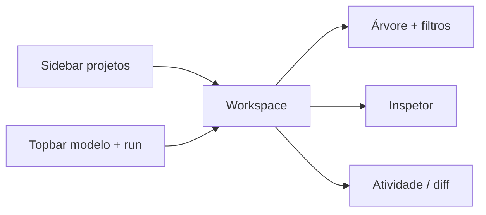

# Análise UX/UI e princípios da plataforma

{width=48}

Comparativo inspirado em **Cursor**, **Hermes** e IDEs agentic — adaptado ao nosso diferencial: **árvore verificável**, não chat monolítico.

Voltar: [frontend.md](/docs/architecture/frontend.md) · [visao-geral.md](/docs/architecture/visao-geral.md)

## O que copiamos (valor alto, baixo risco)

| Padrão (Cursor / agentes) | Nossa implementação |
|---------------------------|---------------------|
| Sidebar de workspace | Coluna **Projetos** + busca |
| Composer / pedido em NL | **Novo objetivo** → tarefa raiz (não substitui o plano) |
| Árvore de atividade | **Tarefas hierárquicas** com badge de estado |
| Painel de detalhe | **Inspetor**: objetivo, metadata, tentativas, evidências |
| Diff / alterações | Aba **Git diff** (`GET /projects/{id}/git-diff`) |
| Seleção de modelo | Barra **Ollama / modelo** persistida em `localStorage` |
| Run / stop | Iniciar · Passo · Auto · Pausar · Cancelar |
| Feed de eventos | **Atividade** legível + filtro por tarefa |
| Atalhos | `Ctrl+Enter` executar auto · `Ctrl+.` passo |

## O que não copiamos (preserva a arquitetura)

| Funcionalidade comum | Motivo de não priorizar |
|----------------------|-------------------------|
| Chat único infinito | Desloca controle para o LLM; quebra decomposição |
| Editor de código embutido | Escopo enorme; usamos path autorizado + diff |
| Indexação semântica global | Custo RAM/tokens; grep + plano local primeiro |
| Autocomplete inline | Produto IDE, não orquestrador |

## Hierarquia visual (layout v0.4)

## Métricas de sucesso UX

1. Criar projeto + objetivo + ver execução **sem ler JSON bruto**.
2. Identificar bloqueio (**BLOCKED/FAILED**) em &lt; 5 s na árvore.
3. Confirmar verificação na aba **Evidências**.
4. Demo E2E em 3 cliques (template + path fixture + executar).

## Manutenção

Código UI: [web/static/assets/](/web/static/assets/) · Endpoints: [api/main.py](/src/agent/api/main.py) (`/overview`, `/git-diff`, `/config/ui-defaults`).
