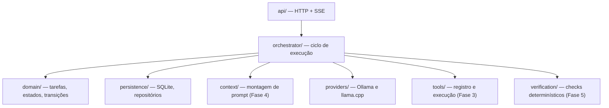

# Arquitetura — visão geral

{width=48}

Entrada: [README do repositório](/README.md) · Contexto: [project-context.md](/docs/project-context.md)

## Princípio central

A **complexidade fica na arquitetura do agente**, não na janela de contexto do modelo. O LLM é um componente substituível; o orquestrador, a persistência, a decomposição e a verificação são lógica explícita e testável.

## Stack (Fase 0–1)

| Camada | Tecnologia | Motivo |
|--------|------------|--------|
| Runtime / API | Python 3.11+, FastAPI, Uvicorn | Ecossistema maduro para SQLite, HTTP (Ollama/llama.cpp), testes |
| Persistência | SQLite + SQLAlchemy 2 | Uma máquina, retomada após reinício, sem infra extra |
| Contratos | Pydantic v2 | Validação de JSON estruturado nas fronteiras |
| Frontend (fases posteriores) | Vite + React | UI rica para árvore de tarefas e logs |
| Artefatos | `data/` (gitignored) | DB, memórias longas, evidências |

## Módulos (`src/agent/`)

## Fases de implementação

| Fase | Escopo | Status |
|------|--------|--------|
| 0 | Diagnóstico + documentação | Concluída |
| 1 | Persistência + estados + API base | Concluída |
| 2 | Provedores + tentativas + mock | Concluída |
| 3 | Ferramentas + segurança de paths | Concluída |
| 4 | Decomposição + contexto + consolidação | Concluída (LLM parcial) |
| 5 | Verificação + loops + retomada | Concluída |
| 6 | UI web estática funcional | Concluída |
| 7 | MCP stdio + visão (refs) | Concluída — ver [mcp.md](/docs/architecture/mcp.md) |
| 8 | E2E pytest | Concluída |

## Decisões (ADR resumido)

1. **Monorepo Python-first** — evita duplicar modelos de domínio entre backend e workers; frontend consome API REST/SSE.
2. **Estado canônico no SQLite** — conversa com o modelo não é fonte da verdade.
3. **Uma operação por vez por padrão** — concorrência limitada só para subtarefas independentes (fase posterior).
4. **Provedores via interface comum** — chat-completions compatível onde possível; capacidades via perfil de modelo.

## Documentos relacionados

- [Modelo de dados](/docs/architecture/modelo-dados.md)
- [Máquina de estados](/docs/architecture/maquina-estados.md)
- [Execução local](/docs/architecture/execucao-local.md)
