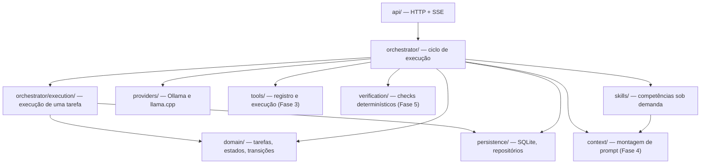

# Arquitetura — visão geral

Entrada: [README do repositório](/README.md) · Contexto: [project-context.md](/docs/project-context.md)

## 🧠 Princípio central

A **complexidade fica na arquitetura do agente**, não na janela de contexto do modelo. O LLM é um componente substituível; o orquestrador, a persistência, a decomposição e a verificação são lógica explícita e testável.

## 🎯 Stack (Fase 0–1)

| Camada | Tecnologia | Motivo |
|--------|------------|--------|
| Runtime / API | Python 3.11+, FastAPI, Uvicorn | Ecossistema maduro para SQLite, HTTP (Ollama/llama.cpp), testes |
| Persistência | SQLite + SQLAlchemy 2 | Uma máquina, retomada após reinício, sem infra extra |
| Contratos | Pydantic v2 | Validação de JSON estruturado nas fronteiras |
| Frontend (fases posteriores) | Vite + React | UI rica para árvore de tarefas e logs |
| Artefatos | `data/` (gitignored) | DB, memórias longas, evidências |

## 🏗️ Módulos (`src/agent/`)

Sistema, desktop e engenharia entram por `tools/`, com adaptadores em `system/` e `desktop/`.
O mapa dessas famílias está em [automacao-sistema.md](/docs/architecture/automacao-sistema.md).

O **`orchestrator/` decide *quando*** uma etapa roda (ciclo, planejamento, estagnação, pausa);
o **`orchestrator/execution/` decide *como*** ela roda (despacho da etapa, operação de modelo,
escrita, verificação). A separação existe porque a execução de uma tarefa é um problema
diferente do ciclo do run — e muda em ritmo diferente.

A **`api/` é uma fachada de roteadores**: `main.py` monta a aplicação e inclui os roteadores
por assunto (`system_`, `project_`, `conversation_`, `task_`, `run_`, `agent_`, `automation_`,
`provider_`, `observe_`); a apresentação de leitura fica em `presenters.py` e a visão ao vivo
em `live_view.py`. Nenhuma rota concentra regra de negócio — elas validam, delegam e serializam.

## 🎯 Fases de implementação

| Fase | Escopo | Status |
|------|--------|--------|
| 0 | Diagnóstico + documentação | Concluída |
| 1 | Persistência + estados + API base | Concluída |
| 2 | Provedores + tentativas + mock | Concluída |
| 3 | Ferramentas + segurança de paths | Concluída |
| 4 | Decomposição + contexto + consolidação | Concluída (LLM parcial) |
| 5 | Verificação + loops + retomada | Concluída |
| 6 | UI web estática funcional | Concluída |
| 7 | MCP stdio + visão (refs) | Concluída — ver [mcp.md](/docs/architecture/mcp.md) |
| 8 | E2E pytest | Concluída |
| 9 | Skills sob demanda, estratégia profissional, decomposição recursiva e recuperação da verificação | Concluída — ver [skills-estrategia.md](/docs/architecture/skills-estrategia.md) |
| 10 | Contrato de qualidade, disposição seletiva e explicação do feed | Concluída no ciclo existente — ver [orquestracao-qualidade.md](/docs/architecture/orquestracao-qualidade.md) |

## 🏗️ Decisões (ADR resumido)

1. **Monorepo Python-first** — evita duplicar modelos de domínio entre backend e workers; frontend consome API REST/SSE.
2. **Estado canônico no SQLite** — conversa com o modelo não é fonte da verdade.
3. **Uma operação por vez por padrão** — concorrência limitada só para subtarefas independentes (fase posterior).
4. **Provedores via interface comum** — chat-completions compatível onde possível; capacidades via perfil de modelo.
5. **Complexidade na arquitetura, não no prompt** — estratégia, skills e decomposição recursiva vivem em código e no SQLite; o modelo é uma peça substituível ([skills-estrategia.md](/docs/architecture/skills-estrategia.md)).
6. **Ciclo e execução em pacotes diferentes** — `orchestrator/` (quando) e `orchestrator/execution/` (como) evoluem separadamente; a verificação continua independente de quem executa.

## 📚 Documentos relacionados

- [Modelo de dados](/docs/architecture/modelo-dados.md)
- [Máquina de estados](/docs/architecture/maquina-estados.md)
- [Execução local](/docs/architecture/execucao-local.md)