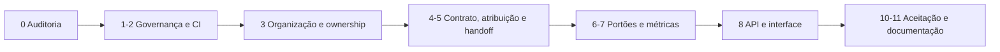

# Auditoria da transformação organizacional

Estado do Callidus antes da transformação em organização de engenharia: o que existe, o que falta e em que ordem mexer.

Voltar ao [hub de engenharia](/docs/engineering/README.md) · [Checkpoint da missão](/internal/tarefas/2026-11-03-transformacao-organizacional-callidus.md)

> **Auditado em:** 2026-11-03 · **Base:** `a43d9c3` (`main`) · cada afirmação abaixo foi conferida no código, não só nos documentos.

## 🧭 Arquitetura atual

As quatro camadas do [AGENTS.md §2](/AGENTS.md#2-camadas-e-dependências) estão de pé: domínio puro em `src/agent/domain`, aplicação em `services/` e `orchestrator/`, infraestrutura em `persistence/`, `providers/`, `tools/`, e transporte em `api/` com a SPA Vue 3 (sem build, módulos ES) em `web/static/`.

| Peça | Onde | Estado *verificado* |
|------|------|---------------------|
| Tarefas e subtarefas | `TaskModel` (`parent_id`, `kind` objetivo/subsistema/operação, `metadata_json`) | criadas pela decomposição (`orchestrator/decomposition.py`) |
| Agente lógico | `AgentModel` + `AgentService.ensure_agent` | um agente por tarefa; papel `orchestrator`/`lead`/`worker` deduzido do `kind` |
| Especialidade | `ProfessionalStrategy.lead_specialty` (`orchestrator/strategy.py`) | ids de skill (`skills/*.md`); escolhe skills, não responsável |
| Consulta entre agentes | `QueryService` | responde primeiro do persistido (`answer_from_persisted`), depois por inferência; casamento lexical |
| Execução | `InferenceExecutor` (padrão 1) + `AgentScheduler` | serializado, por eventos, sem polling de inferência |
| Contexto | `context/operation_builder.py` + `context/budget.py` | componentes com orçamento; skills, memória, contrato, arquivos-alvo |
| Verificação | `VerificationGate` → `TaskExecutor.finalize_verification` | **um** portão; evidência em `EvidenceModel` (`passed`) |
| Recuperação | `stagnation.py`, `replan.py`, `recovery_policy.py`, `global_verify.py` | reprovação vira nova tentativa; operações externas idempotentes |
| Métricas | `intelligence/analytics.py`, `metrics_service.py`, `diagnostics.py` | tokens, contexto, inferência, recursos; percentis já calculados |
| Benchmarks | `lab/avaliar.py`, `intelligence/benchmarks.py` | cenários com aceite objetivo, banco isolado |
| Interface | `web/static/assets/app/main.js` (aba Inteligência com 11 sub-visões) | sem visão de organização, responsável ou portões |

## ✅ Funcionalidades comprovadas

- Verificação independente: quem executa não aprova (`tests/test_independent_verification.py`, `tests/test_global_acceptance.py`).
- Retomada persistente e idempotente (`AgentExecutionModel.checkpoint_json`, efeitos externos marcados).
- Inferência serializada pelo executor compartilhado (`tests/test_executor*.py`).
- Portões locais em um comando: `python scripts/ci.py` roda lint, cabeçalhos, links, referências, Markdown, `resume.md`, testes da SPA, E2E com Playwright e a suíte Python.

## 🔍 Pistas revalidadas

| Pista | Veredito em 2026-11-03 |
|-------|------------------------|
| `plan/` ignorado pelo Git, mas exigido pelo `AGENTS.md` | **verdadeira** — o estado compartilhado passa a viver também em `internal/tarefas/` (versionado) |
| `gaps.md` revisado antes dos commits recentes | **verdadeira** — revisão de 2026-10-22; commits até 2026-11-02 não refletidos |
| `visao-geral.md` com stack de frontend antiga | **verdadeira** — citava "Vite + React"; a SPA é Vue 3 sem build |
| `docs/intelligence/auditoria.md` com persistência antiga | **verdadeira** — citava 14 modelos; há 36 |
| `resume.md` gigante | **verdadeira** — 685 272 caracteres; não é contexto de inferência (o `operation_builder` não o lê) |
| `services/README.md` com contagem divergente | **verdadeira** — título "15 Services", tabela com 21 linhas |
| Ruff fora das dependências de desenvolvimento | **verdadeira** — `ci.py` exige, `pyproject.toml` não declara |
| Verificação JavaScript fora do comando central | **parcial** — testes `node --test` e E2E já estão no `ci.py`; a checagem de sintaxe e importações (`scripts/check-web-syntax.js`) não estava |
| `.github/` sem workflow | **verdadeira** — só o modelo de PR |
| Hierarquia só `orchestrator`/`lead`/`worker` | **verdadeira** — a especialidade existe apenas como skill da estratégia |

## ⚠️ Lacunas e riscos

| Lacuna | Risco | Tratamento |
|--------|-------|------------|
| Nenhum responsável organizacional (equipe, papel, revisor) por tarefa | decisão de quem faz e quem revisa fica implícita | catálogo organizacional + atribuição determinística |
| Nenhum mapa de propriedade consultável | mudança em contrato compartilhado sem coordenação | `owner_of(path)` com um dono principal e regra de coordenação |
| Handoff só como `findings` soltos | o próximo agente reinvestiga | resumo estruturado gravado no agente |
| Estado do trabalho visível só como `TaskStatus` | não se vê em que portão a tarefa está | etapa organizacional **derivada** de status + evidências (sem segunda máquina de estados) |
| Métricas de entrega (lead time, aceite na primeira, retrabalho) ausentes | melhoria sem medida | indicadores com numerador e denominador explícitos |
| CI remoto ausente | regressão chega à `main` | `.github/workflows/ci.yml` com permissões mínimas |
| Trabalho de outra sessão sem commit na árvore (17 arquivos) | sobrescrever trabalho alheio | esta missão não toca esses arquivos ([AGENTS.md §18](/AGENTS.md#18-agentes-em-paralelo)) |

## 🛡️ O que é preservado

Máquina de estados de tarefa, `VerificationGate` como portão único, `InferenceExecutor` e `AgentScheduler`, `QueryService`, contratos HTTP existentes, esquema do banco (nenhuma coluna nova: a organização vive em `metadata_json`, campo já existente), `resume.md` e o `scripts/resume.py`.

## 🚫 O que não será implementado

- Agentes permanentemente ativos por papel: papéis são **atribuições** de agentes lógicos que já existem.
- Segunda máquina de estados para o Kanban: a etapa é calculada.
- Segundo verificador: os portões organizacionais **leem** as evidências do portão único.
- Inferência para decidir atribuição: a seleção é determinística e explica o porquê.
- Paralelismo de inferência.

## 🗺️ Ordem de execução

O progresso de cada fase fica no [checkpoint](/internal/tarefas/2026-11-03-transformacao-organizacional-callidus.md).
