# Modelo operacional

Como o Callidus trabalha como uma organização de engenharia sem manter agentes ociosos nem multiplicar inferências.

Voltar ao [hub de engenharia](/docs/engineering/README.md)

## 🧭 Princípio

A complexidade fica na arquitetura e no estado persistido, não no tamanho do modelo. Papéis são **atribuições** de agentes lógicos que já existem — um por tarefa, criados por `AgentService.ensure_agent` — e não processos vivos. A inferência continua serializada pelo `InferenceExecutor`.

```mermaid
flowchart LR
  P[Pedido] --> R[Requisitos no contrato da raiz]
  R --> D[Decomposição]
  D --> A["Atribuição determinística<br/>select_assignment"]
  A --> C["Contexto com responsabilidade<br/>operation_builder"]
  C --> X[Execução serializada]
  X --> V["Portão de verificação único<br/>VerificationGate"]
  V --> H["Handoff estruturado<br/>record_handoff"]
  H --> G["Portões G0–G4<br/>evaluate_gates"]
  G --> Q["Revisão independente<br/>POST /tasks/{id}/reviews"]
  Q --> M["Indicadores<br/>delivery_metrics"]
```

## 🔁 Ciclo PDCA

| Etapa | Mecanismo existente |
|-------|---------------------|
| Plan | requisitos (`orchestrator/requirements.py`), decomposição, G0 |
| Do | execução serializada, escopo de escrita (`allowed_files`), G1 |
| Check | `VerificationGate`, revisão independente, G2 e G3 |
| Act | recuperação (`replan.py`, `recovery_policy.py`), retrabalho visível na etapa `REWORK`, indicadores de entrega |

## 🧱 O que não existe de propósito

Kanban como segunda máquina de estados, segundo verificador, agente de papel sempre ativo, inferência para decidir atribuição e paralelismo de inferência. Os motivos estão na [auditoria](/docs/engineering/audit.md#-o-que-não-será-implementado).

## 📚 Documentos do modelo

[organization.md](organization.md) · [ownership.md](ownership.md) · [responsibilities.md](responsibilities.md) · [work-contract.md](work-contract.md) · [workflow.md](workflow.md) · [quality-gates.md](quality-gates.md) · [metrics.md](metrics.md) · [knowledge-management.md](knowledge-management.md) · [context-engineering.md](context-engineering.md) · [benchmarking.md](benchmarking.md) · [security-governance.md](security-governance.md)
