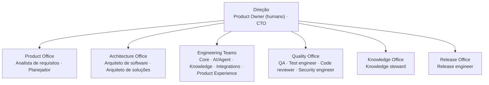

# Organograma

Escritórios, equipes e papéis do Callidus — a fonte é o catálogo em código, este documento é o mapa.

Voltar ao [hub de engenharia](/docs/engineering/README.md) · Catálogo: [organization.py](/src/agent/domain/organization.py) · API: `GET /organization`

## 🏢 Estrutura

## 👥 Equipes

| Equipe | Escritório | Missão |
|--------|------------|--------|
| Core Engineering | Engineering | domínio, serviços e persistência; o tech lead coordena entregas |
| AI/Agent Engineering | Engineering | orquestração, decomposição e operação do modelo |
| Knowledge Engineering | Engineering | contexto, memória, conhecimento e skills |
| Integrations Engineering | Engineering | provedores, ferramentas, MCP, remoto e automação |
| Product Experience | Engineering | API HTTP e interface |
| Quality Engineering | Quality | verificação, testes, segurança, avaliação e métricas |
| Knowledge Office | Knowledge | documentação normativa e técnica |
| Release Office | Release | integração, CI e publicação |

## 🧩 Papel, especialidade e hierarquia

São três dimensões independentes:

| Dimensão | Onde vive | Exemplo |
|----------|-----------|---------|
| Hierarquia | `AgentModel.role` (`orchestrator`, `lead`, `worker`) | `worker` |
| Papel | `metadata_json["assignment"]["role"]` do agente | `backend_developer` |
| Especialidades | `assignment["specialties"]`, ligadas às skills de `skills/` | `data_engineering` → skill `software_engineering` |

A hierarquia diz onde o agente está na árvore de delegação; o papel diz o que ele faz e quem o revisa. A lista completa dos papéis está em [responsibilities.md](responsibilities.md).
