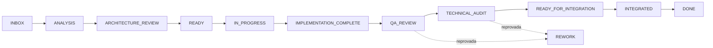

# Fluxo de trabalho

As etapas do Kanban do Callidus e como cada uma é derivada do estado real — sem segunda máquina de estados.

Voltar ao [hub de engenharia](/docs/engineering/README.md) · Código: `stage_for` em [work_flow.py](/src/agent/domain/work_flow.py) · Estados: [maquina-estados.md](/docs/architecture/maquina-estados.md)

## 🔄 Etapas

| `TaskStatus` | Etapa |
|--------------|-------|
| `PENDING` | `INBOX` (G0 não aprovado) ou `READY` |
| `PLANNING` | `ANALYSIS`, ou `ARCHITECTURE_REVIEW` quando o escopo toca área protegida |
| `READY` | `READY` |
| `RUNNING` | `IN_PROGRESS` |
| `VERIFYING` | `IMPLEMENTATION_COMPLETE` (sem evidência) ou `QA_REVIEW` |
| `RETRY_PENDING` | `REWORK` |
| `COMPLETED` | `REWORK` se G2/G3 reprovam; `TECHNICAL_AUDIT` se G3 está pendente; `READY_FOR_INTEGRATION` se G4 não passou; `INTEGRATED` (subtarefa) ou `DONE` (raiz) |
| `BLOCKED`, `FAILED`, `CANCELLED` | a etapa de mesmo nome |

O status continua sendo o da máquina de estados; a etapa é uma leitura. Uma revisão que reprova uma tarefa já `COMPLETED` não reabre o status — ela segura a etapa em `REWORK` e conta como defeito escapado nos [indicadores](metrics.md).

## 🖥️ Onde ver

Aba **Inteligência → Organização**: quadro com etapa, responsável, revisor, risco e os chips G0–G4; ao clicar numa tarefa, as verificações de cada portão, a avaliação em cinco dimensões e o formulário de revisão. Rota: `GET /projects/{id}/board`.
