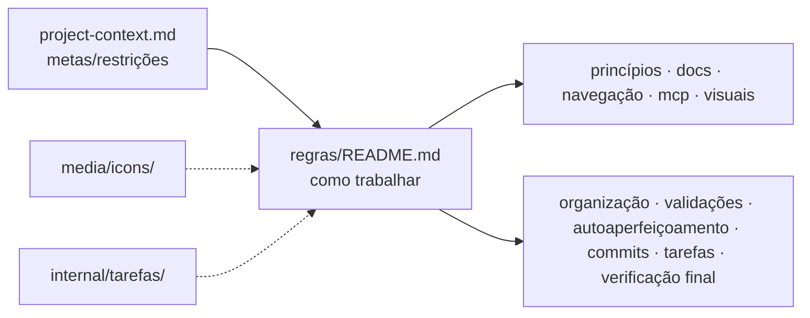

# Contexto do Projeto — Agente de IA Local

{width=48}

**Entrada de regras:** [docs/regras/README.md](/docs/regras/README.md)

Este arquivo guarda o **contexto estável** do Project: metas, restrições e ponteiros. Detalhes operacionais de “como trabalhar” vivem no hub de regras — não duplique regras aqui; **aponte** para elas.

---

## Sumário

1. [Identidade](#identidade)
2. [Metas estáveis](#metas-estáveis)
3. [Restrições](#restrições)
4. [Onde está a verdade](#onde-está-a-verdade)
5. [Estado atual e próximos passos](#estado-atual-e-próximos-passos)

---

## Identidade

| Campo | Valor |
|-------|-------|
| Nome do Project | Agente de IA Local |
| Repositório git (cópia canônica versionada) | `~/Documents/Projetos/Agente de IA Local/` |
| Cursor Context (Agent Store) | Store cloud em `~/Library/Application Support/Cursor/AgentStores/cursor_agent_stores/bc-b167c6af-15fa-4620-8790-0ffcbfc4f326/files/`; em sessões do Project, paths `/cursor/stores/self/…` apontam para esse store |
| Idioma da documentação | Português (Brasil); termos técnicos em inglês quando padrão |

### Sincronia git ↔ Context

| Fonte da verdade | Escopo |
|------------------|--------|
| **Repositório git local** | Docs, regras, media e `internal/` versionados — editar aqui e [commitar](/docs/regras/commits.md) |
| **Agent Store / Notes no Cursor** | Status efêmero (`notes.md`), preferências do coordenador; pode receber espelho manual após commits no repo |

Fluxos aceitos: (1) trabalhar no repo → commit → copiar arquivos alterados ao store se Cloud Agents ainda lerem o Context; (2) mudança só no store → trazer para o repo, alinhar links (`/docs/…`) e commitar. Detalhes na [README](/README.md) na raiz do repositório.

---

## Metas estáveis

1. **Documentar tudo** de forma hierárquica e cross-linkada, utilizável por humanos e por outros agentes.
2. Manter um **hub de regras** como ponto de entrada único para como o agente documenta e trabalha.
3. Garantir que agentes **naveguem só os ramos necessários** após ler as regras de entrada.
4. Usar **ícones, diagramas e tabelas** para acelerar compreensão; diagramas devem adaptar **light/dark**.
5. Tratar **MCP** como dependência de continuidade: ausente/quebrado → corrigir antes de seguir.
6. **Organizar** pastas/arquivos com responsabilidade clara (eficiência de tokens).
7. **Validar e testar** com dimensões aplicáveis (segurança, limites, stress, etc.).
8. **Autoaperfeiçoar** docs/regras quando a mudança impactar o futuro.
9. **Commitar** automaticamente mudanças em português quando houver repositório.
10. Manter **checklist de estado** por atividade em `internal/tarefas/`.
11. **Verificação final** antes de encerrar: consistência código ↔ docs ↔ checklists ↔ regras.

Fonte normativa: [Hub de regras](/docs/regras/README.md).

---

## Restrições

| Restrição | Detalhe |
|-----------|---------|
| Repo local é canônico para docs versionados | Commits em português após mudanças coerentes ([commits](/docs/regras/commits.md)) |
| Coordenador possui status | Não editar `notes.md` nem `preferences.md` salvo ordem explícita |
| Regras finais em `docs/` | Não deixar a fonte normativa só em `internal/` |
| Estado de tarefa em `internal/tarefas/` | Checklists operacionais, não regras |
| Secrets fora do store público | Nunca gravar tokens/credenciais em docs ou media |
| Escopo | Preferir mudanças pedidas; expandir só com autorização |

---

## Onde está a verdade

| Necessidade | Documento |
|-------------|-----------|
| Começar a trabalhar | [regras/README.md](/docs/regras/README.md) |
| Prioridades | [principios.md](/docs/regras/principios.md) |
| Escrever docs | [documentacao.md](/docs/regras/documentacao.md) |
| Como ler a árvore | [navegacao-agentes.md](/docs/regras/navegacao-agentes.md) |
| Ferramentas MCP | [mcps.md](/docs/regras/mcps.md) |
| Ícones/diagramas (tema light/dark) | [ativos-visuais.md](/docs/regras/ativos-visuais.md) |
| Pastas e nomes | [organizacao-arquivos.md](/docs/regras/organizacao-arquivos.md) |
| Testes/validações / dimensões | [validacoes-testes.md](/docs/regras/validacoes-testes.md) |
| Atualizar o próprio agente | [autoaperfeicoamento.md](/docs/regras/autoaperfeicoamento.md) |
| Commits | [commits.md](/docs/regras/commits.md) |
| Estado da atividade | [checklists-tarefas.md](/docs/regras/checklists-tarefas.md) |
| Encerrar tarefa com consistência | [verificacao-final.md](/docs/regras/verificacao-final.md) |
| Modelo de checklist | [`_modelo-checklist.md`](/internal/tarefas/_modelo-checklist.md) |

---

## Estado atual e próximos passos

**Estado:** runtime **v0.2** — orquestrador, ferramentas, verificação, UI web, E2E mock, 19 testes pytest (2026-10-17). Limitações em [limitacoes.md](/docs/architecture/limitacoes.md).

**Próximo passo sugerido:** transporte MCP stdio real; decomposição via Ollama para objetivos genéricos; UI de aprovações.

---

## Links cruzados

- [Hub de regras](/docs/regras/README.md)
- [Princípios](/docs/regras/principios.md)
- [Documentação](/docs/regras/documentacao.md)
- [Navegação](/docs/regras/navegacao-agentes.md)
- [MCPs](/docs/regras/mcps.md)
- [Ativos visuais](/docs/regras/ativos-visuais.md)
- [Organização de arquivos](/docs/regras/organizacao-arquivos.md)
- [Validações e testes](/docs/regras/validacoes-testes.md)
- [Autoaperfeiçoamento](/docs/regras/autoaperfeicoamento.md)
- [Commits](/docs/regras/commits.md)
- [Checklists de tarefas](/docs/regras/checklists-tarefas.md)
- [Verificação final](/docs/regras/verificacao-final.md)
