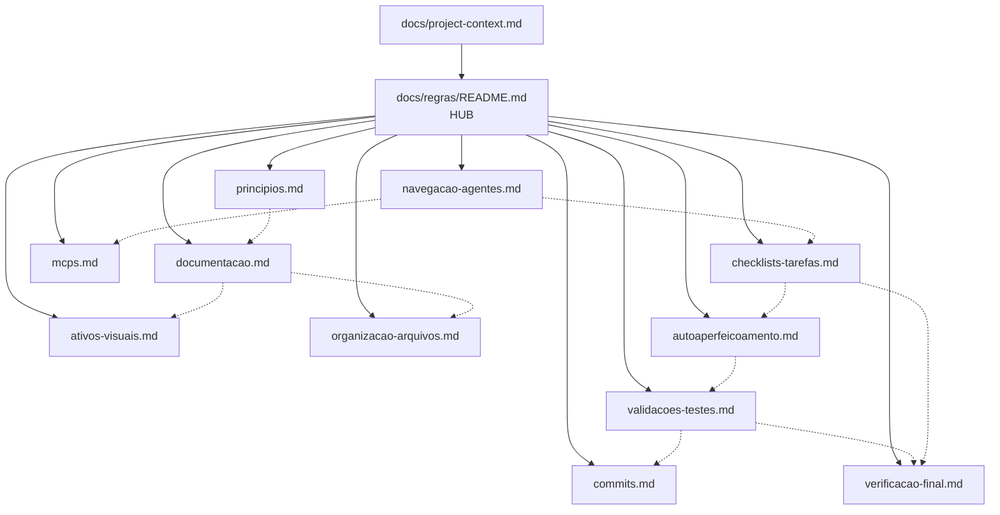
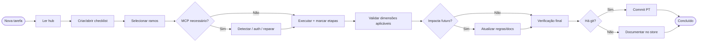

# Regras do Agente — Hub de Entrada

{width=48}

**Comece sempre aqui.** Este hub é o ponto de entrada obrigatório para humanos e agentes de IA que trabalham no Project **Agente de IA Local**.

Leia este índice, escolha apenas os ramos necessários à tarefa e siga os links. Não carregue a árvore inteira por padrão — veja [Navegação para agentes](/docs/regras/navegacao-agentes.md).

---

## Sumário (TOC)

1. [Propósito deste conjunto](#propósito-deste-conjunto)
2. [Mapa da documentação](#mapa-da-documentação)
3. [Ordem de leitura recomendada](#ordem-de-leitura-recomendada)
4. [Checklist rápido antes de qualquer tarefa](#checklist-rápido-antes-de-qualquer-tarefa)
5. [Fluxo visual](#fluxo-visual)
6. [Convenções de caminho](#convenções-de-caminho)
7. [Manutenção deste hub](#manutenção-deste-hub)

---

## Propósito deste conjunto

Estas regras definem **como** o agente deve documentar e trabalhar:

| Regra-mãe | Significado prático |
|-----------|---------------------|
| Documentar tudo | Toda decisão, fluxo e artefato relevante vira doc hierárquico e linkado |
| Navegação seletiva | Agentes leem o hub e só os ramos necessários |
| Estilo didático | Docs claros para humanos **e** IAs (exemplos, tabelas, checklists) |
| Ativos visuais | Ícones, diagramas e tabelas aceleram compreensão; diagramas adaptam light/dark |
| Continuidade MCP | MCP ausente/quebrado → obter/autenticar/reparar **antes** de seguir |
| Organização hierárquica | Pastas/arquivos com responsabilidade única e nomes claros (eficiência de tokens) |
| Validações e testes | Cobertura proporcional nas dimensões aplicáveis (segurança, limites, stress, etc.) |
| Autoaperfeiçoamento | Mudança relevante → atualizar docs/regras/checklists do próprio agente |
| Commits automáticos | Toda mudança commitada pelo agente (PT); vigora quando houver git |
| Estado da tarefa | Checklist em `internal/tarefas/` para avançar e retomar |
| Verificação final | Antes de fechar: consistência código ↔ docs ↔ checklists ↔ regras |

Contexto estável do projeto: [project-context.md](/docs/project-context.md).

---

## Mapa da documentação

| Ícone | Documento | Quando ler |
|-------|-----------|------------|
| {width=28} | [principios.md](/docs/regras/principios.md) | Sempre na primeira sessão; ao duvidar de prioridade |
| {width=28} | [documentacao.md](/docs/regras/documentacao.md) | Ao criar, editar ou reorganizar docs |
| {width=28} | [navegacao-agentes.md](/docs/regras/navegacao-agentes.md) | No início de toda tarefa (como atravessar a árvore) |
| {width=28} | [mcps.md](/docs/regras/mcps.md) | Quando a tarefa depende de MCP ou ferramentas externas |
| {width=28} | [ativos-visuais.md](/docs/regras/ativos-visuais.md) | Ao adicionar ícones, imagens, diagramas ou tabelas visuais |
| {width=28} | [organizacao-arquivos.md](/docs/regras/organizacao-arquivos.md) | Ao criar pastas, nomear arquivos ou separar temas |
| {width=28} | [readmes-pastas.md](/docs/regras/readmes-pastas.md) | Ao criar pasta de código/docs — **README.md** índice |
| {width=28} | [validacoes-testes.md](/docs/regras/validacoes-testes.md) | Ao criar/alterar qualquer artefato que precise verificação |
| {width=28} | [autoaperfeicoamento.md](/docs/regras/autoaperfeicoamento.md) | Quando a mudança influencia trabalho futuro / regras |
| {width=28} | [commits.md](/docs/regras/commits.md) | Ao fechar mudança em repo git (ou para saber o que fazer sem repo) |
| {width=28} | [checklists-tarefas.md](/docs/regras/checklists-tarefas.md) | **Toda** atividade: criar/atualizar estado e retomar |
| {width=28} | [verificacao-final.md](/docs/regras/verificacao-final.md) | **Antes de encerrar** qualquer tarefa |

Template de checklist: [`internal/tarefas/_modelo-checklist.md`](/internal/tarefas/_modelo-checklist.md).

---

## Ordem de leitura recomendada

### Primeira vez no projeto

1. [project-context.md](/docs/project-context.md) — metas e restrições
2. Este hub
3. [principios.md](/docs/regras/principios.md)
4. [navegacao-agentes.md](/docs/regras/navegacao-agentes.md)
5. [checklists-tarefas.md](/docs/regras/checklists-tarefas.md) — criar estado da atividade

### Por tipo de tarefa

| Tipo de tarefa | Ramos obrigatórios | Ramos sob demanda |
|----------------|--------------------|-------------------|
| Qualquer atividade | navegação + checklists-tarefas | verificação-final no fechamento |
| Escrever/atualizar docs | princípios + documentação | organização, ativos-visuais |
| Reorganizar pastas/nomes | organização + documentação | navegação |
| Implementar feature/código | navegação + princípios + validações | mcps, commits, documentação, verificação-final |
| Integrar ferramenta externa | navegação + mcps | documentação, validações |
| Fechar / encerrar tarefa | verificação-final + checklists-tarefas | commits, autoaperfeiçoamento |
| Fechar mudança em git | commits + validações + verificação-final | autoaperfeiçoamento |
| Mudança que afeta o futuro | autoaperfeiçoamento | hub (manutenção) |
| Revisar/manter assets | ativos-visuais (incl. tema light/dark) | documentação |

---

## Checklist rápido antes de qualquer tarefa

{width=32}

- [ ] Li o hub e identifiquei os ramos necessários
- [ ] Criei/abri checklist em [`internal/tarefas/`](/docs/regras/checklists-tarefas.md) (copiar o [modelo](/internal/tarefas/_modelo-checklist.md))
- [ ] Consultei [project-context.md](/docs/project-context.md) se a tarefa toca escopo/metas
- [ ] Verifiquei se preciso de MCP; se sim, apliquei [mcps.md](/docs/regras/mcps.md) **antes** de continuar
- [ ] Planejei onde documentar o resultado (pasta + links; ver [organizacao-arquivos.md](/docs/regras/organizacao-arquivos.md))
- [ ] Planejei validações/testes e dimensões aplicáveis ([validacoes-testes.md](/docs/regras/validacoes-testes.md))
- [ ] Diagramas/visuais: adaptação light/dark ([ativos-visuais.md](/docs/regras/ativos-visuais.md))
- [ ] Ao mudar regras/convenções: [autoaperfeicoamento.md](/docs/regras/autoaperfeicoamento.md)
- [ ] Antes de encerrar: [verificacao-final.md](/docs/regras/verificacao-final.md) (código ↔ docs ↔ checklists ↔ regras)
- [ ] Ao final: commit se houver git ([commits.md](/docs/regras/commits.md))
- [ ] Não editei `notes.md` / `preferences.md` (coordenador) salvo autorização explícita

---

## Fluxo visual

---

## Convenções de caminho

| Tipo | Raiz | Uso |
|------|------|-----|
| Docs para o usuário/agente | `/docs/` | Regras, contexto, guias |
| Mídia e ícones | `/media/` | SVG, PNG, diagramas exportados |
| Trabalho interno | `/internal/` | Evidências, rascunhos, auditorias |
| Estado de atividades | `/internal/tarefas/` | Checklists `- [ ]` / `- [x]` por tarefa |
| Status/preferências | `notes.md`, `preferences.md` | **Somente coordenador** |

Em links Markdown deste conjunto, prefira **caminhos absolutos do store** (ex.: `/docs/regras/principios.md`) para o Cursor Context resolver de forma estável.

---

## Manutenção deste hub

Quando adicionar um novo documento de regras:

1. Crie o arquivo sob `/docs/regras/`
2. Adicione linha na [tabela do mapa](#mapa-da-documentação)
3. Atualize o diagrama Mermaid se a hierarquia mudar
4. Cross-linke a partir dos irmãos relevantes
5. Atualize [ativos-visuais.md](/docs/regras/ativos-visuais.md) se houver ícone novo
6. Se a mudança for estrutural, siga [autoaperfeicoamento.md](/docs/regras/autoaperfeicoamento.md)

{width=28} **Não** publique regras finais só em `internal/` — regras vigentes moram em `docs/`.

---

## Links cruzados

- [Princípios](/docs/regras/principios.md)
- [Documentação](/docs/regras/documentacao.md)
- [Navegação para agentes](/docs/regras/navegacao-agentes.md)
- [MCPs](/docs/regras/mcps.md)
- [Ativos visuais](/docs/regras/ativos-visuais.md)
- [Organização de arquivos](/docs/regras/organizacao-arquivos.md)
- [Validações e testes](/docs/regras/validacoes-testes.md)
- [Autoaperfeiçoamento](/docs/regras/autoaperfeicoamento.md)
- [Commits](/docs/regras/commits.md)
- [Checklists de tarefas](/docs/regras/checklists-tarefas.md)
- [Verificação final](/docs/regras/verificacao-final.md)
- [Modelo de checklist](/internal/tarefas/_modelo-checklist.md)
- [Contexto do projeto](/docs/project-context.md)
