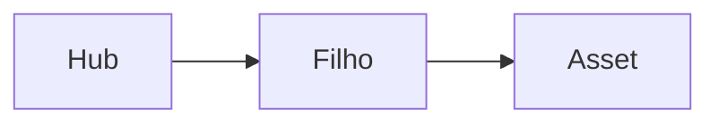

# Padrões de Ativos Visuais

Voltar ao [Hub](/docs/regras/README.md) · Documentação: [documentacao.md](/docs/regras/documentacao.md)

Ícones, imagens, diagramas e tabelas são parte do sistema de regras: aceleram leitura humana e parsing por agentes.

---

## Sumário

1. [Onde guardar](#onde-guardar)
2. [Catálogo de ícones atuais](#catálogo-de-ícones-atuais)
3. [Padrões de ícone SVG](#padrões-de-ícone-svg)
4. [Como embutir em Markdown](#como-embutir-em-markdown)
5. [Diagramas Mermaid](#diagramas-mermaid)
6. [Adaptação claro / escuro (obrigatória)](#adaptação-claro--escuro-obrigatória)
7. [Tabelas](#tabelas)
8. [Quando criar asset novo](#quando-criar-asset-novo)
9. [Checklist](#checklist)

---

## Onde guardar

| Tipo | Caminho | Formato preferido |
|------|---------|-------------------|
| Ícones de regras/guias | `/media/icons/` | SVG |
| Imagens de doc (screenshots, fotos) | `/media/` ou subpasta temática | PNG/WebP |
| Diagramas versionáveis | Mermaid **dentro** do `.md` | Mermaid |
| Export raster de diagrama (se necessário) | `/media/` | PNG |

Não coloque assets de documentação em `internal/` se forem referenciados por docs públicos.

---

## Catálogo de ícones atuais

Ícones são **marcadores pequenos de navegação** — nunca cabeçalhos. O catálogo abaixo é o
conjunto do hub de regras; ele marca as linhas da tabela de navegação.

| Arquivo | Uso |
|---------|-----|
|  `hub.svg` | Hub / índice |
|  `principios.svg` | Princípios |
|  `documentacao.svg` | Documentação |
|  `navegacao.svg` | Navegação de agentes |
|  `mcp.svg` | MCP / integrações |
|  `ativos-visuais.svg` | Ativos visuais |
|  `checklist.svg` | Checklists genéricos em docs |
|  `alerta.svg` | Avisos / anti-padrões |
|  `projeto.svg` | Contexto do projeto |
|  `organizacao.svg` | Organização de arquivos |
|  `validacoes.svg` | Validações e testes |
|  `autoaperfeicoamento.svg` | Autoaperfeiçoamento |
|  `commits.svg` | Commits automáticos |
|  `tarefas.svg` | Checklists de atividade |
|  `verificacao.svg` | Verificação final |

Caminho absoluto base: `/media/icons/`. A **categoria** de um documento ou de uma seção é
marcada por **emoji**, não por SVG — ver
[documentacao.md](/docs/regras/documentacao.md#marcadores-visuais).

---

## Padrões de ícone SVG

| Propriedade | Padrão |
|-------------|--------|
| viewBox | `0 0 64 64` |
| Cantos | `rx="12"` no fundo |
| Estilo | Forma simples, alto contraste, sem texto no SVG |
| Acessibilidade | `role="img"` + `aria-label` |
| Nome | kebab-case alinhado ao tema (`mcp.svg`) |
| Paleta | Uma cor dominante por tema (evitar roxo genérico em tudo) |

Se faltar ícone: **criar SVG local** neste diretório (não depender de URL externa quebrável).

---

## Como embutir em Markdown

**O cabeçalho de uma página não leva ícone.** A silhueta é: título, uma frase de propósito e
a volta para o hub. Ícone grande no topo pesa e rouba a atenção do que importa — o texto.

```markdown
# Título Claro

Frase de propósito: o que este documento responde e para quem.

Voltar ao [Hub](/docs/regras/README.md)
```

Onde um ícone ajuda de verdade é **dentro de uma tabela de navegação**, como marcador
discreto. O Markdown padrão não dimensiona imagem: use HTML inline (que o GitHub renderiza)
com `width` pequeno.

```markdown
|  `hub.svg` | Hub / índice |
```

**Não** use a forma `{width=20}`: o Markdown padrão não entende esse
atributo e o renderizador mostra o `{width=20}` como texto ao lado da imagem.

Aviso dentro do texto:

```markdown
 Texto do aviso.
```

Prefira caminhos absolutos do store para o Context resolver com estabilidade.

---

## Diagramas Mermaid

Use Mermaid para:

- Hierarquia de docs (flowchart)
- Protocolos passo a passo (flowchart)
- Decisões (flowchart com losango)

Evite:

- Diagramas com dezenas de nós sem agrupamento
- Substituir uma tabela simples de 3 linhas por um grafo
- Classes/cores fixas só legíveis em tema claro (ou só escuro)

Exemplo mínimo (**sem** cores hardcoded — o render usa o tema do ambiente):



---

## Adaptação claro / escuro (obrigatória)

**Regra:** diagramas devem adaptar-se ao tema do browser ou ambiente (light/dark). Vale para docs no Context **e** para qualquer UI futura do projeto.

### Preferências

| Abordagem | Uso |
|-----------|-----|
| Mermaid **sem** `style` / `classDef` com hex fixo | **Preferido** em docs — herda cores do tema do viewer |
| SVG com `currentColor`, `fill="currentColor"` | Diagramas/ícones inline em HTML/UI |
| CSS variables (`var(--fg)`, `var(--border)`) | UI React/CSS do produto |
| Duas variantes light/dark | Só se o asset for raster (PNG) e inevitável |

### Proibido / evitar

| ❌ Evitar | Por quê |
|----------|---------|
| `style Nó fill:#fff,stroke:#000` no Mermaid | Quebra no dark (ou no light) |
| Texto cinza claro em fundo branco fixo | Some em um dos temas |
| PNG de diagrama só “modo claro” como única fonte | Prefira Mermaid versionável |
| Assumir fundo branco no Context | O ambiente do usuário pode ser escuro |

### Bom vs ruim (Mermaid)

| ❌ Ruim | ✅ Bom |
|---------|--------|
| `classDef box fill:#EEF,color:#111` | Sem classDef de cor; labels claros |
| `style A fill:#ffffff,color:#333333` | `flowchart` / `sequenceDiagram` padrão |
| Seta e nó com contraste só no light | Confiar no tema do Mermaid renderer |

### SVG / UI futura

```svg
<!-- Preferir herança de cor do texto/ambiente -->
<path d="..." fill="currentColor" stroke="currentColor"/>
```

Em CSS de produto:

```css
.diagram { color: var(--foreground); }
.diagram-edge { stroke: var(--border); }
@media (prefers-color-scheme: dark) {
  /* só se variáveis do design system não cobrirem */
}
```

Ícones decorativos do catálogo (com fundo colorido próprio) são **marcações de seção**, não diagramas de fluxo — para diagramas informativos, priorize Mermaid theme-aware ou SVG com `currentColor`.

### Checklist rápido de tema

- [ ] Mermaid sem fills/strokes hex desnecessários
- [ ] SVG de diagrama usa `currentColor` ou variáveis de tema
- [ ] Não dependo de PNG light-only como única representação
- [ ] Conferido na [verificação final](/docs/regras/verificacao-final.md)

---

## Tabelas

Tabelas são o default para:

- Mapas doc ↔ quando ler
- Comparações bom vs ruim
- Caminhos e convenções
- Sintoma → ação (como em MCP)

Cabeçalhos claros; uma ideia por célula; evite células com parágrafos longos (mova para seção).

---

## Quando criar asset novo

| Situação | Ação |
|----------|------|
| Nova página de regras | Criar ícone SVG correspondente + registrar neste catálogo |
| Screenshot de UI | Salvar em `media/` e linkar com alt text |
| Fluxo complexo | Preferir Mermaid no `.md`; export PNG só se o render falhar |
| Ícone duplicado com outro nome | Reutilizar o existente |

Atualize **este** arquivo e o [hub](/docs/regras/README.md) quando o catálogo mudar.

---

## Checklist

- [ ] Asset no path correto sob `media/`
- [ ] SVG com viewBox 64×64 e aria-label (ícones)
- [ ] Link absoluto no Markdown
- [ ] Alt text descritivo
- [ ] Catálogo atualizado se for ícone novo
- [ ] Diagramas adaptam a light/dark (sem cores fixas frágeis)
- [ ] Sem secrets / dados sensíveis em imagens

---

## Links cruzados

- [Hub](/docs/regras/README.md)
- [Princípios](/docs/regras/principios.md)
- [Documentação](/docs/regras/documentacao.md)
- [Navegação](/docs/regras/navegacao-agentes.md)
- [MCPs](/docs/regras/mcps.md)
- [Organização de arquivos](/docs/regras/organizacao-arquivos.md)
- [Validações e testes](/docs/regras/validacoes-testes.md)
- [Verificação final](/docs/regras/verificacao-final.md)
- [Contexto do projeto](/docs/project-context.md)