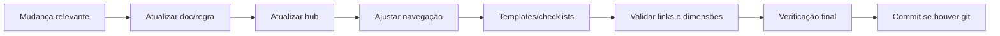

# Autoaperfeiçoamento do Agente

{width=48}

Voltar ao [Hub](/docs/regras/README.md) · Organização: [organizacao-arquivos.md](/docs/regras/organizacao-arquivos.md)

**Regra (self-increment):** em toda mudança relevante que possa influenciar o projeto como um todo ou o trabalho futuro, o agente deve **atualizar a si mesmo** — docs, regras, checklists e convenções — no mesmo ciclo da tarefa.

---

## Sumário

1. [O que conta como mudança relevante](#o-que-conta-como-mudança-relevante)
2. [O que atualizar](#o-que-atualizar)
3. [Fluxo](#fluxo)
4. [O que não fazer](#o-que-não-fazer)
5. [Bom vs ruim](#bom-vs-ruim)
6. [Checklist](#checklist)

---

## O que conta como mudança relevante

Atualize o “eu documental” do agente se a mudança:

| Gatilho | Exemplos |
|---------|----------|
| Nova forma de trabalhar | Protocolo MCP, padrão de commit, pasta de tarefas |
| Nova convenção | Nomenclatura, layout de pastas, template |
| Lição aprendida recorrente | Erro que se repetiria sem regra/checklist |
| Novo domínio estável | Guia de stack, canal Slack, política de deploy |
| Mudança que afeta outros agentes | Qualquer regra em `docs/regras/` |

**Não** é obrigatório autoaperfeiçoar por typo trivial ou ajuste local sem impacto futuro — mas se o typo revelar ambiguidade na regra, corrija a regra.

---

## O que atualizar

Ordem típica:

1. **Doc/regra canônica** sob `/docs/` (filho novo ou seção)
2. **Hub** — mapa, TOC, diagrama, checklist rápido, “quando ler”
3. **Contexto** — só se meta/restrição estável mudou ([project-context.md](/docs/project-context.md))
4. **Template/checklist** — modelo em `internal/tarefas/` ou checklists nas regras
5. **Ícones/catálogo** — [ativos-visuais.md](/docs/regras/ativos-visuais.md)
6. **Navegação** — mapa tarefa→ramos em [navegacao-agentes.md](/docs/regras/navegacao-agentes.md)

---

## Fluxo

1. Concluir a mudança pedida.
2. Perguntar: *“Um agente futuro erraria sem eu registrar isto?”* → se sim, documentar.
3. Preferir **extensão** (novo filho / nova seção) a reescrever o hub.
4. Validar links e dimensões aplicáveis ([validacoes-testes.md](/docs/regras/validacoes-testes.md)).
5. Marcar no checklist de tarefa o item “autoaperfeiçoamento”.
6. Passar pela [verificação final](/docs/regras/verificacao-final.md) (consistência com docs/regras atualizados).
7. Commit automático se houver repositório git ([commits.md](/docs/regras/commits.md)).

Não editar `notes.md` / `preferences.md` (coordenador), salvo ordem explícita.

---

## O que não fazer

| ❌ | Motivo |
|----|--------|
| Guardar regra nova só no chat | Próximo agente não vê |
| Inchar o hub com tutorial completo | Hub é mapa; detalhe vai no filho |
| Duplicar a mesma regra em 5 arquivos sem links | Uma fonte + cross-links |
| “Self-increment” de escopo não pedido (feature creep) | Só o que a mudança exige |

---

## Bom vs ruim

| ❌ Ruim | ✅ Bom |
|---------|--------|
| Descobriu pasta `tarefas/` e não documentou | Filho + hub + template |
| Mudou padrão de commit e deixou doc velho | Atualizou `commits.md` na mesma entrega |
| Copiou parágrafo inteiro para três páginas | Uma página canônica + links |

---

## Checklist

{width=32}

- [ ] Avaliei se a mudança influencia trabalho futuro
- [ ] Atualizei doc/regra canônica (e hub se necessário)
- [ ] Atualizei templates/checklists afetados
- [ ] Validei links e referências
- [ ] Passei pela [verificação final](/docs/regras/verificacao-final.md)
- [ ] Commit quando houver git

---

## Links cruzados

- [Hub](/docs/regras/README.md)
- [Organização de arquivos](/docs/regras/organizacao-arquivos.md)
- [Documentação](/docs/regras/documentacao.md)
- [Validações e testes](/docs/regras/validacoes-testes.md)
- [Verificação final](/docs/regras/verificacao-final.md)
- [Commits](/docs/regras/commits.md)
- [Checklists de tarefas](/docs/regras/checklists-tarefas.md)
- [Ativos visuais](/docs/regras/ativos-visuais.md)
- [Contexto](/docs/project-context.md)
