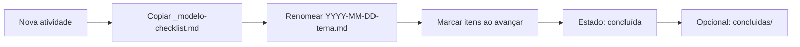

# Checklists de Atividade e Estado da Tarefa

{width=48}

Voltar ao [Hub](/docs/regras/README.md) · Template: [`_modelo-checklist.md`](/internal/tarefas/_modelo-checklist.md)

**Regra:** para **toda** atividade, criar um arquivo de checklist/estado com etapas em mini-tarefas; marcar `- [x]` ao concluir; se interrompido, o agente retoma lendo esse arquivo.

---

## Sumário

1. [Por que existe](#por-que-existe)
2. [Localização e nomenclatura](#localização-e-nomenclatura)
3. [Ciclo de vida](#ciclo-de-vida)
4. [Estrutura do arquivo](#estrutura-do-arquivo)
5. [Retomada após interrupção](#retomada-após-interrupção)
6. [Bom vs ruim](#bom-vs-ruim)
7. [Checklist desta regra](#checklist-desta-regra)

---

## Por que existe

| Problema | Solução |
|----------|---------|
| Contexto do chat some / agente troca | Estado durável no store |
| “Onde parei?” | Mini-tarefas com `[ ]` / `[x]` |
| Trabalho paralelo | Um arquivo por atividade, nome único |

Isto é **estado operacional** (vive em `internal/`), não regra normativa (regras ficam em `docs/regras/`).

---

## Localização e nomenclatura

| Item | Convenção |
|------|-----------|
| Pasta | `/internal/tarefas/` |
| Modelo reutilizável | `/internal/tarefas/_modelo-checklist.md` |
| Arquivo de atividade | `YYYY-MM-DD-kebab-resumo.md` |
| Atividade longa / multi-dia | Mesmo arquivo; atualizar “Estado” no topo |
| Concluídas (opcional) | Mover para `internal/tarefas/concluidas/` quando fizer sentido arquivar |

Exemplos de nome:

- `2026-10-17-complemento-regras-agente.md`
- `2026-10-18-setup-mcp-slack.md`



---

## Ciclo de vida

1. **Início:** copiar o [modelo](/internal/tarefas/_modelo-checklist.md) → novo arquivo na pasta.
2. **Planejar:** quebrar a atividade em mini-tarefas ordenadas (granularidade: 5–20 min de trabalho mental, não “fazer o sistema inteiro”).
3. **Executar:** ao terminar um item, marcar `- [x]` **na hora**.
4. **Bloqueio:** registrar em “Bloqueios” com o que falta do usuário/coordenador.
5. **Verificação final:** percorrer [verificacao-final.md](/docs/regras/verificacao-final.md) (código ↔ docs ↔ checklists ↔ regras) **antes** de marcar `concluída`.
6. **Autoaperfeiçoamento:** se a tarefa mudou regras, seguir [autoaperfeicoamento.md](/docs/regras/autoaperfeicoamento.md).
7. **Fim:** estado `concluída`; listar artefatos (paths absolutos); commit se houver git.

---

## Estrutura do arquivo

Campos mínimos (já no modelo):

- Metadados: título, estado (`em andamento` / `bloqueada` / `concluída`), data, links para docs de regra usados
- Objetivo em 1–3 frases
- Checklist de etapas com `- [ ]` / `- [x]`
- Bloqueios
- Artefatos produzidos
- Próxima ação (uma linha — crucial para retomada)

Use subtarefas aninhadas só quando ajudar:

```markdown
- [ ] Preparar docs
  - [x] Criar ícones
  - [ ] Atualizar hub
```

---

## Retomada após interrupção

Algoritmo do agente:

1. Listar `/internal/tarefas/*.md` (exceto `_modelo-checklist.md` e, se existir, `concluidas/`).
2. Abrir a mais recente com estado ≠ `concluída` **ou** a citada na atribuição.
3. Ler “Próxima ação” + primeiro `- [ ]` restante.
4. Revalidar o último `- [x]` se a interrupção foi no meio de um passo arriscado.
5. Continuar; não recomeçar do zero sem motivo.

---

## Bom vs ruim

| ❌ Ruim | ✅ Bom |
|---------|--------|
| Checklist só no chat | Arquivo em `internal/tarefas/` |
| Um item: “Fazer tudo” | Mini-tarefas verificáveis |
| Marcar tudo no final | Marcar ao concluir cada etapa |
| Sem “próxima ação” | Uma linha explícita de retomada |

---

## Checklist desta regra

{width=32}

- [ ] Criei arquivo a partir do modelo no path correto
- [ ] Etapas são mini-tarefas marcáveis
- [ ] Atualizo `[x]` continuamente
- [ ] Mantive “Próxima ação” atualizada
- [ ] Antes de `concluída`: [verificação final](/docs/regras/verificacao-final.md)
- [ ] Ao concluir: estado + artefatos + commit se aplicável

---

## Links cruzados

- [Hub](/docs/regras/README.md)
- [Modelo de checklist](/internal/tarefas/_modelo-checklist.md)
- [Organização de arquivos](/docs/regras/organizacao-arquivos.md)
- [Validações e testes](/docs/regras/validacoes-testes.md)
- [Verificação final](/docs/regras/verificacao-final.md)
- [Autoaperfeiçoamento](/docs/regras/autoaperfeicoamento.md)
- [Commits](/docs/regras/commits.md)
- [Navegação](/docs/regras/navegacao-agentes.md)
- [Contexto](/docs/project-context.md)
