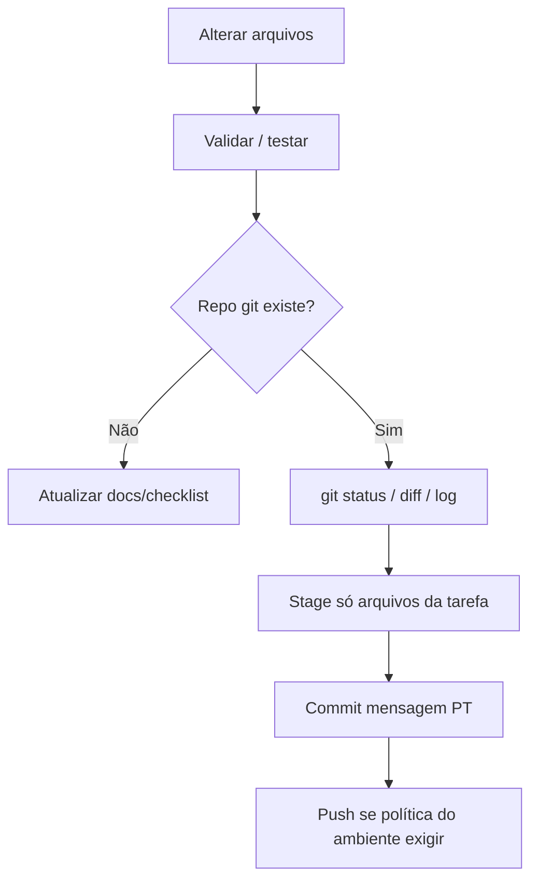

# Commits Automáticos

{width=48}

Voltar ao [Hub](/docs/regras/README.md) · Validações: [validacoes-testes.md](/docs/regras/validacoes-testes.md)

**Regra:** toda mudança que o agente fizer deve ser **commitada automaticamente pelo agente**, com mensagem em **português**, clara e descritiva — e **publicada (`git push`) na branch atual** assim que as validações passarem.

{width=28} O repositório canônico está em `~/Documents/Projetos/Callidus/`. Se a sessão alterar **apenas** o Agent Store (Context), espelhe no repo e commit antes de encerrar. Sem `.git` acessível na árvore editada, registre no checklist e não invente repo ad hoc.

---

## Sumário

1. [Quando se aplica](#quando-se-aplica)
2. [Protocolo do agente](#protocolo-do-agente)
3. [Mensagens em português](#mensagens-em-português)
4. [O que incluir / excluir](#o-que-incluir--excluir)
5. [Bom vs ruim](#bom-vs-ruim)
6. [Checklist](#checklist)

---

## Quando se aplica

| Situação | Ação |
|----------|------|
| Há `.git` / remote e a tarefa altera arquivos do repo | Commit + **push** na branch atual após mudança coerente e validações verdes |
| Só há Agent Store (Context), sem acesso ao repo local | Documentar + checklist; espelhar no repo na primeira oportunidade |
| Usuário/coordenador dispensar commit naquela vez | Respeitar a dispensa e anotar no checklist |
| Preferência do Project “Publicar ao concluir” | Commit (+ push conforme regra do Project) ao concluir |

---

## Protocolo do agente



1. Concluir um pedaço coerente (ou a tarefa).
2. Rodar validações mínimas ([validacoes-testes.md](/docs/regras/validacoes-testes.md)).
3. Se houver git: `status`, `diff`, `log` recente → stage **somente** arquivos da tarefa.
4. Commit com HEREDOC; mensagem em português.
5. Não alterar `git config`; não usar `--force`, `--no-verify`, `--no-gpg-sign`; não amend de commit já enviado.
6. `git push -u origin <branch>` (retry com backoff em falha de rede): o push é parte do ciclo, não um extra — só é dispensado se o usuário pedir ou se não houver remote configurado.

Quando o trabalho for **só no store** e o Project ganhar repo depois, os mesmos artefatos devem ser versionados na primeira oportunidade sob a política do repo.

---

## Mensagens em português

Formato sugerido:

```text
<resumo imperativo em uma linha>

<corpo opcional: por quê / escopo / notas>
```

| Elemento | Guia |
|----------|------|
| Assunto | Verbo no infinitivo ou imperativo: “Adiciona…”, “Corrige…”, “Documenta…” |
| Clareza | Diz **o quê** mudou; evita “wip”, “fix”, “updates” |
| Escopo | Mencionar área: regras, MCP, testes, etc. |

Exemplos:

- `Documenta regra de commits automáticos e atualiza o hub`
- `Adiciona template de checklist em internal/tarefas`
- `Corrige links quebrados em docs/regras`

---

## O que incluir / excluir

| Incluir | Excluir |
|---------|---------|
| Arquivos da tarefa | Mudanças alheias já sujas na árvore |
| Testes/docs da mesma mudança | Secrets, `.env`, credenciais |
| Ícones referenciados pelos docs novos | `notes.md` / `preferences.md` (coordenador) |

---

## Bom vs ruim

| ❌ Ruim | ✅ Bom |
|---------|--------|
| Esquecer de commitar e só avisar no chat | Commit ao fechar o ciclo da mudança |
| `update files` | `Documenta organização de pastas estilo SOLID` |
| Um commit misturando 4 tarefas | Commits por unidade coerente (ou um commit bem descrito se atômico) |
| Criar repo vazio só para “cumprir a regra” | Aplicar quando git existir |

---

## Checklist

{width=32}

- [ ] Validações da mudança passaram
- [ ] Confirmei se há repositório git
- [ ] Se sim: stage só do escopo + commit em português
- [ ] Se não: documentei no store e no checklist de tarefa
- [ ] Nenhum secret no commit
- [ ] Push feito na branch atual (quando há remote)

---

## Links cruzados

- [Hub](/docs/regras/README.md)
- [Validações e testes](/docs/regras/validacoes-testes.md)
- [Autoaperfeiçoamento](/docs/regras/autoaperfeicoamento.md)
- [Checklists de tarefas](/docs/regras/checklists-tarefas.md)
- [Contexto](/docs/project-context.md)
