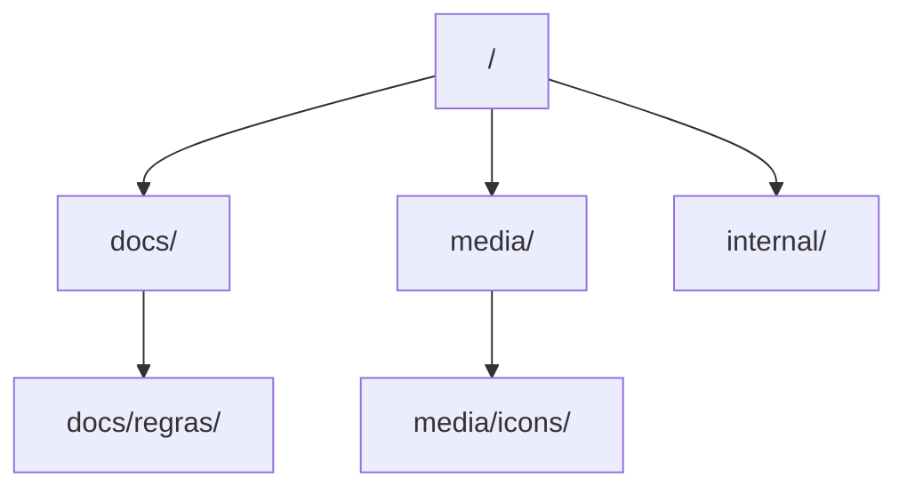
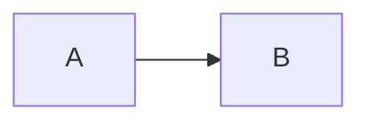

# Como Escrever e Manter Documentação Hierárquica

{width=48}

Voltar ao [Hub](/docs/regras/README.md) · Princípios: [principios.md](/docs/regras/principios.md) · Visuais: [ativos-visuais.md](/docs/regras/ativos-visuais.md)

Este guia é o contrato de **forma**: nomes, pastas, templates, links e quando enriquecer com visuais.

---

## Sumário

1. [Princípio: a documentação faz parte da implementação](#princípio-a-documentação-faz-parte-da-implementação)
2. [Taxonomia de pastas](#taxonomia-de-pastas)
3. [Nomenclatura](#nomenclatura)
4. [Estrutura de uma página](#estrutura-de-uma-página)
5. [Marcadores visuais](#marcadores-visuais)
6. [Regras de linking](#regras-de-linking)
7. [Precisão factual](#precisão-factual)
8. [Responsabilidade por documento](#responsabilidade-por-documento)
9. [Quando usar ícones, diagramas e tabelas](#quando-usar-ícones-diagramas-e-tabelas)
10. [Bom vs ruim](#bom-vs-ruim)
11. [Checklist de publicação](#checklist-de-publicação)
12. [Verificação automatizada](#verificação-automatizada)

---

## Princípio: a documentação faz parte da implementação

Toda alteração de código — implementação, correção, remoção, renomeação ou reorganização —
**inclui a atualização documental correspondente**. Documentação desatualizada não é dívida
menor: ela faz o próximo agente (e a próxima pessoa) tomar decisões sobre um sistema que
já não existe.

Antes de encerrar a tarefa, o agente responde a quatro perguntas:

| Pergunta | Se a resposta mudou, então… |
|----------|----------------------------|
| Algum documento ficou **factualmente errado**? | Corrija no mesmo commit. |
| Algum **índice, diagrama ou link** ficou obsoleto? | Atualize no mesmo commit. |
| Surge **funcionalidade ou contrato novo** relevante? | Registre onde o leitor vai procurar. |
| O que foi **removido**? | Some a referência obsoleta; preserve o histórico no ADR ou no `resume.md`, se ainda tiver valor. |

A revisão documental é critério de **conclusão**, junto com a validação técnica: a tarefa só
está pronta quando a implementação, os testes, os índices, os diagramas e as regras estão
coerentes.

**Atualização proporcional ao impacto** — não é reescrever tudo a cada alteração:

| O que mudou | O que atualizar |
|-------------|-----------------|
| Detalhe interno sem efeito em contrato | README do módulo e os testes documentados |
| Funcionalidade nova | README do módulo, índice, diagrama pertinente e instruções de uso |
| Endpoint alterado | Referência da API, exemplos, testes e documentos que o descrevem |
| Mudança arquitetural | Visão geral, documento de arquitetura, diagramas, ADRs e regras dos agentes |
| Módulo removido | Referências operacionais, navegação e índices (preservando o histórico útil) |

---

## Taxonomia de pastas



| Pasta | Conteúdo permitido | Conteúdo proibido |
|-------|--------------------|-------------------|
| `docs/` | Regras, guias, contexto, entregáveis estáveis | Rascunhos descartáveis, dumps de log |
| `docs/regras/` | Sistema de regras do agente | Features de produto não relacionadas a regras |
| `media/` | Ícones, imagens, exports de diagrama | Segredos, binários de build |
| `media/icons/` | SVG (preferencial) e PNG de ícone | Screenshots grandes |
| `internal/` | Evidências, auditorias, notas de trabalho | **Regras finais vigentes** |

Crie subpastas descritivas em kebab-case **somente** quando houver vários docs relacionados (não uma pasta para um único arquivo).

**Runtime e código:** toda pasta de módulos/scripts/testes deve ter `README.md` conforme [readmes-pastas.md](/docs/regras/readmes-pastas.md).

---

## Nomenclatura

| Elemento | Regra | Exemplo |
|----------|-------|---------|
| Arquivos | kebab-case, português quando for conceito do projeto | `navegacao-agentes.md` |
| Pastas | kebab-case, plural ou tema | `regras/`, `icons/` |
| Títulos H1 | Uma linha, substantivo claro | `# Continuidade de MCP` |
| Âncoras | Geradas pelo Markdown; evite títulos duplicados | — |
| Ícones | Mesmo stem do tema | `mcp.svg` ↔ `mcps.md` |
| Números e contagens | Verificados no código no momento da escrita | "22 tabelas" |

Evite: `README2.md`, `novo.md`, `doc_final_v3.md`, espaços e acentos em **nomes de arquivo**.

---

## Estrutura de uma página

A estrutura serve ao conteúdo: um documento pequeno não precisa de sumário, checklist e
diagrama. O padrão para documentos com mais de uma tela:

````markdown
# Título Claro

{width=48}

Voltar ao [Hub](/docs/regras/README.md) · Princípios: [principios.md](/docs/regras/principios.md)

Frase de propósito: o que este documento responde e para quem.

## Sumário

1. [Seção A](#seção-a)
2. [Seção B](#seção-b)

## Seção A

Texto didático + tabela se houver comparação.

## Seção B



## Limitações

O que este documento **não** cobre (quando houver).

## Links cruzados

- [Hub](/docs/regras/README.md)
- [Princípios](/docs/regras/principios.md)
````

Regras de estrutura:

- **H1 único** e específico; **H2** para as seções de primeiro nível, **H3** para subseções.
- **Sumário** apenas quando o documento tem 4+ seções ou mais de ~120 linhas.
- **Sem salto de nível**: H1 → H2 → H3, sempre.
- **Sem seções vazias** e sem títulos vagos ("Misc", "Diversos").
- Bloco de código sempre com **linguagem** (`python`, `bash`, `json`, `text`, `mermaid`).
- Tabela para **comparações e matrizes**; lista para **sequências e ações**.
- Fim do documento: **Limitações** (quando houver) e **Links cruzados**.

---

## Marcadores visuais

O projeto usa **dois** recursos, com significados fixos:

| Recurso | Onde | Significado |
|---------|------|-------------|
| **Ícone SVG** (`/media/icons/`) | Topo da página (48px) e no índice (24px) | **Identidade do documento** — a categoria do conteúdo |
| **Emoji** no título da seção | Seções de nível 2 | **Categoria da seção** — o mesmo emoji significa sempre a mesma coisa |

Categorias e seus marcadores:

| Categoria | Emoji | Ícone SVG |
|-----------|-------|-----------|
| Objetivo e propósito | 🎯 | `objetivo.svg` |
| Conceitos e fundamentos | 🧠 | `conceitos.svg` |
| Arquitetura e estrutura | 🏗️ | `arquitetura.svg` |
| Configuração e funcionamento | ⚙️ | `configuracao.svg` |
| Fluxos e processos | 🔄 | `fluxos.svg` |
| Integrações e dependências | 🔌 | `integracoes.svg` |
| Testes e validação | 🧪 | `testes.svg` |
| Segurança e permissões | 🔐 | `seguranca.svg` |
| Arquivos e diretórios | 📁 | `arquivos.svg` |
| Métricas e observabilidade | 📊 | `metricas.svg` |
| Restrições, riscos e cuidados | ⚠️ | `restricoes.svg` |
| Exemplos e recomendações | 💡 | `exemplos.svg` |
| Referências e materiais | 📚 | `referencias.svg` |
| Desenvolvimento e manutenção | 🛠️ | `desenvolvimento.svg` |
| Navegação e leitura | 🗺️ | `leitura.svg` |

Regras de uso:

- **Um emoji por seção**, no início do título — nunca em cada linha de uma lista.
- **Documento com sumário de âncoras**: deixe o texto do título **sem emoji**, porque a
  âncora é gerada a partir do texto e o emoji a torna frágil. Use o ícone SVG no topo
  para a identidade do documento.
- Ícones SVG do **hub de regras** (`hub.svg`, `principios.svg`, `documentacao.svg`,
  `navegacao.svg`, `mcps.svg`, `ativos-visuais.svg`, `checklist.svg`, `alerta.svg`,
  `projeto.svg`, `organizacao.svg`, `validacoes.svg`, `autoaperfeicoamento.svg`,
  `commits.svg`, `tarefas.svg`, `verificacao.svg`) seguem o mesmo estilo e são a
  identidade do conjunto de regras.
- Ícone **novo** → SVG local em `/media/icons/`, no padrão do catálogo
  ([ativos-visuais.md](/docs/regras/ativos-visuais.md)), com `role="img"` e `aria-label`
  em português.
- **Não** use emoji como substituto de palavra: "## ⚠️ Limitações" é claro,
  "⚠️" sozinho no meio do texto não é.

---

## Regras de linking

1. **Preferir caminho absoluto do store** em links internos:
   - Bom: `[Hub](/docs/regras/README.md)`
   - Aceitável relativo curto entre irmãos: `[principios](./principios.md)` — mas absolutos são padrão deste conjunto
2. Toda página filha aponta de volta ao **hub** e, se útil, ao **contexto**.
3. O hub lista **todos** os filhos de regras.
4. Irmãos cross-linkam quando há dependência (ex.: documentação ↔ ativos-visuais).
5. Ao mover/renomear: atualizar todos os links do conjunto na mesma mudança.

### Verificação mínima de links

Antes de considerar a tarefa de docs concluída:

- [ ] Cada arquivo novo existe no caminho linkado
- [ ] Nenhum link relativo quebrado dentro do conjunto
- [ ] Ícones referenciados existem em `media/icons/`

Ferramentas: `scripts/check_docs.py` (links e âncoras), `scripts/check_references.py`
(arquivos e símbolos citados), `scripts/check_markdown.py` (estrutura). Ver
[Verificação automatizada](#verificação-automatizada).

---

## Precisão factual

Documento que descreve o sistema errado é pior que documento ausente: ele é consultado e
confiado.

| Regra | Como cumprir |
|-------|--------------|
| **Números** (tabelas, ferramentas, rotas, módulos) | Verificar no código no momento da escrita |
| **Nomes de arquivo, função e endpoint** | Conferir com busca no código antes de citar |
| **Comandos e flags** | Executar ou ler a implementação do comando |
| **Comportamento** | Preferir o código e os testes como fonte; a doc explica, não substitui |
| **Plano futuro** | Marcar como planejado — nunca apresentar como implementado |
| **Divergência entre código e documento** | Decidir explicitamente: corrigir o documento (o código está certo) ou registrar a divergência e corrigir o código, com justificativa |

"Em breve", "talvez" e "será implementado" só entram em documentos de **roadmap** — nunca
como afirmação sobre o que o software faz hoje.

---

## Responsabilidade por documento

Cada explicação completa tem **um** dono. Quando ela já existe, o outro documento usa um
**link contextual** e um resumo de uma linha.

| Tipo de documento | Responde a | Não deve |
|-------------------|------------|----------|
| README da raiz | O que é, como rodar, para onde ir | Ser a enciclopédia do projeto |
| Índice (`docs/README.md`, hub de regras) | Onde está cada assunto | Repetir o conteúdo dos documentos |
| Arquitetura | Componentes, fronteiras, relações, decisões | Detalhar implementação linha a linha |
| README de módulo | Responsabilidade, arquivos, fluxo, contratos, testes, extensão | Descrever módulos vizinhos |
| Referência técnica (endpoints, campos, modelos) | Consulta precisa: nomes, tipos, formatos | Ensinar conceitos |
| Comentário no código | Contrato e decisão local | Substituir a documentação de uso |
| Regras do agente | Como executar, alterar, validar e manter | Descrever o produto |

Regra prática: se a mesma explicação aparece em dois arquivos, **um dos dois está
errado** — ou a duplicação é intencional e curta (uma linha de contexto + link).

---

## Quando usar ícones, diagramas e tabelas

| Recurso | Use quando | Evite quando |
|---------|------------|--------------|
| Ícone no topo | Página de regras ou guia estável | Nota interna de 5 linhas |
| Tabela | Comparações, caminhos, matrizes | Uma única frase |
| Mermaid | Fluxos, decisões, hierarquia | Diagrama mais confuso que a lista |
| Imagem/screenshot | UI real, prova visual | Decoração sem informação |
| Checklist | Passos que o agente deve executar | Texto narrativo sem ação |

Padrões detalhados: [ativos-visuais.md](/docs/regras/ativos-visuais.md).

---

## Bom vs ruim

### Estrutura

| ❌ Ruim | ✅ Bom |
|---------|--------|
| Um único `docs/tudo.md` gigante | Hub + filhos temáticos |
| Informação só no título do PR/chat | Página versionável no store |
| Links `../outro/arquivo.md` frágeis sem verificação | Absolutos do store + checklist de links |

### Conteúdo

| ❌ Ruim | ✅ Bom |
|---------|--------|
| “Configure o MCP direito” | Passos numerados + sintomas + links |
| Jargão sem definição | Termo técnico + uma linha de significado |
| Sem exemplos | Bloco bom vs ruim |

### Idioma

- Português (Brasil) para prosa.
- Termos técnicos estáveis em inglês quando forem padrão da indústria (`MCP`, `OAuth`, `SVG`, `Mermaid`, `kebab-case`).

---

## Checklist de publicação

{width=32}

- [ ] Arquivo no lugar certo (`docs/` vs `internal/` vs `media/`)
- [ ] Nome kebab-case
- [ ] H1 único + TOC se necessário
- [ ] Ícone de categoria no topo (se página de regras/guia)
- [ ] Emoji de categoria nas seções de nível 2 (quando não houver âncoras)
- [ ] Link de volta ao hub
- [ ] Entrada no mapa do hub (se for regra nova)
- [ ] Cross-links para irmãos relevantes
- [ ] Exemplos e/ou checklist
- [ ] Números, nomes e comandos verificados no código
- [ ] Links e assets verificados

---

## Verificação automatizada

Verificações leves, reproduzíveis e sem infraestrutura nova:

| Comando | O que garante |
|---------|----------------|
| `python scripts/check_docs.py` | Nenhum link interno ou âncora quebrada |
| `python scripts/check_references.py` | Nenhum arquivo ou símbolo citado que não exista |
| `python scripts/check_markdown.py` | Estrutura: H1, hierarquia, tabelas, blocos de código, diagramas |
| `python scripts/check_code_drift.py` | Nenhuma edição "de documentação" alterou o código |

Rode as três primeiras ao mexer em documentação. A quarta acompanha alterações de código.

O que **não** é automatizável (verifique com olho humano): se a explicação está correta,
se o exemplo funciona, se o diagrama representa o fluxo real e se o documento responde à
pergunta que o leitor traga.

---

## Links cruzados

- [Hub](/docs/regras/README.md)
- [Princípios](/docs/regras/principios.md)
- [Navegação](/docs/regras/navegacao-agentes.md)
- [MCPs](/docs/regras/mcps.md)
- [Ativos visuais](/docs/regras/ativos-visuais.md)
- [Organização de arquivos](/docs/regras/organizacao-arquivos.md)
- [Autoaperfeiçoamento](/docs/regras/autoaperfeicoamento.md)
- [Contexto do projeto](/docs/project-context.md)
