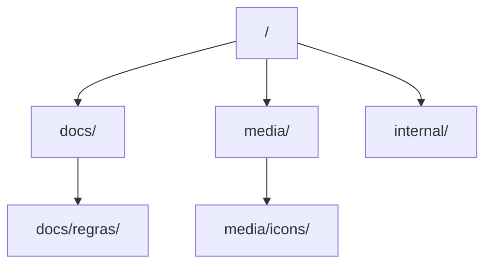
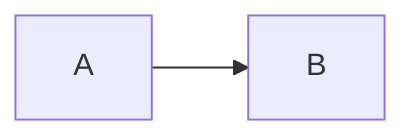

# Como Escrever e Manter Documentação Hierárquica

{width=48}

Voltar ao [Hub](/docs/regras/README.md) · Princípios: [principios.md](/docs/regras/principios.md) · Visuais: [ativos-visuais.md](/docs/regras/ativos-visuais.md)

Este guia é o contrato de **forma**: nomes, pastas, templates, links e quando enriquecer com visuais.

---

## Sumário

1. [Taxonomia de pastas](#taxonomia-de-pastas)
2. [Nomenclatura](#nomenclatura)
3. [Regras de linking](#regras-de-linking)
4. [Template de página](#template-de-página)
5. [Quando usar ícones, diagramas e tabelas](#quando-usar-ícones-diagramas-e-tabelas)
6. [Bom vs ruim](#bom-vs-ruim)
7. [Checklist de publicação](#checklist-de-publicação)

---

## Taxonomia de pastas



| Pasta | Conteúdo permitido | Conteúdo proibido |
|-------|--------------------|-------------------|
| `docs/` | Regras, guias, contexto, entregáveis estáveis | Rascunhos descartáveis, dumps de log |
| `docs/regras/` | Sistema de regras do agente | Features de produto não relacionadas a regras |
| `media/` | Ícones, imagens, exports de diagrama | Segredos, binários de build |
| `media/icons/` | SVG (preferencial) e PNG de ícone | Screenshots grandes |
| `internal/` | Evidências, auditorias, notas de trabalho | **Regras finais vigentes** |

Crie subpastas descritivas em kebab-case **somente** quando houver vários docs relacionados (não uma pasta para um único arquivo).

**Runtime e código:** toda pasta de módulos/scripts/testes deve ter `README.md` conforme [readmes-pastas.md](/docs/regras/readmes-pastas.md).

---

## Nomenclatura

| Elemento | Regra | Exemplo |
|----------|-------|---------|
| Arquivos | kebab-case, português quando for conceito do projeto | `navegacao-agentes.md` |
| Pastas | kebab-case, plural ou tema | `regras/`, `icons/` |
| Títulos H1 | Uma linha, substantivo claro | `# Continuidade de MCP` |
| Âncoras | Geradas pelo Markdown; evite títulos duplicados | — |
| Ícones | Mesmo stem do tema | `mcp.svg` ↔ `mcps.md` |

Evite: `README2.md`, `novo.md`, `doc_final_v3.md`, espaços e acentos em **nomes de arquivo**.

---

## Regras de linking

1. **Preferir caminho absoluto do store** em links internos:
   - Bom: `[Hub](/docs/regras/README.md)`
   - Aceitável relativo curto entre irmãos: `[principios](./principios.md)` — mas absolutos são padrão deste conjunto
2. Toda página filha aponta de volta ao **hub** e, se útil, ao **contexto**.
3. O hub lista **todos** os filhos de regras.
4. Irmãos cross-linkam quando há dependência (ex.: documentação ↔ ativos-visuais).
5. Ao mover/renomear: atualizar todos os links do conjunto na mesma mudança.

### Verificação mínima de links

Antes de considerar a tarefa de docs concluída:

- [ ] Cada arquivo novo existe no caminho linkado
- [ ] Nenhum link relativo quebrado dentro do conjunto
- [ ] Ícones referenciados existem em `media/icons/`

---

## Template de página

Copie e adapte:

```markdown
# Título Claro

{width=48}

Voltar ao [Hub](/docs/regras/README.md)

## Sumário

1. [Seção A](#seção-a)
2. [Seção B](#seção-b)

## Seção A

Texto didático + tabela se houver comparação.

## Seção B



## Checklist

- [ ] Item acionável

## Links cruzados

- [Hub](/docs/regras/README.md)
- [Princípios](/docs/regras/principios.md)
```

Para hubs/índices, inclua **mapa em tabela** + diagrama da árvore.

---

## Quando usar ícones, diagramas e tabelas

| Recurso | Use quando | Evite quando |
|---------|------------|--------------|
| Ícone no topo | Página de regras ou guia estável | Nota interna de 5 linhas |
| Tabela | Comparações, caminhos, matrizes | Uma única frase |
| Mermaid | Fluxos, decisões, hierarquia | Diagrama mais confuso que a lista |
| Imagem/screenshot | UI real, prova visual | Decoração sem informação |
| Checklist | Passos que o agente deve executar | Texto narrativo sem ação |

Padrões detalhados: [ativos-visuais.md](/docs/regras/ativos-visuais.md).

---

## Bom vs ruim

### Estrutura

| ❌ Ruim | ✅ Bom |
|---------|--------|
| Um único `docs/tudo.md` gigante | Hub + filhos temáticos |
| Informação só no título do PR/chat | Página versionável no store |
| Links `../outro/arquivo.md` frágeis sem verificação | Absolutos do store + checklist de links |

### Conteúdo

| ❌ Ruim | ✅ Bom |
|---------|--------|
| “Configure o MCP direito” | Passos numerados + sintomas + links |
| Jargão sem definição | Termo técnico + uma linha de significado |
| Sem exemplos | Bloco bom vs ruim |

### Idioma

- Português (Brasil) para prosa.
- Termos técnicos estáveis em inglês quando forem padrão da indústria (`MCP`, `OAuth`, `SVG`, `Mermaid`, `kebab-case`).

---

## Checklist de publicação

{width=32}

- [ ] Arquivo no lugar certo (`docs/` vs `internal/` vs `media/`)
- [ ] Nome kebab-case
- [ ] H1 único + TOC se necessário
- [ ] Ícone (se página de regras/guia)
- [ ] Link de volta ao hub
- [ ] Entrada no mapa do hub (se for regra nova)
- [ ] Cross-links para irmãos relevantes
- [ ] Exemplos e/ou checklist
- [ ] Links e assets verificados

---

## Links cruzados

- [Hub](/docs/regras/README.md)
- [Princípios](/docs/regras/principios.md)
- [Navegação](/docs/regras/navegacao-agentes.md)
- [MCPs](/docs/regras/mcps.md)
- [Ativos visuais](/docs/regras/ativos-visuais.md)
- [Organização de arquivos](/docs/regras/organizacao-arquivos.md)
- [Autoaperfeiçoamento](/docs/regras/autoaperfeicoamento.md)
- [Contexto do projeto](/docs/project-context.md)
