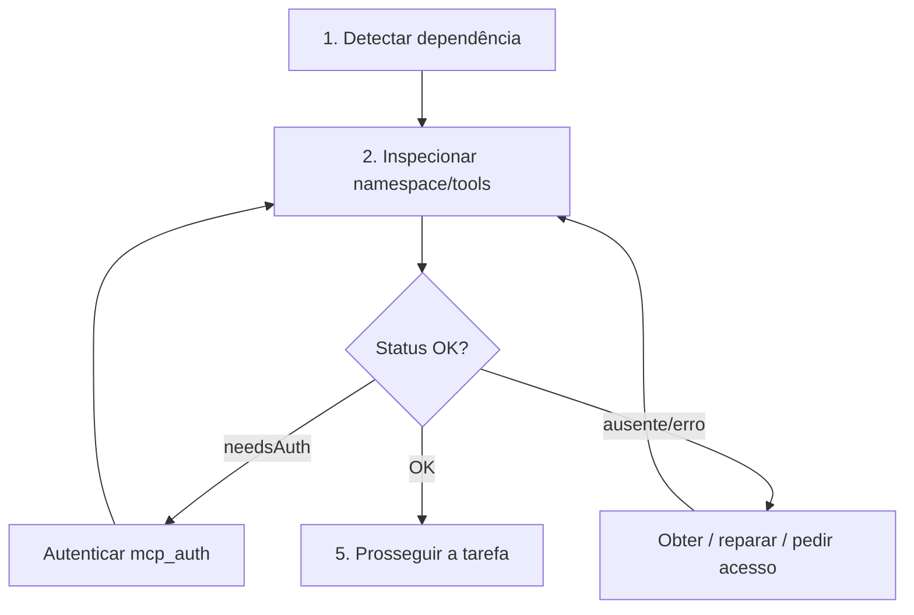

# Continuidade de MCP

{width=48}

Voltar ao [Hub](/docs/regras/README.md) · Navegação: [navegacao-agentes.md](/docs/regras/navegacao-agentes.md)

**Regra:** se a tarefa depende de um MCP (Model Context Protocol) e ele está ausente, sem autenticação ou quebrado, o agente deve **detectar → obter/autenticar/reparar → só então continuar**. Não improvise contornos que escondam a falha.

---

## Sumário

1. [Quando este doc é obrigatório](#quando-este-doc-é-obrigatório)
2. [Protocolo em 5 passos](#protocolo-em-5-passos)
3. [Sintomas e ações](#sintomas-e-ações)
4. [Autenticação](#autenticação)
5. [Bom vs ruim](#bom-vs-ruim)
6. [Checklist](#checklist)

---

## Quando este doc é obrigatório

Abra este ramo se **qualquer** item for verdadeiro:

- A tarefa cita um serviço externo tipicamente via MCP (Slack, Linear, GitHub avançado, Datadog, etc.)
- Uma tool call falhou com erro de auth, namespace ausente ou schema desconhecido
- O catálogo dinâmico mostra `needsAuth`, `error` ou `loading` para o namespace necessário
- Você está tentando “simular” dados que deveriam vir de uma tool

Se a tarefa é só documentação local no store, este ramo é **opcional**.

---

## Protocolo em 5 passos

### 1. Detectar dependência

Liste MCPs necessários pelo nome do serviço e pela ação (ler issues, postar mensagem, etc.).

### 2. Inspecionar

Use as tools de descoberta dinâmica do ambiente (ex.: inventário de namespaces / `GetDynamicTools`):

- Confirme que o **namespace** existe
- Leia o **schema** da tool antes de chamar
- Observe `namespaceStatus` quando disponível

### 3. Classificar o problema

| Status / sintoma | Classe |
|------------------|--------|
| Namespace não listado | Ausente |
| `needsAuth` / 401 / 403 | Auth |
| `error` / timeout / tool sumiu | Quebrado |
| `loading` | Transitório — aguardar e reinspecionar |
| Schema ok + call ok | Saudável |

### 4. Obter / autenticar / reparar

| Classe | Ação |
|--------|------|
| Ausente | Solicitar inclusão do MCP ao usuário/coordenador; não fingir sucesso |
| Auth | Chamar fluxo de auth do namespace (ex.: `mcp_auth` via tool dinâmica) e reinspecionar |
| Quebrado | Registrar erro, tentar reinspeção; se persistir, escalar com evidência |
| Transitório | Esperar e repetir inspeção (sem busy-loop agressivo) |

### 5. Prosseguir

Só execute o trabalho principal depois de uma inspeção que confirme tools utilizáveis.

---

## Sintomas e ações

| Sintoma | Ação imediata | Não fazer |
|---------|---------------|-----------|
| `needsAuth` | Auth → rediscovery → retry | Continuar sem credencial |
| 401/403 em call | Reauth; verificar escopo | Repetir a mesma call em loop |
| Namespace sumiu | Reportar bloqueio; pedir instalação | Inventar API REST “equivalente” sem pedido |
| Tool sem schema | Discovery da tool antes da call | Chutar parâmetros |
| Dados vazios inesperados | Confirmar filtros/args; não assumir MCP morto | Reescrever a tarefa sem evidência |

{width=28} Browser automation **não** é substituto padrão de MCP ausente, salvo pedido explícito do usuário.

---

## Autenticação

Fluxo típico neste ambiente Cursor:

1. Detectar `needsAuth` (ou falha de autorização na call)
2. Invocar autenticação do namespace (padrão: `mcp_auth` no namespace afetado, args vazios, conforme tools disponíveis)
3. Reinspecionar o namespace (schemas + status)
4. Retentar a operação original **uma** vez com schema válido
5. Se ainda falhar: reportar bloqueio ao coordenador/usuário com namespace, erro e o que já foi tentado

Documente no relatório interno (se houver) o namespace e o resultado — **nunca** grave tokens ou secrets em `docs/` ou `media/`.

---

## Bom vs ruim

| ❌ Ruim | ✅ Bom |
|---------|--------|
| “Vou responder sem Linear porque deu 401” | Auth → retry → só então responder |
| Chamar tool sem ler schema | Discovery → call com args corretos |
| Colar token em markdown | Auth via fluxo do produto; zero secrets no store |
| Silenciar falha de MCP | Bloqueio explícito + próximo passo pedido ao usuário |

---

## Checklist

{width=32}

- [ ] Confirmei que a tarefa realmente depende de MCP
- [ ] Inspecionei namespace e schema
- [ ] Tratei ausente / auth / quebrado antes do trabalho
- [ ] Retentei após correção
- [ ] Se bloqueado: relatei evidência sem secrets
- [ ] Só então completei a tarefa original

---

## Links cruzados

- [Hub](/docs/regras/README.md)
- [Princípios](/docs/regras/principios.md)
- [Navegação](/docs/regras/navegacao-agentes.md)
- [Documentação](/docs/regras/documentacao.md)
- [Ativos visuais](/docs/regras/ativos-visuais.md)
- [Contexto do projeto](/docs/project-context.md)
