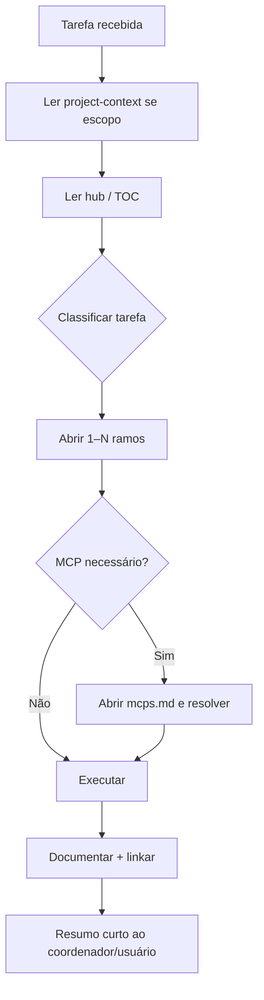

# Navegação de Documentação para Agentes

{width=48}

Voltar ao [Hub](/docs/regras/README.md) · Princípios: [principios.md](/docs/regras/principios.md)

Este documento ensina agentes (e humanos) a **atravessar** a árvore: entrar pelo hub, abrir só os ramos necessários e sair com o contexto certo — sem varrer o store inteiro.

---

## Sumário

1. [Contrato de navegação](#contrato-de-navegação)
2. [Algoritmo passo a passo](#algoritmo-passo-a-passo)
3. [Mapa tarefa → ramos](#mapa-tarefa--ramos)
4. [O que não fazer](#o-que-não-fazer)
5. [Exemplo guiado](#exemplo-guiado)
6. [Checklist](#checklist)

---

## Contrato de navegação

| Regra | Detalhe |
|-------|---------|
| Entrada única | Sempre começar em [README.md (hub)](/docs/regras/README.md) ou via [project-context.md](/docs/project-context.md) → hub |
| Seleção | Abrir apenas docs listados como necessários à tarefa |
| Profundidade | Seguir links filhos sob demanda; não pré-carregar irmãos irrelevantes |
| Parada | Se a informação basta para agir, pare de ler |
| Retorno | Ao documentar resultado, linkar de volta ao mapa existente |

---

## Algoritmo passo a passo

1. **Identificar o tipo de tarefa** (docs, implementação, integração, assets, diagnóstico).
2. **Criar/abrir checklist** em [`internal/tarefas/`](/docs/regras/checklists-tarefas.md).
3. **Ler o hub** — só o suficiente para escolher ramos (mapa + checklist).
4. **Abrir ramos obrigatórios** conforme a tabela abaixo.
5. **Se a tarefa cita ferramenta externa / MCP** → [mcps.md](/docs/regras/mcps.md) **antes** do trabalho principal.
6. **Executar** a tarefa com o contexto mínimo suficiente; marcar etapas no checklist.
7. **Validar** ([validacoes-testes.md](/docs/regras/validacoes-testes.md)) e **autoaperfeiçoar** se impactar o futuro.
8. **Commit** se houver git ([commits.md](/docs/regras/commits.md)); **atualizar docs** se mudou regras ([documentacao.md](/docs/regras/documentacao.md)).
9. **Verificação final** ([verificacao-final.md](/docs/regras/verificacao-final.md)) antes de marcar a tarefa concluída.
10. **Reportar** caminhos absolutos e o que mudou — sem colar o relatório inteiro no chat se já estiver em arquivo.

### Heurística de “mínimo suficiente”

Pergunte: *“Sem este parágrafo, eu erraria a ação?”*
Se não, não leia / não carregue.

---

## Mapa tarefa → ramos

| Tarefa | Obrigatório | Sob demanda |
|--------|-------------|-------------|
| Qualquer atividade | hub + [checklists-tarefas](/docs/regras/checklists-tarefas.md) | — |
| Onboarding / primeira sessão | context + hub + princípios + este doc + checklists | demais |
| Criar/editar documentação | hub + documentação | organização, ativos-visuais, princípios |
| Reorganizar pastas/nomes | hub + [organizacao-arquivos](/docs/regras/organizacao-arquivos.md) | documentação |
| Definir/alterar regras do agente | hub + princípios + documentação + autoaperfeiçoamento | navegação, mcps |
| Trabalho que usa MCP | hub + navegação + mcps | documentação, validações |
| Adicionar ícone/diagrama | hub + ativos-visuais | documentação |
| Entregar mudança verificável | hub + [validacoes-testes](/docs/regras/validacoes-testes.md) | commits, verificação-final |
| Encerrar qualquer tarefa | [verificacao-final](/docs/regras/verificacao-final.md) + checklists | commits |
| Fechar ciclo com git | [commits](/docs/regras/commits.md) + validações + verificação-final | autoaperfeiçoamento |
| Diagramas / tema visual | [ativos-visuais](/docs/regras/ativos-visuais.md) (light/dark) | documentação |
| Bug / diagnóstico de ambiente | hub → ramos citados pelo sintoma | mcps se ferramenta falhar |
| Feature de produto (quando houver repo) | hub + princípios + navegação + validações | docs de feature sob `docs/` |

{width=28} Se a tarefa **não** exige um ramo, **não** o abra “por precaução”.

---

## O que não fazer

| ❌ Anti-padrão | Por quê |
|----------------|---------|
| `Glob **/*.md` e ler tudo | Estoura contexto; viola navegação seletiva |
| Começar por um filho sem o hub | Perde mapa, prioridades e checklist |
| Ignorar MCP quebrado | Viola princípio 5; resultado frágil |
| Duplicar regras no chat | Fonte de verdade deve ser o doc linkado |
| Editar `notes.md` / `preferences.md` | Área do coordenador |

---

## Exemplo guiado

**Pedido:** “Adicionar um checklist de deploy na documentação.”

| Passo | Ação | Doc aberto? |
|-------|------|-------------|
| 1 | Classificar: documentação | — |
| 2 | Ler hub (mapa) | Sim (parcial) |
| 3 | Abrir documentação (template, pasta, links) | Sim |
| 4 | Abrir ativos-visuais se for incluir ícone | Só se necessário |
| 5 | **Não** abrir mcps | Não |
| 6 | Criar/atualizar página + link no hub | — |

**Pedido:** “Listar issues no Linear.”

| Passo | Ação |
|-------|------|
| 1 | Hub → detectar dependência MCP |
| 2 | Abrir [mcps.md](/docs/regras/mcps.md) |
| 3 | Auth/reparar Linear MCP se preciso |
| 4 | Só então listar issues |

---

## Checklist

{width=32}

- [ ] Entrei pelo hub (ou context → hub)
- [ ] Criei/abri checklist em `internal/tarefas/`
- [ ] Classifiquei a tarefa
- [ ] Abri só os ramos da tabela
- [ ] Tratei MCP antes do trabalho, se aplicável
- [ ] Parei de ler quando o contexto bastava
- [ ] Validei, autoaperfeiçoei e committei se couber
- [ ] Documentei e linkei o resultado

---

## Links cruzados

- [Hub](/docs/regras/README.md)
- [Princípios](/docs/regras/principios.md)
- [Documentação](/docs/regras/documentacao.md)
- [MCPs](/docs/regras/mcps.md)
- [Ativos visuais](/docs/regras/ativos-visuais.md)
- [Organização de arquivos](/docs/regras/organizacao-arquivos.md)
- [Validações e testes](/docs/regras/validacoes-testes.md)
- [Autoaperfeiçoamento](/docs/regras/autoaperfeicoamento.md)
- [Commits](/docs/regras/commits.md)
- [Checklists de tarefas](/docs/regras/checklists-tarefas.md)
- [Verificação final](/docs/regras/verificacao-final.md)
- [Contexto do projeto](/docs/project-context.md)
