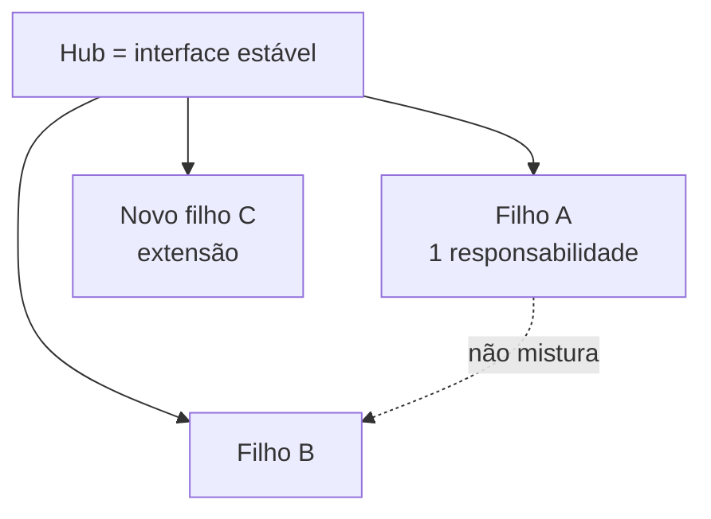

# Organização de Arquivos e Nomenclatura

{width=48}

Voltar ao [Hub](/docs/regras/README.md) · Documentação: [documentacao.md](/docs/regras/documentacao.md) · Navegação: [navegacao-agentes.md](/docs/regras/navegacao-agentes.md)

**Regra:** separar tudo em pastas hierárquicas com nomenclatura clara e separação inteligente por tópico — para que agentes leiam só o necessário (eficiência de tokens). Isto **complementa** qualquer arquitetura técnica do projeto; não a substitui.

---

## Sumário

1. [Analogia SOLID para documentação](#analogia-solid-para-documentação)
2. [Hierarquia canônica do store](#hierarquia-canônica-do-store)
3. [Nomenclatura](#nomenclatura)
4. [Limites e interfaces estáveis](#limites-e-interfaces-estáveis)
5. [Bom vs ruim](#bom-vs-ruim)
6. [Checklist](#checklist)

---

## Analogia SOLID para documentação

| Princípio (código) | Aplicação em docs / layout de arquivos |
|--------------------|----------------------------------------|
| **S**ingle Responsibility | Um doc = um tema; uma pasta = um domínio |
| **O**pen/Closed | Hub estável; extensão via **novos filhos** linkados, sem reescrever tudo |
| **L**iskov (substituição) | Qualquer filho de regras segue o mesmo contrato (ícone, TOC, links, checklist) |
| **I**nterface Segregation | Links e seções finas: não force o agente a “importar” um monólito |
| **D**ependency Inversion | Filhos dependem do hub/contratos estáveis; não de detalhes de irmãos irrelevantes |

---

## Hierarquia canônica do store

| Pasta | Responsabilidade única | Quem lê |
|-------|------------------------|---------|
| `/docs/` | Conhecimento vigente (regras, guias, contexto) | Humanos + agentes na tarefa |
| `/docs/regras/` | Como o agente trabalha | Sempre via hub seletivo |
| `/media/` | Assets visuais | Sob demanda |
| `/media/icons/` | Ícones SVG | Páginas que os referenciam |
| `/internal/` | Evidências, rascunhos, auditorias | Trabalho interno |
| `/internal/tarefas/` | Estado/checklist por atividade | Toda tarefa (retomada) |

Subpastas novas: só quando houver **vários** arquivos do mesmo tema. Uma pasta para um arquivo isolado é desperdício.

Detalhes de forma de escrita: [documentacao.md](/docs/regras/documentacao.md).  
Estado de tarefa: [checklists-tarefas.md](/docs/regras/checklists-tarefas.md).

---

## Nomenclatura

| Elemento | Padrão | Exemplo |
|----------|--------|---------|
| Pastas | kebab-case, tema claro | `regras/`, `tarefas/` |
| Arquivos | kebab-case, substantivo | `organizacao-arquivos.md` |
| Evitar | vago, versionado no nome, acentos | `stuff.md`, `final_v2.md`, `organização.md` |
| Ícones | stem alinhado ao tema | `organizacao.svg` |

Nomes devem permitir a um agente **decidir abrir ou não** só pelo path + título no hub — sem ler o corpo.

---

## Limites e interfaces estáveis

**Limite claro:** se dois assuntos mudam por motivos diferentes, são docs (ou pastas) diferentes.

**Interface estável:**

- Hub lista filhos e “quando ler”
- Cada filho aponta de volta ao hub
- Cross-links só onde há dependência real
- Caminhos absolutos do store nos links

**Extensão:** novo tema → novo filho sob a pasta certa + linha no hub + ícone se for regra. Não inchir o hub com o conteúdo completo do tema.

Isto vale para docs **e** para distribuição de código/config quando houver repo: pastas por responsabilidade, nomes previsíveis, módulos com fronteiras claras — a arquitetura técnica do projeto continua dona dos detalhes; esta regra só exige organização hierárquica legível.

---

## Bom vs ruim

| ❌ Ruim | ✅ Bom |
|---------|--------|
| `docs/misc/tudo-junto.md` | `docs/regras/mcps.md` + `docs/regras/commits.md` |
| Pasta `temp/` com 20 temas | Pastas por domínio + `internal/` para rascunho |
| Agente lê árvore inteira “por segurança” | Hub → 1–3 ramos ([navegacao-agentes.md](/docs/regras/navegacao-agentes.md)) |
| Renomear sem atualizar links | Mover + atualizar links na mesma mudança |

---

## Checklist

{width=32}

- [ ] Cada arquivo/pasta tem uma responsabilidade clara
- [ ] Nome kebab-case e autoexplicativo
- [ ] Tema novo virou filho (não apêndice monólito)
- [ ] Hub/mapa atualizado se for regra ou guia de entrada
- [ ] Separação evita leitura de docs não relacionados

---

## Links cruzados

- [Hub](/docs/regras/README.md)
- [Documentação](/docs/regras/documentacao.md)
- [Navegação](/docs/regras/navegacao-agentes.md)
- [Checklists de tarefas](/docs/regras/checklists-tarefas.md)
- [Autoaperfeiçoamento](/docs/regras/autoaperfeicoamento.md)
- [Contexto](/docs/project-context.md)
