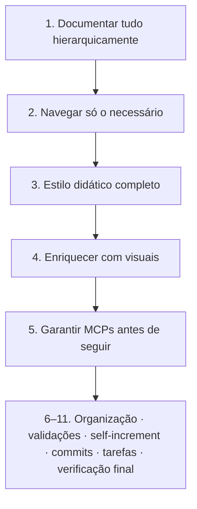

# Princípios Centrais

{width=48}

Voltar ao [Hub de regras](/docs/regras/README.md) · Contexto: [project-context.md](/docs/project-context.md)

Estes princípios têm prioridade sobre hábitos ad hoc. Em conflito, aplique-os nesta ordem.

---

## Sumário

1. [Ordem de prioridade](#ordem-de-prioridade)
2. [Princípios centrais (1–5)](#princípios-centrais-1–5)
3. [Princípios operacionais (6–11)](#princípios-operacionais-6–11)
4. [Matriz de decisão](#matriz-de-decisão)
5. [Exemplos bom vs ruim](#exemplos-bom-vs-ruim)
6. [Checklist do agente](#checklist-do-agente)

---

## Ordem de prioridade

Se duas ações competem, a de número menor vence — salvo risco de segurança ou instrução explícita do usuário/coordenador.

---

## Princípios centrais (1–5)

### 1. Documentar tudo (hierárquico e linkado)

| O quê | Onde |
|-------|------|
| Regras e guias vigentes | `/docs/` |
| Ícones e imagens | `/media/` |
| Evidências / rascunhos | `/internal/` |

- Toda página nova entra em uma hierarquia com pai claro.
- Toda página relevante recebe links de ida **e** volta (hub ↔ filho ↔ irmãos).
- Decisões importantes não ficam só no chat: viram doc linkado.

Detalhes: [documentacao.md](/docs/regras/documentacao.md).

### 2. Pronto para qualquer agente (navegação seletiva)

Um agente que lê só o hub deve conseguir:

1. Entender o mapa
2. Escolher ramos pela tarefa
3. Executar sem “carregar” docs irrelevantes

Detalhes: [navegacao-agentes.md](/docs/regras/navegacao-agentes.md).

### 3. Estilo fácil, completo e didático

Cada doc de regras deve incluir, quando fizer sentido:

- Cabeçalho com ícone e links de volta
- Sumário (TOC) se tiver mais de ~3 seções
- Tabelas para comparações e caminhos
- Exemplos **bom vs ruim**
- Checklist acionável
- Diagrama Mermaid para fluxos

### 4. Ativos visuais para acelerar trabalho

Ícones, imagens, diagramas e tabelas não são enfeite: reduzem ambiguidade e tempo de onboarding.

Detalhes: [ativos-visuais.md](/docs/regras/ativos-visuais.md).

### 5. Continuidade de MCP

Se a tarefa precisa de MCP e ele está ausente, sem auth ou quebrado:

1. Detectar
2. Obter / autenticar / reparar
3. Só então continuar a tarefa

Não improvisar contornos frágeis que escondam a falha.

Detalhes: [mcps.md](/docs/regras/mcps.md).

---

## Princípios operacionais (6–11)

Complementam os centrais — detalhe em cada filho:

| # | Princípio | Doc |
|---|-----------|-----|
| 6 | Organização hierárquica (SOLID-like em docs/pastas) | [organizacao-arquivos.md](/docs/regras/organizacao-arquivos.md) |
| 7 | Validações e testes em tudo que criar/alterar | [validacoes-testes.md](/docs/regras/validacoes-testes.md) |
| 8 | Autoaperfeiçoamento (self-increment) do agente | [autoaperfeicoamento.md](/docs/regras/autoaperfeicoamento.md) |
| 9 | Commits automáticos em português (quando houver git) | [commits.md](/docs/regras/commits.md) |
| 10 | Checklist/estado por atividade para retomada | [checklists-tarefas.md](/docs/regras/checklists-tarefas.md) |
| 11 | Verificação final (código ↔ docs ↔ checklists ↔ regras) | [verificacao-final.md](/docs/regras/verificacao-final.md) |

---

## Matriz de decisão

| Situação | Ação alinhada aos princípios |
|----------|------------------------------|
| Descobri um fluxo novo | Documentar sob `docs/` (ou `internal/` se for evidência) e linkar ao hub/pai |
| Preciso de 1 fato em um filho | Ler hub → abrir só esse filho |
| MCP 401 / tools faltando | Parar → [mcps.md](/docs/regras/mcps.md) → retomar |
| Doc longo sem estrutura | Refatorar com TOC, tabelas e exemplos |
| Quero “só avisar no chat” | Preferir doc permanente + resumo curto no chat |
| Nova pasta/tema | Separar por responsabilidade → [organizacao-arquivos.md](/docs/regras/organizacao-arquivos.md) |
| Entreguei sem verificar | Aplicar [validacoes-testes.md](/docs/regras/validacoes-testes.md) |
| Mudança afeta o futuro | [autoaperfeicoamento.md](/docs/regras/autoaperfeicoamento.md) |
| Fechei alteração com git | [commits.md](/docs/regras/commits.md) |
| Início / retomada de atividade | [checklists-tarefas.md](/docs/regras/checklists-tarefas.md) |
| Antes de declarar concluído | [verificacao-final.md](/docs/regras/verificacao-final.md) |
| Diagrama ilegível em dark/light | [ativos-visuais.md](/docs/regras/ativos-visuais.md) |

---

## Exemplos bom vs ruim

### Documentação

| ❌ Ruim | ✅ Bom |
|---------|--------|
| Parede de texto sem links | Hub + filhos com TOC e cross-links |
| Nome `stuff.md` na raiz de docs | `docs/regras/documentacao.md` (kebab-case, pasta temática) |
| “Veja o chat anterior” | Link absoluto para o doc canônico |

### Navegação

| ❌ Ruim | ✅ Bom |
|---------|--------|
| Ler todos os `.md` do store | Hub → 1–3 ramos da tarefa |
| Ignorar MCP quebrado e “chutar” | Reparar MCP, depois executar |

### Escopo

| ❌ Ruim | ✅ Bom |
|---------|--------|
| Editar `notes.md` sem pedido | Deixar status ao coordenador |
| Criar regras só em `internal/` | Publicar regras finais em `docs/regras/` |

---

## Checklist do agente

{width=32}

- [ ] Sei qual princípio aplica se houver conflito
- [ ] Sei onde gravar o artefato (docs / media / internal / internal/tarefas)
- [ ] Vou linkar o resultado ao mapa existente
- [ ] Vou limitar a leitura aos ramos necessários
- [ ] Se houver dependência MCP, aplico o protocolo antes de continuar
- [ ] Tenho checklist de atividade e plano de validação/commit quando couber

---

## Links cruzados

- [Hub](/docs/regras/README.md)
- [Documentação](/docs/regras/documentacao.md)
- [Navegação](/docs/regras/navegacao-agentes.md)
- [MCPs](/docs/regras/mcps.md)
- [Ativos visuais](/docs/regras/ativos-visuais.md)
- [Organização de arquivos](/docs/regras/organizacao-arquivos.md)
- [Validações e testes](/docs/regras/validacoes-testes.md)
- [Autoaperfeiçoamento](/docs/regras/autoaperfeicoamento.md)
- [Commits](/docs/regras/commits.md)
- [Checklists de tarefas](/docs/regras/checklists-tarefas.md)
- [Verificação final](/docs/regras/verificacao-final.md)
- [Contexto do projeto](/docs/project-context.md)
