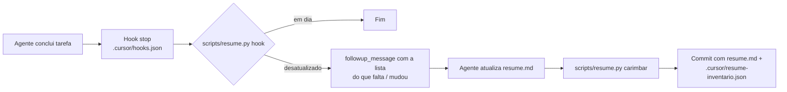

# Resumo vivo do projeto (`resume.md`)

Voltar ao [Hub](/docs/regras/README.md) · Relacionados: [documentacao.md](/docs/regras/documentacao.md) · [verificacao-final.md](/docs/regras/verificacao-final.md)

**Regra:** o arquivo [`/resume.md`](/resume.md) resume o projeto inteiro em texto e é atualizado **a cada tarefa** que altera o repositório.

---

## Sumário

1. [O que o resume.md contém](#o-que-o-resumemd-contém)
2. [Formato](#formato)
3. [Como a sincronia é garantida](#como-a-sincronia-é-garantida)
4. [Protocolo ao fechar uma tarefa](#protocolo-ao-fechar-uma-tarefa)
5. [Limites da verificação automática](#limites-da-verificação-automática)

---

## O que o resume.md contém

Didático, simples, completo e resumido. Para cada **diretório, arquivo, classe e função**:

| Campo | Pergunta que responde |
|-------|------------------------|
| Propósito | O que é / o que faz |
| Por quê | Que problema resolve |
| Quando / onde | Quem usa, em que momento e onde se encaixa na arquitetura |
| Entradas e saídas | Parâmetros principais e o que retorna |

Não descreve o passo a passo interno: só o suficiente para entender o funcionamento e a arquitetura geral.

Exceções de granularidade: testes, documentação e arquivos da raiz têm **uma linha por arquivo**; `media/icons/`, `internal/tarefas/` e `tests/fixtures/` são descritos só como pasta.

## Formato

O verificador depende deste formato:

```markdown
## `src/agent/api/`

**Propósito:** … **Por quê:** … **Quando:** …

### `src/agent/api/main.py`

**Propósito:** … **Quando/onde:** …

- `create_task(project_id, body) → TaskRead` — Rota `POST /projects/{id}/tasks`: … Entrada: … Saída: …
- **`TaskService`** — …
  - `TaskService.create_task(project_id, body) → TaskModel` — …
```

- Diretório: título `##` com o caminho entre crases terminado em `/`.
- Arquivo com símbolos (`src/`, `scripts/`, `web/static/assets/`): título `###` com o caminho completo; os símbolos ficam **dentro** dessa seção.
- Símbolo: nome entre crases no início do item (métodos como `Classe.metodo(`).

## Como a sincronia é garantida



| Peça | Papel |
|------|-------|
| [`scripts/resume.py`](/scripts/resume.py) | Extrai o inventário estrutural (AST do Python, funções do JS, árvore de arquivos via `git ls-files`) e compara com o `resume.md` e com o último carimbo |
| `.cursor/resume-inventario.json` | Inventário carimbado na última revisão; detecta itens novos, removidos ou com assinatura alterada |
| `.cursor/hooks.json` + `.cursor/hooks/resume-check.sh` | Hook `stop` do Cursor: ao fim de cada resposta do agente, devolve um *follow-up* se o resumo ficou para trás (`loop_limit: 2`) |
| `.cursor/rules/resume.mdc` | Regra sempre aplicada que lembra o protocolo |
| [`tests/test_resume.py`](/tests/test_resume.py) | Testa a lógica do verificador |

Comandos:

```bash
python3 scripts/resume.py check      # exit 1 se desatualizado (lista o que falta/mudou)
python3 scripts/resume.py faltando   # esqueleto markdown com assinaturas dos itens sem descrição
python3 scripts/resume.py carimbar   # grava o inventário atual; recusa se faltar descrição
```

## Protocolo ao fechar uma tarefa

1. `python3 scripts/resume.py check`.
2. Se acusar: descrever itens novos, ajustar alterados, apagar removidos no `resume.md`.
3. Também revisar a descrição de itens cujo **comportamento** mudou (o verificador não enxerga isso).
4. `python3 scripts/resume.py carimbar`.
5. Commitar `resume.md` e `.cursor/resume-inventario.json` junto com a tarefa ([commits.md](/docs/regras/commits.md)).

## Limites da verificação automática

- Detecta itens **sem descrição** e mudanças de **estrutura/assinatura**; não detecta mudança de comportamento com a mesma assinatura — isso fica a cargo do agente (passo 3).
- Inclui arquivos não commitados que não estão no `.gitignore` (o resumo reflete a árvore de trabalho).
- Funções aninhadas em Python não são inventariadas; no JS, toda `function nome(...)` é.