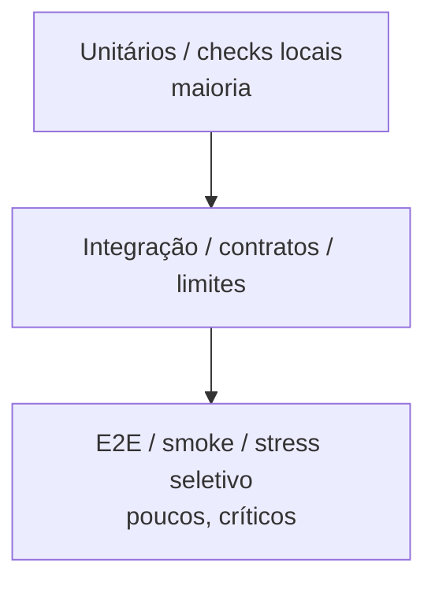
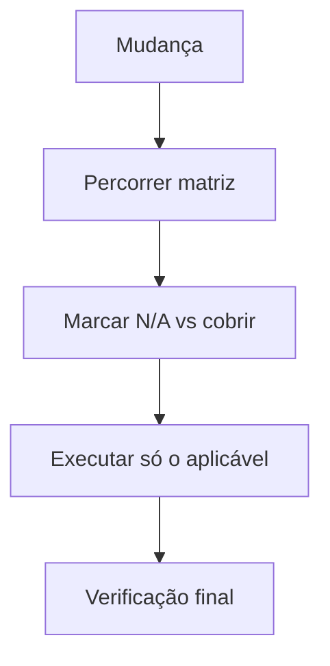

# Validações e Testes

Voltar ao [Hub](/docs/regras/README.md) · Fechamento: [verificacao-final.md](/docs/regras/verificacao-final.md) · Autoaperfeiçoamento: [autoaperfeicoamento.md](/docs/regras/autoaperfeicoamento.md)

**Regra:** para tudo que for criado ou alterado, criar (ou atualizar) **validações e testes** seguindo boas práticas — proporcionais ao tipo de artefato — e cobrir as **dimensões relevantes** da mudança (segurança, performance, limites, stress, escalabilidade, etc.).

Não rode “todas as dimensões” em todo typo. **Considere** a matriz; **cubra** o que se aplica.

---

## Sumário

1. [Escopo: o que “tudo” cobre](#escopo-o-que-tudo-cobre)
2. [Pirâmide e proporcionalidade](#pirâmide-e-proporcionalidade)
3. [Matriz de dimensões de cobertura](#matriz-de-dimensões-de-cobertura)
4. [Como escolher dimensões](#como-escolher-dimensões)
5. [Por tipo de artefato](#por-tipo-de-artefato)
6. [Quando validar](#quando-validar)
7. [Bom vs ruim](#bom-vs-ruim)
8. [Checklist](#checklist)

---

## Escopo: o que “tudo” cobre

| Artefato | Validação mínima esperada |
|----------|---------------------------|
| Código / scripts | Testes automatizados (unit/integration conforme risco) + lint/typecheck do projeto |
| Documentação | Links resolvem; paths existem; TOC coerente; exemplos executáveis quando afirmados |
| Regras do agente | Cross-links no hub; ícones presentes; checklist acionável |
| Config / MCP | Schema inspecionado; auth ok; smoke da tool crítica |
| Assets (SVG/PNG) | Arquivo existe; padrões em [ativos-visuais.md](/docs/regras/ativos-visuais.md); diagramas theme-aware |
| Checklist de tarefa | Itens marcáveis; estado atualizado; verificação final antes de `concluída` |

Se o Project **ainda não tem repo**, valide o que existe no store (docs, links, templates) e documente o plano de testes para quando o código existir.

---

## Pirâmide e proporcionalidade

| Risco da mudança | Exigência |
|------------------|-----------|
| Cosmético (typo em doc) | Releitura + links tocados |
| Regra nova | Hub, links, ícone, exemplos + verificação final |
| Lógica de negócio | Testes automatizados + edge cases + dimensões aplicáveis |
| Integração externa | Smoke MCP/API + falha de auth + segurança básica |

Não exija suíte E2E para um SVG — mas **não** entregue feature sem algum sinal de verificação.

---

## Matriz de dimensões de cobertura

Marque mentalmente (ou no checklist de tarefa) cada dimensão: **N/A** · **considerar** · **cobrir agora**.

| Dimensão | O que verificar | Costuma aplicar quando… | Exemplos de evidência |
|----------|-----------------|-------------------------|------------------------|
| **Correção funcional** | Faz o que a especificação pede | Quase toda mudança de comportamento | Teste unit/integration, smoke manual |
| **Validações de entrada** | Rejeita/ sanitiza dados inválidos | APIs, forms, parsers, configs | Testes de schema, boundary |
| **Segurança** | Authz, secrets, injection, path traversal, XSS, etc. | Auth, I/O externo, HTML, shell, uploads | Testes negativos, review de secrets |
| **Performance** | Latência/throughput aceitáveis no caminho quente | Loops, queries, hot paths, parsing grande | Benchmark simples, profiling pontual |
| **Limites / edge** | Vazios, máximos, null, unicode, timeouts | Qualquer input ou recurso finito | Testes de fronteira |
| **Stress** | Comportamento sob carga ou rajada | Filas, APIs públicas, jobs, caches | Teste de carga mínimo ou nota de risco |
| **Escalabilidade** | Cresce com dados/usuários sem colapsar | Persistência, fan-out, multi-tenant | Design review + teste com N maior |
| **Confiabilidade / falhas** | Retry, fallback, erros claros | Rede, MCP, disk, concorrência | Testes de falha injetada |
| **Compatibilidade** | Temas, browsers, versões, light/dark | UI, diagramas, Markdown render | Ver [ativos-visuais.md](/docs/regras/ativos-visuais.md) |
| **Documentação / consistência** | Docs e regras alinhados ao artefato | Sempre que mudar comportamento ou contrato | [verificacao-final.md](/docs/regras/verificacao-final.md) |
| **Observabilidade** | Logs/métricas úteis sem vazar segredo | Serviços, agentes long-running | Smoke de log, checklist de campos |
| **Acessibilidade** | Uso sem mouse / contraste / labels | UI interativa | Checks a11y básicos |

---

## Como escolher dimensões

1. Liste o que mudou (código, doc, config, asset).
2. Para cada linha da matriz: *“Se isto falhar em produção/uso, dói?”*
3. Se **sim** e a mudança toca essa superfície → **cobrir agora** (teste ou verificação explícita).
4. Se **não** → **N/A** (anote no checklist se o risco for discutível).
5. Se **sim** mas fora de escopo nesta entrega → registre dívida em doc/checklist e não finja cobertura.

| Tipo de mudança | Dimensões típicas (mínimo a considerar) |
|-----------------|----------------------------------------|
| Typo / copy em doc | Documentação/consistência, links |
| Nova regra no hub | Documentação, navegação, verificação final |
| Validação de formulário/API | Validações de entrada, limites, segurança |
| Endpoint público | Segurança, limites, stress (leve), observabilidade |
| Job em lote / fila | Performance, stress, confiabilidade, escalabilidade |
| Diagrama / SVG em docs | Compatibilidade (light/dark), documentação |
| Integração MCP | Segurança (auth), confiabilidade, correção funcional |

---

## Por tipo de artefato

### Código (quando houver repositório)

- Preferir testes próximos ao código alterado
- Nomes descritivos; arrange/act/assert claros
- Cobrir caminho feliz + falha relevante + dimensões escolhidas
- Rodar a suíte acordada do projeto antes de considerar pronto
- Commit inclui testes na mesma mudança quando possível ([commits.md](/docs/regras/commits.md))

### Documentação e regras

- [ ] Arquivos novos existem nos paths linkados
- [ ] Nenhum link quebrado no conjunto tocado
- [ ] Hub/mapa atualizado se necessário
- [ ] Diagramas sem cores fixas que quebrem um tema
- [ ] Template/exemplo não aponta para path inventado (exceto fence de template)

### Integrações

Seguir [mcps.md](/docs/regras/mcps.md): discovery → auth → call de prova → só então trabalho principal. Incluir dimensão **segurança** (credenciais) e **confiabilidade** (retry/erro).

---

## Quando validar

| Momento | Ação |
|---------|------|
| Planejamento da tarefa | Escolher dimensões na matriz |
| Antes de marcar item no checklist | Validar aquele item |
| Antes do commit | Testes/checks da mudança |
| Antes de encerrar | [verificacao-final.md](/docs/regras/verificacao-final.md) |
| Após autoaperfeiçoamento | Links do hub e filhos tocados |
| Se interrompido | Revalidar o último `- [x]` ao retomar |

---

## Bom vs ruim

| ❌ Ruim | ✅ Bom |
|---------|--------|
| “Testei mentalmente” | Evidência observável (comando, assert, checklist) |
| Só happy path em lógica crítica | Happy path + erro + limites |
| Ignorar segurança em endpoint novo | Pelo menos authz + input inválido |
| Rodar stress em typo de markdown | N/A explícito; focar links/docs |
| Adiar testes “para depois” | Cobertura mínima na mesma entrega |

---

## Checklist

- [ ] Identifiquei tipo de artefato e risco
- [ ] Percorri a [matriz de dimensões](#matriz-de-dimensões-de-cobertura) e marquei N/A vs cobrir
- [ ] Criei/atualizei testes ou verificações para o que se aplica
- [ ] Executei e registrei resultado no checklist de tarefa
- [ ] Corrigi falhas antes do fechamento
- [ ] Passei pela [verificação final](/docs/regras/verificacao-final.md)
- [ ] Lacuna recorrente → [autoaperfeicoamento.md](/docs/regras/autoaperfeicoamento.md)

---

## Links cruzados

- [Hub](/docs/regras/README.md)
- [Verificação final](/docs/regras/verificacao-final.md)
- [Commits](/docs/regras/commits.md)
- [Checklists de tarefas](/docs/regras/checklists-tarefas.md)
- [MCPs](/docs/regras/mcps.md)
- [Ativos visuais](/docs/regras/ativos-visuais.md)
- [Autoaperfeiçoamento](/docs/regras/autoaperfeicoamento.md)
- [Contexto](/docs/project-context.md)