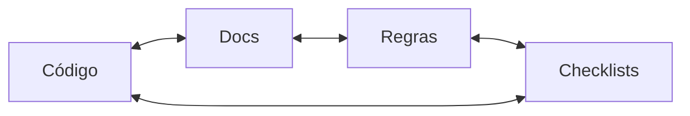

# Verificação Final Antes de Encerrar

{width=48}

Voltar ao [Hub](/docs/regras/README.md) · Testes: [validacoes-testes.md](/docs/regras/validacoes-testes.md) · Tarefas: [checklists-tarefas.md](/docs/regras/checklists-tarefas.md)

**Regra:** antes de fechar qualquer tarefa, o agente deve verificar **todos os arquivos envolvidos**, **incluindo documentação relacionada**, garantindo consistência entre código ↔ docs ↔ checklists ↔ regras.

Não declare “concluído” só porque o código compilou ou o chat parece ok.

---

## Sumário

1. [Quando é obrigatória](#quando-é-obrigatória)
2. [Checklist final concreto](#checklist-final-concreto)
3. [Matriz de consistência](#matriz-de-consistência)
4. [Ordem sugerida](#ordem-sugerida)
5. [Bom vs ruim](#bom-vs-ruim)
6. [Integração com outras regras](#integração-com-outras-regras)

---

## Quando é obrigatória

| Situação | Verificação final? |
|----------|-------------------|
| Toda atividade com checklist em `internal/tarefas/` | **Sim** — último bloco antes de `concluída` |
| Mudança só cosmético (typo) | Sim, enxuta: arquivo + links tocados |
| Feature / regra / integração | Sim, completa (matriz abaixo) |
| Trabalho interrompido | Ao retomar o fechamento, repetir a verificação |

---

## Checklist final concreto

{width=32}

Copie para o arquivo de tarefa ou marque item a item:

### A. Inventário

- [ ] Listei todos os arquivos **criados, editados ou movidos** nesta atividade
- [ ] Incluí docs, media, templates e checklists — não só código
- [ ] Confirmei que nenhum arquivo “órfão” ficou sem referência (ou sem remoção de links antigos)

### B. Consistência cruzada

- [ ] **Código ↔ docs:** comportamento descrito bate com o implementado (se houver código)
- [ ] **Docs ↔ regras:** nada contradiz o [hub](/docs/regras/README.md) ou filhos vigentes
- [ ] **Checklists ↔ realidade:** itens `- [x]` correspondem ao que de fato foi feito
- [ ] **Hub/mapa:** filhos novos/alterados aparecem no mapa e no “quando ler”, se forem regras/guias
- [ ] **Contexto:** metas/restrições estáveis ainda verdadeiras ([project-context.md](/docs/project-context.md))

### C. Qualidade dos artefatos

- [ ] Links absolutos do store resolvem ([validacoes-testes.md](/docs/regras/validacoes-testes.md))
- [ ] Ícones/assets referenciados existem ([ativos-visuais.md](/docs/regras/ativos-visuais.md))
- [ ] Diagramas seguem adaptação claro/escuro (sem cores fixas que quebrem um tema)
- [ ] Dimensões de teste aplicáveis foram cobertas (segurança, limites, etc.)
- [ ] Autoaperfeiçoamento feito se a mudança impacta o futuro ([autoaperfeicoamento.md](/docs/regras/autoaperfeicoamento.md))

### D. Fechamento

- [ ] Checklist de tarefa: estado `concluída`, “Próxima ação” limpa, artefatos listados
- [ ] Commit em português se houver git ([commits.md](/docs/regras/commits.md))
- [ ] Não alterei `notes.md` / `preferences.md` sem autorização
- [ ] Resumo ao coordenador/usuário com paths absolutos

---

## Matriz de consistência

| Par | Pergunta de verificação | Se falhar |
|-----|-------------------------|-----------|
| Código → Doc | A doc descreve a API/fluxo atual? | Atualizar doc ou reverter código |
| Doc → Código | Há instrução sem implementação? | Implementar, marcar como futuro no doc, ou remover |
| Regra → Prática | O checklist da tarefa seguiu a regra? | Corrigir artefato ou a regra ambígua |
| Checklist → Disco | Todo `- [x]` tem evidência no store/repo? | Desmarcar ou completar |
| Hub → Filhos | Todo filho de regra está no mapa? | Atualizar hub |
| Tema visual → Render | Diagrama legível em light e dark? | Remover cores fixas; ver [ativos-visuais.md](/docs/regras/ativos-visuais.md) |

---

## Ordem sugerida

1. Fechar o trabalho técnico/documental pendente.
2. Rodar validações/testes das dimensões aplicáveis.
3. Percorrer o [checklist final concreto](#checklist-final-concreto).
4. Autoaperfeiçoar se descobriu lacuna de regra.
5. Commit (se git) → marcar tarefa `concluída` → reportar.

---

## Bom vs ruim

| ❌ Ruim | ✅ Bom |
|---------|--------|
| “Código ok, docs depois” | Docs e regras na mesma verificação final |
| Marcar checklist inteiro de uma vez | Só `- [x]` com evidência |
| Ignorar hub após criar regra nova | Hub + links + ícone conferidos |
| Diagrama só legível no tema claro | Mermaid/SVG theme-aware |

---

## Integração com outras regras

| Regra | Papel no fechamento |
|-------|---------------------|
| [checklists-tarefas.md](/docs/regras/checklists-tarefas.md) | Inclui etapa explícita de verificação final |
| [validacoes-testes.md](/docs/regras/validacoes-testes.md) | Executa dimensões de teste antes deste gate |
| [autoaperfeicoamento.md](/docs/regras/autoaperfeicoamento.md) | Atualiza regras se a verificação revelar gap sistêmico |
| [commits.md](/docs/regras/commits.md) | Commit após verificação, não antes de inconsistências óbvias |
| [ativos-visuais.md](/docs/regras/ativos-visuais.md) | Conferir diagramas/ícones no fechamento |

---

## Links cruzados

- [Hub](/docs/regras/README.md)
- [Validações e testes](/docs/regras/validacoes-testes.md)
- [Checklists de tarefas](/docs/regras/checklists-tarefas.md)
- [Autoaperfeiçoamento](/docs/regras/autoaperfeicoamento.md)
- [Commits](/docs/regras/commits.md)
- [Ativos visuais](/docs/regras/ativos-visuais.md)
- [Contexto](/docs/project-context.md)
