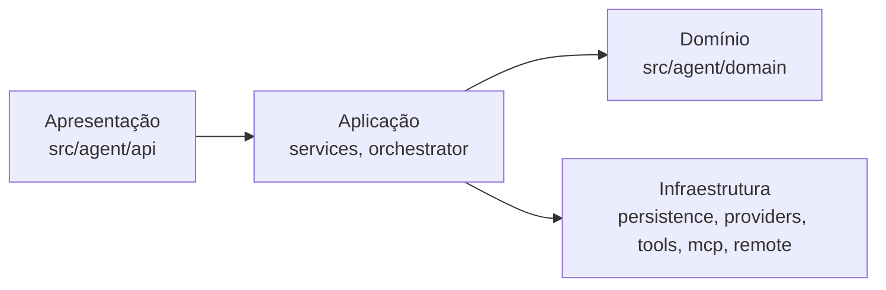
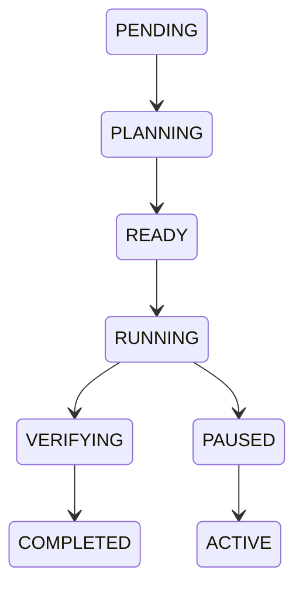

# Auditoria e Plano de Implementação — Knowledge Engine

**Data:** 2026-10-31
**Projeto:** Callidus
**Fase:** Zero — Auditoria e Planejamento
**Status:** Em andamento

## 1. ARQUITETURA ATUAL COMPREENDIDA

### 1.1 Camadas e Dependências (AGENTS.md §2)



- **Domínio** (`src/agent/domain`): enums, schemas, máquina de estados — sem FastAPI/SQLAlchemy
- **Aplicação** (`src/agent/services`, `src/agent/orchestrator`): regras de negócio, orquestração
- **Infraestrutura** (`src/agent/persistence`, `providers`, `tools`, `mcp`, `remote`): adaptadores externos
- **Apresentação** (`src/agent/api`): rotas finas, delegam a serviços

### 1.2 Componentes Existentes Relevantes

| Componente | Localização | Propósito | Reutilizável para Knowledge Engine |
|------------|-------------|-----------|-----------------------------------|
| **Knowledge Graph** | `src/agent/knowledge/graph_service.py`, `indexer.py` | Grafo persistente de símbolos, arquivos, docs do projeto | ✅ Base para memória persistente |
| **Browser Tool** | `src/agent/tools/browser.py` | Navegação headless/visível, pesquisa DuckDuckGo, Playwright | ✅ Base para Browser Intelligence |
| **Tool Registry** | `src/agent/tools/registry.py` | Registro central, execução uniforme, políticas | ✅ Padrão para novas ferramentas |
| **Provider Registry** | `src/agent/providers/registry.py` | Provedores intercambiáveis (Ollama, llama.cpp, OpenRouter, etc.) | ✅ Padrão para Search Providers |
| **Memory Store** | `src/agent/memory/store.py` | Extração e gravação de memória do projeto | ✅ Base para Knowledge Memory |
| **Project Service** | `src/agent/services/project_service.py` | CRUD projetos, memória, knowledge graph | ✅ Integração natural |
| **Task/Run Orchestrator** | `src/agent/orchestrator/runner.py` | Ciclo de execução, planejamento, verificação | ✅ Integração no fluxo |
| **Event Bus** | `src/agent/observability/bus.py` | Eventos em memória + SSE | ✅ Observabilidade |
| **SQLite Models** | `src/agent/persistence/models.py` | 22 tabelas: projects, tasks, runs, memory, kg, evidences, agents, etc. | ✅ Persistência |

### 1.3 Banco de Dados (SQLite + SQLAlchemy)

Tabelas relevantes existentes:
- `projects`, `conversations`, `tasks`, `branches`
- `execution_runs`, `scheduled_runs`, `automations`
- `memory_records` (kind, title, content, summary, outline_json, version, source_refs_json)
- `kg_nodes`, `kg_edges` (project_id, kind, ref, label, meta_json)
- `evidences` (task_id, verifier, passed, summary, detail_json)
- `agents`, `agent_executions`, `agent_queries` (hierarquia recursiva)
- `operation_attempts`, `event_logs`, `context_snapshots`, `inference_records`

### 1.4 Fluxo de Execução Atual



O `RunOrchestrator.step()` escolhe a próxima task, planeja/executa/verifica/consolida.

### 1.5 Hierarquia de Agentes

- Agente lógico (`agents`) → Execução (`agent_executions`) → Consulta (`agent_queries`)
- Pai consulta filho por identificador; resposta vem do estado persistido
- Uma inferência por vez (limite configurável `max_concurrent_inferences`)

---

## 2. PONTOS DE INTEGRAÇÃO IDENTIFICADOS

### 2.1 Knowledge Discovery (Quando acionar)
- No `RunOrchestrator._step_body()` ao selecionar task `RUNNING`
- No `TaskExecutor.execute()` antes de chamar o modelo
- No `ContextAssembler.build_for_task()` ao montar contexto
- Critérios: confiança insuficiente, erros repetidos, dependência de info atualizada

### 2.2 Knowledge Request (Estrutura)
- Nova tabela `knowledge_requests` (id, project_id, task_id, agent_id, question, context, constraints, status, created_at)
- Integra com `agent_queries` para hierarquia

### 2.3 Knowledge Orchestrator (Coordenação)
- Novo service `KnowledgeEngineService` em `src/agent/services/`
- Recebe request, verifica memória, seleciona fontes, distribui, valida, persiste, retorna síntese

### 2.4 Search Providers (Adaptadores)
- Interface comum `SearchProvider` em `src/agent/knowledge/providers/`
- Implementações: DuckDuckGo (já existe no browser), Google, Bing, GitHub, Documentação técnica
- Padrão Strategy como `providers/`

### 2.5 Browser Intelligence (Navegador Autenticado)
- Extender `BrowserSession` para sessões persistentes com perfis isolados
- Suporte a CDP para ChatGPT, Gemini, Claude
- Detecção de conclusão de resposta, timeouts, recuperação

### 2.6 Knowledge Processing
- Normalização: estrutura comum para resultados de fontes diferentes
- Comparação: identificar equivalências, divergências, contradições
- Síntese: resposta compacta com fontes, confiança, riscos
- Verificação: compatibilidade de versões, assinaturas, documentação oficial

### 2.7 Knowledge Memory (Persistência)
- Novas tabelas: `knowledge_items`, `knowledge_sources`, `knowledge_validations`, `knowledge_relations`, `knowledge_usage`, `knowledge_versions`
- Índices: FTS5 para busca textual, opcional embeddings para busca semântica
- Deduplicação: comparar conteúdo+contexto antes de salvar

### 2.8 Integração com Agentes
- Novas ferramentas: `search_knowledge`, `request_knowledge`, `acquire_knowledge`, `validate_knowledge`, `get_knowledge`, `save_knowledge`, `compare_knowledge`, `update_knowledge`
- Integração no `ContextAssembler` para injeção controlada por orçamento de tokens
- Compartilhamento via `agent_queries` na hierarquia

---

## 3. COMPONENTES A MODIFICAR

| Arquivo | Modificação | Risco |
|---------|-------------|-------|
| `src/agent/persistence/models.py` | Adicionar tabelas de knowledge | Baixo (migração aditiva) |
| `src/agent/services/project_service.py` | Adicionar métodos de knowledge | Baixo |
| `src/agent/orchestrator/runner.py` | Integrar discovery no step | Médio |
| `src/agent/context/assembler.py` | Injetar knowledge no contexto | Médio |
| `src/agent/tools/registry.py` | Registrar novas ferramentas | Baixo |
| `src/agent/tools/browser.py` | Estender para sessões autenticadas | Médio |
| `src/agent/api/project_routes.py` | Rotas de knowledge | Baixo |
| `src/agent/config.py` | Configurações de knowledge engine | Baixo |

---

## 4. NOVOS COMPONENTES NECESSÁRIOS

### 4.1 Estrutura de Diretórios Proposta

```text
src/agent/knowledge/
├── __init__.py
├── models.py              # Novos modelos SQLAlchemy
├── service.py             # KnowledgeEngineService (orchestrator)
├── discovery.py           # KnowledgeDiscovery (identifica lacunas)
├── request.py             # KnowledgeRequest (estrutura da solicitação)
├── providers/
│   ├── __init__.py
│   ├── base.py            # SearchProvider interface
│   ├── duckduckgo.py      # Já implementado no browser
│   ├── google.py          # Google Search API
│   ├── bing.py            # Bing Search API
│   ├── github.py          # GitHub API (repos, issues, docs)
│   └── docs.py            # Documentação técnica (readthedocs, etc.)
├── browser/
│   ├── __init__.py
│   ├── session.py         # BrowserSession estendido (perfis, auth)
│   ├── ai_services.py     # ChatGPT, Gemini, Claude via CDP
│   └── extraction.py      # Extração de conteúdo web
├── processing/
│   ├── __init__.py
│   ├── normalize.py       # Normalização de resultados
│   ├── compare.py         # Comparação entre fontes
│   ├── synthesize.py      # Síntese final
│   └── verify.py          # Verificação de código/docs
├── memory/
│   ├── __init__.py
│   ├── store.py           # KnowledgeMemoryStore
│   ├── index.py           # Indexação (FTS5 + embeddings opcional)
│   ├── dedup.py           # Deduplicação e versionamento
│   └── reuse.py           # Recuperação contextual
└── tools.py               # Ferramentas do knowledge engine
```

### 4.2 Novas Tabelas SQLAlchemy

```python
# knowledge_items - conhecimento adquirido
# knowledge_sources - fontes de cada conhecimento
# knowledge_requests - solicitações de aquisição
# knowledge_validations - validações realizadas
# knowledge_relations - relações entre conhecimentos
# knowledge_usage - histórico de uso
# knowledge_versions - versionamento
```

---

## 5. DEPENDÊNCIAS EXTERNAS

| Dependência | Propósito | Status |
|-------------|-----------|--------|
| `playwright` | Browser automation (já existe) | ✅ Instalado |
| `httpx` | HTTP client (já existe) | ✅ Instalado |
| `duckduckgo-search` ou similar | Search provider alternativo | 🔄 Opcional |
| `google-api-python-client` | Google Search API | 🔄 Opcional |
| `sentence-transformers` | Embeddings para busca semântica | 🔄 Opcional (pesado) |
| `sqlite-fts5` | Busca full-text nativa SQLite | ✅ Nativo |

**Decisão:** Não adicionar dependências pesadas obrigatórias. Busca semântica opcional via `sentence-transformers` apenas se disponível localmente.

---

## 6. RISCOS TÉCNICOS

| Risco | Probabilidade | Impacto | Mitigação |
|-------|---------------|---------|-----------|
| Browser autenticado instável (CAPTCHA, mudanças de UI) | Alta | Médio | Fallback para search providers; não bloquear engine |
| Consumo excessivo de tokens/contexto | Média | Alto | Orçamento estrito no `ContextAssembler`; síntese compacta |
| Duplicação de conhecimento | Média | Médio | Deduplicação por hash de conteúdo + contexto |
| Falha de fonte externa bloqueia tudo | Baixa | Alto | Circuit breaker por fonte; fallback gracioso |
| Migração de banco incompatível | Baixa | Alto | Migração aditiva apenas; testes em banco temporário |
| Performance de indexação em projetos grandes | Média | Médio | Limite de arquivos; indexação incremental (`touch_file`) |

---

## 7. ESTRATÉGIA DE TESTES

### 7.1 Testes Unitários
- `KnowledgeDiscovery.should_acquire()` — critérios de acionamento
- `KnowledgeRequest` — validação de estrutura
- `SearchProvider` implementations — normalização de resultados
- `KnowledgeNormalize`, `KnowledgeCompare`, `KnowledgeSynthesize` — processamento
- `KnowledgeMemoryStore` — CRUD, busca, deduplicação
- `KnowledgeIndex` — FTS5, embeddings opcional

### 7.2 Testes de Integração (Mock Providers)
- Pesquisa web com provedor simulado
- Extração de conteúdo com HTML controlado
- Falhas de rede, timeouts, respostas inválidas
- Browser: sessão simulada, auth expirado, resposta incompleta
- Armazenamento e recuperação com banco temporário

### 7.3 Testes de Navegador
- Inicialização Playwright com perfil isolado
- Sessão autenticada (mock), expiração
- Navegação, envio de pergunta, captura de resposta
- Detecção de conclusão de geração
- Erros e recuperação

### 7.4 Testes Ponta a Ponta (Cenários Reais)

| Cenário | Descrição | Critério de Sucesso |
|---------|-----------|---------------------|
| **A — Conhecimento inexistente** | Task exige info não disponível | Identifica lacuna, pesquisa, adquire, utiliza |
| **B — Conhecimento existente** | Task similar à anterior | Recupera descoberta anterior sem repetir pesquisa |
| **C — Divergência entre IAs** | Duas fontes com soluções diferentes | Identifica divergência, busca evidências, não escolhe arbitrariamente |
| **D — Navegador indisponível** | Serviço autenticado não responde | Usa outras fontes disponíveis |
| **E — Reinicialização** | Aquisição interrompida | Recuperável sem perda de integridade |
| **F — Contexto limitado** | Modelo pequeno, task complexa | Fornece só info necessária, sem docs inteiros |
| **G — Solução malsucedida** | Solução adquirida falha nos testes | Registra falha, procura alternativas, não apresenta como comprovada |

---

## 8. ORDEM DE IMPLEMENTAÇÃO

### Fase 1: Core (Semana 1-2)
1. Modelos SQLAlchemy (`knowledge/models.py`)
2. `KnowledgeRequest` + `KnowledgeDiscovery` (`knowledge/request.py`, `discovery.py`)
3. `KnowledgeEngineService` (`knowledge/service.py`)
4. Integração básica no `ProjectService` e `RunOrchestrator`
5. Testes unitários do core

### Fase 2: Acquisition (Semana 2-3)
1. Interface `SearchProvider` + implementações (`knowledge/providers/`)
2. Web content extraction (browser extraction — *a criar na Fase 2*)
3. GitHub/docs providers
4. Testes de integração com mock providers

### Fase 3: Browser Intelligence (Semana 3-4)
1. `BrowserSession` estendido com perfis persistentes
2. `AIServices` para ChatGPT, Gemini, Claude
3. Detecção robusta de conclusão, timeouts, recuperação
4. Testes de navegador com mock

### Fase 4: Processing (Semana 4)
1. Normalização, comparação, síntese, verificação
2. Integração no `KnowledgeEngineService`
3. Testes de processamento

### Fase 5: Memory (Semana 5)
1. `KnowledgeMemoryStore` com novas tabelas
2. Indexação FTS5 + embeddings opcional
3. Deduplicação, versionamento, recuperação contextual
4. Testes de memória

### Fase 6: Integração com Agentes (Semana 5-6)
1. Ferramentas `search_knowledge`, `request_knowledge`, etc.
2. Injeção no `ContextAssembler` com orçamento
3. Compartilhamento via hierarquia (`agent_queries`)
4. Testes de integração completa

### Fase 7: Validação e Aprendizado (Semana 6)
1. Tracking de sucesso/falha por knowledge item
2. Confidence scoring baseado em evidências
3. Testes de validação

### Fase 8: Interface e Observabilidade (Semana 6-7)
1. Rotas API para knowledge library
2. UI: activity tracking, knowledge library, settings
3. Eventos no EventBus

### Fase 9: Confiabilidade (Semana 7)
1. Timeouts, retry com backoff, circuit breaker
2. Limites de concorrência e armazenamento
4. Recuperação após falhas/reinicialização

### Fase 10: Testes E2E (Semana 7-8)
1. Executar 7 cenários ponta a ponta
2. Correção de regressões
3. Validação completa `python scripts/ci.py`

### Fase 11: Documentação (Semana 8)
1. Criar documentação de arquitetura do knowledge-engine (*a criar na Fase 11*)
2. Atualizar `README.md` da pasta `knowledge/`
3. Atualizar `RESUME.md` raiz
4. Verificação documental (`check_docs.py`, `check_references.py`)

---

## 9. CRITÉRIOS DE ACEITAÇÃO DA FASE ZERO

- [x] Arquitetura compreendida e documentada
- [x] Componentes existentes identificados para reutilização
- [x] Pontos de integração mapeados
- [x] Novos componentes definidos com estrutura de diretórios
- [x] Novas tabelas SQLAlchemy definidas
- [x] Dependências externas listadas (sem dependências pesadas obrigatórias)
- [x] Riscos técnicos identificados com mitigações
- [x] Estratégia de testes definida (unit, integration, browser, e2e)
- [x] Ordem de implementação planejada (11 fases, ~8 semanas)
- [ ] Plano validado com o dono (se necessário per AGENTS.md §17)

---

## 10. PRÓXIMOS PASSOS

1. **Iniciar Fase 1**: Criar modelos SQLAlchemy e core do Knowledge Engine
2. **Executar testes de referência** atuais para baseline: `python scripts/ci.py`
3. **Criar branch** para implementação
4. **Implementar Fase 1** com testes unitários

---

**Nota:** Este documento segue as convenções do AGENTS.md — cabeçalhos obrigatórios, documentação hierárquica, sincronização obrigatória. A implementação seguirá o checklist de execução (Etapa A→F) para cada fase.