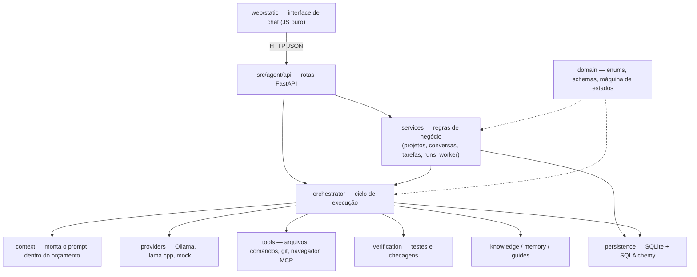

# Resumo do projeto — Agente de IA Local

Resumo didático e completo do projeto inteiro: **propósito, por quê, quando e onde** de cada diretório, arquivo,
classe e função, com **entradas e saídas**. Não descreve o passo a passo interno, só o necessário para entender
o funcionamento e a arquitetura.

> Este arquivo é **mantido a cada tarefa** pelo agente e verificado por `python3 scripts/resume.py check`
> (regra: [`docs/regras/resumo-projeto.md`](/docs/regras/resumo-projeto.md)). Convenção de leitura:
> `nome(params) → saída` — descrição. Métodos aparecem como `Classe.metodo(...)`.

---

## Visão geral

**O que é:** um agente de programação que roda **na própria máquina**. Você escreve um pedido no chat
(ex.: "crie uma tela de login"), e o agente planeja, divide em tarefas pequenas, chama um modelo de linguagem
local, executa ferramentas (ler/escrever arquivos, rodar comandos e testes, navegador, MCP), verifica o
resultado e devolve uma resposta final.

**Por quê:** modelos locais pequenos têm pouca janela de contexto e erram com facilidade. Por isso a
**complexidade fica na arquitetura** (orquestrador, decomposição, verificação, persistência) e não no prompt:
o modelo é uma peça substituível, e o estado verdadeiro fica no SQLite, permitindo retomar após falhas ou
reinícios.

**Quando/onde roda:** `agente-api` sobe uma API FastAPI em `http://127.0.0.1:8765`, que também serve a interface
web estática. Um *worker* em segundo plano avança as execuções autônomas. Dados ficam em `data/agent.db`.

### Arquitetura em camadas

### O caminho de uma mensagem

1. **Interface** (`web/static/assets/app.js`): mostra a mensagem na hora, cria a tarefa-raiz
   (`POST /projects/{id}/tasks`) e uma execução (`POST /projects/{id}/runs`), liga o modo autônomo e dá o
   primeiro passo (`POST /runs/{id}/step`). Enquanto houver execução ativa, novos envios ficam bloqueados.
2. **API** (`src/agent/api/main.py`): valida, grava no SQLite e delega aos *services* e ao orquestrador.
3. **Orquestrador** (`src/agent/orchestrator/runner.py`): a cada passo escolhe a próxima tarefa e
   - **planeja/decompõe** objetivos em subtarefas (`planner`, `decomposition`, `atomizer`);
   - **monta o contexto** e pede ao modelo uma operação estruturada (`context`, `providers`);
   - **executa** a ferramenta escolhida (`tools`) e **verifica** (`verification`, `global_verify`);
   - **consolida** resultados no pai, **replaneja** o que falhou e escreve a **resposta final** (`closing`).
4. **Worker** (`services/autonomous_worker.py`): continua dando passos sozinho enquanto o run for autônomo.
5. **Interface** faz *polling* (`/live`, `/tasks`, `/events`) e desenha pensamentos, etapas, diffs e a resposta.

### Conceitos-chave

| Conceito | O que é |
|----------|---------|
| **Projeto / workspace** | Pasta raiz onde o agente trabalha (`ProjectModel`); conversas sem projeto usam a pasta do usuário |
| **Conversa e ramo** | Histórico do chat (`ConversationModel`); editar uma mensagem cria um **ramo** (`BranchModel`) |
| **Tarefa** | Nó de uma árvore (`TaskModel`): `objective` (pedido) → `subsystem` → `operation` (ação atômica) |
| **Estados da tarefa** | `PENDING → PLANNING → READY → RUNNING → VERIFYING → COMPLETED`, com `RETRY_PENDING`, `BLOCKED`, `FAILED`, `CANCELLED` (`domain/state_machine.py`) |
| **Run (execução)** | Uma rodada do orquestrador sobre uma tarefa-raiz (`ExecutionRunModel`): `active`, `paused`, `completed`, `failed`, `cancelled` |
| **Tentativa** | Cada chamada a modelo, ferramenta ou verificação (`OperationAttemptModel`), com limite por tarefa |
| **Evidência / contrato** | Provas de que algo funcionou (`EvidenceModel`) e critérios de aceite da tarefa (`TaskContractModel`) |
| **Memória** | Fatos lembrados por projeto ou conversa (`MemoryRecordModel`) |
| **Grafo de conhecimento** | Símbolos e imports do código do projeto (`KgNodeModel`, `KgEdgeModel`) |
| **Eventos** | Linha do tempo de tudo que aconteceu (`EventLogModel`), base dos "pensamentos" mostrados na UI |

### Stack e execução

Python 3.11+ (FastAPI, Uvicorn, SQLAlchemy 2, Pydantic v2, httpx), SQLite, JS/CSS puros na interface,
pytest nos testes. Instalação: `pip install -e ".[dev]"`; rodar: `agente-api`; testar: `pytest`.
Configuração por variáveis de ambiente / `.env` (`src/agent/config.py`).

---

## `src/`

**Propósito:** raiz do código-fonte do pacote Python instalável `agente-local` (`pip install -e .`). **Por quê:** separa o código do runtime de docs, testes e interface web. **Quando:** instalado em modo editável para rodar a API (`agente-api`) e os testes.

### `src/README.md`

**Propósito:** índice da pasta `src/`, apontando para o pacote `agent/`. **Quando/onde:** leitura de orientação para quem navega no repositório.

## `src/agent/`

**Propósito:** núcleo do Agente de IA Local: API, domínio, persistência, orquestrador, ferramentas, provedores de modelo, contexto, conhecimento, verificação, segurança, MCP, visão e utilitários. **Por quê:** concentra o runtime em um pacote único importável como `agent`. **Quando:** carregado sempre que a API ou os testes rodam.

### `src/agent/README.md`

**Propósito:** mapa dos subpacotes de `agent/` e suas responsabilidades, com link para `config.py` e para a doc de execução local (Ollama como padrão). **Quando/onde:** documentação de navegação.

### `src/agent/__init__.py`

**Propósito:** marca o pacote `agent` e define `__version__ = "0.1.0"` (versão do pacote; a API anuncia sua própria versão, 0.5.0). **Quando/onde:** importado implicitamente em qualquer `import agent...`.

### `src/agent/config.py`

**Propósito:** configuração central lida de variáveis de ambiente e do arquivo `.env` (pydantic-settings). **Quando/onde:** usada pela API (`deps.read_settings`), pela persistência (URL do banco) e pelo orquestrador/provedores (URLs, modelo padrão, limites).

- **`Settings(BaseSettings)`** — Todas as opções do runtime: diretório de dados, URL do banco, URLs/timeout do Ollama e do llama.cpp, provedor e modelo padrão, orçamento de contexto (limite, entrada, reserva de saída), uso do template genérico de decomposição, fallback para mock, host/porta da API (padrão `127.0.0.1:8765`), limites de tentativas e de passos do orquestrador, proteções contra recursão (`max_tree_depth`, `max_tasks_per_run`), limites operacionais do run (tentativas por estratégia, passos sem progresso, tempo, chamadas ao modelo, ferramentas, tokens, replanejamentos; 0 desliga), limites da observabilidade (texto por campo de evento, resposta final, agrupamento de fragmentos, fila por assinante SSE, anel em memória), pasta da web estática, caminho do `mcp.json` e se o worker em segundo plano liga.
  - `Settings.resolved_database_url() → str` — Devolve a URL SQLite final: em testes do pytest força `data_dir/agent.db` (para não gravar no banco real), senão usa `database_url` se houver, senão `data/agent.db`; cria o diretório de dados quando necessário.
- `get_settings() → Settings` — Cria uma instância de `Settings` e, se `mcp_config_path` não foi definido, preenche com `data_dir/mcp.json`. Chamada sempre que alguém precisa da configuração atual.

## `src/agent/api/`

### `src/agent/api/observe_routes.py.bak`

**Propósito:** Backup do arquivo de rotas de observabilidade antes de alterações, preservando uma versão funcional para possível reversão.

