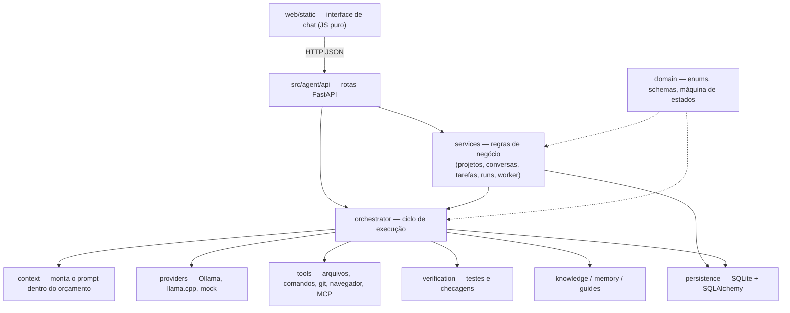

# Resumo do projeto — Agente de IA Local

Resumo didático e completo do projeto inteiro: **propósito, por quê, quando e onde** de cada diretório, arquivo,
classe e função, com **entradas e saídas**. Não descreve o passo a passo interno, só o necessário para entender
o funcionamento e a arquitetura.

> Este arquivo é **mantido a cada tarefa** pelo agente e verificado por `python3 scripts/resume.py check`
> (regra: [`docs/regras/resumo-projeto.md`](/docs/regras/resumo-projeto.md)). Convenção de leitura:
> `nome(params) → saída` — descrição. Métodos aparecem como `Classe.metodo(...)`.

---

## Visão geral


**O que é:** um agente de programação que roda **na própria máquina**. Você escreve um pedido no chat
(ex.: "crie uma tela de login"), e o agente planeja, divide em tarefas pequenas, chama um modelo de linguagem
local, executa ferramentas (ler/escrever arquivos, rodar comandos e testes, navegador, MCP), verifica o
resultado e devolve uma resposta final.

**Por quê:** modelos locais pequenos têm pouca janela de contexto e erram com facilidade. Por isso a
**complexidade fica na arquitetura** (orquestrador, decomposição, verificação, persistência) e não no prompt:
o modelo é uma peça substituível, e o estado verdadeiro fica no SQLite, permitindo retomar após falhas ou
reinícios.

**Quando/onde roda:** `agente-api` sobe uma API FastAPI em `http://127.0.0.1:8765`, que também serve a interface
web estática. Um *worker* em segundo plano avança as execuções autônomas. Dados ficam em `data/agent.db`.

### Arquitetura em camadas



### O caminho de uma mensagem

1. **Interface** (`web/static/assets/app.js`): mostra a mensagem na hora, cria a tarefa-raiz
   (`POST /projects/{id}/tasks`) e uma execução (`POST /projects/{id}/runs`), liga o modo autônomo e dá o
   primeiro passo (`POST /runs/{id}/step`). Enquanto houver execução ativa, novos envios ficam bloqueados.
2. **API** (`src/agent/api/main.py`): valida, grava no SQLite e delega aos *services* e ao orquestrador.
3. **Orquestrador** (`src/agent/orchestrator/runner.py`): a cada passo escolhe a próxima tarefa e
   - **planeja/decompõe** objetivos em subtarefas (`planner`, `decomposition`, `atomizer`);
   - **monta o contexto** e pede ao modelo uma operação estruturada (`context`, `providers`);
   - **executa** a ferramenta escolhida (`tools`) e **verifica** (`verification`, `global_verify`);
   - **consolida** resultados no pai, **replaneja** o que falhou e escreve a **resposta final** (`closing`).
4. **Worker** (`services/autonomous_worker.py`): continua dando passos sozinho enquanto o run for autônomo.
5. **Interface** faz *polling* (`/live`, `/tasks`, `/events`) e desenha pensamentos, etapas, diffs e a resposta.

### Conceitos-chave

| Conceito | O que é |
|----------|---------|
| **Projeto / workspace** | Pasta raiz onde o agente trabalha (`ProjectModel`); conversas sem projeto usam a pasta do usuário |
| **Conversa e ramo** | Histórico do chat (`ConversationModel`); editar uma mensagem cria um **ramo** (`BranchModel`) |
| **Tarefa** | Nó de uma árvore (`TaskModel`): `objective` (pedido) → `subsystem` → `operation` (ação atômica) |
| **Estados da tarefa** | `PENDING → PLANNING → READY → RUNNING → VERIFYING → COMPLETED`, com `RETRY_PENDING`, `BLOCKED`, `FAILED`, `CANCELLED` (`domain/state_machine.py`) |
| **Run (execução)** | Uma rodada do orquestrador sobre uma tarefa-raiz (`ExecutionRunModel`): `active`, `paused`, `completed`, `failed`, `cancelled` |
| **Tentativa** | Cada chamada a modelo, ferramenta ou verificação (`OperationAttemptModel`), com limite por tarefa |
| **Evidência / contrato** | Provas de que algo funcionou (`EvidenceModel`) e critérios de aceite da tarefa (`TaskContractModel`) |
| **Memória** | Fatos lembrados por projeto ou conversa (`MemoryRecordModel`) |
| **Grafo de conhecimento** | Símbolos e imports do código do projeto (`KgNodeModel`, `KgEdgeModel`) |
| **Eventos** | Linha do tempo de tudo que aconteceu (`EventLogModel`), base dos "pensamentos" mostrados na UI |

### Stack e execução

Python 3.11+ (FastAPI, Uvicorn, SQLAlchemy 2, Pydantic v2, httpx), SQLite, JS/CSS puros na interface,
pytest nos testes. Instalação: `pip install -e ".[dev]"`; rodar: `agente-api`; testar: `pytest`.
Configuração por variáveis de ambiente / `.env` (`src/agent/config.py`).

---

---

---

---

---

---

---

## Inventário por pasta e arquivo

### `README.md`

**Propósito:** Documentação principal do repositório — visão geral, instalação, arquitetura, navegação. **Quando/onde:** ponto de entrada para humanos e agentes.

### `pyproject.toml`

**Propósito:** Metadados do pacote Python (`agente-local`), dependências, scripts (`agente-api`), config pytest.

### `notes.md`

**Propósito:** Status efêmero do Project (espelho do painel Notes do Cursor).

### `preferences.md`

**Propósito:** Preferências do usuário/projeto (estilo, convenções, ferramentas).

### `.env.example`

**Propósito:** Template de variáveis de ambiente (copiar para `.env` e ajustar).

### `.gitignore`

**Propósito:** Ignora `.venv/`, `data/`, `__pycache__/`, `.pytest_cache/`, backups, `*.bak`, `*.pyc`.

### `test_server.py`

**Propósito:** Teste manual rápido do servidor (inicia uvicorn, faz requests básicos).

### `test_step.py`

**Propósito:** Teste manual de um step do orquestrador.

### `resume.md`

**Propósito:** Resumo vivo do projeto inteiro — propósito, quando/onde, entradas e saídas de cada diretório, arquivo, classe e função. Verificado por `scripts/resume.py check` a cada tarefa.

## `.cursor/`

**Propósito:** Configuração do Cursor (regras, hooks e inventário do resume) — lida pelo Cursor ao abrir o projeto.

- Subpasta: [.cursor/hooks/](/.cursor/hooks/)
- Subpasta: [.cursor/rules/](/.cursor/rules/)
- Arquivo: [hooks.json](/.cursor/hooks.json)

## `.cursor/hooks/`

**Propósito:** Hooks do Cursor executados no fim de cada resposta do agente.

- Arquivo: [resume-check.sh](/.cursor/hooks/resume-check.sh)

### `.cursor/hooks/resume-check.sh`

**Propósito:** Script chamado pelo hook `stop` — roda `python3 scripts/resume.py check` e alerta se o resumo ficou para trás.

## `.cursor/rules/`

**Propósito:** Regras sempre aplicadas pelo Cursor neste repositório.

- Arquivo: [resume.mdc](/.cursor/rules/resume.mdc)

### `.cursor/rules/resume.mdc`

**Propósito:** Regra `alwaysApply` que exige `resume.md` sincronizado a cada tarefa (check → faltando → carimbar).

### `.cursor/hooks.json`

**Propósito:** Configuração de hooks do Cursor (ex.: `stop` hook roda `resume-check.sh`). **Quando/onde:** disparado automaticamente pelo Cursor.

## `data/`

**Propósito:** Dados de runtime (gitignored): SQLite `agent.db`, `mcp.json`, logs e anexos.

- Arquivo: [README.md](/data/README.md)
- Arquivo: [mcp.example.json](/data/mcp.example.json)

### `data/README.md`

**Propósito:** Índice da pasta `data/` (runtime gitignored).

### `data/mcp.example.json`

**Propósito:** Template de configuração MCP stdio (copiar para `data/mcp.json`).

## `docs/`

**Propósito:** Documentação técnica do projeto (arquitetura, regras e contexto).

- Subpasta: [docs/architecture/](/docs/architecture/)
- Subpasta: [docs/regras/](/docs/regras/)
- Arquivo: [README.md](/docs/README.md)
- Arquivo: [project-context.md](/docs/project-context.md)

## `docs/architecture/`

**Propósito:** Documentos de arquitetura do runtime do agente.

- Arquivo: [README.md](/docs/architecture/README.md)
- Arquivo: [context-builder.md](/docs/architecture/context-builder.md)
- Arquivo: [diagnostico-evolucao.md](/docs/architecture/diagnostico-evolucao.md)
- Arquivo: [execucao-autonoma.md](/docs/architecture/execucao-autonoma.md)
- Arquivo: [execucao-local.md](/docs/architecture/execucao-local.md)
- Arquivo: [ferramentas.md](/docs/architecture/ferramentas.md)
- Arquivo: [frontend.md](/docs/architecture/frontend.md)
- Arquivo: [knowledge-graph.md](/docs/architecture/knowledge-graph.md)
- Arquivo: [limitacoes.md](/docs/architecture/limitacoes.md)
- Arquivo: [maquina-estados.md](/docs/architecture/maquina-estados.md)
- Arquivo: [mcp.md](/docs/architecture/mcp.md)
- Arquivo: [modelo-dados.md](/docs/architecture/modelo-dados.md)
- Arquivo: [requisitos-verificacao-progresso.md](/docs/architecture/requisitos-verificacao-progresso.md)
- Arquivo: [skills-estrategia.md](/docs/architecture/skills-estrategia.md)
- Arquivo: [ux-ui.md](/docs/architecture/ux-ui.md)
- Arquivo: [visao-geral.md](/docs/architecture/visao-geral.md)

### `docs/architecture/README.md`

**Propósito:** Índice da pasta `architecture/` (14 documentos técnicos).

### `docs/architecture/context-builder.md`

**Propósito:** Orçamento de tokens, componentes do prompt, compactação, `ContextBudgetError`.

### `docs/architecture/diagnostico-evolucao.md`

**Propósito:** Diagnóstico de problemas históricos e evolução da arquitetura.

### `docs/architecture/execucao-autonoma.md`

**Propósito:** Worker autônomo, loop background, modo autônomo, replanejamento.

### `docs/architecture/execucao-local.md`

**Propósito:** Instalação, variáveis de ambiente, padrões (Ollama), conversas, memória, UI, MCP, testes.

### `docs/architecture/ferramentas.md`

**Propósito:** Catálogo de ferramentas builtins, aliases, aprovação, segurança de paths.

### `docs/architecture/frontend.md`

**Propósito:** SPA IDE-like (layout, componentes, polling, SSE, diff, live board).

### `docs/architecture/knowledge-graph.md`

**Propósito:** Grafo de conhecimento (AST indexer, nodes/edges, search, neighbors).

### `docs/architecture/limitacoes.md`

**Propósito:** Limitações conhecidas do agente (contexto, verificação, replanejamento, etc.).

### `docs/architecture/maquina-estados.md`

**Propósito:** Machine de estados `TaskStatus` + transições permitidas (Mermaid).

### `docs/architecture/mcp.md`

**Propósito:** Integração MCP stdio (config, discover, call, transport).

### `docs/architecture/modelo-dados.md`

**Propósito:** 14 entidades SQLite + campos essenciais + relações.

### `docs/architecture/requisitos-verificacao-progresso.md`

**Propósito:** Requisitos rastreáveis, validação de plano, verificação independente, progresso real, estagnação, limites, pausa/retomada.

### `docs/architecture/skills-estrategia.md`

**Propósito:** Arquitetura das skills sob demanda, da estratégia profissional, da decomposição recursiva e do ciclo de recuperação da verificação.

### `docs/architecture/ux-ui.md`

**Propósito:** Guia de UX/UI da interface web (layout, estados, interações).

### `docs/architecture/visao-geral.md`

**Propósito:** Visão macro da arquitetura (camadas, fases, ADRs, stack).

## `docs/regras/`

**Propósito:** Regras operacionais para agentes (hub em `README.md`).

- Arquivo: [README.md](/docs/regras/README.md)
- Arquivo: [ativos-visuais.md](/docs/regras/ativos-visuais.md)
- Arquivo: [autoaperfeicoamento.md](/docs/regras/autoaperfeicoamento.md)
- Arquivo: [checklists-tarefas.md](/docs/regras/checklists-tarefas.md)
- Arquivo: [commits.md](/docs/regras/commits.md)
- Arquivo: [documentacao.md](/docs/regras/documentacao.md)
- Arquivo: [mcps.md](/docs/regras/mcps.md)
- Arquivo: [navegacao-agentes.md](/docs/regras/navegacao-agentes.md)
- Arquivo: [organizacao-arquivos.md](/docs/regras/organizacao-arquivos.md)
- Arquivo: [principios.md](/docs/regras/principios.md)
- Arquivo: [readmes-pastas.md](/docs/regras/readmes-pastas.md)
- Arquivo: [resumo-projeto.md](/docs/regras/resumo-projeto.md)
- Arquivo: [validacoes-testes.md](/docs/regras/validacoes-testes.md)
- Arquivo: [verificacao-final.md](/docs/regras/verificacao-final.md)

### `docs/regras/README.md`

**Propósito:** Hub das regras operacionais para agentes (como trabalhar no repo).

### `docs/regras/ativos-visuais.md`

**Propósito:** Uso de SVGs/icons nos docs (pasta `media/icons/`, referências Markdown).

### `docs/regras/autoaperfeicoamento.md`

**Propósito:** Processo de auto-aperfeiçoamento do agente (feedback loops, skills, memory).

### `docs/regras/checklists-tarefas.md`

**Propósito:** Formato de checklists em `internal/tarefas/` (título, passos, critérios, status).

### `docs/regras/commits.md`

**Propósito:** Convenção de commits em português (tipo, escopo, descrição).

### `docs/regras/documentacao.md`

**Propósito:** Padrões de documentação técnica (formato, diagramas, tabelas, navegação).

### `docs/regras/mcps.md`

**Propósito:** Regras para configuração e uso de servidores MCP no projeto.

### `docs/regras/navegacao-agentes.md`

**Propósito:** Como agentes navegam no repositório (links, convenções, context).

### `docs/regras/organizacao-arquivos.md`

**Propósito:** Organização de arquivos no repo (onde colocar cada tipo de artefato).

### `docs/regras/principios.md`

**Propósito:** Princípios fundamentais do projeto (complexidade na arquitetura, estado no SQLite, etc.).

### `docs/regras/readmes-pastas.md`

**Propósito:** Regra: toda pasta com código/docs deve ter `README.md` local (índice + links).

### `docs/regras/resumo-projeto.md`

**Propósito:** Regra do resumo vivo: o que o `resume.md` contém, o formato exigido pelo verificador e o protocolo de sincronia a cada tarefa.

### `docs/regras/validacoes-testes.md`

**Propósito:** Regras de validação e testes (pytest, cobertura, evidências).

### `docs/regras/verificacao-final.md`

**Propósito:** Checklist de verificação final antes de commit (build, testes, docs, resume.md).

### `docs/README.md`

**Propósito:** Índice da pasta `docs/` → `project-context.md`, `regras/`, `architecture/`.

### `docs/project-context.md`

**Propósito:** Metas, restrições e convenções do projeto (hub para agentes Cursor).

## `internal/`

**Propósito:** Trabalho interno do agente (checklists de tarefa e evidências).

- Subpasta: [internal/tarefas/](/internal/tarefas/)
- Arquivo: [README.md](/internal/README.md)

## `internal/tarefas/`

**Propósito:** Checklists das atividades — um arquivo por tarefa.

### `internal/README.md`

**Propósito:** Índice da pasta `internal/` (trabalho interno, checklists, evidências).

## `media/`

**Propósito:** Assets visuais (ícones SVG) usados nos documentos Markdown.

- Subpasta: [media/icons/](/media/icons/)

## `media/icons/`

**Propósito:** Ícones SVG referenciados pelos documentos.

## `scripts/`

**Propósito:** Scripts operacionais (backup do banco, correções de instalação, verificação do resume).

- Arquivo: [README.md](/scripts/README.md)
- Arquivo: [backup-data.sh](/scripts/backup-data.sh)
- Arquivo: [fix-python314-editable.py](/scripts/fix-python314-editable.py)
- Arquivo: [resume.py](/scripts/resume.py)

### `scripts/README.md`

**Propósito:** Índice da pasta `scripts/` (backup-data.sh, fix-python314-editable.py).

### `scripts/backup-data.sh`

**Propósito:** Backup do SQLite `data/agent.db` → `backups/agent-YYYYMMDD-HHMMSS.db`.

### `scripts/fix-python314-editable.py`

**Propósito:** Corrige editable install no Python 3.14+ (remove `.pth` com prefixo `_`).

- `main() -> None` — Entry point do script — remove arquivos `.pth` com prefixo `_` do site-packages, corrigindo a instalação editável do pacote em Python 3.14+. Executado manualmente quando o `pip install -e .` falha.

### `scripts/resume.py`

**Propósito:** Valida e carimba `resume.md`.

- `Item` — dataclass imutável representando um item do inventário (dir | file | sym) com path, name e signature.
- `Item.key() -> str` — Chave única do item — `sym:path::nome(assinatura)` ou `dir:path/` ou `file:path`.
- `Item.short() -> str` — Nome curto para exibição — último segmento do path.
- `_py_signature(node: ast.FunctionDef | ast.AsyncFunctionDef) -> str` — Extrai assinatura de função/método Python (parâmetros sem self/cls + retorno).
- `cmd_carimbar() -> int` — Comando `carimbar` — atualiza `.cursor/resume-inventario.json` com hash atual (recusa se ainda faltar descrição).
- `cmd_check() -> int` — Comando `check` — verifica itens sem descrição no `resume.md`.
- `cmd_faltando() -> int` — Comando `faltando` — mostra esqueleto do que falta descrever.
- `cmd_hook() -> int` — Comando `hook` — executa check no pre-commit/stop hook.
- `describe(missing: list[Item], added: list[str], removed: list[str], limit: int=40) -> str` — Formata relatório de itens faltando/adicionados/removidos.
- `file_sections(text: str) -> dict[str, str]` — Parseia `resume.md` em seções por cabeçalho `##` / `###`.
- `inventory(files: list[str] | None=None) -> list[Item]` — Gera inventário de dirs/files/syms do projeto.
- `js_symbols(path: str, source: str) -> list[Item]` — Extrai símbolos JavaScript/TypeScript (funções, classes, exports) via regex.
- `load_state() -> list[str]` — Carrega estado anterior do `.cursor/resume-inventario.json`.
- `main(argv: list[str]) -> int` — Entry point do script — remove `.pth` com prefixo `_` do site-packages (corrige editable install no Python 3.14+).
- `missing_items(items: list[Item], text: str) -> list[Item]` — Compara inventário com seções do `resume.md` — retorna itens sem descrição.
- `project_files() -> list[str]` — Lista arquivos do projeto (respeita `.gitignore`, ignora `.venv`, `__pycache__`, etc.).
- `python_symbols(path: str, source: str) -> list[Item]` — Extrai símbolos Python (funções, classes, methods) via `ast.parse`.
- `report() -> tuple[list[Item], list[str], list[str]]` — Gera relatório completo: (missing, added, removed) comparando inventário atual vs estado salvo.
- `skeleton(missing: list[Item]) -> str` — Gera esqueleto markdown dos itens faltando (para `faltando`).

## `skills/`

**Propósito:** Catálogo editável de Skills do agente — a fonte de verdade das competências profissionais.

- Arquivo: [README.md](/skills/README.md)
- Arquivo: [debugging-root-cause.md](/skills/debugging-root-cause.md)
- Arquivo: [refactoring-clean-code.md](/skills/refactoring-clean-code.md)
- Arquivo: [software-engineering.md](/skills/software-engineering.md)
- Arquivo: [system-architecture.md](/skills/system-architecture.md)
- Arquivo: [technical-writing.md](/skills/technical-writing.md)
- Arquivo: [testing-quality-assurance.md](/skills/testing-quality-assurance.md)

### `skills/README.md`

**Propósito:** Índice da pasta `skills/` com catálogo de skills disponíveis.

### `skills/debugging-root-cause.md`

**Propósito:** Skill de depuração sistemática e análise de causa raiz (diagnóstico metódico, correção cirúrgica, não-regressão).

### `skills/refactoring-clean-code.md`

**Propósito:** Skill de refatoração e código limpo (estrutura, legibilidade, manutenibilidade sem alterar comportamento).

### `skills/software-engineering.md`

**Propósito:** Skill de engenharia de software e implementação modular (código robusto, tipagem, compatibilidade).

### `skills/system-architecture.md`

**Propósito:** Skill de arquitetura de sistemas e decomposição (fronteiras, contratos, separação de responsabilidades).

### `skills/technical-writing.md`

**Propósito:** Skill de documentação técnica e comunicação estruturada (sincronizada com o código real).

### `skills/testing-quality-assurance.md`

**Propósito:** Skill de garantia de qualidade e testes independentes (verificações determinísticas, critérios de aceite).

## `src/`

**Propósito:** Raiz do código-fonte do pacote instalável `agente-local`.

- Subpasta: [src/agent/](/src/agent/)
- Arquivo: [README.md](/src/README.md)

## `src/agent/`

**Propósito:** Núcleo do Agente de IA Local: API, domínio, persistência, orquestrador, ferramentas, provedores, contexto, skills, verificação e utilitários.

- Subpasta: [src/agent/api/](/src/agent/api/)
- Subpasta: [src/agent/context/](/src/agent/context/)
- Subpasta: [src/agent/domain/](/src/agent/domain/)
- Subpasta: [src/agent/guides/](/src/agent/guides/)
- Subpasta: [src/agent/i18n/](/src/agent/i18n/)
- Subpasta: [src/agent/knowledge/](/src/agent/knowledge/)
- Subpasta: [src/agent/mcp/](/src/agent/mcp/)
- Subpasta: [src/agent/memory/](/src/agent/memory/)
- Subpasta: [src/agent/observability/](/src/agent/observability/)
- Subpasta: [src/agent/orchestrator/](/src/agent/orchestrator/)
- Subpasta: [src/agent/persistence/](/src/agent/persistence/)
- Subpasta: [src/agent/providers/](/src/agent/providers/)
- Subpasta: [src/agent/security/](/src/agent/security/)
- Subpasta: [src/agent/services/](/src/agent/services/)
- Subpasta: [src/agent/skills/](/src/agent/skills/)
- Subpasta: [src/agent/tools/](/src/agent/tools/)
- Subpasta: [src/agent/util/](/src/agent/util/)
- Subpasta: [src/agent/verification/](/src/agent/verification/)
- Subpasta: [src/agent/vision/](/src/agent/vision/)
- Arquivo: [README.md](/src/agent/README.md)
- Arquivo: [__init__.py](/src/agent/__init__.py)
- Arquivo: [config.py](/src/agent/config.py)

## `src/agent/api/`

**Propósito:** Rotas FastAPI (REST e SSE) e dependências da aplicação.

- Arquivo: [README.md](/src/agent/api/README.md)
- Arquivo: [__init__.py](/src/agent/api/__init__.py)
- Arquivo: [deps.py](/src/agent/api/deps.py)
- Arquivo: [main.py](/src/agent/api/main.py)
- Arquivo: [observe_routes.py](/src/agent/api/observe_routes.py)

### `src/agent/api/README.md`

**Propósito:** Índice da pasta `api/` (main.py, observe_routes.py, deps.py).

### `src/agent/api/__init__.py`

**Propósito:** Marca o pacote `api` como parte do `agent`.

### `src/agent/api/deps.py`

**Propósito:** Dependências FastAPI — `db_session` (Session), `read_settings` (Settings), `get_engine` (Engine singleton).

- `db_session() -> Generator[Session, None, None]` — Dependência FastAPI que abre uma sessão SQLAlchemy e a fecha no fim da requisição; devolve a `Session` pronta para uso nas rotas.
- `get_engine()` — Símbolo do módulo — ver a descrição do arquivo.
- `get_session_factory() -> sessionmaker[Session]` — Dependency FastAPI — retorna session factory do SQLAlchemy (singleton via `get_engine()`).
- `read_settings() -> Settings` — Dependência FastAPI que devolve a configuração atual (`Settings`) lida do ambiente e do arquivo `.env`.

### `src/agent/api/main.py`

**Propósito:** Expõe a API HTTP FastAPI do agente (projetos, conversas, tarefas, runs, memória, grafo de conhecimento, métricas e observabilidade) e monta a SPA web estática. **Quando/onde:** Usado quando o processo sobe via `run()`/uvicorn (`agent.api.main:app`); as rotas dependem da sessão `db_session` e o módulo monta o frontend já na importação.

- `ResumeBody(BaseModel)` — Modelo Pydantic do corpo de `POST /tasks/{task_id}/resume-brief`; único campo `apply: bool = False` que decide se o brief é apenas informativo ou reaplica a execução.
- `_RevalidatedStatic(StaticFiles)` — Subclasse de `StaticFiles` que força `Cache-Control: no-cache` em toda resposta de arquivo, evitando o navegador misturar HTML antigo com módulos novos.
- `_RevalidatedStatic.file_response(*args, **kwargs)` — Sobrescreve `StaticFiles.file_response` para acrescentar o cabeçalho `Cache-Control: no-cache` à resposta antes de devolvê-la.
- `_how_for_task(task) -> str` — Deriva dos metadados da tarefa (tool, verification, model_operation, mcp_tool) uma frase curta explicando como ela será executada; o fallback descreve a máquina de estados do orquestrador.
- `_mark_repeated_thought(thoughts: list[dict], item: dict) -> None` — Calcula no item o contador `repeat` (1 ou 2+) comparando o texto com os pensamentos já coletados, para a interface mostrar que a frase se repetiu sem mudança.
- `_mcp_path(settings: Settings) -> Path` — Resolve o arquivo de configuração MCP: usa `settings.mcp_config_path` ou `data_dir/mcp.json`; se não existir, cai no `data/mcp.example.json` da raiz do repositório.
- `_mount_web(settings: Settings) -> None` — Monta a SPA web estática no app FastAPI: publica `/assets` via `_RevalidatedStatic` e registra `GET /` servindo `index.html`; executado na importação do módulo.
- `_present_conversation(session: Session, item: ConversationModel) -> ConversationRead` — Serializa a conversa em `ConversationRead`, garantindo a branch ativa, anexando branches, `root_path` efetivo e `path_origin` (chosen/home), e ocultando `project_id` nas conversas da inbox.
- `_present_task(session: Session, task) -> TaskRead` — Monta o `TaskRead` da tarefa, traduzindo o título para o idioma da tarefa e preenchendo `usage_tokens` e `metadata_json` com o modelo lembrado.
- `_remembered_model(session: Session, task) -> dict` — Devolve os metadados da tarefa preservando `model_id`; se a tarefa raiz não tiver modelo, procura na run mais recente que a iniciou para recuperar o `model_id` usado.
- `_thought_trace(session: Session, project_id: uuid.UUID, tasks: list) -> list[dict]` — Lê os eventos `agent.thought`/`orchestrator.action` do projeto, traduz as ações por `ACTION_COPY`, descarta ações internas e devolve os 16 pensamentos mais recentes com fase, texto e task associada.
- `_usage_tokens(session: Session, task) -> int` — Estima os tokens consumidos pela tarefa: usa `metadata["usage"]["total"]` quando existe, senão o `estimated_tokens` do snapshot de contexto mais recente.
- `_web_dir(settings: Settings) -> Path | None` — Localiza a pasta do frontend: `settings.static_web_dir` se for diretório, senão `web/static` na raiz do repositório; devolve `None` quando nada existe.
- `activate_branch(conversation_id: uuid.UUID, branch_id: uuid.UUID, session: Session=Depends(db_session)) -> ConversationRead` — `POST /conversations/{conversation_id}/branches/{branch_id}/activate`: ativa a branch indicada e devolve a conversa atualizada; 404 se a conversa não existir.
- `add_dependency(task_id: uuid.UUID, body: TaskDependencyCreate, session: Session=Depends(db_session)) -> dict` — `POST /tasks/{task_id}/dependencies`: cria a dependência entre tarefas a partir do corpo e devolve `{id, task_id, depends_on}`; 404 tarefa inexistente, 400 dependência inválida.
- `add_memory(project_id: uuid.UUID, body: MemoryCreate, session: Session=Depends(db_session)) -> MemoryRead` — `POST /projects/{project_id}/memory`: grava memória canônica ou contextual via `ProjectService.add_memory` e devolve `MemoryRead`; 404 se o projeto não existir.
- `cancel_run(run_id: uuid.UUID, session: Session=Depends(db_session)) -> dict` — `POST /runs/{run_id}/cancel`: cancela a execução e devolve `{id, status}`; 404 se a run não existir.
- `conversation_tasks(conversation_id: uuid.UUID, branch_id: uuid.UUID | None=None, session: Session=Depends(db_session)) -> list[TaskRead]` — `GET /conversations/{conversation_id}/tasks`: lista as tarefas da conversa (branch ativa ou a `branch_id` informada) já apresentadas por `_present_task`; 404 conversa inexistente.
- `create_conversation(project_id: uuid.UUID, body: ConversationCreate, session: Session=Depends(db_session)) -> ConversationRead` — `POST /projects/{project_id}/conversations`: cria uma conversa dentro do projeto a partir do corpo e devolve `ConversationRead`; 404 projeto inexistente.
- `create_loose_conversation(body: ConversationCreate, session: Session=Depends(db_session)) -> ConversationRead` — `POST /conversations`: cria uma conversa sem projeto (inbox/"loose") e devolve `ConversationRead` com branches e raiz efetiva.
- `create_project(body: ProjectCreate, session: Session=Depends(db_session)) -> ProjectRead` — `POST /projects`: cria o projeto via `ProjectService.create_project` e devolve o `ProjectRead` correspondente.
- `create_task(project_id: uuid.UUID, body: TaskCreate, session: Session=Depends(db_session)) -> TaskRead` — `POST /projects/{project_id}/tasks`: cria a tarefa detectando idioma, materializando anexos, tocando o título da conversa e extraindo memórias do objetivo; 404 projeto, 400 objetivo inválido.
- `debug_chat_ollama(body: dict, settings: Settings=Depends(read_settings)) -> dict` — chat direto Ollama (debug).
- `delete_conversation(conversation_id: uuid.UUID, session: Session=Depends(db_session)) -> dict` — `DELETE /conversations/{conversation_id}`: remove a conversa e devolve `{"deleted": true}`; 404 se não existir.
- `disable_autonomous(run_id: uuid.UUID, session: Session=Depends(db_session)) -> dict` — `POST /runs/{run_id}/autonomous/disable`: desliga o modo autônomo ajustando `config_json["autonomous"]` para `False`, faz commit e devolve `{id, autonomous}`.
- `enable_autonomous(run_id: uuid.UUID, session: Session=Depends(db_session)) -> dict` — `POST /runs/{run_id}/autonomous/enable`: habilita o modo autônomo via `enable_autonomous_on_run`, faz commit e devolve `{id, autonomous}`.
- `fork_conversation(conversation_id: uuid.UUID, body: ConversationFork, session: Session=Depends(db_session)) -> dict` — `POST /conversations/{conversation_id}/fork`: cria a tarefa-filha a partir de `body.task_id` e `body.objective` e devolve a conversa com a nova task.
- `fs_browse(path: str | None=None) -> dict` — `GET /fs/browse`: navega o sistema de arquivos local a partir de um caminho devolvendo diretórios e subpastas; 400 para caminho inválido.
- `fs_pick_folder() -> dict` — `POST /fs/pick-folder`: abre o seletor nativo de pastas do sistema operacional e devolve `{"path": ...}`; 400 quando não há seleção válida.
- `get_context_snapshot(snapshot_id: uuid.UUID, session: Session=Depends(db_session)) -> dict` — `GET /context-snapshots/{snapshot_id}`: devolve o snapshot de contexto (tokens estimados, componentes, notas de estratégia, refs, timestamp) ou 404 se não existir.
- `get_project(project_id: uuid.UUID, session: Session=Depends(db_session)) -> ProjectRead` — `GET /projects/{project_id}`: busca o projeto pelo id e devolve `ProjectRead`; 404 quando não encontrado.
- `get_task(task_id: uuid.UUID, session: Session=Depends(db_session)) -> TaskRead` — `GET /tasks/{task_id}`: devolve a tarefa apresentada (título traduzido, usage, modelo lembrado) em `TaskRead`; 404 se não existir.
- `get_task_contract(task_id: uuid.UUID, session: Session=Depends(db_session)) -> dict` — `GET /tasks/{task_id}/contract`: devolve o contrato da tarefa (inputs, outputs, invariantes, aceite) ou 404 quando o contrato não foi definido.
- `health() -> dict` — health check + versão.
- `kg_neighbors(project_id: uuid.UUID, ref: str, depth: int=1, session: Session=Depends(db_session)) -> dict` — `GET /projects/{project_id}/knowledge/neighbors`: busca no grafo de conhecimento os nós vizinhos de uma referência (profundidade limitada a 3) e devolve `{ref, nodes}`.
- `kg_reindex(project_id: uuid.UUID, session: Session=Depends(db_session)) -> dict` — `POST /projects/{project_id}/knowledge/reindex`: reindexa o grafo do projeto a partir do `root_path` e devolve as estatísticas da indexação.
- `kg_search(project_id: uuid.UUID, q: str, limit: int=20, session: Session=Depends(db_session)) -> dict` — `GET /projects/{project_id}/knowledge/search`: pesquisa no grafo do projeto (limite máximo 100) e devolve `{query, hits}`.
- `lifespan(app: FastAPI)` — Gerenciador de contexto assíncrono do FastAPI: inicializa o engine, liga o worker em background se habilitado e garante o desligamento dele no `finally`.
- `list_conversations(project_id: uuid.UUID, session: Session=Depends(db_session)) -> list[ConversationRead]` — `GET /projects/{project_id}/conversations`: lista as conversas do projeto (validando o projeto) com branches e raiz efetiva; 404 projeto inexistente.
- `list_events(project_id: uuid.UUID, session: Session=Depends(db_session)) -> list[EventRead]` — timeline de eventos.
- `list_loose_conversations(session: Session=Depends(db_session)) -> list[ConversationRead]` — `GET /conversations`: lista as conversas sem projeto (inbox) apresentadas por `_present_conversation`.
- `list_memory(project_id: uuid.UUID, kind: MemoryKind | None=None, session: Session=Depends(db_session)) -> list[MemoryRead]` — `GET /projects/{project_id}/memory`: lista as memórias do projeto, opcionalmente filtradas por `MemoryKind`; 404 projeto inexistente.
- `list_projects(session: Session=Depends(db_session)) -> list[ProjectRead]` — `GET /projects`: lista todos os projetos persistidos e devolve a lista de `ProjectRead`.
- `list_runs(project_id: uuid.UUID, session: Session=Depends(db_session)) -> list[ExecutionRunRead]` — `GET /projects/{project_id}/runs`: lista as execuções do projeto em `list[ExecutionRunRead]`; 404 projeto inexistente.
- `list_tasks(project_id: uuid.UUID, session: Session=Depends(db_session)) -> list[TaskRead]` — `GET /projects/{project_id}/tasks`: lista as tarefas do projeto já apresentadas (título traduzido, usage, modelo); 404 projeto inexistente.
- `list_tools() -> dict` — specs das ferramentas registradas.
- `llamacpp_models(settings: Settings=Depends(read_settings)) -> dict` — lista modelos llama.cpp.
- `mcp_call(body: dict, settings: Settings=Depends(read_settings)) -> dict` — chama ferramenta MCP.
- `mcp_discover(settings: Settings=Depends(read_settings)) -> dict` — descobre ferramentas nos servidores MCP.
- `mcp_servers(settings: Settings=Depends(read_settings)) -> dict` — servidores + ferramentas MCP.
- `move_conversation(conversation_id: uuid.UUID, body: ConversationMove, session: Session=Depends(db_session)) -> ConversationRead` — `POST /conversations/{conversation_id}/move`: move a conversa para outro projeto (`body.project_id`) e devolve a conversa apresentada; 404 se não existir.
- `ollama_models(settings: Settings=Depends(read_settings)) -> dict` — lista modelos Ollama.
- `pause_run(run_id: uuid.UUID, session: Session=Depends(db_session)) -> dict` — `POST /runs/{run_id}/pause`: pausa a execução via `RunService.pause_run` e devolve `{id, status}`.
- `project_git_diff(project_id: uuid.UUID, session: Session=Depends(db_session)) -> dict` — `GET /projects/{project_id}/git-diff`: executa a ferramenta `git_diff` do registry com o `root_path` do projeto e devolve o diff do repositório.
- `project_live(project_id: uuid.UUID, session: Session=Depends(db_session)) -> dict` — estado atual para UI (thoughts, focus, action).
- `project_metrics(project_id: uuid.UUID, session: Session=Depends(db_session)) -> dict` — `GET /projects/{project_id}/metrics`: devolve as métricas agregadas do projeto via `MetricsService.project_metrics`; 404 projeto inexistente.
- `project_overview(project_id: uuid.UUID, session: Session=Depends(db_session)) -> dict` — resumo (tasks por status, run ativa).
- `resume_run(run_id: uuid.UUID, retry_blocked: bool=False, session: Session=Depends(db_session)) -> dict` — `POST /runs/{run_id}/resume`: retoma a run pausada, opcionalmente repetindo tarefas bloqueadas (`retry_blocked`); 404 run inexistente, 409 quando não pode retomar.
- `run() -> None` — Entry point do console script `agente-api` — sobe o Uvicorn com a aplicação FastAPI no host/porta configurados.
- `run_execute(run_id: uuid.UUID, max_steps: int=50, session: Session=Depends(db_session), settings: Settings=Depends(read_settings)) -> dict` — múltiplos passos (`run_until_idle`).
- `run_metrics(run_id: uuid.UUID, session: Session=Depends(db_session)) -> dict` — `GET /runs/{run_id}/metrics`: devolve as métricas da execução (tokens, tempos) via `MetricsService.run_metrics` ou 404 se a run não existir.
- `run_step(run_id: uuid.UUID, session: Session=Depends(db_session), settings: Settings=Depends(read_settings)) -> dict` — um passo do orquestrador.
- `start_run(project_id: uuid.UUID, body: ExecutionRunCreate, session: Session=Depends(db_session)) -> ExecutionRunRead` — `POST /projects/{project_id}/runs`: inicia uma execução para o projeto a partir de `ExecutionRunCreate` e devolve `ExecutionRunRead`; 404 projeto inexistente.
- `task_attempts(task_id: uuid.UUID, session: Session=Depends(db_session)) -> list[dict]` — `GET /tasks/{task_id}/attempts`: lista as tentativas de operação da tarefa (kind, provider, sucesso, erro, timestamp) da mais nova para a mais antiga.
- `task_context_snapshots(task_id: uuid.UUID, session: Session=Depends(db_session)) -> list[dict]` — `GET /tasks/{task_id}/context-snapshots`: devolve até 20 snapshots de contexto da tarefa (tokens, componentes, notas, refs) ordenados por data decrescente.
- `task_evidences(task_id: uuid.UUID, session: Session=Depends(db_session)) -> list[dict]` — `GET /tasks/{task_id}/evidences`: lista as evidências de verificação da tarefa (verifier, passed, summary).
- `task_resume_brief(task_id: uuid.UUID, body: ResumeBody, session: Session=Depends(db_session)) -> dict` — `POST /tasks/{task_id}/resume-brief`: sobe até a tarefa raiz e devolve o brief de retomada; com `body.apply` reativa a execução e devolve `reactivated_run_id`.
- `ui_defaults(settings: Settings=Depends(read_settings)) -> dict` — `GET /config/ui-defaults`: devolve os padrões de configuração da interface (provider, model_id, URLs de Ollama/llama.cpp, aprovação de tools e template genérico).
- `update_conversation(conversation_id: uuid.UUID, body: ConversationUpdate, session: Session=Depends(db_session)) -> ConversationRead` — `PATCH /conversations/{conversation_id}`: renomeia, define ou limpa o `root_path` da conversa conforme o corpo e devolve a conversa apresentada.
- `update_project(project_id: uuid.UUID, body: ProjectUpdate, session: Session=Depends(db_session)) -> ProjectRead` — `PATCH /projects/{project_id}`: atualiza nome e/ou `root_path` do projeto; 404 projeto inexistente, 400 valor inválido.
- `update_task_status(task_id: uuid.UUID, body: TaskStatusUpdate, session: Session=Depends(db_session)) -> TaskRead` — `PATCH /tasks/{task_id}/status`: aplica a mudança de status validando a máquina de estados; 404 tarefa inexistente, 409 transição inválida.
- `upsert_task_contract(task_id: uuid.UUID, body: dict, session: Session=Depends(db_session)) -> dict` — `PUT /tasks/{task_id}/contract`: grava (cria ou atualiza) o contrato com inputs/outputs/invariantes/aceite e devolve o impacto da mudança; 404 tarefa inexistente.

### `src/agent/api/observe_routes.py`

**Propósito:** Expõe o histórico paginado de eventos, a foto do estado de uma run e a transmissão SSE em tempo real das execuções. **Quando/onde:** Router incluído em `main.py` (`app.include_router(observe_router)`), consumido pela interface web para acompanhar uma run ao vivo.

- `_Disconnectable(Protocol)` — Protocolo estrutural com `is_disconnected`, usado para tipar o objeto de requisição dentro do gerador SSE sem acoplar ao FastAPI.
- `_Disconnectable.is_disconnected() -> bool` — Método do protocolo: indica de forma assíncrona se o cliente (navegador) já desconectou da conexão SSE.
- `_page(factory: sessionmaker[Session], run_id: uuid.UUID, after: int) -> dict[str, Any]` — Lê do banco uma página de até 500 eventos da run com `seq` maior que `after`; executada em thread (`asyncio.to_thread`) pelo stream.
- `_run_or_404(session: Session, run_id: uuid.UUID) -> ExecutionRunModel` — Busca a run pelo id e levanta `HTTPException 404` ("run não encontrada") quando ela não existe.
- `_sse(data: dict[str, Any], *, event: str | None=None, seq: int | None=None) -> str` — Monta um frame SSE (linhas `event:`, `id:` e `data:` com JSON serializado) terminado em linha em branco.
- `_status(factory: sessionmaker[Session], run_id: uuid.UUID) -> str | None` — Consulta em thread o status atual da run no banco; devolve `None` quando a run não existe.
- `run_events(run_id: uuid.UUID, after: int=0, limit: int=200, types: str | None=None, task_id: uuid.UUID | None=None, tail: int | None=None, session: Session=Depends(db_session)) -> dict` — `GET /runs/{run_id}/events`: devolve o histórico persistido paginado (`after`+`limit`) ou os últimos `tail` eventos; `types` aceita tipos exatos, categorias ou prefixos separados por vírgula.
- `run_observe(run_id: uuid.UUID, session: Session=Depends(db_session)) -> dict` — `GET /runs/{run_id}/observe`: devolve a foto do estado da run lida do banco (tarefas, evidências, tentativas) somada ao que só existe em memória (saídas em andamento).
- `run_stream(run_id: uuid.UUID, request: Request, after: int | None=None, last_event_id: str | None=Header(default=None)) -> StreamingResponse` — `GET /runs/{run_id}/stream`: abre o `StreamingResponse` SSE da run, definindo o cursor inicial por `after` ou pelo header `Last-Event-ID` da reconexão do navegador.
- `sse_stream(run_id: uuid.UUID, request: _Disconnectable, after: int, *, factory: sessionmaker[Session], bus: EventBus, heartbeat: float=HEARTBEAT_SEC, max_age: float | None=None) -> AsyncIterator[str]` — Gerador assíncrono do SSE: assina o `EventBus` antes de ler o banco, reenvia o persistido após `after`, transmite eventos ao vivo sem repetir `seq`, responde a `RESYNC` relendo o banco e emite `end`/`rotate` conforme o fim da run ou `max_age`.

## `src/agent/context/`

**Propósito:** Montagem do prompt dentro do orçamento de tokens do modelo.

- Arquivo: [README.md](/src/agent/context/README.md)
- Arquivo: [__init__.py](/src/agent/context/__init__.py)
- Arquivo: [assembler.py](/src/agent/context/assembler.py)
- Arquivo: [budget.py](/src/agent/context/budget.py)
- Arquivo: [operation_builder.py](/src/agent/context/operation_builder.py)

### `src/agent/context/README.md`

**Propósito:** Índice da pasta `context/`.

### `src/agent/context/__init__.py`

**Propósito:** Re-exporta `budget`, `assembler`, `operation_builder`.

### `src/agent/context/assembler.py`

**Propósito:** `build_operation_context(...)` — monta componentes do prompt da operação (required + optional com prioridades).

- `build_operation_context(profile: ModelProfile, *, global_rules: str, project_rules: str, objective: str, technical: str, acceptance: str, tools_summary: str, output_format: str, previous_failures: str='', contract: str='', target_files: str='', global_objective: str='', dependency_results: str='', skills: str='', compact: bool=False) -> BudgetResult` — Monta os componentes do prompt da operação (obrigatórios e opcionais por prioridade) e devolve o `BudgetResult` com as mensagens, os tokens estimados e as notas de estratégia. Entradas: perfil do modelo e cada bloco de contexto; saída: prompt pronto dentro do orçamento.

### `src/agent/context/budget.py`

**Propósito:** Define o orçamento de tokens por chamada, a heurística de estimativa de tokens e o erro de estouro de contexto. **Quando/onde:** Usado na montagem do prompt (`assemble_messages`) e Whenever um componente obrigatório excede a janela do modelo.

- `BudgetResult` — resultado da montagem.
- `ContextBudgetError(ValueError)` — exceção quando obrigatórios > orçamento.
- `ContextBudgetError.__init__(budget: int, required_tokens: int, breakdown: list[dict]) -> None` — Constrói o `ValueError` que sinaliza que os componentes obrigatórios não cabem no orçamento; guarda `budget`, `required_tokens` e o `breakdown` (custo por componente) para diagnóstico, além do `snapshot_id` preenchido depois pelo orquestrador.
- `ContextComponent` — componente com prioridade.
- `assemble_messages(profile: ModelProfile, components: list[ContextComponent], *, safety_margin: int=256) -> BudgetResult` — adiciona required (sempre), depois optional por prioridade até estourar input_budget; `ContextBudgetError` se required não couber.
- `compact_text(text: str) -> str` — remove linhas duplicadas consecutivas + espaços extras (não corta conteúdo semântico).
- `estimate_tokens(text: str) -> int` — Estima o custo de um texto em tokens pela heurística conservadora de ~4 caracteres por token (texto PT/EN misto). Retorna 0 para texto vazio e no mínimo 1 para texto não vazio.

### `src/agent/context/operation_builder.py`

**Propósito:** Monta o contexto operacional de uma tarefa (regras, memória, contrato, arquivos-alvo, guias, skills e falhas anteriores) dentro do orçamento do modelo e grava o snapshot do contexto. **Quando/onde:** Chamado pelo orquestrador antes de cada operação de modelo, por meio de `build_for_task`.

- `OperationContextBuilder` — Classe que monta, para uma tarefa, os blocos de contexto consumidos pelo modelo (objetivo global, regras, memória, contrato, arquivos, guias, skills, falhas), respeitando o orçamento de tokens e persistindo um `ContextSnapshotModel` do resultado.
- `OperationContextBuilder.__init__(session: Session) -> None` — Inicializa o construtor guardando a sessão SQLAlchemy e instanciando o `KnowledgeGraphService` usado para recuperar trechos técnicos do grafo de conhecimento.
- `OperationContextBuilder._ancestor_attachments(task: TaskModel) -> list[dict]` — Percorre a cadeia de tarefas-pai (com proteção contra ciclos) e concatena os `attachments` declarados em `metadata_json`. Retorna a lista de referências de anexos (imagens/textos) da tarefa e de seus ancestrais.
- `OperationContextBuilder._attachment_snippet(root_path: str, task: TaskModel) -> str` — Monta o bloco textual dos anexos do pedido: lista até 8 anexos e, para os do tipo `text`, o preview de até 2000 caracteres lido via `resolve_under_root` (ignora anexos ilegíveis). Retorna string vazia quando não há anexos.
- `OperationContextBuilder._contract_block(task: TaskModel) -> tuple[str, list[str]]` — Lê o contrato da tarefa no `ContractService` e devolve o corpo formatado (entradas, saídas, invariantes e aceite, truncados a 600 caracteres cada) e a lista de arquivos referenciados no contrato.
- `OperationContextBuilder._dependency_results(task: TaskModel) -> str` — Busca as tarefas das quais esta depende e monta uma linha por dependência com título, status e o resumo do `consolidated_result_json`. Retorna as linhas unidas por quebra de linha (vazio se não houver dependências).
- `OperationContextBuilder._failures_block(task: TaskModel) -> str` — Devolve o resumo das falhas anteriores da etapa (`describe_failures`) e, se houver, anexa a seção "Orientação de recuperação" vinda de `metadata_json["recovery_guidance"]` — a orientação do ciclo diagnóstico → correção → re-verificação.
- `OperationContextBuilder._global_objective(task: TaskModel) -> str` — Sobe até a tarefa-raiz pela cadeia de `parent_id` e devolve o objetivo global (até 800 caracteres) quando ele difere do objetivo da tarefa atual. Retorna string vazia quando a tarefa já é a raiz ou compartilha o mesmo objetivo.
- `OperationContextBuilder._image_payloads(root_path: str, task: TaskModel, profile: ModelProfile) -> list[str]` — Converte anexos de imagem em base64 para envio multimodal, lendo os bytes sob a raiz do projeto. Devolve lista vazia se o perfil não suporta visão, se o arquivo estoura 4 MB ou se não há anexos de imagem (máximo de 2 imagens).
- `OperationContextBuilder._max_skills() -> int` — Lê `skills_max_per_operation` das settings e devolve o limite de Skills por operação (mínimo 1). Cai para 2 quando a configuração está ausente, para não impedir a execução.
- `OperationContextBuilder._memory_block(project_id: uuid.UUID, task: TaskModel) -> tuple[str, str]` — Escolhe as memórias relevantes ao objetivo e monta as linhas de contexto (`projeto`/`conversa` + tipo + título + fragmento). Retorna o bloco textual (ou "(sem memória registrada)") e uma nota de diagnóstico com o tamanho do índice e quantas memórias foram escolhidas.
- `OperationContextBuilder._memory_bodies(ids: list[uuid.UUID]) -> dict[uuid.UUID, str]` — Busca no banco os conteúdos completos das memórias indicadas. Retorna um dicionário `id → content` (vazio quando a lista de ids é vazia).
- `OperationContextBuilder._memory_index(project_id: uuid.UUID, task) -> list[dict]` — Monta o índice de memórias visíveis do projeto e da conversa, filtrando por `memory_visible` e derivando o outline de cada registro. Retorna até 24 dicionários com `id`, `title`, `summary`, `facts`, `topics`, `kind` e `scope`.
- `OperationContextBuilder._skills_block(root_path: str, task: TaskModel, profile: ModelProfile) -> tuple[str, list[SkillMatch]]` — Seleciona as Skills com `SkillSelector` (por estratégia profissional ou por palavras-chave do objetivo), renderiza suas instruções e limita o bloco a ~12% do orçamento de entrada (entre 400 e 2500 caracteres). Retorna o texto renderizado e a lista de `SkillMatch` aplicada.
- `OperationContextBuilder._target_files(root_path: str, task: TaskModel, extra: list[str]) -> tuple[str, list[str]]` — Seleciona os arquivos citados no pedido (título, objetivo, aceite, contrato e `path` da ferramenta) que existem sob a raiz e monta seus conteúdos, truncando em 8000 caracteres por arquivo e 12000 no total. Retorna o bloco de arquivos e a lista de caminhos incluídos.
- `OperationContextBuilder._technical_snippet(project_id: uuid.UUID, objective: str) -> str` — Busca no grafo de conhecimento os símbolos mencionados no objetivo (até 8 tokens, 3 hits cada) e devolve as referências encontradas. Retorna um aviso para usar `list_dir`/`search_grep` quando nada é encontrado.
- `OperationContextBuilder.build_for_task(*, project_id: uuid.UUID, root_path: str, task: TaskModel, profile: ModelProfile, run_id: uuid.UUID | None=None, compact: bool=False) -> tuple[BudgetResult, ContextSnapshotModel]` — Monta o prompt completo da operação (objetivo, contrato, regras, memórias, arquivos citados, skills selecionadas, dependências) respeitando o orçamento do modelo, grava o `ContextSnapshotModel` e devolve `(BudgetResult, ContextSnapshotModel)`.
- `_result_summary(result: dict | None, limit: int=400) -> str` — Resume o `consolidated_result_json` de uma tarefa, preferindo os campos `summary`, `stdout`, `content` ou `markdown` e, na ausência deles, serializando o resultado em JSON. Retorna "(sem resultado)" para entrada vazia e trunca no limite informado.

## `src/agent/domain/`

**Propósito:** Contratos centrais do domínio: enums, schemas, máquina de estados e falhas.

- Arquivo: [README.md](/src/agent/domain/README.md)
- Arquivo: [__init__.py](/src/agent/domain/__init__.py)
- Arquivo: [enums.py](/src/agent/domain/enums.py)
- Arquivo: [failures.py](/src/agent/domain/failures.py)
- Arquivo: [schemas.py](/src/agent/domain/schemas.py)
- Arquivo: [state_machine.py](/src/agent/domain/state_machine.py)

### `src/agent/domain/README.md`

**Propósito:** Índice da pasta `domain/`.

### `src/agent/domain/__init__.py`

**Propósito:** Re-exporta enums, state_machine, schemas, failures.

### `src/agent/domain/enums.py`

**Propósito:** Enums de domínio (StrEnum):

- `AttemptKind(StrEnum)` — : MODEL, TOOL, VERIFICATION.
- `MemoryKind(StrEnum)` — : CANONICAL, EXECUTION, CONTEXTUAL, EVIDENCE, PROCEDURE.
- `RunStatus(StrEnum)` — : ACTIVE, PAUSED, COMPLETED, FAILED, CANCELLED.
- `TaskKind(StrEnum)` — : OBJECTIVE, SUBSYSTEM, OPERATION.
- `TaskStatus(StrEnum)` — : PENDING, PLANNING, READY, RUNNING, VERIFYING, RETRY_PENDING, BLOCKED, COMPLETED, FAILED, CANCELLED.

### `src/agent/domain/failures.py`

**Propósito:** Taxonomia de falhas do orquestrador, com categorias, causas, dicas de retentativa e detecção de resposta truncada. **Quando/onde:** Usado para classificar erros de ferramenta, provider, contexto e verificação e para montar o contexto de falhas da tentativa seguinte.

- `Failure` — `as_dict()` para serialização.
- `Failure.as_dict() -> dict[str, Any]` — Serializa a falha (categoria, causa, detalhe, assinatura) em dicionário para gravar nos metadados da tarefa e nos eventos.
- `Failure.from_dict(data: dict[str, Any] | None) -> Failure | None` — Reconstrói uma `Failure` a partir de um dicionário serializado (`category`, `cause`, `detail`). Retorna `None` quando o dicionário é vazio ou tem chaves/valores inválidos.
- `Failure.retry_same_strategy() -> bool` — Indica se vale repetir a mesma abordagem: só falha da categoria `RECOVERABLE` admite retry, demais exigem mudar de estratégia ou intervenção. Retorna `True` ou `False`.
- `FailureCategory(StrEnum)` — : CHANGE_STRATEGY, OPERATIONAL_LIMIT, CONFIGURATION, EXTERNAL_UNAVAILABLE, BLOCKED_DEPENDENCY.
- `FailureCause(StrEnum)` — : INVALID_PLAN, REPEATED_PROMPT, REPEATED_OUTPUT, STAGNATION, ATTEMPTS_EXHAUSTED, CONTEXT_BUDGET, MAX_TASKS, MAX_DEPTH, APPROVAL_REQUIRED, EXECUTABLE_MISSING, INVALID_CONFIG, PROVIDER_DOWN, NETWORK_ERROR, TOOL_UNAVAILABLE, DEPENDENCY_FAILED, DEPENDENCY_CANCELLED.
- `classify_context_error(message: str) -> Failure` — Classifica um `ContextBudgetError` em falha de categoria `CONFIGURATION` com causa `CONTEXT_BUDGET`; devolve `None` quando o erro não é de contexto.
- `classify_model_output(content: str, parse_error: str | None, missing: list[str] | None=None) -> Failure | None` — Classifica a saída inválida do modelo (JSON ilegível, prompt truncado, saída repetida) na categoria e causa correspondentes.
- `classify_provider_error(message: str) -> Failure` — Classifica erro de provider (timeout, rede, modelo inexistente) em falha de causa `PROVIDER_DOWN`, `NETWORK_ERROR` ou `INVALID_CONFIG`.
- `classify_tool_result(out: dict[str, Any]) -> Failure | None` — Classifica o retorno de uma ferramenta (sucesso, approval_required, executável ausente, timeout) em falha categorizada.
- `classify_verification(passed: bool | None, summary: str, output: str='') -> Failure | None` — Classifica a reprovação de uma verificação (falha de teste, artefato ausente, erro de sintaxe) quando o verificador reprova de fato.
- `describe_failures(history: list[dict[str, Any]], *, limit: int=3, detail_chars: int=400) -> str` — Monta o resumo textual das últimas falhas (limite padrão de 3) para o contexto da próxima tentativa, com causa, detalhe truncado e o "O que fazer diferente" derivado de `retry_hint`. Retorna string vazia quando o histórico não tem falhas válidas.
- `looks_truncated(content: str) -> bool` — Detecta se a resposta do modelo foi cortada pelo limite de saída: cerca de código com número ímpar de ``` ou JSON aberto sem o `}` correspondente. Retorna `False` para conteúdo vazio.
- `retry_hint(failure: Failure) -> str` — Devolve a instrução de correção para a próxima tentativa conforme a `cause` da falha (saída inválida, truncada, erro de tool, verificação, provider). Retorna string vazia quando não há dica mapeada para a causa.

### `src/agent/domain/schemas.py`

**Propósito:** Contratos Pydantic de entrada e saída da API, cobrindo projetos, conversas, tarefas, execuções e memórias. **Quando/onde:** Usado na validação de payloads e na serialização das respostas HTTP da API.

- `BranchRead(BaseModel)` — Schema de leitura de um ramo de conversa (`id`, `conversation_id`, `parent_id`, `fork_task_id`, `created_at`) devolvido pela API.
- `ConversationCreate(BaseModel)` — Payload de criação de conversa, com `title` e `locale` opcionais. Valida a entrada da API para abrir uma nova conversa.
- `ConversationFork(BaseModel)` — Payload de bifurcação de conversa a partir de uma tarefa, exigindo `task_id` e `objective` não vazio. Usado quando o usuário abre um novo ramo a partir de uma tarefa existente.
- `ConversationMove(BaseModel)` — Payload de movimentação de conversa para outro projeto, com `project_id` opcional. Usado para realocar uma conversa entre projetos.
- `ConversationRead(BaseModel)` — Modelo de leitura de uma conversa com id, projeto, workspace, título, locale, raiz, origem do caminho, branch ativo, lista de branches e timestamps. `from_attributes` permite serializar direto do modelo ORM.
- `ConversationUpdate(BaseModel)` — Payload de atualização parcial de conversa (`title`, `root_path` e `clear_root` para apagar a raiz). Usado no PATCH de conversa.
- `EventRead(BaseModel)` — , `MemoryCreate/Read`, `ResumeBody`.
- `ExecutionRunCreate(BaseModel)` — Payload de criação de uma execução, com a tarefa-raiz e um `config` livre opcional. Usado para disparar um novo run do orquestrador.
- `ExecutionRunRead(BaseModel)` — Modelo de leitura de uma execução com id, projeto, tarefa-raiz, status (`RunStatus`) e timestamps. `from_attributes` habilita a serialização a partir do ORM.
- `MemoryCreate(BaseModel)` — Payload de criação de memória, com `kind`, `title`, `content` e vínculos opcionais de tarefa, conversa, branch e `source_refs`. Usado pela API de memória.
- `MemoryRead(BaseModel)` — Modelo de leitura de memória com id, projeto, escopo de conversa/branch, tipo, título, conteúdo, resumo, outline, versão, referências de origem e data de criação. `from_attributes` habilita a serialização a partir do ORM.
- `ProjectCreate(BaseModel)` — Payload de criação de projeto, exigindo `name` entre 1 e 200 caracteres, com `root_path` e `description` opcionais. Usado na API de projetos.
- `ProjectRead(BaseModel)` — Modelo de leitura de projeto com id, nome, raiz, descrição, origem do caminho e timestamps. `from_attributes` habilita a serialização a partir do ORM.
- `ProjectUpdate(BaseModel)` — Payload de atualização parcial de projeto (`name` e/ou `root_path` opcionais). Usado no PATCH de projeto.
- `TaskCreate(BaseModel)` — Payload de criação de tarefa, com título (1–500) e objetivo obrigatórios, escopo, aceite, `kind`, vínculos de conversa/branch/pai e `metadata` livre. Usado pela API e pela decomposição do orquestrador.
- `TaskDependencyCreate(BaseModel)` — Payload de criação de dependência entre tarefas, exigindo `depends_on_task_id`. Usado para declarar de qual tarefa uma etapa depende.
- `TaskRead(BaseModel)` — Modelo de leitura de tarefa com identificação, vínculos, título, objetivo, escopo, aceite, status, `kind`, ordem, metadados, resultado consolidado, timestamps e tokens de uso. `from_attributes` habilita a serialização a partir do ORM.
- `TaskStatusUpdate(BaseModel)` — Payload de mudança de status de uma tarefa, com `status` e `reason` opcional. Usado para transições manuais via API.

### `src/agent/domain/state_machine.py`

**Propósito:** Define as transições válidas entre status de tarefa e o erro emitido quando uma transição é proibida. **Quando/onde:** Usado pelo orquestrador sempre que o status de uma `Task` muda de estado.

- `InvalidTransitionError(ValueError)` — Exceção levantada quando uma transição de status de tarefa não é permitida pela `ALLOWED_TRANSITIONS`.
- `InvalidTransitionError.__init__(current: TaskStatus, target: TaskStatus) -> None` — Constrói o `ValueError` de transição inválida, com a mensagem "Transição inválida: atual → alvo" e os atributos `current` e `target` para tratamento posterior. Levantado por `validate_transition`.
- `can_transition(current: TaskStatus, target: TaskStatus) -> bool` — Símbolo do módulo — ver a descrição do arquivo.
- `transition(current: TaskStatus, target: TaskStatus) -> TaskStatus` — valida e retorna target.
- `validate_transition(current: TaskStatus, target: TaskStatus) -> None` — levanta `InvalidTransitionError` se inválida.

## `src/agent/guides/`

**Propósito:** Descoberta de capacidade do modelo e digest de guias do projeto.

- Arquivo: [README.md](/src/agent/guides/README.md)
- Arquivo: [discover.py](/src/agent/guides/discover.py)

### `src/agent/guides/README.md`

**Propósito:** Índice da pasta `guides/`.

### `src/agent/guides/discover.py`

**Propósito:** Descobre guias de agentes e regras existentes no repositório (AGENTS.md, CLAUDE.md, GEMINI.md, regras de editor, SKILL.md) e informa as capacidades de resposta de um modelo. **Quando/onde:** Usado ao montar o contexto da operação (`guide_digest`) e ao gerar instruções de formato de resposta no chat.

- `GuideHit` — Dataclass que representa um guia encontrado, com `kind` (agents, claude, cursor-rule, skill…), `path` relativo à raiz e `text` já recortado. É o item devolvido por `discover_guides`.
- `_clip(root: Path, path: Path, kind: str, limit: int=PER_FILE) -> GuideHit | None` — Lê um arquivo de guia garantindo que ele está sob a raiz e ignorando diretórios descartados (`SKIP`); remove front matter de `.mdc`/arquivos iniciados por `---` e trunca no limite. Retorna `GuideHit` ou `None` se ilegível, vazio ou fora da raiz.
- `_read(root: Path, rel: str, kind: str, limit: int=PER_FILE) -> GuideHit | None` — Atalho que resolve um caminho relativo à raiz e delega a leitura a `_clip`. Usado para os arquivos known da raiz (AGENTS.md, CLAUDE.md, etc.).
- `_scoped(root: Path, folder: str, suffixes: tuple[str, ...]) -> list[Path]` — Lista até 4 arquivos de uma pasta específica (`.cursor/rules`, `.github/instructions`) com os sufixos aceitos, em ordem alfabética. Retorna lista vazia se a pasta não existir.
- `_skill_meta(raw: str, fallback: str) -> tuple[str, str]` — Extrai `name` e `description` do front matter de um `SKILL.md`, usando o nome da pasta como fallback e "fluxo reutilizável" como descrição padrão. Retorna o par (nome, descrição truncada em 240 caracteres).
- `_skills(root: Path) -> list[GuideHit]` — Varre `skills/`, `.agents/skills/` e `.cursor/skills/` em busca de `SKILL.md` e devolve até 8 `GuideHit` do tipo "skill" com nome e descrição. Ignora arquivos em diretórios descartados.
- `_strip_front_matter(text: str) -> str` — Remove o bloco de front matter (`---` … `---`) do início de um texto Markdown. Devolve o texto original quando não há front matter ou quando o bloco não é fechado.
- `capability_line(model_id: str) -> str` — linha de capacidade (ex.: "suporta ferramentas, streaming, visão").
- `discover_guides(project_root: str | Path, objective: str='') -> list[GuideHit]` — Varre a raiz em ordem de precedência (AGENTS/CLAUDE/GEMINI/copilot/cursor/llms/docs, README como fallback, regras de editor, SKILL.md e AGENTS.md de pastas citadas no objetivo), respeitando o teto total de caracteres. Retorna a lista de `GuideHit` encontrados.
- `guide_digest(project_root: str | Path, objective: str='') -> str` — resumo concatenado para injeção no prompt.
- `reply_capabilities(model_id: str) -> dict[str, bool]` — Informa quais formatos de resposta o chat aceita (markdown, headings, listas, tabelas, código, mermaid, fontes) e se o modelo suporta visão, detectada por marcadores no id do modelo. Retorna o dicionário de capacidades.

## `src/agent/i18n/`

**Propósito:** Internacionalização (pt/en/es) do prompt e dos rótulos.

- Arquivo: [README.md](/src/agent/i18n/README.md)
- Arquivo: [__init__.py](/src/agent/i18n/__init__.py)
- Arquivo: [locale.py](/src/agent/i18n/locale.py)

### `src/agent/i18n/README.md`

**Propósito:** Índice da pasta `i18n/`.

### `src/agent/i18n/__init__.py`

**Propósito:** Re-exporta `locale`.

### `src/agent/i18n/locale.py`

**Propósito:** Detecta o idioma do pedido e traduz textos fixos do orquestrador e glosários técnicos entre português, inglês e espanhol. **Quando/onde:** Usado para exibir pensamentos, títulos e mensagens de status no idioma do usuário.

- `_apply_glossary(text: str, source: str, target: str) -> str` — Traduz um texto substituindo verbos do idioma de origem no início da string e, em seguida, os termos do glosário (do mais longo para o mais curto, com limites de palavra). Devolve o texto inalterado quando origem ou destino não são códigos suportados.
- `detect_language(text: str) -> str` — heurística por palavras-chave.
- `language_instruction(code: str) -> str` — instrução para o modelo.
- `translate(text: str, target: str, *, _depth: int=0) -> str` — tradução simples de labels conhecidos.

## `src/agent/knowledge/`

**Propósito:** Grafo de conhecimento do projeto (símbolos e imports).

- Arquivo: [README.md](/src/agent/knowledge/README.md)
- Arquivo: [graph_service.py](/src/agent/knowledge/graph_service.py)
- Arquivo: [indexer.py](/src/agent/knowledge/indexer.py)

### `src/agent/knowledge/README.md`

**Propósito:** Índice da pasta `knowledge/`.

### `src/agent/knowledge/graph_service.py`

**Propósito:** mantém o grafo de conhecimento do projeto (nós de arquivo/símbolo e arestas) persistido nas tabelas `kg_nodes` e `kg_edges`. **Quando/onde:** usado pelo serviço de knowledge graph para reindexar a árvore do projeto, consultar vizinhos e símbolos, e tocar arquivos alterados.

- `KnowledgeGraphService` — Serviço que mantém o grafo de conhecimento do projeto no SQLite: upsert de nós e arestas, busca textual e consulta de vizinhança.
- `KnowledgeGraphService.__init__(session: Session) -> None` — guarda a sessão SQLAlchemy usada para ler e escrever nós e arestas. Entrada: sessão do banco; saída: `None` (efeito colateral: instância pronta para as operações do grafo).
- `KnowledgeGraphService._node_dict(n: KgNodeModel) -> dict` — converte uma linha `KgNodeModel` no dicionário serializável `{id, kind, ref, label, meta}` devolvido pela API. Entrada: nó do grafo; saída: dicionário simples. Quando o serviço lista vizinhos ou resultados de busca.
- `KnowledgeGraphService._upsert_node(project_id: uuid.UUID, spec: dict) -> KgNodeModel` — procura o nó por (projeto, `kind`, `ref`) e o cria com `flush` quando ainda não existe, guardando o resto do spec em `meta_json`. Entrada: id do projeto e spec (`kind`, `ref`, `label` e extras); saída: o modelo `KgNodeModel` persistido. Quando `touch_file` registra arquivo e símbolos.
- `KnowledgeGraphService.neighbors(project_id: uuid.UUID, ref: str, depth: int=1) -> list[dict]` — Devolve os nós vizinhos de uma referência, expandindo até `depth` saltos, para contextualizar o símbolo alterado.
- `KnowledgeGraphService.reindex(project_id: uuid.UUID, root_path: str) -> dict` — Varre todos os arquivos `.py` do projeto (até o limite configurado) e reconstrói nós e arestas de import; devolve o resumo do que foi indexado.
- `KnowledgeGraphService.search(project_id: uuid.UUID, query: str, limit: int=20) -> list[dict]` — Busca textual no grafo por `ref`/`label` (ILIKE) e devolve até `limit` nós com seus metadados.
- `KnowledgeGraphService.touch_file(project_id: uuid.UUID, root_path: str, rel_path: str) -> None` — Reindexa um único arquivo (incremental) e atualiza as arestas de import dele.

### `src/agent/knowledge/indexer.py`

**Propósito:** indexa arquivos e símbolos do projeto por AST, produzindo os nós e arestas do grafo de conhecimento. **Quando/onde:** chamado pelo `KnowledgeGraphService` na indexação inicial do projeto e ao tocar arquivos Python.

- `_py_import_edges(path: Path, root: Path) -> list[dict]` — lê o AST do arquivo Python e devolve uma aresta `imports` para cada `import`/`from ... import`, com o destino no formato `modulo/caminho.py`. Entrada: caminho do arquivo e raiz do projeto; saída: lista de dicionários `src_ref`/`dst_ref`/`rel` (vazia se o arquivo não compilar).
- `_py_symbols(path: Path, root: Path) -> list[dict]` — extrai do AST as funções e classes do arquivo, devolvendo specs `{kind, ref ("arquivo::Nome"), label, line}`; sem símbolos, devolve um único nó do tipo `file`. Entrada: caminho e raiz; saída: lista de specs de nós. Quando o indexador monta os nós de código.
- `grep_symbols_in_objective(objective: str) -> list[str]` — extrai do objetivo textual os identificadores de 3+ caracteres (letra inicial, resto alfanumérico/underscore) para casar com símbolos do projeto. Entrada: objetivo; saída: lista de strings candidatas. Quando se quer ligar o objetivo a símbolos indexados.
- `scan_project(root_path: str, *, max_files: int=500) -> tuple[list[dict], list[dict]]` — varre a árvore do projeto e monta o grafo inicial: nós de projeto/arquivo/símbolo/módulo/documento e arestas `contains`, `defines`, `imports`, `documents` e `tests`, parando em `max_files`. Entrada: raiz do projeto e limite de arquivos; saída: tupla `(nodes, edges)`. Quando o `KnowledgeGraphService.reindex` indexa tudo.

## `src/agent/mcp/`

**Propósito:** Integração com servidores MCP via stdio (JSON-RPC 2.0).

- Arquivo: [README.md](/src/agent/mcp/README.md)
- Arquivo: [config_models.py](/src/agent/mcp/config_models.py)
- Arquivo: [manager.py](/src/agent/mcp/manager.py)
- Arquivo: [stdio_transport.py](/src/agent/mcp/stdio_transport.py)

### `src/agent/mcp/README.md`

**Propósito:** Índice da pasta `mcp/`.

### `src/agent/mcp/config_models.py`

**Propósito:** `McpConfig`, `McpServerConfig` (Pydantic para `mcp.json`).

- `McpServerConfig` — Configuração Pydantic de um servidor MCP no `mcp.json` (comando, argumentos, variáveis de ambiente e timeout).

### `src/agent/mcp/manager.py`

**Propósito:** gerencia a configuração MCP: carrega servidores e ferramentas do arquivo JSON, descobre as ferramentas expostas e despacha as chamadas. **Quando/onde:** usado pelo orquestrador quando o modelo pede uma ferramenta `mcp:<servidor>:<ferramenta>` ou uma ferramenta MCP registrada.

- `McpManager` — Gerenciador dos servidores MCP stdio configurados: descobre as ferramentas de cada servidor e as chama via JSON-RPC 2.0.
- `McpManager.__init__(config_path: Path) -> None` — inicializa o gerenciador e já carrega a configuração do arquivo MCP. Entrada: caminho do JSON de configuração; saída: `None` (servidores e ferramentas ficam em memória).
- `McpManager._parse_tool_id(tool_id: str) -> tuple[str, str] | None` — separa um id no formato `mcp:<server_id>:<tool_name>` em `(server_id, tool_name)`, devolvendo `None` quando o id não segue esse padrão. Entrada: id da ferramenta; saída: tupla ou `None`. Quando `call_tool` decide entre invocação direta e registro.
- `McpManager.call_tool(tool_id: str, arguments: dict[str, Any]) -> dict[str, Any]` — Chama uma ferramenta MCP pelo id, serializando os argumentos; devolve o resultado ou o erro do servidor.
- `McpManager.discover() -> dict[str, Any]` — Percorre todos os servidores, coleta as ferramentas de cada um e devolve o inventário consolidado (inclui erros de conexão).
- `McpManager.list_servers() -> list[McpServerConfig]` — Devolve a lista de servidores MCP configurados, com nome, comando e status.
- `McpManager.list_tools() -> list[dict[str, Any]]` — Conecta aos servidores e devolve as ferramentas MCP disponíveis (id, servidor e schema de argumentos).
- `McpManager.reload() -> None` — relê o JSON de configuração, recriando a lista de servidores e o mapa de ferramentas registradas e resetando `auto_discover`. Entrada: nenhuma (usa `self._config_path`); saída: `None`. Quando a configuração muda em disco.

### `src/agent/mcp/stdio_transport.py`

**Propósito:** fala com servidores MCP por stdio usando o SDK oficial, subindo o processo, listando ferramentas e invocando-as. **Quando/onde:** usado pelo `McpManager` na descoberta e na execução de ferramentas MCP.

- `_parameters(server: McpServerConfig) -> StdioServerParameters` — monta os parâmetros de processo stdio do SDK MCP a partir do comando e do `env` do servidor. Entrada: config do servidor; saída: `StdioServerParameters` (lança `ValueError` se o comando estiver vazio).
- `invoke_tool(server: McpServerConfig, tool_name: str, arguments: dict[str, Any]) -> dict[str, Any]` — sobe o processo stdio, inicializa a sessão MCP e chama a ferramenta, devolvendo `{success, is_error, content, structured}`. Entrada: servidor, nome da ferramenta e argumentos; saída: dicionário com o texto concatenado dos blocos e o conteúdo estruturado.
- `list_server_tools(server: McpServerConfig) -> list[dict[str, Any]]` — lista as ferramentas do servidor MCP e as devolve normalizadas, com id `mcp:<servidor>:<ferramenta>`, descrição e `input_schema`. Entrada: config do servidor; saída: lista de dicionários de ferramenta. Quando o `McpManager.discover` descobre ferramentas.

## `src/agent/memory/`

**Propósito:** Extração e gravação de memória (projeto e conversa).

- Arquivo: [README.md](/src/agent/memory/README.md)
- Arquivo: [__init__.py](/src/agent/memory/__init__.py)
- Arquivo: [store.py](/src/agent/memory/store.py)

### `src/agent/memory/README.md`

**Propósito:** Índice da pasta `memory/`.

### `src/agent/memory/__init__.py`

**Propósito:** Re-exporta `store`.

### `src/agent/memory/store.py`

**Propósito:** Resumir memórias na criação e recortá-las na leitura, entregando só os trechos relevantes ao objetivo dentro de um orçamento de caracteres. **Quando/onde:** Usado na gravação de memórias e na montagem do bloco de memória do contexto da operação.

- `_tokens(text: str) -> set[str]` — Extrai o conjunto de tokens normalizados (minúsculos, 4+ caracteres) de um texto. É a base da comparação por sobreposição usada na escolha de memórias.
- `choose_memory_index(rows: list[dict], objective: str, *, limit: int=4) -> list[dict]` — Pontua cada registro de memória pela sobreposição de tokens entre o objetivo e título/resumo/tópicos/fatos, preservando a ordem original como desempate e sempre garantindo ao menos uma memória de escopo "projeto" quando existir. Retorna no máximo `limit` dicionários.
- `decompose_for_use(text: str, objective: str, *, budget: int=480) -> list[str]` — Quebra o texto em parágrafos/frases, ordena por sobreposição com o objetivo e devolve apenas os trechos relevantes (ou o resumo, se nada casar), cortados no orçamento. Retorna a lista de fragmentos.
- `extract_memory_request(text: str) -> tuple[str, str] | None` — regex para "lembre-se", "grave na memória", "anote que", "remember".
- `fragments_for_prompt(summary: str, content: str, objective: str, *, budget: int=480) -> str` — Combina o resumo com os fragmentos relevantes do conteúdo completo, evitando duplicar o resumo, e trunca o resultado no orçamento. Retorna o texto final para o prompt.
- `structure_memory(text: str) -> dict` — Gera o índice estruturado de uma memória: resumo, até 8 fatos (parágrafos truncados) e até 6 tópicos. Retorna o dicionário `{"summary", "facts", "topics"}` sem o texto completo.
- `summarize_text(text: str, limit: int=320) -> str` — Produz um resumo curto do texto, preferindo frases completas e preservando o texto íntegro quando ele já cabe no limite. O conteúdo completo continua guardado em outro campo.

## `src/agent/observability/`

**Propósito:** Barramento de eventos, emissor, sanitização e snapshots da execução.

- Arquivo: [README.md](/src/agent/observability/README.md)
- Arquivo: [__init__.py](/src/agent/observability/__init__.py)
- Arquivo: [batching.py](/src/agent/observability/batching.py)
- Arquivo: [bus.py](/src/agent/observability/bus.py)
- Arquivo: [contracts.py](/src/agent/observability/contracts.py)
- Arquivo: [emitter.py](/src/agent/observability/emitter.py)
- Arquivo: [sanitize.py](/src/agent/observability/sanitize.py)
- Arquivo: [snapshot.py](/src/agent/observability/snapshot.py)

### `src/agent/observability/README.md`

**Propósito:** Índice da pasta `observability/`.

### `src/agent/observability/__init__.py`

**Propósito:** Re-exporta `bus`, `emitter`, `batching`, `snapshot`, `sanitize`, `contracts`.

### `src/agent/observability/batching.py`

**Propósito:** Agrupa fragmentos de texto antes de publicar, cortando o lote por tamanho ou por intervalo de tempo. **Quando/onde:** Usado pelos provedores de modelo e pelo executor de comandos ao emitir eventos de saída parcial (`agent.output.delta`, `tool.output`, `command.output`).

- `DeltaBatcher` — Símbolo do módulo — ver a descrição do arquivo.
- `DeltaBatcher.__init__(publish: Callable[[str], None], *, interval_ms: int | None=None, max_chars: int | None=None) -> None` — Constrói o acumulador com a callback `publish` que recebe cada lote de texto; os limites vêm das settings (`stream_delta_interval_ms`, `stream_delta_max_chars`) quando `interval_ms`/`max_chars` são `None`. Deixa buffer vazio, temporizador desligado e contadores `batches`/`chars` em zero.
- `DeltaBatcher.add(text: str) -> None` — Acumula um fragmento de saída e devolve `True` quando o lote deve ser enviado (intervalo ou tamanho máximo atingido).
- `DeltaBatcher.flush() -> None` — Envia o buffer acumulado ao callback `on_flush` e zera o buffer; não faz nada quando o buffer está vazio.
- `_defaults() -> tuple[int, int]` — Lê com cache (`lru_cache`) o par `(interval_ms, max_chars)` das settings; usado no `__init__` para não repetir a leitura de configuração.

### `src/agent/observability/bus.py`

**Propósito:** Barramento em memória por run: sequência monotônica, anel de eventos recentes, assinantes com fila e o texto parcial das saídas/operações em andamento. **Quando/onde:** Usado pelo SSE/API para entregar eventos em tempo real; os fatos duráveis permanecem em `event_logs`.

- `EventBus` — Símbolo do módulo — ver a descrição do arquivo.
- `EventBus.__init__(*, ring_size: int=3000, queue_size: int=1000, max_runs: int=64) -> None` — Cria o barramento com anel de `ring_size` envelopes por run, filas de `queue_size` por assinante e no máximo `max_runs` runs mantidas em memória (LRU), serializando o acesso com um `RLock`.
- `EventBus._deliver(sub: Subscription, env: dict[str, Any]) -> None` — Entrega o envelope na fila do assinante; se a fila estiver cheia (assinate lento), descarta o conteúdo pendente, contabiliza a perda em `sub.dropped` e enfileira um evento `stream.resync` para o cliente recuperar do banco.
- `EventBus._ensure(run_id: str, initial: Callable[[], int]) -> _RunState` — Devolve o estado volátil da run, criando-o (com `seq` inicial vindo de `initial()`) se ainda não existir; ao passar de `max_runs`, descarta a run mais antiga que não tenha assinantes.
- `EventBus._state(run_id: str) -> _RunState | None` — Busca o estado da run e o move para o fim do `OrderedDict` (reforçando o LRU); devolve `None` quando a run é desconhecida neste processo.
- `EventBus._track(st: _RunState, env: dict[str, Any]) -> None` — Atualiza o rastreio interno da run:Registry de saídas do modelo (`outputs`) e de operações/ferramentas em andamento (`operations`).
- `EventBus.active_steps(run_id: str) -> int` — Quantos passos do orquestrador estão rodando agora para a run; vale zero após um reinício, pois o contador é só em memória.
- `EventBus.allocate_seq(run_id: str, initial: Callable[[], int]) -> int` — Reserva o próximo número de sequência monotônico da run; usa o valor inicial quando a run ainda não tem estado no barramento.
- `EventBus.last_seq(run_id: str) -> int | None` — Último `seq` publicado no processo para a run, ou `None` se a run não existe aqui (nesse caso o valor persistido deve ser consultado no banco).
- `EventBus.live(run_id: str) -> dict[str, Any]` — Devolve o estado vivo da run: saídas do modelo em streaming, operações abertas, último `seq` e contadores de publicação.
- `EventBus.publish(env: dict[str, Any]) -> None` — Publica um envelope no barramento: guarda no anel da run, notifica os assinantes e atualiza o rastreio de saídas e operações em andamento.
- `EventBus.recent(run_id: str, after_seq: int=0) -> list[dict[str, Any]]` — Devolve os eventos do anel da run com `seq` maior que `after_seq` — base do replay e da reconexão do SSE.
- `EventBus.reset() -> None` — Limpa estados de run e contadores de passo e fecha todas as assinaturas, esvaziando o registro de assinantes.
- `EventBus.step_finished(run_id: str) -> None` — Decrementa o contador de passos ativos da run, removendo a entrada quando o valor chega a zero.
- `EventBus.step_started(run_id: str) -> None` — Incrementa o contador de passos ativos da run, sinalizando que o orquestrador está executando.
- `EventBus.subscribe(run_id: str, loop: asyncio.AbstractEventLoop | None=None) -> Subscription` — Cria uma assinatura da run com fila assíncrona; devolve o handle `Subscription` usado para receber os eventos e para cancelar.
- `EventBus.subscriber_count(run_id: str | None=None) -> int` — Quantidade de assinantes de uma run específica ou, sem `run_id`, o total de assinantes de todas as runs.
- `EventBus.unsubscribe(sub: Subscription) -> None` — Fecha a assinatura e remove a fila do assinante do barramento.
- `Subscription` — Dataclass que representa um assinante: `run_id`, o event loop asyncio onde a entrega é agendada, a fila de envelopes, o flag `closed` e o contador `dropped` de eventos perdidos por fila cheia.
- `_RunState` — Dataclass com o estado volátil de uma run: `seq` atual, anel `deque` de envelopes, dicionários de saídas e operações em andamento, e contadores `published`/`ephemeral`.
- `_append(current: str, text: str, keep: int, *, tail: bool) -> str` — Concatena `text` a `current` respeitando o limite `keep` de caracteres; com `tail=True` preserva o trecho final (saída de comandos/testes) e com `tail=False` o inicial (texto do modelo).
- `get_bus() -> EventBus` — singleton (config via `Settings.stream_ring_size`, `stream_subscriber_queue`).

### `src/agent/observability/contracts.py`

**Propósito:** Contrato tipado dos eventos de execução: catálogo de tipos com campos obrigatórios, validação de payload e normalização de linhas do banco em envelopes. **Quando/onde:** Usado pelo emissor antes de persistir/publicar eventos e pela API ao reidr o histórico persistido.

- `EventEnvelope(BaseModel)` — Envelope Pydantic de um evento (tipo, run, `seq`, dados, timestamp e task opcional) — o formato único que circula pelo barramento e pela API.
- `EventSpec` — Dataclass imutável com a especificação de um tipo de evento: `type`, `category` (prefixo antes do ponto), `persist` (se o fato vai para `event_logs`), a tupla `required` de campos obrigatórios e `description`.
- `InvalidEventPayload(ValueError)` — Exceção levantada quando o payload do evento não tem os campos obrigatórios ou não é serializável em JSON.
- `UnknownEventType(ValueError)` — Exceção levantada quando o tipo de evento não existe no catálogo `EVENT_SPECS`.
- `_s(value: Any) -> str | None` — Converte um valor para `str` preservando `None`; usado para normalizar os UUIDs do banco em texto.
- `_spec(type_: str, required: tuple[str, ...]=(), *, persist: bool=True, description: str='') -> EventSpec` — Fábrica interna que monta um `EventSpec` derivando a categoria do prefixo de `type_`; usada para popular o catálogo `EVENT_SPECS`.
- `as_utc(value: datetime | None) -> datetime | None` — Normaliza datas: devolve `None` ou datetimes com fuso intactos e marca como UTC as datas "naive" devolvidas pelo SQLite.
- `envelope_from_row(row: Any) -> dict[str, Any]` — Converte uma linha de `event_logs` no dicionário de envelope (id, run/projeto/tarefa, type, seq, ts, data, versão de schema) entregue pela API e pelo SSE.
- `spec_for(event_type: str) -> EventSpec` — Devolve a especificação do tipo de evento; levanta `UnknownEventType` se o tipo não estiver no catálogo.
- `validate_payload(event_type: str, data: dict[str, Any] | None) -> dict[str, Any]` — Valida o payload contra a spec (campos obrigatórios e serializabilidade em JSON) e devolve uma cópia do dicionário; levanta `InvalidEventPayload` em caso de falha.

### `src/agent/observability/emitter.py`

**Propósito:** Contexto de observação da execução: liga eventos à run/tarefa, grava os fatos persistidos e publica os envelopes no barramento somente depois do commit. **Quando/onde:** Usado pelo orquestrador e pelas ferramentas dentro de um bloco `observe()`.

- `Observation` — Dataclass com o contexto de emissão: `session` SQLAlchemy, `run_id`, `project_id`, `task_id` e o `agent` responsável (padrão `"orchestrator"`).
- `_after_commit(session: Session) -> None` — Listener do SQLAlchemy que, após o commit, publica no barramento os envelopes acumulados em `session.info`; eventos persistidos só ficam visíveis depois de gravados.
- `_after_flush(session: Session, _ctx: Any) -> None` — Listener que, após o flush, converte as linhas pendentes de `event_logs` em envelopes e os guarda em `session.info` aguardando o commit.
- `_after_soft_rollback(session: Session, previous_transaction: Any) -> None` — Descarta linhas e envelopes pendentes em caso de rollback; em sub-transações (rollback aninhado) não faz nada, preservando o estado externo.
- `_before_flush(session: Session, _ctx: Any, _instances: Any) -> None` — Prepara as novas linhas de `event_logs` antes do flush: completa `run_id`/`project_id`/`agent`/`parent_task_id`, gera `id` e `created_at`, sanitiza o payload e aloca o `seq` no barramento.
- `_limit_for(event_type: str) -> int` — Limite de caracteres do payload conforme o tipo: `output_limit` para `agent.output.completed` e para tipos fora do catálogo, `text_limit` nos demais.
- `_limits() -> tuple[int, int]` — Lê com cache o par `(event_text_limit, event_output_limit)` das settings.
- `_max_seq(session: Session, run_id: uuid.UUID) -> int` — Maior `seq` já gravado no banco para a run, usado como base da sequência quando a run entra no processo.
- `_on_init(target: EventLogModel, _args: Any, _kwargs: Any) -> None` — Listener do evento `init` do modelo: marca cada linha nova com um contador de ordem, preservando a ordem de criação no flush.
- `_parent_of(session: Session, task_id: uuid.UUID | None) -> uuid.UUID | None` — Busca a tarefa e devolve o `parent_id`, ou `None` quando não há `task_id` ou a tarefa não existe.
- `current() -> Observation | None` — Devolve a observação ativa no contexto (ContextVar) ou `None` fora de um bloco `observe`.
- `emit(event_type: str, data: dict[str, Any] | None=None, *, task_id: Any=_UNSET, agent: str | None=None, commit: bool=False) -> EventLogModel | dict[str, Any] | None` — Emite um evento tipado: monta o envelope (run_id do contexto, `seq` do barramento, timestamp), sanitiza o payload, publica no barramento e — quando `commit=True` — grava o `EventLogModel` no SQLite. Devolve o envelope ou `None` fora de uma run.
- `install() -> None` — Registra uma única vez os listeners do SQLAlchemy (`init`, `before_flush`, `after_flush`, `after_commit`, `after_soft_rollback`); é idempotente e roda na importação do módulo.
- `observe(session: Session, *, run_id: uuid.UUID, project_id: uuid.UUID | None=None, task_id: uuid.UUID | None=None, agent: str='orchestrator') -> Iterator[Observation]` — Gerenciador de contexto que define a observação corrente (run, projeto, tarefa, agente) para que tudo emitido dentro do bloco saia associado a ela; restaura o contexto anterior ao sair.
- `scoped(*, task_id: Any=_UNSET, agent: str | None=None) -> Iterator[Observation | None]` — Gerenciador de contexto que troca temporariamente a tarefa e/ou o agente do contexto atual (sobre uma cópia, para não vazar); sem contexto ativo, não faz nada e devolve `None`.
- `set_task(task_id: uuid.UUID | None) -> None` — Troca a tarefa da observação corrente, dentro do bloco que a criou, de modo que os eventos seguintes fiquem vinculados a ela.

### `src/agent/observability/sanitize.py`

**Propósito:** Remove segredos dos textos e dos payloads e limita o tamanho do conteúdo que vai para os eventos. **Quando/onde:** Usado pelo emissor antes de persistir ou publicar qualquer payload.

- `is_sensitive_path(path: str | None) -> bool` — detecta `.env`, `secrets`, `keys`, `passwords`, `tokens`, `credentials`, `.pem`, `.key`, `.crt`.
- `redact_text(text: str) -> str` — Aplica os padrões de segredo (chaves privadas, tokens, senhas, chaves de API, credenciais em URL) e substitui os trechos encontrados por `[redigido]`.
- `sanitize(value: Any, *, limit: int=20000, _depth: int=0) -> Any` — Copia a estrutura recebida redigindo segredos e truncando textos, sem alterar tipos JSON básicos; descarta dicionários de `env`/`headers` e substitui valores de chaves sensíveis por `[redigido]`.
- `truncate(text: str, limit: int) -> str` — Limita o texto a `limit` caracteres preservando início e fim e inserindo um marcador com a quantidade de caracteres omitidos; devolve o texto intacto quando ele já couber.

### `src/agent/observability/snapshot.py`

**Propósito:** Monta a foto do estado real de uma run (tarefas, evidências, eventos) combinando o banco com o que só existe em memória no processo. **Quando/onde:** Usado pela API para renderizar o painel de acompanhamento e recuperar o histórico paginado de eventos.

- `_iso(value: datetime | None) -> str | None` — Serializa um datetime em ISO 8601 depois de normalizar o fuso para UTC; devolve `None` quando não há data.
- `_type_filter(types: list[str])` — Monta o filtro SQL de `event_type` a partir dos tipos pedidos: prefixo terminado em ponto casa por `startswith`, tipo completo casa por igualdade; devolve `None` quando a lista é vazia.
- `events_page(session: Session, run_id: uuid.UUID, *, after: int=0, limit: int=200, types: list[str] | None=None, task_id: uuid.UUID | None=None, tail: int | None=None) -> dict[str, Any]` — Devolve uma página de eventos persistidos em ordem de `seq` (paginação para frente a partir de `after` ou os `tail` últimos), com `next_after`, `has_more` e `last_seq`; linhas antigas sem `seq` ficam de fora.
- `last_seq(session: Session, run_id: uuid.UUID) -> int` — Maior `seq` gravado no banco para a run, ou zero se ainda não houver eventos.
- `open_operations(session: Session, run_id: uuid.UUID) -> list[dict[str, Any]]` — Lista chamadas ao modelo, ferramentas, comandos e testes que começaram (`*.started`) e não têm evento de conclusão gravado.
- `run_snapshot(session: Session, run_id: uuid.UUID, *, bus: EventBus | None=None, recent: int=300) -> dict[str, Any]` — Monta o retrato completo da run (run, header com modo replay/paused/live/interrupted, tarefas com evidências e tentativas, saídas em memória, operações interrompidas, eventos recentes e estatísticas); levanta `LookupError` se a run não existir.

## `src/agent/orchestrator/`

**Propósito:** Ciclo de execução: estratégia, decomposição, validação, verificação, consolidação e progresso.

- Arquivo: [README.md](/src/agent/orchestrator/README.md)
- Arquivo: [__init__.py](/src/agent/orchestrator/__init__.py)
- Arquivo: [atomizer.py](/src/agent/orchestrator/atomizer.py)
- Arquivo: [closing.py](/src/agent/orchestrator/closing.py)
- Arquivo: [consolidation.py](/src/agent/orchestrator/consolidation.py)
- Arquivo: [decomposition.py](/src/agent/orchestrator/decomposition.py)
- Arquivo: [engine.py](/src/agent/orchestrator/engine.py)
- Arquivo: [global_verify.py](/src/agent/orchestrator/global_verify.py)
- Arquivo: [plan_validation.py](/src/agent/orchestrator/plan_validation.py)
- Arquivo: [planner.py](/src/agent/orchestrator/planner.py)
- Arquivo: [progress.py](/src/agent/orchestrator/progress.py)
- Arquivo: [replan.py](/src/agent/orchestrator/replan.py)
- Arquivo: [requirements.py](/src/agent/orchestrator/requirements.py)
- Arquivo: [resume.py](/src/agent/orchestrator/resume.py)
- Arquivo: [runner.py](/src/agent/orchestrator/runner.py)
- Arquivo: [stagnation.py](/src/agent/orchestrator/stagnation.py)
- Arquivo: [strategy.py](/src/agent/orchestrator/strategy.py)
- Arquivo: [usage.py](/src/agent/orchestrator/usage.py)

### `src/agent/orchestrator/README.md`

**Propósito:** Índice da pasta `orchestrator/`.

### `src/agent/orchestrator/__init__.py`

**Propósito:** Re-exporta módulos públicos.

### `src/agent/orchestrator/atomizer.py`

**Propósito:** decide de forma adaptativa quando e como uma etapa interna do plano deve ser subdividida em subetapas atômicas. **Quando/onde:** usado pelo `RunOrchestrator` durante o planejamento de uma tarefa sem filhos, quando o gatilho `atomize` está ativo ou a complexidade/tentativas justificam dividir mais.

- `adaptive_decompose_operation(objective: str, *, metadata: dict[str, Any] | None=None, lead_specialty: str | None=None, depth: int=0, max_depth: int=3) -> DecompositionResult` — Escolhe o roteiro de decomposição conforme o domínio do objetivo (bug, refatoração, documentação ou engenharia padrão) e a especialidade líder. Entrada: objetivo, metadados, `lead_specialty` e profundidade; saída: `DecompositionResult` com subetapas encadeadas por `depends_on_indices`; ao atingir `max_depth`, devolve uma única etapa atômica.
- `complexity_score(*, objective: str, metadata: dict | None, kind: str, attempt_count: int) -> int` — Pontua a complexidade da etapa: tamanho do objetivo (até +5), número de chaves de metadata, +2 para kind SUBSYSTEM/OBJECTIVE, +3 para `model_operation`, +2 a partir de 2 tentativas e +5 para o gatilho `atomize`. Entrada: objetivo, metadados, tipo e nº de tentativas; saída: inteiro comparável ao limiar de subdivisão.
- `depth_guard(*, depth: int, max_depth: int, parent_title: str='', sibling_titles: list[str] | None=None) -> str | None` — Barreira contra recursão e ciclos na decomposição recursiva: devolve o motivo do bloqueio quando a profundidade máxima é atingida ou quando o título do pai repetiria um título de etapa irmã; devolve `None` quando a decomposição pode seguir.
- `micro_decompose_operation(objective: str) -> DecompositionResult` — plano granular.
- `should_decompose_further(*, objective: str, metadata: dict | None, kind: str, attempt_count: int, has_children: bool, threshold: int=4, depth: int=0, max_depth: int=3) -> bool` — decide se divide mais (tentativas ≥ 2).

### `src/agent/orchestrator/closing.py`

**Propósito:** verifica se um texto do modelo serve como resposta utilizável e compõe o Markdown de conclusão (ou de trabalho incompleto). **Quando/onde:** usado na etapa final do run, para validar a resposta escrita pelo modelo e montar o relatório final ao usuário.

- `compose_final_markdown(*, objective: str, stages: list[dict], model_text: str='') -> str` — Monta o Markdown da resposta final a partir do objetivo, das etapas concluídas e do texto do modelo. Entradas: objetivo, estágios e texto; saída: resposta final formatada.
- `compose_incomplete_markdown(*, objective: str, pending: list[dict], reason: str, requirements: list[dict] | None=None) -> str` — Monta a resposta final quando a tarefa não foi concluída, listando pendências, o motivo e os requisitos em aberto. Entradas: objetivo, pendências, motivo e requisitos; saída: Markdown explicativo.
- `ensure_closing_stages(plan: DecompositionResult) -> DecompositionResult` — garante etapa final_answer + verificação.
- `extract_sources(*chunks: str) -> list[str]` — Extrai as fontes (caminhos de arquivo) citadas nos textos informados; devolve a lista de caminhos únicos.
- `local_now_line() -> str` — data/hora local formatada.
- `usable_markdown(text: str) -> bool` — Indica se o texto tem formato Markdown aproveitável: exige tamanho mínimo de 40 caracteres, proíbe início com `{` ou `[` (JSON de ferramenta) e exige marcadores como `#`, item de lista, separador de tabela ou bloco de código. Entrada: texto bruto; saída: booleano.
- `usable_reply(text: str) -> bool` — valida se resposta do modelo serve como final.

### `src/agent/orchestrator/consolidation.py`

**Propósito:** consolida bottom-up o resultado dos filhos no pai, checando evidências, pendências e casos opcionais/substituídos. **Quando/onde:** chamado pelo `RunOrchestrator` quando uma tarefa com filhos termina, e como fonte de estado (verificação, supersessão, opcionalidade) para o resto do orquestrador.

- `_walk(ts: TaskService, task_id: uuid.UUID, path: list[TaskStatus], reason: str | None=None) -> None` — Percorre a sequência de estados em `path` e aplica cada um na tarefa via `TaskService.update_status`, opcionalmente com um motivo. Entrada: serviço de tarefas, id da tarefa e caminho de estados; saída: `None` (efeito colateral no banco).
- `children_of(session: Session, parent_id: uuid.UUID) -> list[TaskModel]` — Devolve as subtarefas (filhos diretos) da tarefa informada, na ordem de criação.
- `collect_evidences(session: Session, task_id: uuid.UUID) -> list[dict[str, Any]]` — Lista as evidências registradas para a tarefa em ordem cronológica. Entrada: sessão e id da tarefa; saída: lista de dicionários com `verifier`, `passed`, `summary` e `detail`.
- `consolidate_parent(session: Session, parent_id: uuid.UUID) -> dict[str, Any] | None` — sobe resultados, `achieved`, `pending`.
- `is_optional(task: TaskModel) -> bool` — Diz se a subtarefa é opcional (falha dela não impede o pai): verifica `metadata.optional` ou `metadata.severity == "optional"`. Entrada: modelo da tarefa; saída: booleano.
- `pending_reason(task: TaskModel) -> str` — Explica por que a tarefa não concluiu: detalhe da última falha categorizada, motivo de bloqueio ou o próprio status, truncado em 300 caracteres. Entrada: modelo da tarefa; saída: string motivo.
- `settled(task: TaskModel) -> bool` — task terminal (COMPLETED/FAILED/CANCELLED).
- `superseded(task: TaskModel) -> bool` — Indica que a etapa parada foi substituída por um replanejamento (`metadata.superseded_by_replan`) e por isso deixa de contar como pendência. Entrada: modelo da tarefa; saída: booleano.
- `verification_evidence_ok(session: Session, task: TaskModel) -> bool` — evidência válida e atual.
- `verification_spec(task: TaskModel) -> dict | None` — Devolve a especificação de verificação declarada na tarefa ou, para escritas sem declaração, a verificação implícita que já rodou. Entrada: modelo da tarefa; saída: dicionário de spec ou `None`.

### `src/agent/orchestrator/decomposition.py`

**Propósito:** define o modelo de dados do plano (subtarefas) e resolve a decomposição hierárquica do objetivo, via modelo ou templates de fallback. **Quando/onde:** usado pelo `RunOrchestrator` no estado PLANNING para gerar o plano de subetapas de uma tarefa.

- `DecompositionResult(BaseModel)` — Modelo Pydantic que representa o plano como uma lista de `SubTaskSpec`. Entrada: lista de specs; saída: instância validada com o campo `subtasks`.
- `SubTaskSpec(BaseModel)` — Modelo Pydantic de uma subtarefa do plano: `title`, `objective`, `kind`, `scope`, `acceptance_criteria`, `metadata` e `depends_on_indices` (índices de subtarefas predecessoras). Entrada: campos da spec; saída: instância validada.
- `_is_page_request(objective: str) -> bool` — Detecta pedidos de página/site (site, página, html, landing, loja) que não sejam em Python. Entrada: objetivo textual; saída: booleano que decide entre o plano de página e o plano genérico.
- `align_verification(objective: str, plan: DecompositionResult) -> DecompositionResult` — troca pytest por file_contains em page requests.
- `apply_decomposition(session: Session, project_id: uuid.UUID, parent_id: uuid.UUID, plan: DecompositionResult) -> list[uuid.UUID]` — cria subtasks + deps.
- `builtin_plan_for_objective(objective: str) -> DecompositionResult | None` — plano fixo E2E.
- `direct_answer_plan(objective: str) -> DecompositionResult | None` — pergunta curta → final_answer direto.
- `executable_leaf(metadata: dict | None) -> bool` — tool/verification/model_operation/atomic/final_answer = folha.
- `fallback_plan(objective: str) -> tuple[DecompositionResult, str]` — template genérico ou page template.
- `page_plan(objective: str) -> DecompositionResult` — plano para página/site (HTML).
- `plan_copies_siblings(sibling_titles: list[str], plan_titles: list[str], current_title: str) -> bool` — detecta plano repetido.
- `plan_with_model(provider: LLMProvider, profile: ModelProfile, objective: str, context_snippet: str, *, language: str='pt', browser_mode: str='off', requirements: list[dict[str, Any]] | None=None) -> DecompositionResult | None` — Monta o prompt de decomposição (idioma, estado do navegador, contexto do projeto, bloco de requisitos, catálogo de ferramentas) e pede um JSON ao modelo via `observed_chat`. Entrada: provider, perfil, objetivo, contexto e requisitos; saída: `DecompositionResult` validado ou `None` quando a resposta não é JSON válido/sem subtarefas.
- `profile_from_run_config(run_config: dict[str, Any], settings: Settings) -> ModelProfile` — Deriva o `ModelProfile` (limite de contexto, orçamento de entrada, reserva de saída) da configuração da run e dos padrões das settings. Entradas: config e settings; saída: perfil do modelo.
- `requirements_block(requirements: list[dict[str, Any]] | None) -> str` — Monta o bloco de texto com os requisitos que o plano precisa cobrir e instrui o modelo a declarar `metadata.covers` em cada subtarefa. Entrada: lista de requisitos; saída: string (vazia quando não há requisitos).
- `resolve_decomposition_plan(*, settings: Settings, run_config: dict[str, Any], objective: str, project_root: str, provider: LLMProvider | None=None, requirements: list[dict[str, Any]] | None=None) -> tuple[DecompositionResult | None, str]` — builtin e2e → modelo → template genérico → mock.
- `seal_repeated_steps(parent_title: str, plan: DecompositionResult) -> DecompositionResult` — filho com mesmo título do pai vira model_operation.

### `src/agent/orchestrator/engine.py`

**Propósito:** esqueleto explícito do ciclo de orquestração, capable de promover e iniciar tarefas. **Quando/onde:** usado como ciclo mínimo de coordenação de status (base para as fases seguintes), independente do `RunOrchestrator` completo.

- `OrchestratorEngine` — Coordenação explícita da transição de estados das tarefas, expandível com decomposição, ferramentas e verificação. Entrada: sessão do SQLAlchemy via `__init__`; saída: ações do ciclo em `tick`.
- `OrchestratorEngine.__init__(session: Session) -> None` — Inicializa o motor guardando um `TaskService` ligado à sessão. Entrada: sessão; saída: `None`.
- `OrchestratorEngine.tick(task_id: uuid.UUID) -> dict` — Executa um passo do ciclo: promove PLANNING→READY quando as dependências estão satisfeitas, senão move READY→RUNNING; devolve `{"action": ...}` com a ação aplicada ou `noop` com o status atual. Entrada: id da tarefa; saída: dicionário de ação.

### `src/agent/orchestrator/global_verify.py`

**Propósito:** avalia os critérios globais de conclusão do objetivo (evidências válidas e requisitos obrigatórios comprovados) e reabre o que ficou sem prova. **Quando/onde:** usado pelo `RunOrchestrator` quando o run chega ao fim das tarefas para aceitar ou reabrir o resultado.

- `_gap_failure(session: Session, task: TaskModel) -> Failure` — Classifica a falha de evidência da tarefa: `STALE_EVIDENCE` quando os arquivos verificados mudaram depois da verificação, senão `VERIFICATION_FAILED`. Entrada: sessão e tarefa; saída: `Failure` recuperável com a causa e o detalhe.
- `_reopen(ts: TaskService, task: TaskModel, reason: str) -> None` — Reabre uma tarefa concluída, levando-a de COMPLETED a VERIFYING e depois PLANNING com o motivo. Entrada: serviço de tarefas, tarefa e motivo; saída: `None`.
- `_subtree_tasks(session: Session, root_id: uuid.UUID) -> list[TaskModel]` — Devolve todas as tarefas da subárvore da raiz, fechando a relação `parent_id` iterativamente. Entrada: sessão e id da raiz; saída: lista de `TaskModel`.
- `correct_requirement_gaps(session: Session, root: TaskModel) -> list[uuid.UUID]` — cria etapas `Atender Rn`/`Comprovar Rn`.
- `ensure_global_verification_task(session: Session, project_id: uuid.UUID, root: TaskModel) -> TaskModel | None` — cria etapa se faltar.
- `evaluate_global_acceptance(session: Session, root_id: uuid.UUID) -> tuple[bool, str]` — todos requisitos `satisfied`?
- `invalidate_latest(session: Session, task_id: uuid.UUID, reason: str) -> None` — Marca a evidência mais recente como `desatualizado` (estado anterior, momento e motivo), sem apagá-la. Entrada: sessão, id da tarefa e motivo; saída: `None` (a evidência permanece no banco).
- `reopen_verification_gaps(session: Session, root_id: uuid.UUID) -> list[uuid.UUID]` — reabre tasks com evidência reprovada/desatualizada.
- `requirements_report(session: Session, root: TaskModel) -> list[dict]` — status de cada requisito.
- `unmet_requirements(report: list[dict]) -> list[dict]` — Filtra do relatório os requisitos que não são `satisfied`, `não aplicável` ou `informativo`. Entrada: relatório de requisitos; saída: lista dos requisitos não atendidos.

### `src/agent/orchestrator/plan_validation.py`

**Propósito:** valida de forma determinística o plano de subtarefas antes da execução, repara o que é seguro e decide se o plano pode rodar. **Quando/onde:** chamado pelo `RunOrchestrator` logo após decompor e antes de executar as etapas, e de novo quando o plano muda.

- `Issue` — Dataclass que representa um problema do plano: `code`, `verdict` (PlanVerdict), `message` e `task_id` opcional da etapa afetada. Entrada: campos da issue; saída: registro estruturado usado no relatório de validação.
- `PlanValidation` — Resultado da validação do plano: veredito, problemas encontrados, correções aplicadas, cobertura, fingerprint e estado bloqueante.
- `PlanValidation.as_dict() -> dict[str, Any]` — Serializa a validação para dicionário, convertendo o veredito e as issues para os valores textuais dos enums. Entrada: instância de `PlanValidation`; saída: dicionário JSON-serializável.
- `PlanValidation.runnable() -> bool` — Indica se o plano pode ser executado: verdicts `válido`, `válido com ressalvas` e `inconclusivo` são considered runnable. Entrada: instância; saída: booleano.
- `PlanVerdict(StrEnum)` — Enum de veredictos do plano (`válido`, `válido com ressalvas`, `inconclusivo`, `incompleto`, `inconsistente`, `inviável`), ordenados por gravidade. Entrada: valor do enum; saída: string comparável.
- `_cancel(ts: TaskService, task: TaskModel, reason: str) -> None` — Cancela a tarefa com o motivo quando ela está em PENDING, PLANNING, READY, RETRY_PENDING ou BLOCKED. Entrada: serviço de tarefas, tarefa e motivo; saída: `None`.
- `_dependency_issues(session: Session, kids: list[TaskModel]) -> list[Issue]` — Analisa as dependências entre as etapas do plano e aponta dependência inexistente, de outro projeto, de tarefa cancelada ou circular. Entrada: sessão e filhos; saída: lista de `Issue`.
- `_duplicate_issues(kids: list[TaskModel]) -> list[Issue]` — Deteta etapas repetidas exatamente (título, objetivo, ferramenta e args) ou com o mesmo título. Entrada: filhos; saída: lista de `Issue`.
- `_norm(text: str | None) -> str` — Normaliza texto para comparação: colapsa espaços e aplica `casefold`. Entrada: texto possivelmente nulo; saída: string normalizada.
- `_produced_before(session: Session, task: TaskModel, path: str) -> bool` — Verifica se alguma dependência anterior da etapa cria o caminho lido (operação de modelo, tool_args ou objetivo). Entrada: sessão, tarefa e caminho; saída: booleano.
- `_reaches(graph: dict[int, set[int]], start: int, target: int) -> bool` — Percorre em profundidade o grafo de dependências por índice para detectar ciclos. Entrada: grafo e nós; saída: booleano de alcançabilidade.
- `_reaches_ids(graph: dict[uuid.UUID, set[uuid.UUID]], start: uuid.UUID, target: uuid.UUID) -> bool` — Mesma verificação de alcançabilidade, mas sobre o grafo de dependências por uuid de tarefa. Entrada: grafo e ids; saída: booleano.
- `_subtree_ids(session: Session, root: TaskModel) -> set[uuid.UUID]` — Devolve o conjunto de ids de todas as tarefas descendentes da raiz, no mesmo projeto. Entrada: sessão e tarefa raiz; saída: conjunto de UUIDs.
- `_verifiable(task: TaskModel) -> bool` — Diz se a etapa tem critério verificável (verificação, resposta final, operação de modelo, subsystem ou critérios de aceite preenchidos). Entrada: modelo da tarefa; saída: booleano.
- `active_children(session: Session, parent_id: uuid.UUID) -> list[TaskModel]` — Devolve as subtarefas ativas (não canceladas) da tarefa informada — a base das regras de validação e do plano.
- `plan_fingerprint(session: Session, parent_id: uuid.UUID) -> str` — hash do plano (títulos, kinds, tools, covers, deps).
- `record_validation(session: Session, parent: TaskModel, validation: PlanValidation, run_id: uuid.UUID | None) -> None` — Grava o estado atual da validação em `metadata.plan_validation` (com versão incremental) e registra um evento `plan.validated` com a versão e o plano. Entrada: sessão, pai, validação e run; saída: `None`.
- `repair_plan(session: Session, parent: TaskModel, validation: PlanValidation) -> list[str]` — Aplica correções automáticas seguras (cancelar duplicatas, remover dependências inválidas, trocar ferramenta inexistente por operação de modelo, criar etapa para requisito sem responsável). Entrada: sessão, pai e validação; saída: lista com a descrição de cada correção aplicada.
- `sanitize_spec(plan: DecompositionResult) -> tuple[DecompositionResult, list[Issue]]` — remove deps inválidas, cancela duplicatas.
- `summarize(validation: PlanValidation, limit: int=4) -> str` — texto para failure.
- `validate_and_repair(session: Session, parent: TaskModel, *, project_root: str, run_config: dict[str, Any] | None, max_tasks: int | None, run_id: uuid.UUID | None, extra_issues: list[Issue] | None=None) -> PlanValidation` — Valida o plano da tarefa contra as regras determinísticas e o repara quando possível (sanitiza dependências, cancela duplicatas, corrige cobertura); devolve a `PlanValidation` com veredito e correções.
- `validate_children(session: Session, parent: TaskModel, *, project_root: str, run_config: dict[str, Any] | None=None, max_tasks: int | None=None, extra_issues: list[Issue] | None=None) -> PlanValidation` — Aplica todas as regras estruturais do plano: objetivo e critérios, cobertura de requisitos, ferramentas inexistentes ou bloqueadas, arquivos de entrada ausentes, duplicatas, dependências e orçamento de tarefas. Entrada: sessão, tarefa pai e parâmetros de execução; saída: `PlanValidation` com veredito, issues, cobertura, etapas bloqueadas e fingerprint do plano.

### `src/agent/orchestrator/planner.py`

**Propósito:** Memória canônica do objetivo.

- `ensure_canonical_memory_for_objective(session: Session, project_id: uuid.UUID, root_task: TaskModel) -> None` — grava "Objetivo global" + memória da conversa.

### `src/agent/orchestrator/progress.py`

**Propósito:** calcula progresso verificável a partir do estado persistido das tarefas, e não do número de chamadas. **Quando/onde:** usado pelo `RunOrchestrator` para medir o progresso do run, detectar estagnação e decidir se houve avanço real.

- `made_progress(before: dict[str, int] | None, after: dict[str, int]) -> bool` — mais verificados ou menos pendentes sem perder verificados.
- `progress_state(session: Session, root_id: uuid.UUID) -> dict[str, int]` — `{verified, pending, blocked, total}`.
- `subtree(session: Session, root_id: uuid.UUID) -> list[TaskModel]` — Devolve todas as tarefas da subárvore da raiz, fechando a relação `parent_id` iterativamente dentro do mesmo projeto. Entrada: sessão e id da raiz; saída: lista de `TaskModel`.

### `src/agent/orchestrator/replan.py`

**Propósito:** revisa o plano do pai quando uma etapa para no meio, conforme orçamento e progresso, sem refazer o que já foi concluído. **Quando/onde:** chamado pelo `RunOrchestrator` no início de cada passo, antes de escolher a próxima tarefa.

- `ReplanDecision` — Dataclass imutável com o veredito `replan` e o `reason` da recusa ou da decisão. Entrada: campos da decisão; saída: registro consultado pela política de replanejamento.
- `_carried_covers(session: Session, kids: list[TaskModel], stopped: TaskModel) -> list[dict] | None` — Funde a cobertura de requisitos da etapa parada e das irmãs ainda pendentes para que o plano corrigido não perca requisito; devolve `None` quando o plano não declara cobertura. Entrada: sessão, filhos e etapa parada; saída: lista de coberturas ou `None`.
- `replan_decision(parent_meta: dict, stopped: TaskModel, completed: int) -> ReplanDecision` — decide se replaneja (policy).
- `replan_parent(session: Session, parent: TaskModel) -> dict | None` — Reescreve o plano do pai cujo filho parou: cancela as etapas irrecuperáveis, marca a parada como substituída, cria o plano corrigido e registra o histórico. Entrada: sessão e tarefa pai; saída: dicionário com `action`, `task_id`, `stopped_at` e `cancelled`, ou `None` quando não cabe replanejar.
- `replan_under(session: Session, root_id: uuid.UUID) -> dict | None` — replaneja se diagnóstico novo em `metadata.stagnation`.

### `src/agent/orchestrator/requirements.py`

**Propósito:** extrai e mantém os requisitos do objetivo original, controla a cobertura declarada por tarefa e calcula o estado de cada requisito por evidência. **Quando/onde:** usado na raiz do run para estabilizar os ids dos requisitos e, ao final, para aceitar ou reabrir o trabalho.

- `_answered(task: TaskModel) -> bool` — Indica se a tarefa já entregou resposta final com Markdown não vazio em `consolidated_result_json`. Entrada: modelo da tarefa; saída: booleano.
- `_items(text: str | None) -> list[str]` — Extrai os itens de lista (marcadores `-`/`*`/`•` ou numeração) de um texto. Entrada: texto; saída: lista de itens.
- `_passed_current(session: Session, task_id: uuid.UUID) -> list[EvidenceModel]` — Lista as evidências da tarefa que passaram e cujo fingerprint de artefatos ainda é atual. Entrada: sessão e id da tarefa; saída: lista de `EvidenceModel`.
- `_subtree(session: Session, root: TaskModel) -> list[TaskModel]` — Devolve as tarefas descendentes da raiz, no mesmo projeto, fechando a relação `parent_id` iterativamente. Entrada: sessão e tarefa raiz; saída: lista de `TaskModel`.
- `derive_requirements(objective: str, acceptance_criteria: str | None=None) -> list[dict[str, Any]]` — Deriva requisitos determinísticos (R1..Rn) dos itens enumerados do objetivo e das linhas dos critérios de aceite; sem itens, o objetivo inteiro vira R1. Entrada: objetivo e critérios; saída: lista de requisitos com descrição, origem, critério e tipo de evidência.
- `effective_covers(session: Session, task: TaskModel, reqs: list[dict[str, Any]] | None=None) -> list[dict[str, Any]]` — covers declarados ou herdados do pai.
- `ensure_requirements(session: Session, root: TaskModel) -> list[dict[str, Any]]` — deriva do contrato/objetivo + grava no contrato.
- `evidence_kind(text: str) -> str` — Classifica o tipo de evidência exigida: `change` quando o texto indica alteração de código/arquivo (exige verificador) e `answer` quando basta a resposta final verificada. Entrada: texto; saída: `"change"` ou `"answer"`.
- `load_requirements(session: Session, root: TaskModel) -> list[dict[str, Any]]` — Lê puramente os requisitos gravados no contrato da raiz, sem derivar nem gravar. Entrada: sessão e raiz; saída: lista normalizada de requisitos (vazia se não houver contrato).
- `normalize_covers(raw: Any) -> list[dict[str, Any]] | None` — Normaliza a declaração de cobertura (`["R1", {"req": "R2", "partial": true, "part": "API"}]`) em lista uniforme de `{req, partial, part}`; devolve `None` quando nada foi declarado. Entrada: valor cru de `metadata.covers`; saída: lista normalizada ou `None`.
- `normalize_requirement(raw: dict[str, Any], index: int) -> dict[str, Any]` — Normaliza um requisito cru: id, descrição, origem, critério, aplicabilidade, tipo de evidência e referências, com defaults seguros. Entrada: dicionário bruto e índice; saída: dicionário de requisito normalizado.
- `requirement_status(session: Session, root: TaskModel) -> list[dict[str, Any]]` — uncovered/failed/pending/unverified/satisfied/não_aplicável.
- `root_of(session: Session, task: TaskModel) -> TaskModel` — sobe até raiz (parent_id=None).
- `siblings_declare_covers(session: Session, task: TaskModel) -> bool` — Diz se alguma tarefa irmã da mesma fase declara `covers`, o que torna a tarefa sem declaração uma etapa de apoio. Entrada: sessão e tarefa; saída: booleano.

### `src/agent/orchestrator/resume.py`

**Propósito:** identifica onde a tarefa parou, o que ainda falta e retoma o run pausado sem refazer o trabalho já feito. **Quando/onde:** usado pela API de retomada (`POST /runs/{id}/resume`) e na preparação de briefings de continuação.

- `_reason(task: TaskModel) -> str` — Extrai o motivo da parada: erro do resultado consolidado, `blocked_reason` dos metadados ou o próprio status, truncado em 240 caracteres. Entrada: modelo da tarefa; saída: string motivo.
- `apply_resume(session: Session, root: TaskModel, brief: dict) -> ExecutionRunModel | None` — Aplica a retomada: substitui o objetivo da raiz pela instrução corrigida (guardando o anterior), grava a memória "Retomada" e reativa o run pausado em modo autônomo. Entrada: sessão, raiz e briefing; saída: o `ExecutionRunModel` reativado ou `None` se não houver run pausado.
- `build_resume_brief(session: Session, root: TaskModel) -> dict` — Monta o briefing de retomada com o que já foi concluído, o que falta, onde parou, o motivo e uma instrução corrigida que não refaz o trabalho anterior. Entrada: sessão e raiz; saída: dicionário `brief` com `done`, `missing`, `reason`, `corrected_instruction` e `can_continue`.
- `resume_root(session: Session, task_id: uuid.UUID, *, apply: bool) -> dict` — pendências, feito, faltando, próxima ação.

### `src/agent/orchestrator/runner.py`

**Propósito:** implementa o ciclo completo de execução do run — decomposição, execução de ferramentas e do modelo, verificação, replanejamento, estagnação e fechamento. **Quando/onde:** é o orquestrador principal, acionado pela API de execução de runs e pelo avanço de cada passo (`step`/`run_until_idle`).

- `RunBlockedError(RuntimeError)` — Exceção de domínio para sinalizar que a execução foi bloqueada de forma recuperável. Entrada: mensagem; saída: erro levantado ao chamador.
- `RunOrchestrator` — Orquestrador do run: coordena status das tarefas, provider, ferramentas, tentativas, validação de plano, verificação e memória. Entrada: sessão do SQLAlchemy e `Settings` via `__init__`; saída: o dicionário de ação de cada passo.
- `RunOrchestrator.__init__(session: Session, settings: Settings | None=None) -> None` — Inicializa o orquestrador com a sessão, as configurações, o `TaskService`, o `AttemptService` (limite de tentativas) e o registro de ferramentas. Entrada: sessão e configurações opcionais; saída: `None`.
- `RunOrchestrator._all_terminal_under(root_id: uuid.UUID) -> bool` — Verifica se todas as descendentes da raiz já estão em estado terminal (completed, cancelled ou failed), ignorando a própria raiz. Entrada: id da raiz; saída: booleano.
- `RunOrchestrator._apply_provider_usage(task: TaskModel, provider) -> None` — Acumula no metadado da tarefa o uso de tokens reportado pelo provider na última chamada. Entrada: tarefa e provider; saída: `None` (metadado atualizado).
- `RunOrchestrator._block_invalid_plan(parent: TaskModel, validation: PlanValidation) -> dict[str, Any]` — Bloqueia o pai quando o plano não pôde ser corrigido: classifica a falha (externo, limite operacional ou mudança de estratégia), move a tarefa para BLOCKED pela tabela de transições e devolve a ação `plan_invalid`. Entrada: pai e validação; saída: dicionário de ação com veredito e falha.
- `RunOrchestrator._capture_outcome_memory(project: ProjectModel, root: TaskModel) -> None` — Grava a memória contextual "Resultado da conversa" com objetivo e resposta final da raiz, evitando duplicar. Entrada: projeto e raiz; saída: `None`.
- `RunOrchestrator._check_stagnation(run_id: uuid.UUID, out: dict[str, Any]) -> dict[str, Any] | None` — Reage à repetição da mesma falha com a mesma estratégia: diagnostica a causa, decide entre replanejar o pai ou pausar o run e grava o evento `run.stagnation`. Entrada: id do run e saída do passo; saída: dicionário de ação ou `None` quando ainda não há estagnação.
- `RunOrchestrator._context_overflow(run: ExecutionRunModel, project: ProjectModel, task: TaskModel, provider_name: str, profile: ModelProfile, exc: ContextBudgetError) -> dict[str, Any]` — Trata o estouro de orçamento de contexto: explica qual componente obrigatório não cabe, registra a tentativa, bloqueia a tarefa e devolve `blocked_context`. Entrada: run, projeto, tarefa, provider, perfil e a exceção; saída: dicionário de ação com a falha.
- `RunOrchestrator._criteria_of(task: TaskModel) -> dict[str, Any]` — Monta o critério avaliado pela verificação: requisitos cobertos pela etapa (e os parciais) e o critério de aceite dela. Entrada: modelo da tarefa; saída: dicionário com `requirements`, `partial` e `acceptance`.
- `RunOrchestrator._depth(task: TaskModel) -> int` — Calcula a profundidade da tarefa na árvore, contando os ancestrais. Entrada: modelo da tarefa; saída: inteiro de profundidade.
- `RunOrchestrator._ensure_final_message(root: TaskModel) -> None` — Garante que a raiz tenha uma resposta final: reaproveita o Markdown da etapa `final_answer` ou compõe um relatório com as etapas filhas. Entrada: raiz; saída: `None` (resultado consolidado atualizado).
- `RunOrchestrator._execute_task(run: ExecutionRunModel, project: ProjectModel, task: TaskModel, config: dict, work_root: str | None=None) -> dict[str, Any]` — Executa a etapa conforme o metadado: ferramenta MCP, resposta final, operação do modelo (com montagem de contexto, streaming e escrita/edição de arquivo) ou ferramenta determinística, com registro de tentativas e tratamento de falhas/loops. Entrada: run, projeto, tarefa, configuração e raiz de trabalho; saída: dicionário de ação (sucesso, falha ou bloqueio).
- `RunOrchestrator._finalize_verification(run: ExecutionRunModel, project: ProjectModel, task: TaskModel, work_root: str | None=None, implicit_spec: dict | None=None) -> dict[str, Any]` — Roda a verificação proporcional ao risco (a declarada, ou a implícita de escrita), grava a evidência com snapshot dos artefatos e decide entre concluir, bloquear, planejar recuperação ou reentrar em retry. Entrada: run, projeto, tarefa, raiz de trabalho e spec implícita opcional; saída: dicionário de ação com a evidência/falha.
- `RunOrchestrator._note_thought(run: ExecutionRunModel, task: TaskModel | None, text: str, *, phase: str='thinking') -> None` — Registra o que está acontecendo como evento `agent.thought` e faz commit para a interface ler durante a inferência. Entrada: run, tarefa opcional, texto e fase; saída: `None`.
- `RunOrchestrator._pause_run(run: ExecutionRunModel, root: TaskModel, hit: dict[str, Any], next_action: str, *, diagnosis: dict[str, Any] | None=None) -> dict[str, Any]` — Pausa o run (retomável) ao atingir um limite, gravando estado, pendências, requisitos, motivo e próxima ação na raiz e no evento `run.paused`, sem mudar o estado das tarefas. Entrada: run, raiz, limite atingido e próxima ação; saída: dicionário de ação `run_paused`.
- `RunOrchestrator._pending_under(root_id: uuid.UUID) -> list[dict[str, Any]]` — Lista as folhas pendentes sob a raiz (não concluídas, não assentadas e sem filhos), com título, status e motivo. Entrada: id da raiz; saída: lista de dicionários de pendência.
- `RunOrchestrator._pick_next_task(root_id: uuid.UUID) -> TaskModel | None` — Escolhe a próxima tarefa a executar por prioridade de status (running, verifying, ready, retry_pending, planning, pending), respeitando dependências e filhos não assentados. Entrada: id da raiz; saída: `TaskModel` ou `None` quando nada pode avançar.
- `RunOrchestrator._plan_verification_recovery(task: TaskModel, vresult: Any, detail: dict[str, Any], spec: dict[str, Any]) -> dict[str, Any]` — Diagnostica a reprovação da verificação e planeja a recuperação (diagnóstico → correção → re-verificação), contando as recuperações e emitindo `verification.recovery_planned`. Entrada: tarefa, resultado da verificação, detalhe e spec; saída: dicionário de plano de recuperação.
- `RunOrchestrator._promote_ready_or_block(task_id: uuid.UUID) -> dict[str, Any] | None` — Valida o contrato da tarefa: se estiver válido, move para READY; caso contrário, move para BLOCKED com os erros e devolve a ação `blocked_contract`. Entrada: id da tarefa; saída: dicionário de bloqueio ou `None`.
- `RunOrchestrator._propagate_strategy(parent: TaskModel, plan: Any) -> None` — Repassa aos filhos a especialidade líder, o gatilho `atomize` (quando a estratégia é complexa) e os requisitos extraídos da estratégia do pai. Entrada: pai e plano; saída: `None` (metadados dos filhos atualizados).
- `RunOrchestrator._record_action(run_id: uuid.UUID, out: dict[str, Any]) -> None` — Registra o evento `orchestrator.action` com a saída do passo e emite `run.progress` quando o estado de progresso muda. Entrada: id do run e dicionário de saída; saída: `None`.
- `RunOrchestrator._recursion_guard(run: ExecutionRunModel, task: TaskModel) -> str | None` — Protege contra recursão: bloqueia quando a etapa repete título/objetivo de um ancestral, excede `max_tree_depth` ou o run atinge `max_tasks_per_run`. Entrada: run e tarefa; saída: motivo do bloqueio ou `None`.
- `RunOrchestrator._remember_failure(task: TaskModel, failure: Failure) -> dict[str, Any]` — Guarda a falha na tarefa (histórico `failures` e `last_failure`) com a assinatura do erro e da estratégia, para a próxima tentativa e o replanejamento lerem. Entrada: tarefa e `Failure`; saída: dicionário da falha registrada.
- `RunOrchestrator._revalidate_plan(run: ExecutionRunModel, task: TaskModel, config: dict[str, Any], work_root: str) -> dict[str, Any] | None` — Antes de executar a etapa, compara o fingerprint do plano do pai com o da última validação e revalida se mudou (replanejamento, dependência ou cobertura). Entrada: run, tarefa, configuração e raiz de trabalho; saída: dicionário de revalidação/bloqueio ou `None`.
- `RunOrchestrator._run_as_leaf(run: ExecutionRunModel, task: TaskModel, *, note: str) -> dict[str, Any]` — Executa a etapa como folha, sem nova divisão: garante operação atômica, verifica dependências e promove para READY ou aguarda. Entrada: run, tarefa e nota de pensamento; saída: dicionário de ação.
- `RunOrchestrator._run_config(run: ExecutionRunModel) -> dict` — Devolve a configuração persistida do run. Entrada: modelo do run; saída: dicionário de configuração.
- `RunOrchestrator._same_title_above(task: TaskModel) -> bool` — Verifica se algum ancestral tem o mesmo título ou o mesmo objetivo normalizado da tarefa. Entrada: modelo da tarefa; saída: booleano.
- `RunOrchestrator._save_requested_memory(project: ProjectModel, task: TaskModel, args: dict) -> dict` — Executa o pedido de salvar memória feito pelo modelo, definindo escopo (projeto ou conversa) e tipo canônico/contextual. Entrada: projeto, tarefa e argumentos da ferramenta; saída: dicionário com sucesso, id e resumo da memória.
- `RunOrchestrator._stall_run(run: ExecutionRunModel, root: TaskModel, reason: str) -> dict[str, Any]` — Encerra o run como falho quando nada pode avançar: bloqueia a raiz, salva o relatório com pendências e requisitos e emite `run.failed`. Entrada: run, raiz e motivo; saída: dicionário de ação `run_stalled`.
- `RunOrchestrator._step_body(run_id: uuid.UUID) -> dict[str, Any]` — Corpo do passo: checa limites, replaneja, escolhe a tarefa, e conforme o status avança planejamento, promoção, execução ou verificação, fechando o run quando o aceite global é aprovado. Entrada: id do run; saída: dicionário de ação do passo.
- `RunOrchestrator._subtree_ids(root_id: uuid.UUID, tasks: list[TaskModel]) -> set[uuid.UUID]` — Devolve os ids de todas as descendentes da raiz, fechando a relação `parent_id` iterativamente sobre a lista de tarefas dada. Entrada: id da raiz e lista de tarefas; saída: conjunto de UUIDs.
- `RunOrchestrator._task_requirements(task: TaskModel) -> list[dict]` — Lista os requisitos obrigatórios que a etapa precisa atender, combinando os requisitos da raiz com a cobertura herdada da tarefa. Entrada: modelo da tarefa; saída: lista de requisitos com marcação de parcial.
- `RunOrchestrator._validate_plan(run: ExecutionRunModel, parent: TaskModel, config: dict[str, Any], work_root: str, spec_issues: list | None=None) -> PlanValidation` — Valida o plano do pai e o repara quando possível, usando o limite de tarefas das configurações. Entrada: run, pai, configuração, raiz de trabalho e issues extras da spec; saída: `PlanValidation`.
- `RunOrchestrator._work_root(project: ProjectModel, task: TaskModel | None) -> str` — Calcula a raiz de trabalho efetiva do projeto, considerando a conversa da tarefa. Entrada: projeto e tarefa opcional; saída: caminho da raiz de trabalho.
- `RunOrchestrator._write_final_answer(run: ExecutionRunModel, project: ProjectModel, task: TaskModel, config: dict) -> dict[str, Any]` — Pede ao modelo a resposta final ao usuário (ou a compõe a partir das etapas), extrai as fontes, grava o Markdown e conclui a tarefa, consolidando o pai. Entrada: run, projeto, tarefa e configuração; saída: dicionário de ação `final_answer`.
- `RunOrchestrator.run_until_idle(run_id: uuid.UUID, max_steps: int=50) -> list[dict]` — Avança o run em sequência até alcançar um estado terminal, pausado ou bloqueado, ou até o limite de passos, acumulando o log de ações. Entrada: id do run e número máximo de passos; saída: lista de dicionários de ação.
- `RunOrchestrator.step(run_id: uuid.UUID) -> dict[str, Any]` — Executa um passo completo do run sob observação: chama o corpo do passo, verifica estagnação e registra a ação no log de eventos. Entrada: id do run; saída: dicionário de ação do passo.
- `_profile_from_config(run_config: dict, settings: Settings) -> ModelProfile` — Deriva o `ModelProfile` (modelo, limites de contexto e geração) da configuração do run e das configurações globais. Entrada: configuração do run e settings; saída: `ModelProfile`.
- `_select_provider(settings: Settings, run_config: dict) -> LLMProvider` — Escolhe o provider LLM a partir do nome configurado (`ollama`, `llamacpp` ou `mock`), aplicando timeout e mapa de palavras-chave do mock. Entrada: settings e configuração do run; saída: instância de `LLMProvider`.
- `evidence_state(passed: bool | None, blocked: bool=False) -> str` — Traduz o resultado da verificação no estado gravado na evidência: `aprovado`, `reprovado`, `inconclusivo` ou `bloqueado`. Entrada: resultado e flag de bloqueio; saída: string de estado.

### `src/agent/orchestrator/stagnation.py`

**Propósito:** detecta repetição por assinatura normalizada de erro, diagnostica a causa provável e controla os limites operacionais do run. **Quando/onde:** usado pelo `RunOrchestrator` para checar estagnação e, no início de cada passo, para pausar o run quando um limite é atingido.

- `_digest(data: Any) -> str` — Calcula o hash estável (sha1, 16 caracteres) de qualquer estrutura serializável, usado para comparar assinaturas. Entrada: dado qualquer; saída: string hexadecimal.
- `_naive(value: datetime | None) -> datetime | None` — Normaliza um datetime para UTC sem timezone (ou devolve `None`). Entrada: datetime possivelmente nulo; saída: datetime naive ou `None`.
- `diagnose(failure: dict[str, Any], count: int) -> dict[str, Any]` — kind, probable_cause, action, automatic.
- `error_signature(failure: dict[str, Any]) -> str` — categoria+causa+texto normalizado (sem números/ids/hashes).
- `limit_reached(session: Session, run: ExecutionRunModel, limits: dict[str, int]) -> dict[str, Any] | None` — verifica limites operacionais.
- `limits_for(settings: Settings, config: dict[str, Any]) -> dict[str, int]` — merge settings + config.limits.
- `next_action_for_limit(run_id: uuid.UUID, hit: dict[str, Any]) -> str` — próxima ação baseada no limite.
- `normalize_error(text: str) -> str` — Normaliza o texto de erro removendo o que muda entre tentativas idênticas (uuids, hex, números, aspas e espaços). Entrada: texto do erro; saída: string normalizada de até 300 caracteres.
- `repeated_failures(failures: list[dict[str, Any]]) -> int` — conta falhas com mesma signature+strategy.
- `segment_start(session: Session, run: ExecutionRunModel) -> datetime` — Devolve o início do trecho atual do run: o último evento `run.resumed` ou a criação do run, para que retomar não zere o trabalho feito. Entrada: sessão e run; saída: datetime naive.
- `strategy_signature(task: Any) -> str` — tool/args/verification/mode/strategy/objetivo.
- `usage_since(session: Session, run: ExecutionRunModel) -> dict[str, int]` — Mede o consumo do trecho atual do run: passos sem progresso, segundos, chamadas ao modelo, chamadas a ferramentas, tokens estimados e replanejamentos. Entrada: sessão e run; saída: dicionário de contadores.

### `src/agent/orchestrator/strategy.py`

**Propósito:** formula a camada de abordagem profissional do pedido (domínio, complexidade, especialidades, requisitos e sequência executável). **Quando/onde:** usado pelo `RunOrchestrator` ao planejar a raiz, para gravar `professional_strategy` e orientar a decomposição adaptativa.

- `ProfessionalStrategist` — Planejador que classifica o objetivo por domínio (consulta, QA, bug, refatoração, documentação, engenharia) e devolve uma estratégia executável proporcional, preservando a intenção original. Entrada: objetivo e resumo de contexto em `analyze`; saída: `ProfessionalStrategy`.
- `ProfessionalStrategist.analyze(objective: str, *, context_summary: str='') -> ProfessionalStrategy` — detecta complexidade/domínio, preserva intenção, define especialidades e sequência de execução.
- `ProfessionalStrategy` — estratégia executável (intenção original, complexidade, domínio, especialidade líder, requisitos, riscos, aceitação, sequência).
- `ProfessionalStrategy.as_dict() -> dict[str, Any]` — Serializa a estratégia em dicionário (inclui `complexity_rank` e `needs_atomization`) para gravar nos metadados da tarefa e nos eventos de observabilidade.
- `ProfessionalStrategy.complexity_rank() -> int` — Traduz a complexidade textual em nível numérico (0 = simples, 1 = moderado, 2 = complexo). Entrada: instância da estratégia; saída: inteiro do ranking.
- `ProfessionalStrategy.from_dict(data: dict[str, Any] | None) -> 'ProfessionalStrategy | None'` — Reconstrói a estratégia a partir do dicionário gravado nos metadados da tarefa, ignorando chaves desconhecidas e devolvendo `None` se faltar o pedido original ou a especialidade líder. Entrada: dicionário (ou `None`); saída: `ProfessionalStrategy` ou `None`.
- `ProfessionalStrategy.needs_atomization() -> bool` — Indica se a etapa interna deve ser subdividida recursivamente em diagnóstico → correção → verificação, o que ocorre para tarefas complexas (rank >= 2). Entrada: instância da estratégia; saída: booleano.
- `ProfessionalStrategy.render_summary() -> str` — Renderiza a estratégia como texto estruturado (domínio, complexidade, especialidades, requisitos, riscos e critérios de aceitação) para inspeção e injeção no contexto.

### `src/agent/orchestrator/usage.py`

**Propósito:** Acúmulo de tokens por tarefa.

- `accumulate_usage(metadata: dict | None, prompt: int, completion: int) -> dict` — atualiza `metadata_json.usage`.
- `remember_usage(provider, prompt: int | None, completion: int | None) -> None` — guarda no `provider.last_usage`.

## `src/agent/persistence/`

**Propósito:** SQLAlchemy 2 + SQLite: modelos, engine e fábrica de sessões.

- Arquivo: [README.md](/src/agent/persistence/README.md)
- Arquivo: [__init__.py](/src/agent/persistence/__init__.py)
- Arquivo: [database.py](/src/agent/persistence/database.py)
- Arquivo: [models.py](/src/agent/persistence/models.py)

### `src/agent/persistence/README.md`

**Propósito:** Índice da pasta `persistence/`.

### `src/agent/persistence/__init__.py`

**Propósito:** Re-exporta `models` + `database`.

### `src/agent/persistence/database.py`

**Propósito:** cria a engine SQLAlchemy, aplica migrações leves de schema no SQLite e oferece um gerenciador de sessão transacional. **Quando/onde:** usado na inicialização do banco e por todos os serviços que precisam de uma `Session` curta.

- `_add_column(conn, table: str, column: str, ddl: str) -> None` — insere uma coluna nova na tabela SQLite se ela ainda não existir, lendo `PRAGMA table_info` antes. Entrada: conexão, nome da tabela/coluna e o DDL do tipo; saída: `None` (efeito colateral no schema).
- `_configure_sqlite(engine: Engine) -> None` — registra um listener de conexão que liga `PRAGMA foreign_keys=ON` quando o backend é SQLite. Entrada: engine; saída: `None`. Quando `create_db_engine` monta a engine.
- `_migrate_sqlite(engine: Engine) -> None` — aplica migrações leves de schema no SQLite: adiciona colunas ausentes (`config_json`, `conversation_id`, `branch_id`, `seq`, `summary`, etc.) e cria o índice `ix_event_logs_run_seq`. Entrada: engine; saída: `None`. Quando `init_db` roda depois do `create_all`.
- `build_session_factory(engine: Engine) -> sessionmaker[Session]` — `expire_on_commit=False`, `future=True`.
- `create_db_engine(settings: Settings | None=None) -> Engine` — `pool_pre_ping=True`, `future=True`.
- `init_db(engine: Engine | None=None, settings: Settings | None=None) -> Engine` — `Base.metadata.create_all`.
- `session_scope(session_factory: sessionmaker[Session]) -> Generator[Session, None, None]` — context manager que abre uma sessão, faz `commit` no sucesso, `rollback` em exceção e sempre fecha. Entrada: fábrica de sessões; saída: gerador que entrega a `Session` ativa. Quando os serviços do agente abrem transações curtas.

### `src/agent/persistence/models.py`

**Propósito:** declara os modelos ORM (SQLAlchemy 2.0) que formam o schema do agente: projetos, conversas, tarefas, runs, memórias, grafo e evidências. **Quando/onde:** importado pelos serviços de persistência e usado por `Base.metadata.create_all` na criação do banco.

- `Base(DeclarativeBase)` — classe base declarativa do SQLAlchemy 2.0 que concentra o metadado de todas as tabelas. Entrada: nenhuma; saída: classe base da qual herdam os modelos. Quando o banco é criado a partir do metadado.
- `BranchModel(Base)` — `branches` (id, conversation_id, parent_id, fork_task_id, created_at).
- `ContextSnapshotModel(Base)` — `context_snapshots` (id, project_id, task_id, run_id, estimated_tokens, components_json, strategy_notes_json, refs_json, created_at).
- `ConversationModel(Base)` — `conversations` (id, project_id, title, locale, root_path, active_branch_id, timestamps).
- `EventLogModel(Base)` — `event_logs` (id, project_id, run_id, task_id, event_type, payload_json, created_at, seq, parent_task_id, agent, schema_version, index `ix_event_logs_run_seq`).
- `EvidenceModel(Base)` — `evidences` (id, task_id, attempt_id, verifier, passed, summary, detail_json, created_at).
- `ExecutionRunModel(Base)` — `execution_runs` (id, project_id, root_task_id, status, config_json, timestamps).
- `KgEdgeModel(Base)` — `kg_edges` (id, project_id, src_id, dst_id, rel, unique `uq_kg_edge`).
- `KgNodeModel(Base)` — `kg_nodes` (id, project_id, kind, ref, label, meta_json, updated_at, unique `uq_kg_node_ref`).
- `MemoryRecordModel(Base)` — `memory_records` (id, project_id, conversation_id, branch_id, task_id, kind, title, content, summary, outline_json, version, source_refs_json, created_at).
- `OperationAttemptModel(Base)` — `operation_attempts` (id, run_id, task_id, kind, provider, request_json, response_json, success, error_message, created_at).
- `ProjectModel(Base)` — `projects` (id, name, root_path, description, path_origin, timestamps).
- `ScheduledRunModel(Base)` — `scheduled_runs` (id, project_id, cron_expression, config_json, enabled, last_run_at, next_run_at, timestamps).
- `TaskContractModel(Base)` — `task_contracts` (id, task_id unique, inputs_json, outputs_json, invariants_json, acceptance_json, created_at).
- `TaskDependencyModel(Base)` — `task_dependencies` (id, task_id, depends_on_task_id, unique pair).
- `TaskModel(Base)` — `tasks` (id, project_id, conversation_id, branch_id, parent_id, title, objective, scope, acceptance_criteria, status, kind, sort_order, metadata_json, consolidated_result_json, timestamps).
- `utcnow() -> datetime` — devolve o instante atual em UTC com fuso, usado como valor padrão das colunas de data/hora. Entrada: nenhuma; saída: `datetime` timezone-aware.

## `src/agent/providers/`

**Propósito:** Provedores de modelo (Ollama, llama.cpp, mock) e o contrato comum.

- Arquivo: [README.md](/src/agent/providers/README.md)
- Arquivo: [__init__.py](/src/agent/providers/__init__.py)
- Arquivo: [base.py](/src/agent/providers/base.py)
- Arquivo: [llamacpp.py](/src/agent/providers/llamacpp.py)
- Arquivo: [mock.py](/src/agent/providers/mock.py)
- Arquivo: [observed.py](/src/agent/providers/observed.py)
- Arquivo: [ollama.py](/src/agent/providers/ollama.py)

### `src/agent/providers/README.md`

**Propósito:** Índice da pasta `providers/`.

### `src/agent/providers/__init__.py`

**Propósito:** Re-exporta `base`, `ollama`, `llamacpp`, `mock`, `observed`.

### `src/agent/providers/base.py`

**Propósito:** Contrato base `LLMProvider` (ABC).

- `ChatCompletionRequest(BaseModel)` — Símbolo do módulo — ver a descrição do arquivo.
- `ChatCompletionResponse(BaseModel)` — Símbolo do módulo — ver a descrição do arquivo.
- `ChatMessage(BaseModel)` — Símbolo do módulo — ver a descrição do arquivo.
- `LLMProvider(ABC)` — Contrato base (ABC) dos provedores de modelo: `name`, `supports_streaming`, `list_models()`, `chat()` e `chat_streaming()` opcional.
- `LLMProvider.chat(request: ChatCompletionRequest) -> ChatCompletionResponse` — Envia a requisição ao modelo e devolve a `ChatCompletionResponse` com o conteúdo e a estimativa de tokens.
- `LLMProvider.chat_streaming(request: ChatCompletionRequest, on_delta: Callable[[str], None]) -> ChatCompletionResponse` — Envia a requisição Emitindo fragmentos via `on_delta`; devolve a resposta completa ao final. Opcional — provedores sem streaming levantam `NotImplementedError`.
- `LLMProvider.list_models() -> list[str]` — Devolve a lista de modelos disponíveis no provider (ids), para a UI e a escolha de perfil.
- `ModelProfile(BaseModel)` — Símbolo do módulo — ver a descrição do arquivo.
- `ProviderError(RuntimeError)` — exceção base.

### `src/agent/providers/llamacpp.py`

**Propósito:** integra servidores llama.cpp/llama-server pela API compatível com OpenAI, com chat simples e streaming. **Quando/onde:** usado como provedor de inferência local quando o `provider` configurado é `llamacpp`.

- `LlamaCppProvider(LLMProvider)` — `name="llamacpp"`, `supports_streaming=True`.
- `LlamaCppProvider.__init__(base_url: str, timeout: float=120.0) -> None` — normaliza a URL base (sem barra final) e guarda o timeout das requisições HTTP. Entrada: URL do servidor llama.cpp e timeout; saída: `None`.
- `LlamaCppProvider._body(request: ChatCompletionRequest) -> dict` — monta o corpo JSON compatível com a API OpenAI: modelo do perfil, mensagens convertidas, `max_tokens` da reserva de saída, parâmetros de geração e o `response_format` quando houver. Entrada: requisição de chat; saída: dicionário pronto para o POST.
- `LlamaCppProvider.chat(request: ChatCompletionRequest) -> ChatCompletionResponse` — Faz `POST /v1/chat/completions` no formato compatível com OpenAI e devolve a resposta com `usage.prompt_tokens`/`completion_tokens`.
- `LlamaCppProvider.chat_streaming(request: ChatCompletionRequest, on_delta: Callable[[str], None]) -> ChatCompletionResponse` — Consome o SSE de `POST /v1/chat/completions`, entregando cada delta ao `on_delta` e devolvendo a resposta completa.
- `LlamaCppProvider.list_models() -> list[str]` — Consulta `GET /v1/models` do llama.cpp e devolve os ids dos modelos carregados.
- `_data_url(encoded: str) -> str` — monta a `data:` URL de uma imagem base64, inferindo `image/jpeg` (prefixo `/9j/`) ou `image/png`. Entrada: base64 da imagem; saída: string `data:<mime>;base64,<dados>`.
- `_openai_message(message) -> dict` — converte uma `ChatMessage` no formato OpenAI: texto simples quando não há imagens, ou lista de partes `text` + `image_url` quando há. Entrada: mensagem do request; saída: dicionário `{role, content}`.

### `src/agent/providers/mock.py`

**Propósito:** provedor de inferência determinístico, sem rede, para testes e simulações. **Quando/onde:** usado nos testes e em execuções sem modelo real, quando o `provider` configurado é `mock`.

- `MockProvider(LLMProvider)` — `name="mock"`, `supports_streaming=False`.
- `MockProvider.__init__(responses: list[str] | None=None, keyword_map: dict[str, str] | None=None) -> None` — prepara o provedor com respostas em sequência, mapa palavra-chave→resposta e contador de chamadas. Entrada: listas/dicionários opcionais; saída: `None`.
- `MockProvider.chat(request: ChatCompletionRequest) -> ChatCompletionResponse` — Procura a primeira palavra-chave do mapa na última mensagem do usuário e devolve a resposta correspondente — permite testes E2E sem modelo real.
- `MockProvider.list_models() -> list[str]` — Devolve as chaves do mapa de palavras-chave configurado — os modelos do provider de teste.
- `decomposition_json(subtasks: list[dict[str, Any]]) -> str` — serializa a lista de subtarefas no JSON `{"subtasks": [...]}` usado como resposta simulada da decomposição. Entrada: lista de specs; saída: string JSON com `ensure_ascii=False`.

### `src/agent/providers/observed.py`

**Propósito:** Wrapper `observed_chat` — emite eventos streaming no EventBus.

- `observed_chat(provider: LLMProvider, request: ChatCompletionRequest, *, purpose: str, stream: bool=True) -> ChatCompletionResponse` — Chama o provider emitindo os eventos de streaming no barramento (`agent.started`, `agent.output.delta`, `agent.output.completed/failed`) e agrupa os fragmentos; devolve a resposta completa.

### `src/agent/providers/ollama.py`

**Propósito:** integra o Ollama por HTTP (`/api/tags`, `/api/chat`), com chat simples e streaming. **Quando/onde:** usado como provedor de inferência local quando o `provider` configurado é `ollama`.

- `OllamaProvider(LLMProvider)` — `name="ollama"`, `supports_streaming=True`.
- `OllamaProvider.__init__(base_url: str, timeout: float=120.0) -> None` — normaliza a URL base (sem barra final) e guarda o timeout usado nas chamadas HTTP ao Ollama. Entrada: URL do servidor e timeout; saída: `None`.
- `OllamaProvider.chat(request: ChatCompletionRequest) -> ChatCompletionResponse` — Faz `POST /api/chat` com `stream=false` e devolve a resposta, usando `prompt_eval_count`/`eval_count` como tokens.
- `OllamaProvider.chat_streaming(request: ChatCompletionRequest, on_delta: Callable[[str], None]) -> ChatCompletionResponse` — Faz `POST /api/chat` com `stream=true` e percorre as linhas JSON, entregando cada fragmento ao `on_delta` e devolvendo a resposta completa.
- `OllamaProvider.list_models() -> list[str]` — Consulta `GET /api/tags` no Ollama e devolve os ids dos modelos instalados.
- `_ollama_message(message) -> dict` — converte `ChatMessage` + images.
- `_reasoning_model(model_id: str) -> bool` — detecta qwen3, gpt-oss, deepseek, reason.
- `chat_body(request: ChatCompletionRequest) -> dict` — monta body (model, messages, stream, options, format, think para reasoning models).
- `inference_failure_text(exc: Exception) -> str` — normaliza erro (timeout → "tempo esgotado").

## `src/agent/security/`

**Propósito:** Resolução segura de caminhos dentro da pasta do projeto.

- Arquivo: [README.md](/src/agent/security/README.md)
- Arquivo: [paths.py](/src/agent/security/paths.py)

### `src/agent/security/README.md`

**Propósito:** Índice da pasta `security/`.

### `src/agent/security/paths.py`

**Propósito:** Resolução segura de paths dentro do `project_root`.

- `PathSecurityError(ValueError)` — exceção de path fora do escopo.
- `resolve_under_root(root: str | Path, user_path: str) -> Path` — normaliza, resolve symlinks, verifica `candidate.relative_to(root)`, levanta `PathSecurityError` se fora.

## `src/agent/services/`

**Propósito:** Regras de negócio (projetos, conversas, tarefas, runs, memória, métricas, worker).

- Arquivo: [README.md](/src/agent/services/README.md)
- Arquivo: [__init__.py](/src/agent/services/__init__.py)
- Arquivo: [attachments.py](/src/agent/services/attachments.py)
- Arquivo: [attempt_service.py](/src/agent/services/attempt_service.py)
- Arquivo: [autonomous_worker.py](/src/agent/services/autonomous_worker.py)
- Arquivo: [branches.py](/src/agent/services/branches.py)
- Arquivo: [contract_service.py](/src/agent/services/contract_service.py)
- Arquivo: [conversation_service.py](/src/agent/services/conversation_service.py)
- Arquivo: [fs_browse.py](/src/agent/services/fs_browse.py)
- Arquivo: [inbox.py](/src/agent/services/inbox.py)
- Arquivo: [metrics_service.py](/src/agent/services/metrics_service.py)
- Arquivo: [project_service.py](/src/agent/services/project_service.py)
- Arquivo: [run_service.py](/src/agent/services/run_service.py)
- Arquivo: [scheduler.py](/src/agent/services/scheduler.py)
- Arquivo: [task_service.py](/src/agent/services/task_service.py)

### `src/agent/services/README.md`

**Propósito:** Índice da pasta `services/`.

### `src/agent/services/__init__.py`

**Propósito:** Re-exporta todos os 11 services.

### `src/agent/services/attachments.py`

**Propósito:** Materializa anexos colados no chat (texto, imagem, arquivo) em disco dentro do projeto. **Quando/onde:** chamado ao receber mensagens com anexos, antes de montar o contexto do modelo.

- `_safe_name(name: str, fallback: str) -> str` — Higieniza o nome do arquivo: extrai apenas o basename, troca caracteres fora de `[A-Za-z0-9._-]` por `-`, remove pontuação das pontas e trunca em 80 caracteres; devolve `fallback` quando o nome fica vazio. Quando `materialize_attachments` monta o nome de destino do anexo.
- `attachment_note(refs: list[dict]) -> str` — texto para anexar ao objective.
- `materialize_attachments(project_root: str, task_id: str, items: list) -> list[dict]` — salva arquivos, retorna refs `{path, mime, size}`.

### `src/agent/services/attempt_service.py`

**Propósito:** Registro de tentativas de operação e detecção de loops de saída repetida. **Quando/onde:** usado pelo orquestrador a cada chamada de modelo/ferramenta para persistir o histórico e decidir quando desistir.

- `AttemptService` — Símbolo do módulo — ver a descrição do arquivo.
- `AttemptService.__init__(session: Session, max_attempts: int=8) -> None` — Inicializa o serviço com a sessão de banco e o limite máximo de tentativas por tarefa (8 por padrão). Quando o orquestrador cria o registrador de tentativas.
- `AttemptService.attempts_exhausted(task_id: uuid.UUID) -> bool` — Indica se a tarefa já atingiu o limite de tentativas configurado.
- `AttemptService.count_attempts(task_id: uuid.UUID) -> int` — Conta as tentativas já registradas para a tarefa — base do limite de tentativas.
- `AttemptService.fingerprint(data: dict | str) -> str` — Calcula o fingerprint SHA256 normalizado de um payload (chaves ordenadas, espaços normalizados) para comparar prompts e saídas.
- `AttemptService.prompt_already_sent(task_id: uuid.UUID, prompt_fp: str) -> bool` — Indica se o mesmo prompt (mesmo fingerprint) já foi enviado para a tarefa — evita repetir a mesma chamada.
- `AttemptService.record(*, run_id: uuid.UUID, task_id: uuid.UUID, kind: AttemptKind, provider: str | None, request: dict | None, response: dict | None, success: bool, error: str | None=None, project_id: uuid.UUID | None=None, failure: Failure | None=None) -> OperationAttemptModel` — Grava uma `OperationAttemptModel` (tipo, provider, request, response, sucesso e falha) e devolve a linha persistida.
- `AttemptService.repeated_output_detected(task_id: uuid.UUID, output_fingerprint: str, window: int=3) -> bool` — Indica se a mesma saída (mesmo fingerprint) apareceu na janela recente de tentativas — sinal de loop.

### `src/agent/services/autonomous_worker.py`

**Propósito:** Execução autônoma em segundo plano, varrendo runs ativos em loop. **Quando/onde:** usado pelo servidor da API para avançar runs marcados como `autonomous` sem intervenção do usuário.

- `autonomous_loop(interval_sec: float=2.0) -> None` — a cada intervalo, `step()` runs `ACTIVE` + `autonomous=true`.
- `enable_autonomous_on_run(session, run_id: uuid.UUID) -> ExecutionRunModel` — seta `config.autonomous=true`.
- `request_stop() -> None` — Seta o evento global `_stop`, sinalizando ao `autonomous_loop` que deve encerrar na próxima iteração. Quando se solicita o desligamento do worker de fundo.
- `start_background_worker() -> asyncio.Task` — inicia loop (lifespan API).
- `stop_background_worker() -> None` — cancela task.

### `src/agent/services/branches.py`

**Propósito:** Lógica de visibilidade de branches + memória.

- `_aware(value: datetime | None) -> datetime | None` — normaliza timezone.
- `ancestor_chain(branches: dict[uuid.UUID, BranchModel], branch_id: uuid.UUID | None) -> list[BranchModel]` — cadeia ancestral até raiz.
- `memory_visible(*, memory_branch_id: uuid.UUID | None, memory_created_at: datetime | None, conversation_id: uuid.UUID | None, task_branch_id: uuid.UUID | None, branches: dict[uuid.UUID, BranchModel]) -> bool` — memória visível se branch ancestral ou mesma branch.
- `visible_tasks(tasks: list[TaskModel], branch: BranchModel, branches: dict[uuid.UUID, BranchModel]) -> list[TaskModel]` — filtra tasks visíveis na branch ativa.

### `src/agent/services/contract_service.py`

**Propósito:** Contratos explícitos entre tarefas (entradas, saídas, invariantes, aceite) e análise de impacto por arquivos. **Quando/onde:** usado ao planejar decomposição de tarefas e ao localizar tarefas afetadas por mudanças de contrato.

- `ContractService` — Símbolo do módulo — ver a descrição do arquivo.
- `ContractService.__init__(session: Session) -> None` — Inicializa o serviço guardando a sessão SQLAlchemy usada para ler e gravar `TaskContractModel`. Quando o serviço é instanciado.
- `ContractService.file_refs_from_contract(row: TaskContractModel) -> list[str]` — Extrai do contrato as referências de arquivos procuradas nas chaves `files`, `paths` e `modules` de `outputs_json`, `inputs_json` e `acceptance_json`; devolve lista de strings (vazia se os blocos não forem dicts). Quando se quer saber quais arquivos um contrato toca.
- `ContractService.find_impacted_tasks(project_id: uuid.UUID, file_refs: list[str]) -> list[uuid.UUID]` — Cruza as referências de arquivo com o texto das tarefas do projeto (objective, título, metadata) e com os nós do grafo de conhecimento (`KgNodeModel`); devolve os ids das tarefas impactadas (vazio se `file_refs` for vazio). Quando se avalia o alcance de uma mudança de contrato.
- `ContractService.get(task_id: uuid.UUID) -> TaskContractModel | None` — Devolve o contrato (`TaskContractModel`) da tarefa ou `None` quando ela ainda não tem contrato.
- `ContractService.upsert(task_id: uuid.UUID, *, inputs: dict | None=None, outputs: dict | None=None, invariants: list | None=None, acceptance: dict | None=None) -> TaskContractModel` — Cria ou atualiza o contrato da tarefa, aplicando apenas os blocos não-None e persistindo com flush; devolve a linha `TaskContractModel`. Levanta `LookupError` se a tarefa não existir.
- `ContractService.upsert_with_impact(task_id: uuid.UUID, *, inputs: dict | None=None, outputs: dict | None=None, invariants: list | None=None, acceptance: dict | None=None) -> dict` — Grava o contrato da tarefa (entradas, saídas, invariantes, aceite) e devolve o impacto: as tarefas afetadas pelos arquivos citados.
- `ContractService.validate_for_run(task_id: uuid.UUID) -> tuple[bool, list[str]]` — Valida o contrato antes de a tarefa executar; devolve `(ok, erros)` — bloqueia a execução quando há entrada exigida ausente.

### `src/agent/services/conversation_service.py`

**Propósito:** Gerencia conversas dentro e fora de projetos, incluindo ramos, movimentação e o projeto "inbox". **Quando/onde:** usado pela API de chat para criar, listar, mover e apagar conversas e suas tarefas.

- `ConversationService` — Símbolo do módulo — ver a descrição do arquivo.
- `ConversationService.__init__(session: Session) -> None` — Inicializa o serviço guardando a sessão SQLAlchemy. Quando o serviço é instanciado pela camada de chat.
- `ConversationService._assign(task: TaskModel, conversation_id: uuid.UUID) -> None` — Define `conversation_id` na tarefa e propaga recursivamente aos filhos via `parent_id`. Quando uma árvore de tarefas é vinculada a uma conversa.
- `ConversationService._backfill(project_id: uuid.UUID) -> None` — Cria conversas para tarefas raiz antigas sem `conversation_id`, detectando o idioma pelo `metadata_json` ou por `detect_language`, e as vincula com `_assign`. Quando `list_conversations` precisa exibir tarefas herdadas de versões anteriores.
- `ConversationService._ensure_inbox() -> ProjectModel` — Devolve o projeto "inbox" de conversas soltas, criando-o via `ProjectService.create_project` (nome "Conversas soltas", raiz na home, `origin="inbox"`) caso ainda não exista. Quando é preciso um destino para conversas fora de projeto.
- `ConversationService._find_inbox() -> ProjectModel | None` — Localiza o projeto inbox por `root_path == INBOX_ROOT` ou `path_origin == "inbox"`, normalizando `root_path` para a home do usuário; devolve `None` se não existir. Quando se consulta o inbox sem criá-lo.
- `ConversationService.activate_branch(conversation_id: uuid.UUID, branch_id: uuid.UUID) -> ConversationModel` — Ativa um ramo da conversa — a partir daí as novas mensagens entram nele.
- `ConversationService.branches_of(conversation_id: uuid.UUID) -> list[BranchModel]` — Devolve todos os ramos da conversa, do mais antigo ao mais recente.
- `ConversationService.create_conversation(project_id: uuid.UUID, data: ConversationCreate) -> ConversationModel` — Cria uma conversa dentro de um projeto, herdando a raiz de trabalho do projeto.
- `ConversationService.create_loose(data: ConversationCreate) -> ConversationModel` — Cria uma conversa sem projeto (inbox), usando a pasta do usuário como raiz de trabalho.
- `ConversationService.delete_conversation(conversation_id: uuid.UUID) -> None` — Apaga a conversa e as tarefas que pertencem a ela.
- `ConversationService.ensure_branch(conversation: ConversationModel) -> BranchModel` — Garante que a conversa tenha uma branch ativa; cria a primeira branch quando necessário.
- `ConversationService.fork_message(conversation_id: uuid.UUID, task_id: uuid.UUID, objective: str) -> TaskModel` — Cria um ramo (branch) a partir de uma tarefa e uma task-raiz com o objetivo do fork, permitindo refazer a conversa a partir de uma mensagem.
- `ConversationService.get_conversation(conversation_id: uuid.UUID) -> ConversationModel` — Devolve a conversa pelo id; levanta `LookupError` se não existir.
- `ConversationService.list_conversations(project_id: uuid.UUID) -> list[ConversationModel]` — Devolve as conversas de um projeto, da mais recente para a mais antiga.
- `ConversationService.list_loose() -> list[ConversationModel]` — Devolve as conversas sem projeto (inbox).
- `ConversationService.move_conversation(conversation_id: uuid.UUID, project_id: uuid.UUID | None) -> ConversationModel` — Move a conversa para outro projeto ou de volta para o inbox, ajustando suas tarefas.
- `ConversationService.rename(conversation_id: uuid.UUID, title: str) -> ConversationModel` — Renomeia a conversa e grava o título exibido na UI.
- `ConversationService.set_root(conversation_id: uuid.UUID, root_path: str | None) -> ConversationModel` — Define (ou limpa) a pasta de trabalho da conversa — permite trabalhar fora da pasta do projeto.
- `ConversationService.tasks_for_branch(conversation_id: uuid.UUID, branch_id: uuid.UUID | None=None) -> list[TaskModel]` — Devolve as tarefas visíveis na branch informada (inclui as ancestrais).
- `ConversationService.touch_title(conversation_id: uuid.UUID, title: str, locale: str) -> None` — Atualiza título e idioma (locale) da conversa a partir do texto do usuário.
- `locale_for_task(session: Session, task: TaskModel | None) -> str` — Sobe a árvore de tarefas até a raiz para descobrir a conversa e usar seu `locale`; senão usa `metadata_json["locale"]` ou `detect_language` do objective/título; devolve "pt" quando não há tarefa. Quando se decide o idioma de resposta de uma tarefa.

### `src/agent/services/fs_browse.py`

**Propósito:** Escolha e navegação de pastas do projeto restritas a raízes permitidas. **Quando/onde:** usado pela API de seleção de diretório e pelo seletor nativo de pasta no macOS.

- `_allowed(path: Path) -> bool` — Resolve o caminho e verifica se ele é igual a alguma raiz permitida ou está dentro dela; devolve `True`/`False`. Quando `browse_directories` e `pick_folder_native` filtram pastas fora do alcance.
- `_roots() -> list[Path]` — Monta a lista de raízes permitidas: a home do usuário mais `/Users`, `/Volumes` e `/home`, quando existirem. Quando `_allowed` precisa delimitar o alcance da navegação.
- `browse_directories(path: str | None=None) -> dict` — lista entradas (path, kind=dir/file), `os.listdir`.
- `pick_folder_native() -> str` — macOS `osascript` para escolher pasta no Finder.

### `src/agent/services/inbox.py`

**Propósito:** Representa a pasta do usuário como destino padrão quando nenhum diretório foi escolhido. **Quando/onde:** usado por `ConversationService` e `ProjectService` para criar e reconhecer o projeto de conversas soltas.

- `effective_root(project, conversation=None) -> str` — `conversation.root_path` ou `project.root_path` ou `Path.home()`.
- `is_inbox_path(root_path: str | None) -> bool` — Indica se o caminho começa com o prefixo `agente-inbox://`; devolve `True`/`False` (string vazia ou None resultam em False). Quando se distingue caminhos de inbox de pastas reais.
- `is_inbox_project(project) -> bool` — `project.path_origin != "chosen"`.
- `user_home() -> str` — Devolve a home do usuário como string (`Path.home()`), usada como raiz efetiva quando não há pasta escolhida. Quando se resolve a raiz de um projeto sem `root_path` explícito.

### `src/agent/services/metrics_service.py`

**Propósito:** Métricas agregadas de execução por projeto e por run, com detecção de estagnação e evidências. **Quando/onde:** usado pela API de observabilidade e pelo painel de progresso de um run.

- `MetricsService` — Símbolo do módulo — ver a descrição do arquivo.
- `MetricsService.__init__(session: Session) -> None` — Inicializa o serviço guardando a sessão SQLAlchemy usada nas agregações. Quando o serviço é instanciado.
- `MetricsService._max_depth(tasks: list[TaskModel]) -> int` — Percorre a cadeia `parent_id` de cada tarefa dentro do conjunto e devolve a maior profundidade da árvore (0 se não houver hierarquia). Quando se calcula a profundidade da árvore de tarefas.
- `MetricsService._model_calls_since_progress(attempts: list, events: list) -> int` — Encontra o último evento `orchestrator.action` que representa avanço (`made_progress`) e conta as tentativas de tipo `model` criadas depois dele; devolve o contador. Quando se mede o quanto o run avançou desde a última evolução verificável.
- `MetricsService.project_metrics(project_id: uuid.UUID) -> dict` — Devolve as métricas agregadas do projeto: tasks por status, tokens totais, tentativas e evidências.
- `MetricsService.run_metrics(run_id: uuid.UUID) -> dict | None` — Devolve as métricas de uma execução: passos, tentativas, tokens, duração e progresso real (verificados/pendentes).
- `_current(evidence: EvidenceModel) -> bool` — Indica se a evidência ainda reflete o estado atual dos artefatos, delegando a `verification.fingerprint.is_current` com os artefatos de `detail_json`; devolve booleano. Quando se separa evidências válidas de evidências obsoletas.
- `_naive(moment)` — Normaliza um `datetime` removendo o fuso (`replace(tzinfo=None)`), pois SQLite devolve datas ingênuas e as em memória estão em UTC; devolve `None` se a entrada for None. Quando se comparam timestamps vindos do banco com timestamps em memória.

### `src/agent/services/project_service.py`

**Propósito:** CRUD de projetos e memória canônica inicial, com saneamento de pastas vazadas por testes. **Quando/onde:** usado pela API para criar e listar projetos e registrar memórias do projeto.

- `ProjectService` — Símbolo do módulo — ver a descrição do arquivo.
- `ProjectService.__init__(session: Session) -> None` — Inicializa o serviço guardando a sessão SQLAlchemy. Quando o serviço é instanciado.
- `ProjectService.add_memory(project_id: uuid.UUID, data: MemoryCreate) -> MemoryRecordModel` — Grava um fato na memória do projeto ou da conversa e devolve o registro criado.
- `ProjectService.create_project(data: ProjectCreate, *, origin: str | None=None) -> ProjectModel` — Cria um projeto (nome, pasta raiz, descrição) e devolve a linha persistida.
- `ProjectService.get_project(project_id: uuid.UUID) -> ProjectModel` — Devolve o projeto pelo id; levanta `LookupError` se não existir.
- `ProjectService.list_memory(project_id: uuid.UUID, kind: MemoryKind | None=None) -> list[MemoryRecordModel]` — Devolve as memórias do projeto, opcionalmente filtrando por `kind`.
- `ProjectService.list_projects() -> list[ProjectModel]` — Devolve todos os projetos cadastrados, da criação mais recente para a mais antiga.
- `ProjectService.update_project(project_id: uuid.UUID, *, name: str | None=None, root_path: str | None=None) -> ProjectModel` — Atualiza nome, pasta raiz e/ou descrição do projeto e devolve a linha persistida.
- `_is_leaked_test_project(root_path: str) -> bool` — Detecta caminhos residuais de `pytest-of-`/`/T/pytest-` ou o pseudo-caminho de inbox; devolve `True` para descartar esses projetos. Quando `list_projects` filtra projetos que escaparam de testes automatizados.

### `src/agent/services/run_service.py`

**Propósito:** Controle do ciclo de vida de execuções (start, pause, resume, cancel) e registro de eventos. **Quando/onde:** usado pela API de execução e pelo orquestrador ao retomar ou cancelar runs.

- `RunService` — Símbolo do módulo — ver a descrição do arquivo.
- `RunService.__init__(session: Session) -> None` — Inicializa o serviço guardando a sessão SQLAlchemy. Quando o serviço é instanciado.
- `RunService._under(task: TaskModel, root_id: uuid.UUID) -> bool` — Sobe a cadeia de `parent_id` da tarefa (com proteção contra ciclos via `seen`) verificando se ela é descendente da tarefa raiz; devolve `True`/`False`. Quando `resume_run` decide quais tarefas bloqueadas devem voltar para PLANNING.
- `RunService.cancel_run(run_id: uuid.UUID) -> ExecutionRunModel` — Cancela a execução (ACTIVE/PAUSED → CANCELLED) e devolve a run atualizada.
- `RunService.list_runs(project_id: uuid.UUID) -> list[ExecutionRunModel]` — Devolve as execuções de um projeto, da mais recente para a mais antiga.
- `RunService.pause_run(run_id: uuid.UUID) -> ExecutionRunModel` — Símbolo do módulo — ver a descrição do arquivo.
- `RunService.resume_run(run_id: uuid.UUID, *, retry_blocked: bool=False) -> ExecutionRunModel` — Retoma uma execução pausada (PAUSED → ACTIVE); com `retry_blocked`, move tarefas BLOCKED de volta para PLANNING e zera os contadores de limites.
- `RunService.start_run(project_id: uuid.UUID, data: ExecutionRunCreate) -> ExecutionRunModel` — Símbolo do módulo — ver a descrição do arquivo.

### `src/agent/services/scheduler.py`

**Propósito:** Serviço de agendamento cron que dispara execuções automáticas. **Quando/onde:** usado pelo servidor da API quando há `ScheduledRunModel` habilitados.

- `_get_next_run_time(cron_expr: str, base_time: datetime | None=None) -> datetime` — Calcula o próximo horário a partir da expressão cron usando `croniter`, com base em `base_time` ou em `datetime.now()`; devolve o datetime resultante. Quando se agenda ou reagenda um schedule.
- `_schedule_job(schedule_id: str) -> None` — Callback do APScheduler: carrega o schedule, ignora se ausente ou desabilitado, cria um `ExecutionRunModel` ACTIVE com o `config_json` do schedule e atualiza `last_run_at`/`next_run_at`; erros são logged e a transação revertida. Quando o cron dispara uma execução agendada.
- `schedule_disabled_on_run(session, schedule_id: str) -> ScheduledRunModel` — Marca o schedule como desabilitado (`enabled = False`) e devolve a linha; levanta `LookupError` se o id não existir. Quando se pausa um agendamento.
- `schedule_enabled_on_run(session, schedule_id: str) -> ScheduledRunModel` — Marca o schedule como habilitado (`enabled = True`) e devolve a linha; levanta `LookupError` se o id não existir. Quando se reativa um agendamento.
- `start_scheduler() -> None` — inicia scheduler, agenda jobs ativos.
- `stop_scheduler() -> None` — para scheduler.

### `src/agent/services/task_service.py`

**Propósito:** CRUD de tarefas, dependências e transições de status com log de eventos. **Quando/onde:** usado pela API e pelo orquestrador para criar, consultar e promover tarefas dentro de um projeto.

- `DependencyError(ValueError)` — Exceção de domínio sinalizando dependência inválida (projeto diferente, auto-dependência ou ciclo). Quando `add_dependency` recusa a criação do vínculo.
- `TaskNotFoundError(LookupError)` — Exceção de domínio para tarefa inexistente ou pertencente a outro projeto. Quando `get_task`/`create_task` não encontram a referência pedida.
- `TaskService` — CRUD de tarefas, dependências (com validação de DAG) e transições de status auditadas na máquina de estados.
- `TaskService.__init__(session: Session) -> None` — Inicializa o serviço guardando a sessão SQLAlchemy usada para ler e gravar tarefas, dependências e eventos. Quando o serviço é instanciado pela camada de API ou pelo orquestrador.
- `TaskService._creates_cycle(task_id: uuid.UUID, new_dep: uuid.UUID) -> bool` — Símbolo do módulo — ver a descrição do arquivo.
- `TaskService._log_event(*, project_id: uuid.UUID, task_id: uuid.UUID | None, event_type: str, payload: dict | None, run_id: uuid.UUID | None=None) -> None` — Símbolo do módulo — ver a descrição do arquivo.
- `TaskService.add_dependency(task_id: uuid.UUID, data: TaskDependencyCreate) -> TaskDependencyModel` — Símbolo do módulo — ver a descrição do arquivo.
- `TaskService.create_task(project_id: uuid.UUID, data: TaskCreate) -> TaskModel` — Símbolo do módulo — ver a descrição do arquivo.
- `TaskService.dependencies_satisfied(task_id: uuid.UUID) -> bool` — Símbolo do módulo — ver a descrição do arquivo.
- `TaskService.get_task(task_id: uuid.UUID) -> TaskModel` — Símbolo do módulo — ver a descrição do arquivo.
- `TaskService.list_tasks(project_id: uuid.UUID) -> list[TaskModel]` — Símbolo do módulo — ver a descrição do arquivo.
- `TaskService.promote_ready_if_dependencies_met(task_id: uuid.UUID) -> TaskModel | None` — Símbolo do módulo — ver a descrição do arquivo.
- `TaskService.update_status(task_id: uuid.UUID, update: TaskStatusUpdate) -> TaskModel` — Símbolo do módulo — ver a descrição do arquivo.

## `src/agent/skills/`

**Propósito:** Skills do agente: contrato, catálogo, descoberta, seleção e injeção no prompt.

- Subpasta: [src/agent/skills/catalog/](/src/agent/skills/catalog/)
- Arquivo: [README.md](/src/agent/skills/README.md)
- Arquivo: [__init__.py](/src/agent/skills/__init__.py)
- Arquivo: [builtins.py](/src/agent/skills/builtins.py)
- Arquivo: [discovery.py](/src/agent/skills/discovery.py)
- Arquivo: [models.py](/src/agent/skills/models.py)
- Arquivo: [selector.py](/src/agent/skills/selector.py)

## `src/agent/skills/catalog/`

**Propósito:** Leitura do catálogo de Skills em Markdown (fonte de verdade).

- Arquivo: [__init__.py](/src/agent/skills/catalog/__init__.py)
- Arquivo: [loader.py](/src/agent/skills/catalog/loader.py)

### `src/agent/skills/catalog/__init__.py`

**Propósito:** Re-exporta o carregador do catálogo de Skills em Markdown (fonte de verdade das competências).

### `src/agent/skills/catalog/loader.py`

**Propósito:** Converte o catálogo de Skills em Markdown (`skills/*.md`) em objetos `SkillSpec`, sendo a fonte de verdade das competências profissionais do agente. **Quando/onde:** Usado na descoberta (`SkillRegistry.reload`) para carregar as Skills do repositório e do projeto.

- `_as_list(value: object) -> list[str]` — Normaliza um valor do front matter (escalar, lista ou `None`) em uma lista de textos não vazios. Usado para campos como `keywords`, `required_tools` e `examples`.
- `_section_key(header: str) -> str | None` — Mapeia o título de uma seção Markdown para o campo correspondente do `SkillSpec` (procedimentos, validação, riscos, critérios de ativação, proibições, ferramentas, exemplos). Retorna `None` quando a seção não é mapeada.
- `_split_list(value: str) -> list[str]` — Divide um valor de lista inline (`[a, b]`) em itens, removendo colchetes, aspas e espaços em volta. Retorna a lista de itens de string.
- `catalog_dir(project_root: str | Path | None=None) -> Path | None` — Resolve o catálogo a usar: `<project_root>/skills` quando existe, senão o catálogo do repositório. Retorna `None` quando nenhum catálogo está disponível.
- `default_catalog_dir() -> Path | None` — Localiza o catálogo `skills/` shipped com o repositório, reconhecendo a raiz pelo `pyproject.toml` e exigindo ao menos um `.md` dentro. Retorna `None` quando o pacote foi instalado sem o repositório.
- `load_catalog(directory: str | Path | None=None, *, strict: bool=True) -> list[SkillSpec]` — Lê todos os `.md` do diretório de catálogo (ignorando `README.md`), converte cada um e descarta — com log — os inválidos quando `strict` é verdadeiro. Retorna a lista de `SkillSpec`; arquivo corrompido nunca derruba a execução.
- `parse_frontmatter(text: str) -> tuple[dict[str, object], str]` — Separa o front matter YAML-like do corpo do Markdown, aceitando escalares, listas inline (`chave: [a, b]`) e listas em bloco (`chave:` seguido de linhas `- item`). Retorna o dicionário de metadados e o corpo restante.
- `parse_skill_markdown(text: str, *, source_path: str | Path | None=None) -> SkillSpec` — Converte um Markdown de Skill em `SkillSpec` completo: id (do front matter ou do nome do arquivo), nome, descrição (do front matter, da seção "Descrição" ou do primeiro parágrafo) e as listas de critérios, proibições, ferramentas, procedimentos, validação, riscos, exemplos, keywords e `applies_to_kinds`. Retorna sempre uma instância, mesmo com campos vazios.

### `src/agent/skills/README.md`

**Propósito:** Índice da pasta `skills/` do agente — contrato, catálogo, descoberta, seleção e injeção das competências no prompt.

### `src/agent/skills/__init__.py`

**Propósito:** Pacote de Skills do Agente — re-exporta `SkillSpec`, `SkillMatch`, `SkillRegistry`, `SkillSelector`, `get_builtin_skills`.

### `src/agent/skills/builtins.py`

**Propósito:** Catálogo de Skills profissionais nativas.

- `get_builtin_skills() -> list[SkillSpec]` — 6 skills: `software_engineering`, `debugging_root_cause`, `testing_quality_assurance`, `refactoring_clean_code`, `system_architecture`, `technical_writing`.

### `src/agent/skills/discovery.py`

**Propósito:** Mantém o registro central de Skills do agente, combinando skills embutidas, catálogo do repositório e skills do projeto, e expondo sua origem e erros de validação. **Quando/onde:** Usado pelo `SkillSelector` e pelo construtor de contexto para obter as Skills disponíveis na raiz do projeto atual.

- `SkillRegistry` — carrega built-ins e descobre skills no diretório `skills/`.
- `SkillRegistry.__init__(project_root: str | Path | None=None) -> None` — Inicializa o registro com a raiz do projeto (quando informada) e dispara `reload()`, que carrega as skills embutidas e depois as do catálogo do projeto e do repositório, com precedência do projeto por identificador.
- `SkillRegistry._catalog_dirs() -> list[Path]` — Lista os diretórios de catálogo por ordem de especificidade: `<project_root>/skills` primeiro e, se distinto, o catálogo genérico do repositório. Retorna a lista de diretórios existentes.
- `SkillRegistry._register(skill: SkillSpec, *, source: str) -> None` — Valida a Skill e, se válida, a indexa por id guardando a origem; se inválida, registra os erros em `_invalid_skills` e emite warning sem interromper o carregamento.
- `SkillRegistry.get(skill_id: str) -> SkillSpec | None` — Devolve a Skill pelo identificador ou `None` quando ela não existe no catálogo.
- `SkillRegistry.list_all() -> list[SkillSpec]` — Devolve todas as Skills válidas do catálogo (embutidas + repositório + projeto).
- `SkillRegistry.list_invalid() -> dict[str, list[str]]` — Devolve uma cópia do mapa de Skills inválidas e seus erros de validação, indexado por id. Usado para diagnóstico e testes.
- `SkillRegistry.register(skill: SkillSpec) -> None` — Registra programaticamente uma Skill em tempo de execução, com origem "runtime"; se a validação falhar, guarda os erros e levanta `ValueError`.
- `SkillRegistry.reload() -> None` — recarrega catálogo; valida e separa skills inválidas.
- `SkillRegistry.source_of(skill_id: str) -> str | None` — Informa a origem da Skill carregada (`builtin`, caminho do catálogo ou "runtime"). Retorna `None` se o id não estiver registrado.
- `get_skill_registry(project_root: str | Path | None=None) -> SkillRegistry` — instância singleton.
- `reset_skill_registry() -> None` — Descarta o singleton do registro, forçando o recarregamento na próxima chamada a `get_skill_registry`. Usado em testes e ao trocar de projeto em runtime.

### `src/agent/skills/models.py`

**Propósito:** Define o contrato formal de dados de uma Skill (`SkillSpec`) e o resultado de matching (`SkillMatch`), além da validação e da renderização para prompt. **Quando/onde:** Usado por todo o pacote `agent.skills` para representar e validar competências.

- `SkillMatch` — resultado do matching.
- `SkillSpec` — metadados, critérios de ativação/proibição, procedimentos, validação, ferramentas.
- `SkillSpec.is_valid() -> bool` — Indica se a Skill satisfaz todos os requisitos do contrato (id, name, description e procedimentos ou critérios de ativação). Retorna `True` quando `validate()` não produz erros.
- `SkillSpec.render_prompt_instructions(max_chars: int=1500) -> str` — bloco condensado para injeção no prompt.
- `SkillSpec.validate() -> list[str]` — valida integridade do contrato.

### `src/agent/skills/selector.py`

**Propósito:** Motor de seleção sob demanda de Skills, que pontua o objetivo contra as Skills registradas e injeta apenas as instruções relevantes no prompt. **Quando/onde:** Usado na montagem do contexto da operação (`OperationContextBuilder._skills_block`) e por qualquer fluxo que precise escolher competências.

- `SkillSelector` — seleciona até `max_skills` competências por palavras-chave, kind e ferramentas.
- `SkillSelector.__init__(registry: SkillRegistry | None=None) -> None` — Cria o seletor usando o registro informado ou, na ausência dele, o singleton `get_skill_registry()`. Define a origem da lista de Skills candidatas.
- `SkillSelector._prohibited(skill: SkillSpec, lower_obj: str, words: set[str]) -> bool` — Aplica os critérios de não-ativação da Skill: descarta quando o objetivo é de leitura pura e a Skill exige alteração, ou quando o critério negativo ("não use para X") casa com o objetivo. Retorna `True` se a Skill não puder ser usada.
- `SkillSelector.render_selected_skills(matches: list[SkillMatch], *, max_chars: int=2500) -> str` — bloco de instruções dentro do orçamento.
- `SkillSelector.select(objective: str, *, task_kind: str | None=None, available_tools: Sequence[str] | None=None, max_skills: int=2) -> list[SkillMatch]` — Seleciona as Skills relevantes para o objetivo (palavras-chave, tipo de tarefa e ferramentas disponíveis), respeitando os critérios de não-ativação; devolve até `max_skills` `SkillMatch` ordenados por relevância.
- `SkillSelector.select_for_strategy(strategy: object, *, task_kind: str | None=None, available_tools: Sequence[str] | None=None, max_skills: int=2) -> list[SkillMatch]` — Seleciona Skills a partir de uma `ProfessionalStrategy`: usa o objetivo original da estratégia, bonifica a especialidade líder (+10) e as revisoras (+5) e completa com os demais matches ordenados por score, respeitando `max_skills`. Retorna a lista de `SkillMatch` escolhidos.
- `_overlaps(phrase: str, lower_obj: str) -> bool` — Indica se ao menos uma palavra significativa (4+ caracteres) da frase aparece como palavra inteira no objetivo. Retorna `False` quando a frase não tem palavras relevantes.
- `_word_pattern(term: str) -> re.Pattern[str]` — Compila um padrão de palavra inteira (`(?<!\w)termo(?!\w)`) para o termo em minúsculas, evitando casar `api` dentro de `rapido`. Retorna o `re.Pattern` pronto para `search`.

## `src/agent/tools/`

**Propósito:** Registro central de ferramentas e as builtins (arquivos, comandos, git, testes, browser).

- Arquivo: [README.md](/src/agent/tools/README.md)
- Arquivo: [browser.py](/src/agent/tools/browser.py)
- Arquivo: [builtins.py](/src/agent/tools/builtins.py)
- Arquivo: [diffing.py](/src/agent/tools/diffing.py)
- Arquivo: [registry.py](/src/agent/tools/registry.py)

### `src/agent/tools/README.md`

**Propósito:** Índice da pasta `tools/`.

### `src/agent/tools/browser.py`

**Propósito:** navegador local via Playwright (janela visível ou headless) e busca textual na web, com uma única página mantida viva entre as etapas. **Quando/onde:** usado pela ferramenta `browser` quando o compositor liga o navegador, preservando o estado do site entre chamadas do agente.

- `BrowserSession` — gerencia browser persistente (uma instância por sessão).
- `BrowserSession.__init__() -> None` — cria a fila de ações e sobe a thread daemon que mantém o navegador vivo entre chamadas. Entrada: nenhuma; saída: `None`.
- `BrowserSession._loop() -> None` — laço infinito da thread: consome ações da fila, reabre o Chromium quando o modo (headless/visível) muda e devolve o resultado na fila de resposta da chamada. Entrada: item `(action, args, headed, box)` da fila; saída: `None` (o resultado vai para a fila da chamada). Quando o `BrowserSession` está ativo.
- `BrowserSession.call(action: str, args: dict, *, headed: bool, timeout: float=45) -> dict` — enfileira uma ação e espera o resultado da thread, devolvendo erro de tempo esgotado se ela não responder. Entrada: ação, argumentos, modo visível/headless e limite de espera; saída: dicionário de resultado ou `{"success": False, "error": "navegador demorou demais"}`.
- `_act(page, action: str, args: dict, *, headed: bool) -> dict` — executa uma ação do Playwright na página (`navigate`, `snapshot`, `click`, `type`, `press`, `scroll`) e devolve `{success, ...}` com o modo usado. Entrada: página, ação e argumentos; saída: dicionário de resultado ou erro de ação desconhecida.
- `_launch(playwright, headed: bool)` — abre o Chromium, preferindo o canal `chrome` e caindo para o Chromium embutido quando o primeiro falha. Entrada: contexto do Playwright e flag de janela visível; saída: objeto `Browser`.
- `browser_call(action: str, args: dict, *, headed: bool) -> dict` — actions: `navigate`, `click`, `fill`, `screenshot`, `evaluate`, `select`, `hover`, `wait`, `close`.
- `guard_url(url: str) -> str` — valida URL (https, não localhost/private).
- `parse_search_html(html: str, limit: int=5) -> list[dict]` — extrai resultados.
- `search_web(query: str, limit: int=5) -> dict` — busca DuckDuckGo/Google, parse HTML.

### `src/agent/tools/builtins.py`

**Propósito:** implementa as ferramentas locais do agente (arquivos, busca, comandos, testes, git, memória, navegador) e as registra no `ToolRegistry`. **Quando/onde:** é o conjunto principal de handlers executado pelo `ToolRegistry.execute` quando o modelo pede uma ferramenta local.

- `_argv(command: object) -> list[str] | None` — normaliza o comando pedido pelo modelo: string vira lista via `shlex.split`, lista de strings é usada como está (com split se tiver um item com espaço) e qualquer outro valor devolve `None`. Entrada: `command` cru; saída: argv ou `None`. Quando `_run_command` monta a execução.
- `_browser(ctx: ToolContext, args: dict) -> dict` — atende a ferramenta `browser`: recusa se o navegador estiver desligado, faz busca textual via DuckDuckGo ou delega as demais ações à `BrowserSession` em thread. Entrada: contexto e args (`action`, `url`, `text`, `selector`, `query`); saída: dicionário com o resultado da ação.
- `_delete_file(ctx: ToolContext, args: dict) -> dict` — apaga um arquivo dentro da raiz do projeto e emite o evento `file.deleted`. Entrada: `path`; saída: `{"success": True, "path": ...}` ou erro (arquivo inexistente, caminho fora do escopo).
- `_drop_stale_bytecode(path: Path) -> None` — remove o `.pyc` cacheado do `.py` correspondente em `__pycache__`, evitando que o Python execute a versão antiga do arquivo. Entrada: caminho do `.py`; saída: `None`. Quando um arquivo é escrito ou editado.
- `_edit_file(ctx: ToolContext, args: dict) -> dict` — substitui um trecho do arquivo (`old_string`→`new_string`, com apelidos `old`/`new`/`replace`/`replacement`), exigindo trecho único salvo `replace_all`, e devolve o diff. Entrada: `path` e o par antigo/novo; saída: dicionário com `replacements` e o diff unificado.
- `_file_event(event_type: str, path: str, diff: dict | None=None, **extra: object) -> None` — publica o evento de arquivo (`file.read`, `file.changed`, ...) já ligado ao `call_id` da ferramenta em curso; em caminho sensível, publica só as contagens e marca `sensitive`. Entrada: tipo de evento, caminho, diff opcional e campos extras; saída: `None`.
- `_git_diff(ctx: ToolContext, args: dict) -> dict` — roda `git -C <raiz> diff` com as opções `--stat`, `--cached` e `-- <path>`, truncando a saída em 12000 caracteres. Entrada: args opcionais; saída: dicionário com `success`, `stdout`, `stderr` e `truncated`.
- `_git_status(ctx: ToolContext, args: dict) -> dict` — roda `git -C <raiz> status --short` na raiz do projeto. Entrada: contexto; saída: dicionário com `success`, `stdout` (até 8000 caracteres) e `stderr`.
- `_glob_files(ctx: ToolContext, args: dict) -> dict` — casa o glob pedido contra a árvore do projeto, recusando padrões absolutos ou com `..` e pulando diretórios ignorados. Entrada: `pattern`; saída: `{"success": True, "matches": [...], "truncated": ...}`.
- `_list_dir(ctx: ToolContext, args: dict) -> dict` — lista o conteúdo de um diretório (recursivo com `recursive`), ignorando `.git`, `node_modules`, `__pycache__` e afins, e ordena diretórios antes de arquivos. Entrada: `path` e `recursive`; saída: `{"success": True, "entries": [...], "truncated": ...}`.
- `_make_dir(ctx: ToolContext, args: dict) -> dict` — cria o diretório dentro da raiz com `parents=True`; falha se o caminho já for um arquivo. Entrada: `path`; saída: `{"success": True, "path": ...}` ou erro.
- `_move_file(ctx: ToolContext, args: dict) -> dict` — move/renomeia um arquivo dentro do projeto (aceita `from`/`source`/`path` e `to`/`dest`/`destination`), cria o diretório de destino e emite `file.deleted` + `file.created`. Entrada: origem e destino; saída: `{"success": True, "from": ..., "to": ...}` ou erro.
- `_pump(stream: asyncio.StreamReader | None, chunks: list[bytes], batcher: DeltaBatcher) -> None` — lê o stream do subprocesso em blocos de 4096 bytes, decodifica incrementalmente em UTF-8 e entrega os textos ao `DeltaBatcher` enquanto guarda os bytes crus. Entrada: stream, lista de chunks e batcher; saída: `None` (encerra no EOF). Quando `_run_command` consome stdout/stderr.
- `_read_file(ctx: ToolContext, args: dict) -> dict` — lê o arquivo com paginação por `offset`/`limit`, corta em 400 linhas quando não há limite e emite o evento `file.read`. Entrada: `path` e paginação; saída: dicionário com `content`, `offset`, `total_lines` e `truncated`.
- `_remember(ctx: ToolContext, args: dict) -> dict` — grava uma memória delegando ao `memory_saver` do contexto, com `content`, `title` e `scope` (`project`/`conversation`). Entrada: args da memória; saída: o que o `memory_saver` devolver, ou erro quando não há memória disponível.
- `_resolve(ctx: ToolContext, raw: str) -> tuple[Path | None, dict | None]` — resolve path seguro via `resolve_under_root`.
- `_root(ctx: ToolContext) -> Path` — devolve a raiz do projeto resolvida a partir de `ctx.project_root`. Entrada: contexto; saída: `Path` absoluto. Quando as ferramentas de arquivo calculam caminhos relativos.
- `_run_command(ctx: ToolContext, args: dict, *, kind: str='command') -> dict` — executa o comando como subprocesso assíncrono, emitindo a saída em tempo real, matando o processo no timeout e devolvendo `exit_code`, `stdout` e `stderr` truncados. Entrada: `command` (lista ou string), `cwd`, `env` e `timeout`; saída: dicionário com `success`, `exit_code` e as saídas.
- `_run_pytest(ctx: ToolContext, args: dict) -> dict` — roda `python -m pytest -q -p no:cacheprovider` no alvo, com `PYTHONDONTWRITEBYTECODE=1` para não deixar `.pyc` obsoleto, e extrai os contadores do resumo. Entrada: `path` opcional e `timeout`; saída: dicionário de comando acrescido de `counts` (`passed`, `failed`, ...).
- `_run_script(ctx: ToolContext, args: dict) -> dict` — executa um `.py` do projeto com o interpretador do venv local, colocando o pacote no `PYTHONPATH` (usa a raiz extra em scripts dentro de `tests/`). Entrada: `path` e `timeout`; saída: dicionário de comando com o resultado da execução.
- `_search_grep(ctx: ToolContext, args: dict) -> dict` — busca uma regex nos arquivos do projeto (ou em `path`), pulando binários e diretórios ignorados e parando em 100 ocorrências. Entrada: `pattern`/`query` e `path`; saída: `{"success": True, "matches": [{path, line, text}], "count": n}`.
- `_skipped(rel: Path) -> bool` — diz se um caminho relativo está dentro de um diretório ignorado (`.git`, `node_modules`, `__pycache__`, `.venv`, caches). Entrada: caminho relativo; saída: booleano. Quando listagem, glob e grep filtram resultados.
- `_system_info(ctx: ToolContext, args: dict) -> dict` — descreve a máquina: sistema, release, arquitetura, versão do Python, usuário, pasta pessoal, hora local e raiz do workspace. Entrada: contexto; saída: dicionário com os dados do ambiente.
- `_test_counts(stdout: str) -> dict[str, int]` — extrai do último resumo do pytest as quantidades de passed/failed/error/skipped. Entrada: stdout do pytest; saída: dicionário `{"passed": n, "failed": n, ...}`.
- `_write_file(ctx: ToolContext, args: dict) -> dict` — grava o conteúdo no arquivo, criando diretórios quando preciso, remove o bytecode obsoleto e emite `file.created`/`file.changed` com o diff. Entrada: `path` e `content`; saída: dicionário com `bytes`, `created` e o diff.
- `python_for(project_root: str) -> str` — escolhe o interpretador do projeto: o `python` do `.venv`/`venv` se existir, senão o `sys.executable` do agente. Entrada: raiz do projeto; saída: caminho do interpretador. Quando `_run_command`, `_run_script` e `_run_pytest` montam o argv.
- `register_all(registry: ToolRegistry) -> None` — registra todas builtins.

### `src/agent/tools/diffing.py`

**Propósito:** Diff unificado textual (para `file_edit` emitir diff).

- `unified_diff_text(path: str, before: str, after: str, *, limit: int=4000) -> dict` — `added`, `removed`, `diff` (unified diff string).

### `src/agent/tools/registry.py`

**Propósito:** registro central de ferramentas: guarda specs e handlers, resolve apelidos de nome, aplica aprovação obrigatória e emite os eventos de execução. **Quando/onde:** usado pelo orquestrador para validar e despachar toda chamada de ferramenta do modelo.

- `ToolContext` — contexto de execução.
- `ToolRegistry` — Símbolo do módulo — ver a descrição do arquivo.
- `ToolRegistry.__init__() -> None` — cria o registro vazio de especificações e handlers. Entrada: nenhuma; saída: `None`.
- `ToolRegistry.execute(tool_id: str, ctx: ToolContext, args: dict[str, Any], *, approved: bool=False) -> dict[str, Any]` — executa com timeout, emite eventos, valida aprovação.
- `ToolRegistry.get_spec(tool_id: str) -> ToolSpec` — schema da ferramenta.
- `ToolRegistry.list_specs() -> list[ToolSpec]` — catálogo para o modelo.
- `ToolRegistry.register(spec: ToolSpec, handler: ToolHandler) -> None` — registra.
- `ToolSpec(BaseModel)` — Especificação de uma ferramenta: id, nome, descrição, kind, schema JSON dos parâmetros, aliases, timeout, exigência de aprovação e categorias.
- `_args_preview(args: dict[str, Any]) -> dict[str, Any]` — prepara os argumentos para o evento de início da ferramenta, trocando conteúdos longos de arquivo por `[N caracteres]`. Entrada: args; saída: dicionário para exibição. Quando `ToolRegistry.execute` emite `tool.started`.
- `_ms(started: float) -> int` — converte o instante inicial (de `time.monotonic`) em milissegundos decorridos. Entrada: timestamp inicial; saída: inteiro de milissegundos. Quando o registro calcula a duração da chamada.
- `_summary(result: dict[str, Any]) -> dict[str, Any]` — extrai do resultado só as chaves de resumo (`path`, `exit_code`, `count`, `bytes`, `added`, `removed`, etc.) para anexar aos eventos. Entrada: resultado da ferramenta; saída: dicionário resumido. Quando a chamada termina com sucesso ou falha.
- `build_default_registry() -> ToolRegistry` — carrega todos builtins + browser se Playwright.
- `canonical_tool_id(tool_id: str) -> str` — resolve alias → canônico.
- `current_call_id() -> str | None` — devolve o id da chamada de ferramenta em andamento, guardado num `ContextVar`. Entrada: nenhuma; saída: id hex ou `None`. Quando comandos e eventos de arquivo se ligam à chamada que os disparou.

## `src/agent/util/`

**Propósito:** Utilitários compartilhados (extração tolerante de JSON).

- Arquivo: [README.md](/src/agent/util/README.md)
- Arquivo: [json_parse.py](/src/agent/util/json_parse.py)

### `src/agent/util/README.md`

**Propósito:** Índice da pasta `util/`.

### `src/agent/util/json_parse.py`

**Propósito:** Extração tolerante de JSON de texto do modelo.

- `parse_json_object(text: str) -> tuple[dict[str, Any] | None, str | None]` — encontra primeiro `{`...`}` balanceado, tenta `json.loads`, se falha tenta reparar (aspas simples, trailing commas, etc.).

## `src/agent/verification/`

**Propósito:** Verificações determinísticas independentes e o ciclo de recuperação.

- Arquivo: [README.md](/src/agent/verification/README.md)
- Arquivo: [fingerprint.py](/src/agent/verification/fingerprint.py)
- Arquivo: [recovery.py](/src/agent/verification/recovery.py)
- Arquivo: [runner.py](/src/agent/verification/runner.py)

### `src/agent/verification/README.md`

**Propósito:** Índice da pasta `verification/`.

### `src/agent/verification/fingerprint.py`

**Propósito:** Fingerprint SHA256 de artefatos para detectar mudanças.

- `_files(base: Path, rel: str) -> list[Path]` — expande globs.
- `artifact_paths(spec: dict[str, Any], tool_args: dict[str, Any] | None=None) -> list[str]` — resolve paths dos artefatos declarados no spec.
- `fingerprint(root: str, paths: list[str]) -> str` — hash SHA256 do conteúdo concatenado (ordenado).
- `is_current(artifacts: dict[str, Any] | None) -> bool` — compara fingerprint atual com salvo.
- `snapshot(root: str, spec: dict[str, Any], tool_args: dict[str, Any] | None=None) -> dict[str, Any] | None` — `{fingerprint, paths, mtimes}`.

### `src/agent/verification/recovery.py`

**Propósito:** Concentra a taxonomia do diagnóstico de uma verificação reprovada, permitindo o ciclo diagnóstico → correção → re-verificação sem repetir o prompt nem mascarar o sintoma. **Quando/onde:** Usado pelo orquestrador após uma verificação reprovada, para classificar a causa, decidir a ação e montar a orientação da próxima tentativa.

- `RecoveryDiagnosis` — Dataclass que representa o diagnóstico de uma reprovação, com `cause` (taxonomia), `action` a aplicar, `automatic` (se a correção pode ser automática), `guidance` textual ao modelo e `evidence` com as linhas de erro coletadas.
- `RecoveryDiagnosis.as_dict() -> dict[str, Any]` — Serializa o diagnóstico em dicionário com as chaves `cause`, `action`, `automatic`, `guidance` e `evidence`. Usado para persistir o diagnóstico nos metadados da tarefa.
- `_extract_failures(detail: dict[str, Any] | None) -> list[str]` — Extrai do `stdout`/`stderr` do verificador até 5 linhas de asserção ou erro (marcadas por "E " ou por padrões de falha), deduplicadas e truncadas em 200 caracteres. Retorna a lista de evidências.
- `_haystack(summary: str, detail: dict[str, Any] | None) -> str` — Constrói o texto de busca concatenando o resumo com `stdout`, `stderr`, `error`, `reason`, `syntax_error`, `command` e os problemas do detalhe, tudo em minúsculas. É a entrada da classificação por dicas.
- `diagnose_verification_failure(*, verifier: str, summary: str, detail: dict[str, Any] | None=None, spec: dict[str, Any] | None=None) -> RecoveryDiagnosis` — Classifica a causa da reprovação (sintaxe, dependência ausente, timeout, artefato ausente, ambiente, falha de teste ou desconhecida) e devolve o diagnóstico com a ação correspondente (`fix_syntax`, `install_dependency`, `retry`, `regenerate_artifact`, `manual_review`, `fix_tests`), se é automática e a orientação ao modelo. Quando a causa é falha de teste, anexa as asserções como evidência.
- `plan_recovery(diagnosis: RecoveryDiagnosis, *, attempt_count: int=0, max_recoveries: int=2) -> dict[str, Any]` — Decide o próximo passo do ciclo: `block` quando o número de tentativas excedeu o limite, `manual_review` quando a ação não é automática e `fix_and_retry` caso contrário. Retorna o dicionário com `action`, `retry`, `guidance`, `cause` e, no retry, `evidence`.
- `recovery_signature(diagnosis: RecoveryDiagnosis, detail: dict[str, Any] | None=None) -> str` — Gera uma assinatura estável da falha, ignorando números, endereços hexadecimais e espaços repetidos no texto de causa/ação/saída do verificador. Retorna a assinatura normalizada (até 500 caracteres), usada para detectar reincidência.

### `src/agent/verification/runner.py`

**Propósito:** Executa verificações determinísticas (pytest, script, comando, presença de trecho, sintaxe, existência de arquivo, análise estática) contra o projeto e emite eventos de observabilidade. **Quando/onde:** Usado pelo orquestrador para comprovar a entrega de uma etapa antes de marcá-la como concluída.

- `VerificationResult` — Resultado de uma verificação: verificador, veredito (aprovado/reprovado/inconclusivo), resumo, detalhe estruturado e artefatos avaliados.
- `_has_non_python_deliverable(root: str) -> bool` — Verifica se o projeto possui entregáveis não-Python (`.html`, `.css`, `.js`, `.md`, `.tsx`, `.svg`, etc.), ignorando diretórios descartados. Retorna `True` quando existe pelo menos um, permitindo aceitar projetos sem testes Python.
- `_no_tests_collected(out: dict[str, Any]) -> bool` — Detecta que o pytest não coletou nenhum teste, pelo código de saída 5 ou pelas mensagens "no tests ran"/"collected 0 items" na saída. Retorna `True` quando nada foi coletado.
- `_read_whole(project_root: str, path: str) -> dict[str, Any]` — lê arquivo completo para `file_contains`.
- `_verify(*, project_root: str, spec: dict[str, Any], tool_args: dict[str, Any] | None, approved: bool) -> VerificationResult` — despacha por tipo, executa subprocess/validação, captura saída.
- `run_verification(*, project_root: str, spec: dict[str, Any], tool_args: dict[str, Any] | None=None, approved: bool=False) -> VerificationResult` — Executa a verificação determinística pedida no spec (pytest, command, script, file_contains, syntax, file_exists, static_analysis) e devolve o `VerificationResult` com os eventos de verificação emitidos.
- `syntax_problem(path: str, content: str) -> str | None` — `ast.parse` para .py, validação básica outros.

## `src/agent/vision/`

**Propósito:** Referências de imagem para modelos com visão.

- Arquivo: [README.md](/src/agent/vision/README.md)
- Arquivo: [context.py](/src/agent/vision/context.py)

### `src/agent/vision/README.md`

**Propósito:** Índice da pasta `vision/`.

### `src/agent/vision/context.py`

**Propósito:** Referências de imagem para modelos com visão.

- `ImageReference(BaseModel)` — path relativo ao project_root, mime type, detail (low/high/auto).
- `VisionContextBundle(BaseModel)` — Pacote de imagens prontas para o modelo: referências (caminho relativo, mime, detalhe) e data URIs em base64.
- `resolve_images(project_root: str, refs: list[ImageReference]) -> VisionContextBundle` — lê arquivos, converte para base64 data URI.
- `vision_supported(profile: dict) -> bool` — verifica `supports_vision` no perfil.

### `src/agent/README.md`

**Propósito:** mapa dos subpacotes de `agent/` e suas responsabilidades, com link para `config.py` e para a doc de execução local (Ollama como padrão). **Quando/onde:** documentação de navegação.

### `src/agent/__init__.py`

**Propósito:** marca o pacote `agent` e define `__version__ = "0.1.0"` (versão do pacote; a API anuncia sua própria versão, 0.5.0). **Quando/onde:** importado implicitamente em qualquer `import agent...`.

### `src/agent/config.py`

**Propósito:** configuração central lida de variáveis de ambiente e do arquivo `.env` (pydantic-settings). **Quando/onde:** usada pela API (`deps.read_settings`), pela persistência (URL do banco) e pelo orquestrador/provedores (URLs, modelo padrão, limites).

- `Settings(BaseSettings)` — Objeto de configuração (pydantic-settings) com todas as opções do runtime: diretório de dados, URL do banco, provedores e modelos, orçamentos de contexto, limites de tentativas, recursão e run, observabilidade e caminhos da interface.
- `Settings.resolved_database_url() -> str` — Devolve a URL final do SQLite — nos testes força `data_dir/agent.db` para não gravar no banco real; em produção usa `database_url` ou `data/agent.db`, criando o diretório quando necessário.
- `get_settings() -> Settings` — Cria uma instância de `Settings` e, se `mcp_config_path` não foi definido, preenche com `data_dir/mcp.json`. Chamada sempre que alguém precisa da configuração atual.

### `src/README.md`

**Propósito:** índice da pasta `src/`, apontando para o pacote `agent/`. **Quando/onde:** leitura de orientação para quem navega no repositório.

## `tests/`

**Propósito:** Suíte de testes do agente (pytest).

- Subpasta: [tests/fixtures/](/tests/fixtures/)
- Subpasta: [tests/web/](/tests/web/)
- Arquivo: [README.md](/tests/README.md)
- Arquivo: [test_api.py](/tests/test_api.py)
- Arquivo: [test_atomizer.py](/tests/test_atomizer.py)
- Arquivo: [test_attachments.py](/tests/test_attachments.py)
- Arquivo: [test_attempt_loop.py](/tests/test_attempt_loop.py)
- Arquivo: [test_consolidation.py](/tests/test_consolidation.py)
- Arquivo: [test_context_budget.py](/tests/test_context_budget.py)
- Arquivo: [test_context_recovery.py](/tests/test_context_recovery.py)
- Arquivo: [test_contract_impact.py](/tests/test_contract_impact.py)
- Arquivo: [test_contract_service.py](/tests/test_contract_service.py)
- Arquivo: [test_conversations_memory_i18n.py](/tests/test_conversations_memory_i18n.py)
- Arquivo: [test_decompose_loop.py](/tests/test_decompose_loop.py)
- Arquivo: [test_decomposition.py](/tests/test_decomposition.py)
- Arquivo: [test_dev_tools.py](/tests/test_dev_tools.py)
- Arquivo: [test_diff_resume_browser.py](/tests/test_diff_resume_browser.py)
- Arquivo: [test_e2e_orchestrator.py](/tests/test_e2e_orchestrator.py)
- Arquivo: [test_end_to_end_requirements.py](/tests/test_end_to_end_requirements.py)
- Arquivo: [test_evolution_api.py](/tests/test_evolution_api.py)
- Arquivo: [test_failures.py](/tests/test_failures.py)
- Arquivo: [test_functional_depth.py](/tests/test_functional_depth.py)
- Arquivo: [test_global_acceptance.py](/tests/test_global_acceptance.py)
- Arquivo: [test_global_verify.py](/tests/test_global_verify.py)
- Arquivo: [test_guides_and_closing.py](/tests/test_guides_and_closing.py)
- Arquivo: [test_hierarchical_decompose.py](/tests/test_hierarchical_decompose.py)
- Arquivo: [test_home_branches.py](/tests/test_home_branches.py)
- Arquivo: [test_independent_verification.py](/tests/test_independent_verification.py)
- Arquivo: [test_knowledge_graph.py](/tests/test_knowledge_graph.py)
- Arquivo: [test_knowledge_imports.py](/tests/test_knowledge_imports.py)
- Arquivo: [test_llamacpp_provider.py](/tests/test_llamacpp_provider.py)
- Arquivo: [test_loose_memory_replan.py](/tests/test_loose_memory_replan.py)
- Arquivo: [test_mcp_manager.py](/tests/test_mcp_manager.py)
- Arquivo: [test_model_choice.py](/tests/test_model_choice.py)
- Arquivo: [test_observability_api.py](/tests/test_observability_api.py)
- Arquivo: [test_observability_e2e.py](/tests/test_observability_e2e.py)
- Arquivo: [test_observability_events.py](/tests/test_observability_events.py)
- Arquivo: [test_observability_executor.py](/tests/test_observability_executor.py)
- Arquivo: [test_observability_streaming.py](/tests/test_observability_streaming.py)
- Arquivo: [test_observability_unit1.py](/tests/test_observability_unit1.py)
- Arquivo: [test_operation_context.py](/tests/test_operation_context.py)
- Arquivo: [test_orchestrator_recovery.py](/tests/test_orchestrator_recovery.py)
- Arquivo: [test_persistence.py](/tests/test_persistence.py)
- Arquivo: [test_plan_validation.py](/tests/test_plan_validation.py)
- Arquivo: [test_progress_metrics.py](/tests/test_progress_metrics.py)
- Arquivo: [test_proportional_verification.py](/tests/test_proportional_verification.py)
- Arquivo: [test_requirements.py](/tests/test_requirements.py)
- Arquivo: [test_resume.py](/tests/test_resume.py)
- Arquivo: [test_resume_integrity.py](/tests/test_resume_integrity.py)
- Arquivo: [test_retry_strategy.py](/tests/test_retry_strategy.py)
- Arquivo: [test_run_termination.py](/tests/test_run_termination.py)
- Arquivo: [test_skills_catalog.py](/tests/test_skills_catalog.py)
- Arquivo: [test_skills_evaluation.py](/tests/test_skills_evaluation.py)
- Arquivo: [test_skills_observability.py](/tests/test_skills_observability.py)
- Arquivo: [test_skills_system.py](/tests/test_skills_system.py)
- Arquivo: [test_stagnation_limits.py](/tests/test_stagnation_limits.py)
- Arquivo: [test_state_machine.py](/tests/test_state_machine.py)
- Arquivo: [test_strategy_and_decomposition.py](/tests/test_strategy_and_decomposition.py)
- Arquivo: [test_sufficient_context.py](/tests/test_sufficient_context.py)
- Arquivo: [test_tools.py](/tests/test_tools.py)

## `tests/fixtures/`

**Propósito:** Fixtures de teste (projeto de exemplo para o fluxo E2E).

## `tests/web/`

**Propósito:** Testes Playwright da interface de observabilidade.

- Arquivo: [observe-core.test.mjs](/tests/web/observe-core.test.mjs)
- Arquivo: [observe-stream.test.mjs](/tests/web/observe-stream.test.mjs)
- Arquivo: [replay.mjs](/tests/web/replay.mjs)

### `tests/web/observe-core.test.mjs`

**Propósito:** Teste Playwright do core de observabilidade (aplicação de eventos, árvore, métricas).

### `tests/web/observe-stream.test.mjs`

**Propósito:** Teste Playwright de streaming SSE (conexão, delta batching, reconexão).

### `tests/web/replay.mjs`

**Propósito:** Teste Playwright de replay de eventos (snapshot → replay → estado final).

### `tests/README.md`

**Propósito:** Índice da pasta `tests/` — organização, fixtures, como rodar.

### `tests/test_api.py`

**Propósito:** Testes de integração da API (FastAPI TestClient): CRUD projects/conversations/tasks/runs, observabilidade, fs_browse.

### `tests/test_atomizer.py`

**Propósito:** Testes do atomizer (micro-decomposição de operações complexas).

### `tests/test_attachments.py`

**Propósito:** Testes de materialização de anexos (imagens/docs).

### `tests/test_attempt_loop.py`

**Propósito:** Testes do loop de tentativas (dedup, fingerprint, exaustão).

### `tests/test_consolidation.py`

**Propósito:** Testes de consolidação de tarefas pai (evidências, verificação, status).

### `tests/test_context_budget.py`

**Propósito:** Testes do orçamento de tokens (ContextBudget, assemble_messages, truncagem).

### `tests/test_context_recovery.py`

**Propósito:** Testes de recuperação de contexto (snapshots, retomada).

### `tests/test_contract_impact.py`

**Propósito:** Testes de impacto de contrato (arquivos afetados → tasks impactadas).

### `tests/test_contract_service.py`

**Propósito:** Testes do ContractService (upsert, validação, impacto).

### `tests/test_conversations_memory_i18n.py`

**Propósito:** Testes integrados: conversas, memória, i18n (detecção de idioma).

### `tests/test_decompose_loop.py`

**Propósito:** Testes do loop de decomposição (plano → sub-tasks → execução).

### `tests/test_decomposition.py`

**Propósito:** Testes da decomposição (modelo, builtin, page, fallback, direct_answer).

### `tests/test_dev_tools.py`

**Propósito:** Testes de ferramentas de desenvolvimento (grep, git, system_info).

### `tests/test_diff_resume_browser.py`

**Propósito:** Testes de diff + retomada + browser.

### `tests/test_e2e_orchestrator.py`

**Propósito:** Testes E2E do orquestrador completo (run até idle, verificação, consolidação).

### `tests/test_end_to_end_requirements.py`

**Propósito:** Testes E2E de requisitos (derivação, cobertura, aceite global).

### `tests/test_evolution_api.py`

**Propósito:** Testes de evolução da API (compatibilidade, migrações).

### `tests/test_failures.py`

**Propósito:** Testes de classificação de falhas (domain/failures.py).

### `tests/test_functional_depth.py`

**Propósito:** Testes de profundidade funcional (múltiplos níveis de decomposição).

### `tests/test_global_acceptance.py`

**Propósito:** Testes de aceite global (todos requisitos satisfied → COMPLETED).

### `tests/test_global_verify.py`

**Propósito:** Testes de verificação global (reabertura de gaps, correção).

### `tests/test_guides_and_closing.py`

**Propósito:** Testes de descoberta de guias + stages de fechamento.

### `tests/test_hierarchical_decompose.py`

**Propósito:** Testes de decomposição hierárquica (task → sub-tasks → sub-sub-tasks).

### `tests/test_home_branches.py`

**Propósito:** Testes de branches na conversa "home" (inbox).

### `tests/test_independent_verification.py`

**Propósito:** Testes de verificação independente (quem executa não aprova).

### `tests/test_knowledge_graph.py`

**Propósito:** Testes do Knowledge Graph (indexação, busca, vizinhança).

### `tests/test_knowledge_imports.py`

**Propósito:** Testes de imports do KG (resolução de símbolos).

### `tests/test_llamacpp_provider.py`

**Propósito:** Testes do provider llama.cpp.

### `tests/test_loose_memory_replan.py`

**Propósito:** Testes de memória solta + replanejamento.

### `tests/test_mcp_manager.py`

**Propósito:** Testes do MCP Manager (descoberta, chamada, reload).

### `tests/test_model_choice.py`

**Propósito:** Testes de escolha de modelo (perfil, provider, reasoning).

### `tests/test_observability_api.py`

**Propósito:** Testes da API de observabilidade (eventos, snapshot, live).

### `tests/test_observability_e2e.py`

**Propósito:** Testes E2E de observabilidade (streaming, snapshot, live, replay).

### `tests/test_observability_events.py`

**Propósito:** Testes de emissão/eventos de observabilidade (EventBus, emitter).

### `tests/test_observability_executor.py`

**Propósito:** Testes do executor com observabilidade (streaming, operations live).

### `tests/test_observability_streaming.py`

**Propósito:** Testes de streaming real (SSE, DeltaBatcher, observed_chat).

### `tests/test_observability_unit1.py`

**Propósito:** Testes unitários de observabilidade (EventBus, emitter, batching, contracts).

### `tests/test_operation_context.py`

**Propósito:** Testes do OperationContextBuilder (componentes, prioridades, truncagem).

### `tests/test_orchestrator_recovery.py`

**Propósito:** Testes de recuperação do orquestrador (retomada, pause/resume, cancel).

### `tests/test_persistence.py`

**Propósito:** Testes de persistência (models, relationships, migrações SQLite).

### `tests/test_plan_validation.py`

**Propósito:** Testes de validação de plano (16 regras, repair, fingerprint).

### `tests/test_progress_metrics.py`

**Propósito:** Testes de métricas de progresso (verified/pending/blocked, made_progress).

### `tests/test_proportional_verification.py`

**Propósito:** Testes de verificação proporcional ao risco (tipo de verificação por kind).

### `tests/test_requirements.py`

**Propósito:** Testes de requisitos (derivação, covers, status).

### `tests/test_resume.py`

**Propósito:** Testes de resumo de run (onde parou, próximas ações).

### `tests/test_resume_integrity.py`

**Propósito:** Testes de integridade do resume.md (check/carimbar).

### `tests/test_retry_strategy.py`

**Propósito:** Testes de estratégia de retry (backoff, max_attempts, dedup).

### `tests/test_run_termination.py`

**Propósito:** Testes de terminação de run (completed, cancelled, failed, limits).

### `tests/test_skills_catalog.py`

**Propósito:** Testes do catálogo de Skills em Markdown (frontmatter, seções, precedência catálogo → projeto, skill inválida).

### `tests/test_skills_evaluation.py`

**Propósito:** Avaliação comparativa: tarefa simples vs. multinível, falha de skill, falha opcional vs. obrigatória, esgotamento de orçamento e ciclo de recuperação da verificação.

### `tests/test_skills_observability.py`

**Propósito:** Testes de integração dos eventos de estratégia, skills selecionadas, decomposição recursiva e recuperação da verificação.

### `tests/test_skills_system.py`

**Propósito:** Testes do sistema de Skills (descoberta, validação, seleção sob demanda).

### `tests/test_stagnation_limits.py`

**Propósito:** Testes de detecção de estagnação + limites operacionais.

### `tests/test_state_machine.py`

**Propósito:** Testes da máquina de estados (transições válidas/inválidas).

### `tests/test_strategy_and_decomposition.py`

**Propósito:** Testes da camada estratégica, decomposição adaptativa e integridade.

### `tests/test_sufficient_context.py`

**Propósito:** Testes de contexto suficiente (budget, compactação, fallback).

### `tests/test_tools.py`

**Propósito:** Testes do registro de ferramentas + builtins (execução, aprovação, timeout, aliases).

## `web/`

**Propósito:** SPA estática servida pela API.

- Subpasta: [web/static/](/web/static/)
- Arquivo: [README.md](/web/README.md)

## `web/static/`

**Propósito:** Shell HTML da interface.

- Subpasta: [web/static/assets/](/web/static/assets/)
- Arquivo: [index.html](/web/static/index.html)

## `web/static/assets/`

**Propósito:** JS e CSS da interface (chat, árvore de tarefas, diff, observabilidade).

- Arquivo: [app.js](/web/static/assets/app.js)
- Arquivo: [observe-core.js](/web/static/assets/observe-core.js)
- Arquivo: [observe-view.js](/web/static/assets/observe-view.js)
- Arquivo: [observe.js](/web/static/assets/observe.js)
- Arquivo: [style.css](/web/static/assets/style.css)

### `web/static/assets/app.js`

**Propósito:** Módulo ES da interface principal: chat com o agente, projetos e conversas, árvore de tarefas, execução de runs e integração com o painel de observação. **Quando/onde:** é importado como módulo pela página principal servida em `web/static/`, sendo o ponto de entrada da UI (chama `init()` ao final do arquivo).

- `addAttachment(item)` — empilha um anexo (texto, imagem ou arquivo em base64) na lista local de anexos e repinta os chips. Quando o usuário anexa um arquivo por input, arrastar-soltar ou colagem.
- `agentBusy()` — informa se há envio pendente ou run em andamento, o que bloqueia novos envios. Quando o compositor e os botões verificam a ocupação do agente.
- `answerHtml(root)` — monta o HTML da resposta final da tarefa raiz: markdown visível, diffs de arquivos, referências e medidores. Quando o chat renderiza a bolha do agente.
- `api(path, opts = {})` — wrapper de `fetch` com cabeçalho JSON que lança `Error` com o texto do corpo quando a resposta não é OK. Quando qualquer trecho da UI fala com a API local.
- `appendChat(list, conversation, onOpen)` — cria a linha de uma conversa (botão com ícone, título e carimbo) e o menu de ações, chamando `onOpen` no clique. Quando a lista de conversas do projeto ou avulsa é montada.
- `applyConversation(updated)` — substitui a conversa em `state.loose`/`state.conversations` e, se for a atual, atualiza título e branch ativa. Quando a API devolve a conversa modificada.
- `beginRename()` — troca o `<h1>` do workspace por um input, salva o novo título via PATCH e restaura o cabeçalho. Quando o usuário aciona o botão de renomear conversa.
- `beginRenameProject(project)` — faz o mesmo com o nome do projeto, atualizando `state.projects` e o projeto selecionado. Quando o usuário renomeia o projeto pela barra lateral.
- `buildTreeNodes(tasks, parentId = null, depth = 0)` — achata a hierarquia de tarefas em lista linear, aplicando o filtro de status escolhido. Quando a árvore de tarefas é desenhada.
- `cancelRun()` — cancela a run atual via API, zera `currentRun`, para o polling e avisa o usuário. Quando o botão de parar/cancelar é acionado.
- `changesHtml(root)` — gera o HTML da lista de arquivos alterados, com contagem de linhas e diff expansível. Quando a resposta final exibe o que mudou nos arquivos.
- `chatCopy()` — devolve o dicionário de textos da UI no idioma vigente (pt/en/es). Quando balões, empty states e mensagens são montados.
- `chatMenu(conversation)` — cria o menu "⋮" com mover, renomear, alterar pasta e remover, já com os handlers ligados. Quando uma linha de conversa é inserida na lista.
- `collectChanges(root)` — percorre as descendentes da raiz e reúne as alterações de arquivo sem duplicar caminho. Quando se monta o diff consolidado da execução.
- `continueResume(taskId)` — aplica o resumo de retomada e reativa a run ou relança a execução da tarefa. Quando o usuário clica em "Continuar" no bloco de resume.
- `currentRoot()` — devolve a tarefa raiz (sem `parent_id`) da conversa atual, priorizando a selecionada. Quando se precisa do objetivo principal em execução.
- `descendantIds(rootId)` — coleta os ids de todas as descendentes da tarefa informada. Quando se filtra por subárvore (medidores, mudanças, pensamentos).
- `diffHtml(diff)` — converte um diff unificado em linhas HTML com classes `add`, `del` e `ctx`. Quando um diff de arquivo é exibido.
- `escapeHtml(s)` — escapa `&`, `<` e `>` para interpolação segura em HTML. Quando texto vindo do modelo ou do servidor entra no DOM.
- `eventLabel(ev)` — traduz um evento de atividade para um rótulo legível em português. Quando o feed de atividade é pintado.
- `fileChangeFrom(result)` — extrai `{path, added, removed, diff}` do resultado consolidado de uma tarefa, ignorando diffs internos. Quando se detectam arquivos alterados por uma etapa.
- `fileToAttachment(file)` — lê um `File` (texto como string, imagem/binário como base64) e o converte em item de anexo. Quando o usuário anexa arquivos pelo seletor, drag-and-drop ou colagem.
- `formatSpan(ms)` — formata milissegundos como `m:ss` ou `h:mm:ss`. Quando se exibe a duração de uma execução.
- `formatTime(iso)` — alias de `formatWhen` que devolve a hora formatada do carimbo ISO. Quando se mostra apenas o horário de um evento.
- `formatTokens(value)` — formata a contagem de tokens (número cru ou `1,2k`). Quando se mostra o consumo de tokens.
- `formatWhen(iso)` — converte um carimbo ISO em hora local (data + hora quando for outro dia). Quando se mostra quando algo aconteceu.
- `icon(name)` — devolve o SVG inline do ícone pedido, com fallback `circle`. Quando qualquer botão ou badge precisa de um ícone.
- `init()` — inicializa a UI: ícones, abas, eventos do chat, modelos, projetos, anexos, atalhos de teclado e ações de run. Quando o módulo é carregado (executado no fim do arquivo).
- `keepComposerChoices(form)` — reseta o formulário preservando o provider e o modelo selecionados. Quando uma mensagem é enviada, para não perder as escolhas.
- `latestRunId()` — devolve o id da run atual ou da última run vinculada à tarefa raiz. Quando o painel de observação precisa se abrir.
- `linkifyText(html)` — transforma URLs em texto puro em links, preservando as tags HTML existentes. Quando o texto renderizado contém endereços.
- `loadFolder(path)` — lista o conteúdo de um diretório via `/fs/browse` e monta as entradas do modal de pasta. Quando o seletor de pasta navega entre diretórios.
- `loadInspector(taskId)` — busca a tarefa, tentativas, evidências, snapshots de contexto e contrato, preenchendo o painel de detalhe. Quando uma tarefa é selecionada na árvore.
- `loadModels()` — popula o seletor de modelos do provider atual, com opção de fallback quando o provider está offline. Quando o provider muda ou a página carrega.
- `loadPrefs()` — lê as preferências da UI do `localStorage`, tolerando JSON inválido. Quando se recupera o estado anterior (projeto, conversa, modelo).
- `meterParts(startIso, endIso, tokens, live)` — calcula duração e tokens de um intervalo, usando o instante atual quando o medidor está "live". Quando se monta um medidor de tempo.
- `meterTag(startIso, endIso, tokens, live)` — gera a tag `<time class="meter">` com ícone de timer, duração e tokens. Quando se exibe o tempo de uma tarefa ou de uma run.
- `moveConversation(conversation, projectId)` — move a conversa para outro projeto (ou tira do projeto) e reatualiza listas e seleção. Quando o menu da conversa escolhe um destino.
- `observePanel()` — devolve o elemento do painel de observação. Quando se verifica se o painel existe e está visível.
- `openFolderPicker(start)` — abre o modal de escolha de pasta e carrega o diretório inicial. Quando o usuário quer trocar a pasta do projeto ou da conversa.
- `paintBranches()` — atualiza o indicador de branch (`n/total`) do workspace. Quando a conversa tem duas ou mais branches.
- `paintBrowser()` — atualiza o chip do modo de navegador (desligado, invisível ou janela). Quando o modo muda ou a página carrega.
- `paintComposer()` — ajusta ícone, rótulo e estado do botão de envio conforme o agente estar ocupado. Quando o estado da execução muda.
- `paintIcons(root = document)` — insere os SVGs nos elementos com `data-icon` que ainda não têm `<svg>`. Quando HTML novo é renderizado na tela.
- `paintWorkspace()` — atualiza título, subtítulo e caminho da conversa ou projeto no cabeçalho. Quando a conversa ou o projeto selecionado muda.
- `parseStamp(iso)` — converte carimbo ISO do servidor (UTC) em `Date`, assumindo UTC quando não há fuso explícito. Quando se interpreta `created_at`/`updated_at`.
- `pendingBubble()` — monta a bolha de "enviando" com o texto e os anexos enquanto a tarefa ainda não aparece. Quando um envio está em voo.
- `referenceLinks(markdown, root)` — extrai URLs do markdown e das `sources` do relatório consolidado. Quando se monta a lista de referências.
- `refreshActivity()` — busca os eventos do workspace e pinta o feed de atividade com os 40 mais recentes. Quando se atualiza a visão geral do projeto.
- `refreshAll()` — roda em paralelo a atualização de tarefas, overview, atividade e estado live, e repinta o chat. Quando se quer sincronizar a interface inteira.
- `refreshConversationList()` — recarrega as conversas do projeto (ou as avulsas) preservando a selecionada. Quando uma conversa é criada ou alterada.
- `refreshLive()` — busca o estado "live" do workspace, atualiza a barra de status e liga ou desliga o polling. Enquanto há execução em andamento.
- `refreshOverview()` — busca o overview do projeto e atualiza os chips de status na barra de estatísticas. Quando se exibe o resumo quantitativo.
- `refreshTasks()` — recarrega as tarefas da conversa (filtradas pela branch) ou do workspace e repinta árvore e chat. Quando a conversa muda ou o polling roda.
- `refsHtml(markdown, root)` — gera o bloco HTML com os links de referência da resposta. Quando a resposta final tem fontes.
- `removeConversation(conversation)` — apaga a conversa via DELETE e limpa o estado, as listas e o chat. Quando o menu escolhe "Remover".
- `renderAttachmentChips()` — repinta os chips dos anexos pendentes na linha de anexos. Quando um anexo é adicionado ou removido.
- `renderChat()` — redesenha o log inteiro do chat: bolhas do usuário e do agente, cards de ferramentas, mediações e respostas. Quando o estado de tarefas ou de execução muda.
- `renderDiagram(source)` — converte um diagrama Mermaid simples (nós `id[label]` e setas `-->`) em SVG. Quando o markdown traz um bloco `mermaid`.
- `renderInline(text)` — aplica a formatação inline do markdown (código, negrito, links e referências a arquivos). Quando o conteúdo inline de um bloco é renderizado.
- `renderLive(live)` — atualiza os ícones de ação, modelo e ferramenta da barra de status. Quando o snapshot "live" do servidor muda.
- `renderLoose()` — repinta a lista de conversas fora de projeto. Quando `renderProjects` é chamado.
- `renderMarkdown(raw)` — converte markdown em HTML, tratando blocos de código e diagramas Mermaid. Quando a resposta do modelo é exibida.
- `renderMarkdownBlocks(chunk)` — converte um trecho de markdown sem blocos de código em HTML (títulos, listas, tabelas e parágrafos). Quando `renderMarkdown` processa as partes de texto.
- `renderProjects(filter = "")` — repinta a barra lateral com os projetos filtrados, as conversas aninhadas e as ações de cada um. Quando a busca de projetos muda ou a lista é recarregada.
- `renderTaskTree()` — desenha a árvore de tarefas com status, seleção e marca de "busy", selecionando a raiz quando nada está selecionado. Quando as tarefas são recarregadas.
- `reopenObserver()` — reabre o painel de observação para a run mais recente da conversa. Quando a conversa muda ou o painel é reaberto.
- `resultLine(task)` — extrai uma linha resumida do resultado consolidado (erro, resumo ou stdout). Quando o detalhe de uma etapa é exibido.
- `resumeHtml(root)` — gera o bloco de retomada com o que foi feito, o que falta, o motivo e o botão "Continuar". Quando existe um `resumeBrief` para a tarefa raiz.
- `runConfigFromUI(objective)` — monta a configuração da run (provider, modelo, aprovação de ferramentas, modo de browser) a partir dos controles da UI. Quando o usuário envia um objetivo ou inicia uma run.
- `runMeter(root)` — monta o medidor agregado de tempo e tokens de uma run, somando as descendentes. Quando a bolha do agente mostra o custo da execução.
- `sameTitleCount(task)` — conta as descendentes com o mesmo título, sinalizando etapas duplicadas. Quando o card de uma ferramenta é renderizado.
- `savePrefs(partial)` — mescla e grava as preferências da UI no `localStorage`. Quando qualquer escolha persistível é alterada.
- `selectConversation(conversation)` — troca a conversa ativa, limpa seleções, salva a preferência e recarrega tarefas e estado live. Quando o usuário abre uma conversa.
- `selectLoose(conversation)` — seleciona uma conversa fora de projeto, escondendo a barra de execução. Quando o usuário abre um chat avulso.
- `selectProject(p)` — seleciona o projeto, carrega suas conversas, restaura a última usada e atualiza a interface. Quando o usuário clica em um projeto na barra lateral.
- `selectTask(taskId)` — marca a tarefa como selecionada, repinta a árvore e carrega o inspetor. Quando o usuário clica em uma tarefa.
- `setupTabs()` — liga o clique das abas à troca do painel ativo. Quando a página carrega.
- `shiftBranch(delta)` — ativa a branch anterior ou seguinte da conversa e recarrega as tarefas dela. Quando o usuário navega entre branches.
- `stageDetail(task)` — monta o detalhe de uma etapa (caminho, contagem de linhas, diff e resumo do resultado). Quando um card de ferramenta é expandido.
- `stageMeter(task)` — medidor de tempo e tokens de uma tarefa, considerado "live" enquanto ela está em execução. Quando um card de etapa é renderizado.
- `stageMetersHtml(root)` — linha com os medidores de tempo de cada subtarefa da raiz. Quando a resposta final é exibida.
- `stampTag(iso)` — gera a tag `<time class="stamp">` com ícone de relógio e hora. Quando se marca quando algo aconteceu.
- `startConversation()` — cria uma conversa no projeto selecionado (ou avulsa, se não houver projeto) e a abre. Quando o usuário clica em "Nova conversa".
- `startLooseConversation()` — cria uma conversa sem projeto, na pasta do usuário, e a abre. Quando o usuário inicia um chat avulso.
- `startPolling()` — inicia o intervalo de 2,5 s que reatualiza a tela enquanto houver run ativa. Quando a polling está habilitada e existe execução.
- `startRun(config, { onStarted } = {})` — cria a run, habilita o modo autônomo, dá o primeiro passo e dispara o polling. Quando o usuário executa o objetivo.
- `statusBadge(status)` — gera a badge de status com o ícone correspondente. Quando o status de uma tarefa ou run é exibido.
- `stopPolling()` — cancela o timer de polling. Quando a run termina, é pausada ou cancelada.
- `syncObserver()` — reabre o observador quando o id da run atual mudou. Quando o snapshot live aponta outra execução.
- `taskTokens(task)` — devolve os tokens consumidos pela tarefa, lendo `usage_tokens` ou os metadados. Quando se calcula o custo de uma etapa.
- `thoughtBlock(root)` — monta o bloco expansível com os pensamentos do agente na subárvore da raiz. Enquanto a execução está pensando e ainda não há resposta.
- `tickMeters()` — atualiza a cada segundo a duração dos medidores marcados como "live". Quando há tarefas em execução.
- `titleOf(task)` — devolve o título exibível da tarefa (`display_title` ou `title`). Quando um card ou nó da árvore é rotulado.
- `toast(message, type = "info")` — exibe uma notificação temporária no canto da tela. Quando uma operação avisa sucesso ou erro.
- `toggleObserver()` — mostra ou esconde o painel de observação, criando o observer na primeira abertura. Quando o botão "observar" é acionado.
- `toolOf(task)` — deduz a ferramenta usada pela tarefa a partir dos metadados (tool, verificação ou modelo). Quando se escolhe o ícone de uma etapa.
- `uiLocale()` — decide o idioma da UI (da conversa, do navegador ou pt como padrão). Quando se busca os textos do chat.
- `updateRunButtons()` — habilita ou desabilita os botões de executar, passo, pausa e cancelar conforme o estado atual. Quando o estado da execução muda.
- `useFolder(path)` — aplica a pasta escolhida ao projeto ou à conversa alvo e fecha o modal. Quando o usuário confirma a seleção de pasta.
- `visibleReply(markdown)` — extrai a parte visível da resposta (seção "resposta final", lista de arquivos ou linha "Agora:"). Quando se decide o que mostrar ao usuário.
- `workspaceId()` — devolve o id do workspace (projeto selecionado ou o da conversa). Quando se chama uma API escopada por projeto.

### `web/static/assets/observe-core.js`

**Propósito:** Estado puro (sem DOM) da tela de acompanhamento de uma run, alimentado pela foto do servidor (`/runs/{id}/observe`) e pelos envelopes do SSE (`/runs/{id}/stream`). **Quando/onde:** é importado por `observe.js` e `observe-view.js` para agregar e filtrar o que o navegador exibe, sem decidir o estado real das tarefas.

- `applyEvent(state, env, { replay = false, now = Date.now()` — aplica um envelope ao estado, deduplicando por `seq` e descartando fragmentos atrasados; devolve `false` quando o envelope foi ignorado. Quando chega um evento do SSE ou do replay do snapshot.
- `applyLive(state, live)` — sobrepõe outputs e operações com o snapshot "live" do servidor quando ele for mais recente. Quando o servidor emite o evento `live`.
- `buildTree(state)` — monta a árvore hierárquica das tarefas com `done/total` das folhas assentadas. Quando a árvore do painel é desenhada.
- `cap(list, max)` — corta o início da lista quando ela passa de `max` itens e devolve a própria lista. Quando se limitam eventos, saídas e histórico.
- `category(type)` — devolve a categoria (prefixo antes do ponto) de um tipo de evento. Quando se filtram ou rotulam eventos.
- `countsText(counts)` — formata um objeto de contagens (`{passed: 3}`) como texto legível. Quando se mostra o resultado de uma bateria de testes.
- `createState(snapshot, now = Date.now()` — cria o estado inicial a partir do snapshot do servidor, reaplicando os eventos e marcando as operações interrompidas. Quando o painel abre uma run.
- `criterionText(value)` — extrai o texto de um critério de verificação (string, descrição, comando ou JSON). Quando se registra uma verificação.
- `currentTask(state)` — devolve a tarefa em execução mais relevante segundo a ordem de status. Quando o cabeçalho mostra a tarefa atual.
- `describe(env)` — traduz um envelope em uma frase legível conforme o seu tipo. Quando os eventos são listados na atividade.
- `elapsedSeconds(state, now = Date.now()` — devolve o tempo decorrido da run, congelando o valor quando ela terminou ou está pausada. Quando o cabeçalho mostra a duração.
- `emptyMetrics()` — devolve o contador de métricas zerado (recebidos, persistidos, duplicados, latências e demais). Quando o estado é criado.
- `filesList(state, filters = {})` — devolve os eventos de arquivo dentro do escopo dos filtros. Quando a área de arquivos é pintada.
- `findLast(list, pred)` — percorre a lista de trás para frente devolvendo o último item que satisfaz o predicado. Quando se localiza uma verificação ainda aberta.
- `insertSorted(list, env)` — insere o envelope na lista mantendo a ordem crescente de `seq`. Quando eventos persistidos chegam fora de ordem.
- `latency(state)` — resume as amostras de atraso (média, máximo e última). Quando se mostra a latência do stream.
- `markConnection(state, connection)` — registra o estado da conexão e conta as reconexões. Quando o SSE muda de status.
- `markResync(state)` — incrementa o contador de ressincronizações. Quando o servidor pede um resync.
- `matches(state, item, filters = {}, scope = null)` — testa se um item satisfaz os filtros (tarefa, categorias, erros e texto). Quando se filtra a atividade.
- `newOp(kind, callId, taskId, seq)` — cria o registro de uma operação de tool, command ou test em execução. Quando chega o evento de início da operação.
- `newOutput(id, env)` — cria o registro de uma saída do modelo, com status inicial "waiting". Quando chega `agent.started`.
- `outputsList(state, filters = {})` — lista as saídas do modelo dentro do escopo, ordenadas por início. Quando a área de respostas do agente é pintada.
- `parseTs(iso)` — converte carimbo ISO do servidor (UTC) em `Date.parse`, assumindo UTC quando não há fuso explícito. Quando se calcula a latência de um envelope.
- `progressText(progress = {})` — formata o progresso do servidor ("N verificadas · N pendentes"). Quando o cabeçalho mostra o progresso da run.
- `recordLatency(state, env, now)` — registra a amostra de atraso entre o carimbo do evento e a chegada dele. Quando um envelope novo é aplicado.
- `reduce(state, env, { fresh, persisted })` — despacha o envelope para o redutor da sua categoria (run, task, agent, op, file, verification). Quando `applyEvent` processa um evento.
- `reduceAgent(state, env, d, persisted)` — atualiza a saída do modelo: status, deltas concatenados, conclusão ou falha. Quando chegam eventos `agent.*`.
- `reduceOp(state, env, d, kind, persisted)` — atualiza a operação de tool, command ou test (saída parcial, status, exit code, duração). Quando chegam os eventos dessas operações.
- `reduceRun(state, type, d, fresh)` — aplica status e modo da run (ativa, pausada, encerrada) e o progresso informado. Quando chegam eventos `run.*`.
- `reduceTask(state, env, d, fresh)` — cria ou atualiza a tarefa (status, título, motivo de bloqueio/falha, timestamps). Quando chegam eventos `task.*`.
- `scoped(state, filters, items)` — filtra os itens pelo escopo da tarefa selecionada, incluindo descendentes. Quando se aplica o filtro de tarefa.
- `sortTasks(a, b)` — ordena tarefas por `sort_order` e, em empate, pelo título. Quando a árvore é montada.
- `subtreeIds(state, rootId)` — coleta os ids da tarefa e de todas as suas descendentes. Quando se filtra por tarefa.
- `tailText(text, max)` — devolve apenas os últimos `max` caracteres do texto. Quando se limita o tamanho de saídas e terminais.
- `terminalList(state, filters = {})` — lista comandos e testes (e tools com saída) no escopo, ordenados por início. Quando a área de terminal é pintada.
- `toolList(state, filters = {})` — lista apenas as operações de ferramenta dentro do escopo. Quando a área de ferramentas é pintada.
- `trimOps(state)` — remove operações antigas e já finalizadas quando o mapa excede o limite. Quando o estado cresce demais.
- `trimOutputs(state)` — remove saídas finalizadas quando o mapa excede o limite. Quando o estado cresce demais.
- `verificationList(state, filters = {})` — junta verificações e testes como itens de verificação, ordenados por `seq`. Quando a área de verificação é pintada.
- `visibleEvents(state, filters = {}, limit = 300)` — devolve os eventos mais recentes que passam pelos filtros, até o limite informado. Quando a lista de atividade é montada.

### `web/static/assets/observe-view.js`

**Propósito:** Geração do HTML de cada área do painel de acompanhamento a partir do estado de `observe-core.js`. **Quando/onde:** é importado por `observe.js`, que chama cada renderizador por área; é puro, sem tocar no DOM.

- `clock(iso)` — formata um carimbo ISO como hora local `hh:mm:ss`. Quando se mostra a hora de um evento.
- `duration(seconds)` — formata segundos como `12s`, `3m20s` ou `1h05m`. Quando se mostra a duração da run.
- `esc(value)` — escapa `&`, `<`, `>`, `"` e `'` para uso seguro dentro de HTML. Quando o HTML do painel é montado.
- `renderActivity(state, filters, limit = 200)` — gera a lista HTML de eventos recentes, com hora, `seq`, descrição e referência da tarefa. Quando a aba "Atividade" é pintada.
- `renderFiles(state, filters, openSeqs)` — gera a lista de arquivos criados, alterados ou removidos, com o diff expansível. Quando a aba "Arquivos" é pintada.
- `renderFilters(state, filters)` — gera os chips de categoria, o modo "Só falhas", a tarefa selecionada e o campo de busca. Quando a barra de filtros é repintada.
- `renderHeader(state, now = Date.now()` — monta o cabeçalho com objetivo, status e modo da run, duração, progresso, tarefa atual, conexão e latência. Quando o painel é atualizado.
- `renderInterrupted(state)` — gera o aviso de operações interrompidas sem conclusão gravada. Quando o snapshot traz a lista `interrupted`.
- `renderMetrics(state)` — resume as métricas do stream (recebidos, persistidos, duplicados, reconexões, atraso). Quando a linha de métricas é pintada.
- `renderOutputs(state, filters)` — gera os cartões das chamadas ao modelo com status, metadados e o texto acumulado. Quando a aba "Respostas do agente" é pintada.
- `renderTaskHistory(state, taskId)` — gera a lista cronológica dos últimos eventos de uma tarefa. Quando há uma tarefa selecionada no filtro.
- `renderTerminal(state, filters)` — gera os cartões de comandos e testes com código de saída, duração e saída capturada. Quando a aba "Terminal" é pintada.
- `renderTools(state, filters)` — gera a lista das ferramentas chamadas com status e erro ou resumo. Quando a área de ferramentas é pintada.
- `renderTree(state, opts)` — monta o HTML da árvore de tarefas, respeitando nós expandidos, colapsados e a seleção. Quando a aba "Tarefas" é pintada.
- `renderVerification(state, filters)` — gera a lista de verificações e testes com veredito, verificador e resumo. Quando a aba "Verificação" é pintada.
- `statusBadge(status, interrupted = false)` — gera a badge de status da tarefa, tratando o caso interrompido. Quando um nó da árvore ou um item é rotulado.
- `summaryText(summary)` — achata um objeto de resumo em texto "chave valor · chave valor". Quando se mostra o resumo de uma ferramenta.
- `taskTitle(state, id)` — devolve o título da tarefa pelo id, ou string vazia. Quando se referencia uma tarefa em um item.
- `treeNode(state, node, opts)` — gera o HTML de um nó da árvore (status, título, progresso, tentativas, evidência) e recursa nos filhos. Quando `renderTree` percorre a árvore.

### `web/static/assets/observe.js`

**Propósito:** Controlador do painel de acompanhamento: busca a foto da run, assina o SSE e redesenha as áreas no máximo uma vez por quadro. **Quando/onde:** é importado por `app.js`, que o instancia em `toggleObserver()` para o painel `#observe-panel`.

- `close()` — invalida a geração atual, para o stream e o ticker, e limpa o estado e o `runId`. Quando o observador é fechado ou outra run é aberta.
- `createObserver({ root, fetchJson, EventSourceImpl = globalThis.EventSource, now = ()` — cria o controlador do painel: monta o layout, liga os eventos de clique e filtro e expõe `open`/`close` e o estado. Quando o painel de observação é instanciado.
- `createStream({ runId, cursor, EventSourceImpl, onEnvelope, onLive, onResync, onEnd, onStatus, timers = globalThis })` — assina o SSE da run, encaminhando envelopes, live, resync e end, e reconecta com espera crescente. Quando uma run é aberta.
- `finish(mine)` — encerra o stream, recarrega o snapshot final, preserva as métricas e marca a conexão como encerrada. Quando a run termina ou chega o evento `end`.
- `followBottom(name)` — rola até o fim os blocos `<pre>` de uma área. Quando chegam saídas novas ou saída de terminal.
- `layout()` — devolve o HTML do painel com cabeçalho, aviso de interrupção, filtros e as áreas expansíveis. Quando o observador é criado.
- `load(id, mine)` — busca o snapshot de `/runs/{id}/observe` e o descarta se a geração já mudou. Quando uma run é aberta ou finalizada.
- `open()` — abre a conexão SSE da run em `/runs/{id}/stream?after=<seq>`, ligando os handlers de open, message, live, resync, rotate, end e error. Quando `createStream` inicia a assinatura.
- `paint(name, html)` — escreve o HTML de uma área apenas quando o conteúdo mudou, devolvendo se houve alteração. Quando o painel é redesenhado.
- `paintFilters()` — força a repintura da barra de filtros, invalidando o cache da área. Quando os filtros mudam.
- `render()` — redesenha todas as áreas do painel a partir do estado atual. Quando um redesenho é agendado.
- `schedule()` — agenda um redesenho por quadro, no máximo um pendente por vez. Quando chegam eventos ou o usuário interage.
- `stop()` — encerra o stream SSE, cancela o timer de reconexão e descarta o `EventSource`. Quando a run termina ou o observador fecha.
- `stopStream()` — para o stream SSE ativo e o descarta. Quando o observador é fechado ou troca de run.
- `toggleCategory(cat)` — alterna uma categoria no filtro (conjunto vazio significa todas). Quando o usuário clica num chip de categoria.

### `web/static/assets/style.css`

**Propósito:** Estilos globais da SPA (tema, layout, componentes, observabilidade, dark mode).

### `web/static/index.html`

**Propósito:** Shell HTML da SPA (imports, mount point, meta tags, CSP).

### `web/README.md`

**Propósito:** Índice da pasta `web/` (SPA estática, build, assets).
