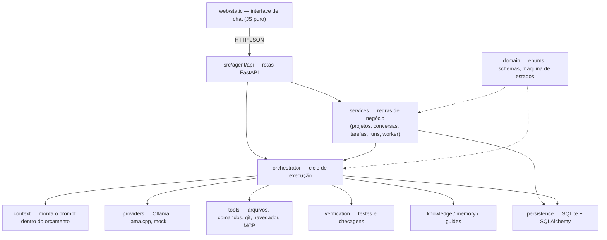

# Resumo do projeto — Agente de IA Local

Resumo didático e completo do projeto inteiro: **propósito, por quê, quando e onde** de cada diretório, arquivo,
classe e função, com **entradas e saídas**. Não descreve o passo a passo interno, só o necessário para entender
o funcionamento e a arquitetura.

> Este arquivo é **mantido a cada tarefa** pelo agente e verificado por `python3 scripts/resume.py check`
> (regra: [`docs/regras/resumo-projeto.md`](/docs/regras/resumo-projeto.md)). Convenção de leitura:
> `nome(params) → saída` — descrição. Métodos aparecem como `Classe.metodo(...)`.

---

## Visão geral

**O que é:** um agente de programação que roda **na própria máquina**. Você escreve um pedido no chat
(ex.: "crie uma tela de login"), e o agente planeja, divide em tarefas pequenas, chama um modelo de linguagem
local, executa ferramentas (ler/escrever arquivos, rodar comandos e testes, navegador, MCP), verifica o
resultado e devolve uma resposta final.

**Por quê:** modelos locais pequenos têm pouca janela de contexto e erram com facilidade. Por isso a
**complexidade fica na arquitetura** (orquestrador, decomposição, verificação, persistência) e não no prompt:
o modelo é uma peça substituível, e o estado verdadeiro fica no SQLite, permitindo retomar após falhas ou
reinícios.

**Quando/onde roda:** `agente-api` sobe uma API FastAPI em `http://127.0.0.1:8765`, que também serve a interface
web estática. Um *worker* em segundo plano avança as execuções autônomas. Dados ficam em `data/agent.db`.

### Arquitetura em camadas

### O caminho de uma mensagem

1. **Interface** (`web/static/assets/app.js`): mostra a mensagem na hora, cria a tarefa-raiz
   (`POST /projects/{id}/tasks`) e uma execução (`POST /projects/{id}/runs`), liga o modo autônomo e dá o
   primeiro passo (`POST /runs/{id}/step`). Enquanto houver execução ativa, novos envios ficam bloqueados.
2. **API** (`src/agent/api/main.py`): valida, grava no SQLite e delega aos *services* e ao orquestrador.
3. **Orquestrador** (`src/agent/orchestrator/runner.py`): a cada passo escolhe a próxima tarefa e
   - **planeja/decompõe** objetivos em subtarefas (`planner`, `decomposition`, `atomizer`);
   - **monta o contexto** e pede ao modelo uma operação estruturada (`context`, `providers`);
   - **executa** a ferramenta escolhida (`tools`) e **verifica** (`verification`, `global_verify`);
   - **consolida** resultados no pai, **replaneja** o que falhou e escreve a **resposta final** (`closing`).
4. **Worker** (`services/autonomous_worker.py`): continua dando passos sozinho enquanto o run for autônomo.
5. **Interface** faz *polling* (`/live`, `/tasks`, `/events`) e desenha pensamentos, etapas, diffs e a resposta.

### Conceitos-chave

| Conceito | O que é |
|----------|---------|
| **Projeto / workspace** | Pasta raiz onde o agente trabalha (`ProjectModel`); conversas sem projeto usam a pasta do usuário |
| **Conversa e ramo** | Histórico do chat (`ConversationModel`); editar uma mensagem cria um **ramo** (`BranchModel`) |
| **Tarefa** | Nó de uma árvore (`TaskModel`): `objective` (pedido) → `subsystem` → `operation` (ação atômica) |
| **Estados da tarefa** | `PENDING → PLANNING → READY → RUNNING → VERIFYING → COMPLETED`, com `RETRY_PENDING`, `BLOCKED`, `FAILED`, `CANCELLED` (`domain/state_machine.py`) |
| **Run (execução)** | Uma rodada do orquestrador sobre uma tarefa-raiz (`ExecutionRunModel`): `active`, `paused`, `completed`, `failed`, `cancelled` |
| **Tentativa** | Cada chamada a modelo, ferramenta ou verificação (`OperationAttemptModel`), com limite por tarefa |
| **Evidência / contrato** | Provas de que algo funcionou (`EvidenceModel`) e critérios de aceite da tarefa (`TaskContractModel`) |
| **Memória** | Fatos lembrados por projeto ou conversa (`MemoryRecordModel`) |
| **Grafo de conhecimento** | Símbolos e imports do código do projeto (`KgNodeModel`, `KgEdgeModel`) |
| **Eventos** | Linha do tempo de tudo que aconteceu (`EventLogModel`), base dos "pensamentos" mostrados na UI |

### Stack e execução

Python 3.11+ (FastAPI, Uvicorn, SQLAlchemy 2, Pydantic v2, httpx), SQLite, JS/CSS puros na interface,
pytest nos testes. Instalação: `pip install -e ".[dev]"`; rodar: `agente-api`; testar: `pytest`.
Configuração por variáveis de ambiente / `.env` (`src/agent/config.py`).

---

## `src/`

**Propósito:** raiz do código-fonte do pacote Python instalável `agente-local` (`pip install -e .`). **Por quê:** separa o código do runtime de docs, testes e interface web. **Quando:** instalado em modo editável para rodar a API (`agente-api`) e os testes.

### `src/README.md`

**Propósito:** índice da pasta `src/`, apontando para o pacote `agent/`. **Quando/onde:** leitura de orientação para quem navega no repositório.

## `src/agent/`

**Propósito:** núcleo do Agente de IA Local: API, domínio, persistência, orquestrador, ferramentas, provedores de modelo, contexto, conhecimento, verificação, segurança, MCP, visão e utilitários. **Por quê:** concentra o runtime em um pacote único importável como `agent`. **Quando:** carregado sempre que a API ou os testes rodam.

### `src/agent/README.md`

**Propósito:** mapa dos subpacotes de `agent/` e suas responsabilidades, com link para `config.py` e para a doc de execução local (Ollama como padrão). **Quando/onde:** documentação de navegação.

### `src/agent/__init__.py`

**Propósito:** marca o pacote `agent` e define `__version__ = "0.1.0"` (versão do pacote; a API anuncia sua própria versão, 0.5.0). **Quando/onde:** importado implicitamente em qualquer `import agent...`.

### `src/agent/config.py`

**Propósito:** configuração central lida de variáveis de ambiente e do arquivo `.env` (pydantic-settings). **Quando/onde:** usada pela API (`deps.read_settings`), pela persistência (URL do banco) e pelo orquestrador/provedores (URLs, modelo padrão, limites).

- **`Settings(BaseSettings)`** — Todas as opções do runtime: diretório de dados, URL do banco, URLs/timeout do Ollama e do llama.cpp, provedor e modelo padrão, orçamento de contexto (limite, entrada, reserva de saída), uso do template genérico de decomposição, fallback para mock, host/porta da API (padrão `127.0.0.1:8765`), limites de tentativas e de passos do orquestrador, proteções contra recursão (`max_tree_depth`, `max_tasks_per_run`), pasta da web estática, caminho do `mcp.json` e se o worker em segundo plano liga.
  - `Settings.resolved_database_url() → str` — Devolve a URL SQLite final: em testes do pytest força `data_dir/agent.db` (para não gravar no banco real), senão usa `database_url` se houver, senão `data/agent.db`; cria o diretório de dados quando necessário.
- `get_settings() → Settings` — Cria uma instância de `Settings` e, se `mcp_config_path` não foi definido, preenche com `data_dir/mcp.json`. Chamada sempre que alguém precisa da configuração atual.

## `src/agent/api/`

**Propósito:** camada HTTP (FastAPI) que expõe projetos, conversas, tarefas, runs, memória, grafo de conhecimento, MCP, provedores e serve a SPA em `/`. **Por quê:** é a porta de entrada da interface web e de clientes externos. **Quando:** ao executar `agente-api` (porta 8765); docs interativas em `/docs`.

### `src/agent/api/README.md`

**Propósito:** descreve os artefatos da API (`main.py` com rotas e SPA, `deps.py` com sessão e settings), a porta e os endpoints `/docs` e `/health`. **Quando/onde:** documentação.

### `src/agent/api/__init__.py`

**Propósito:** arquivo vazio que marca `agent.api` como pacote. **Quando/onde:** import do pacote.

### `src/agent/api/deps.py`

**Propósito:** dependências injetadas nas rotas FastAPI: engine do banco (singleton preguiçoso), fábrica de sessões, sessão por requisição e configuração. **Quando/onde:** usado por `main.py` via `Depends(...)` e no `lifespan` da aplicação.

- `get_engine() → Engine` — Na primeira chamada inicializa o banco (`init_db`) e a fábrica de sessões globais; depois só devolve a engine já criada.
- `get_session_factory() → sessionmaker[Session]` — Garante a engine e devolve a fábrica de sessões global.
- `db_session() → Generator[Session]` — Dependência por requisição: abre uma sessão, faz commit ao final, rollback em erro e sempre fecha.
- `read_settings() → Settings` — Dependência que devolve `get_settings()` para as rotas.

### `src/agent/api/main.py`

**Propósito:** define a aplicação FastAPI (`app`, versão 0.5.0), todas as rotas REST, helpers de apresentação (tarefas, conversas, trilha de "pensamentos"), o texto amigável das ações do orquestrador (`ACTION_COPY`) e a montagem da interface web estática. **Quando/onde:** carregado pelo uvicorn (`agent.api.main:app`) via `run()`; a interface web em `web/static/` consome estas rotas.

Helpers e ciclo de vida:

- `_usage_tokens(session, task) → int` — Tokens consumidos pela tarefa: usa `metadata_json.usage.total` ou, na falta, a estimativa do snapshot de contexto mais recente.
- `_remembered_model(session, task) → dict` — Para tarefa-raiz sem `model_id` nos metadados, copia o `model_id` do run mais recente dela, para a UI lembrar qual modelo foi usado.
- `_present_task(session, task) → TaskRead` — Converte `TaskModel` em `TaskRead` acrescentando título traduzido para o idioma da conversa, tokens usados e metadados com o modelo lembrado.
- `_web_dir(settings) → Path | None` — Localiza a pasta da interface web (`static_web_dir` configurado ou `web/static` do repositório).
- `lifespan(app)` — Ciclo de vida da aplicação: inicializa o banco e, se `enable_background_worker`, liga o worker autônomo na subida e o para no desligamento.
- `_mcp_path(settings) → Path` — Caminho do arquivo de servidores MCP; se `mcp.json` não existir, usa `data/mcp.example.json` do repositório quando disponível.
- `_present_conversation(session, item) → ConversationRead` — Monta a conversa para a API: garante uma branch, esconde o projeto "inbox" (conversas soltas), calcula a raiz efetiva, a origem do caminho (`chosen`/`home`), a branch ativa e a lista de branches.
- `_thought_trace(session, project_id, tasks) → list[dict]` — Lê os últimos eventos `agent.thought` e `orchestrator.action` do projeto, descarta ações burocráticas, traduz para frases legíveis no idioma da tarefa e devolve até 16 itens (fase, texto, tarefa, horário).
- `_mark_repeated_thought(thoughts, item) → None` — Acrescenta o pensamento à lista marcando repetições (contador `repeat`), para a interface mostrar que nada mudou.
- `_how_for_task(task) → str` — Frase curta explicando como a tarefa será executada (ferramenta, verificação determinística, operação do modelo, chamada MCP ou decisão do orquestrador).
- `_mount_web(settings) → None` — Monta `/assets` como arquivos estáticos e registra `GET /` devolvendo o `index.html` da SPA; chamada na importação do módulo e em `run()`.
- `run() → None` — Ponto de entrada do comando `agente-api`: monta a web e sobe o uvicorn no host/porta configurados.
- **`ResumeBody(BaseModel)`** — Corpo de `POST /tasks/{id}/resume-brief`; campo `apply` (se deve aplicar a retomada ou só gerar o resumo).

Saúde, provedores, ferramentas e MCP:

- `health() → dict` — Rota `GET /health`: devolve status `ok` e a versão.
- `ollama_models(settings) → dict` — Rota `GET /providers/ollama/models`: lista os modelos do Ollama local; 503 se ele não responder.
- `llamacpp_models(settings) → dict` — Rota `GET /providers/llamacpp/models`: lista os modelos do servidor llama.cpp; 503 em falha.
- `list_tools() → dict` — Rota `GET /tools`: especificações de todas as ferramentas do registro padrão.
- `mcp_servers(settings) → dict` — Rota `GET /mcp/servers`: servidores MCP configurados, suas ferramentas e o caminho do arquivo de configuração.
- `mcp_discover(settings) → dict` — Rota `POST /mcp/discover`: conecta aos servidores MCP e descobre as ferramentas disponíveis.
- `mcp_call(body, settings) → dict` — Rota `POST /mcp/call`: executa uma ferramenta MCP. Entrada: `tool_id` (obrigatório, senão 400) e `arguments`. Saída: resultado da chamada.
- `ui_defaults(settings) → dict` — Rota `GET /config/ui-defaults`: valores padrão da interface (provedor, modelo, aprovação de ferramentas arriscadas, template genérico, URLs do Ollama e llama.cpp).
- `debug_chat_ollama(body, settings) → dict` — Rota `POST /debug/chat/ollama`: envia um `prompt` direto a um `model` do Ollama e devolve o texto; para diagnóstico.

Projetos (workspaces):

- `create_project(body) → ProjectRead` — Rota `POST /projects`: cria um projeto a partir de `ProjectCreate`.
- `list_projects() → list[ProjectRead]` — Rota `GET /projects`: lista os projetos.
- `get_project(project_id) → ProjectRead` — Rota `GET /projects/{project_id}`: busca um projeto; 404 se não existir.
- `update_project(project_id, body) → ProjectRead` — Rota `PATCH /projects/{project_id}`: altera nome e/ou pasta raiz; 404 ou 400 em erro.
- `project_overview(project_id) → dict` — Rota `GET /projects/{project_id}/overview`: total de tarefas, contagem por status, run ativo, total de runs e pasta raiz.
- `project_live(project_id) → dict` — Rota `GET /projects/{project_id}/live`: painel "ao vivo" consultado pela UI: run ativo (com flag autônoma), tarefa em foco, última ação, manchete e explicação legíveis, trilha de pensamentos, se está "pensando", provedor/modelo e ferramenta em uso.
- `project_metrics(project_id) → dict` — Rota `GET /projects/{project_id}/metrics`: métricas do projeto calculadas pelo `MetricsService`.
- `run_metrics(run_id) → dict` — Rota `GET /runs/{run_id}/metrics`: métricas do run (árvore, decomposições, replanejamentos, tentativas, repetição, tokens, contexto omitido, erros por categoria, tempo, evidências, progresso); 404 se o run não existe.
- `project_git_diff(project_id) → dict` — Rota `GET /projects/{project_id}/git-diff`: roda a ferramenta `git_diff` na raiz do projeto e devolve o resultado.
- `list_events(project_id) → list[EventRead]` — Rota `GET /projects/{project_id}/events`: os 200 eventos mais recentes do projeto.
- `add_memory(project_id, body) → MemoryRead` — Rota `POST /projects/{project_id}/memory`: grava um registro de memória (`MemoryCreate`).
- `list_memory(project_id, kind) → list[MemoryRead]` — Rota `GET /projects/{project_id}/memory`: lista memórias do projeto, opcionalmente filtradas por tipo.

Conversas e branches:

- `list_loose_conversations() → list[ConversationRead]` — Rota `GET /conversations`: lista conversas soltas (sem projeto escolhido, no "inbox").
- `create_loose_conversation(body) → ConversationRead` — Rota `POST /conversations`: cria uma conversa solta.
- `list_conversations(project_id) → list[ConversationRead]` — Rota `GET /projects/{project_id}/conversations`: conversas de um projeto.
- `create_conversation(project_id, body) → ConversationRead` — Rota `POST /projects/{project_id}/conversations`: cria conversa dentro de um projeto.
- `move_conversation(conversation_id, body) → ConversationRead` — Rota `POST /conversations/{conversation_id}/move`: move a conversa para outro projeto (ou para o inbox com `project_id` nulo).
- `update_conversation(conversation_id, body) → ConversationRead` — Rota `PATCH /conversations/{conversation_id}`: renomeia e/ou define ou limpa a pasta raiz própria da conversa.
- `delete_conversation(conversation_id) → dict` — Rota `DELETE /conversations/{conversation_id}`: apaga a conversa; devolve `{"deleted": true}`.
- `conversation_tasks(conversation_id, branch_id) → list[TaskRead]` — Rota `GET /conversations/{conversation_id}/tasks`: tarefas (mensagens) da branch indicada ou da ativa.
- `fork_conversation(conversation_id, body) → dict` — Rota `POST /conversations/{conversation_id}/fork`: cria uma nova branch a partir de uma mensagem com objetivo editado; devolve a conversa e a nova tarefa.
- `activate_branch(conversation_id, branch_id) → ConversationRead` — Rota `POST /conversations/{conversation_id}/branches/{branch_id}/activate`: torna a branch a ativa da conversa.

Sistema de arquivos:

- `fs_browse(path) → dict` — Rota `GET /fs/browse`: lista subpastas de um caminho para o seletor de pasta da UI; 400 se inválido.
- `fs_pick_folder() → dict` — Rota `POST /fs/pick-folder`: abre o seletor de pasta nativo do sistema e devolve o caminho escolhido.

Tarefas:

- `create_task(project_id, body) → TaskRead` — Rota `POST /projects/{project_id}/tasks`: cria a tarefa de uma mensagem do chat: detecta o idioma, grava anexos na pasta do projeto e anexa nota ao objetivo, atualiza o título da conversa e, se o texto pedir para "lembrar" algo, grava memória canônica (projeto) ou contextual (conversa).
- `list_tasks(project_id) → list[TaskRead]` — Rota `GET /projects/{project_id}/tasks`: todas as tarefas do projeto.
- `get_task(task_id) → TaskRead` — Rota `GET /tasks/{task_id}`: uma tarefa apresentada (título traduzido, tokens).
- `update_task_status(task_id, body) → TaskRead` — Rota `PATCH /tasks/{task_id}/status`: muda o status validando a máquina de estados; 409 se a transição for inválida.
- `add_dependency(task_id, body) → dict` — Rota `POST /tasks/{task_id}/dependencies`: registra que a tarefa depende de outra; 400 em dependência inválida.
- `task_attempts(task_id) → list[dict]` — Rota `GET /tasks/{task_id}/attempts`: tentativas (modelo/ferramenta/verificação) com provedor, sucesso e erro.
- `task_evidences(task_id) → list[dict]` — Rota `GET /tasks/{task_id}/evidences`: evidências de verificação (verificador, passou, resumo).
- `task_context_snapshots(task_id) → list[dict]` — Rota `GET /tasks/{task_id}/context-snapshots`: até 20 snapshots de contexto recentes (tokens estimados, componentes, notas de estratégia, referências).
- `get_context_snapshot(snapshot_id) → dict` — Rota `GET /context-snapshots/{snapshot_id}`: detalhes de um snapshot de contexto.
- `get_task_contract(task_id) → dict` — Rota `GET /tasks/{task_id}/contract`: contrato da tarefa (entradas, saídas, invariantes, aceite); 404 se não definido.
- `upsert_task_contract(task_id, body) → dict` — Rota `PUT /tasks/{task_id}/contract`: cria ou atualiza o contrato e devolve também o impacto calculado pelo `ContractService`.
- `task_resume_brief(task_id, body) → dict` — Rota `POST /tasks/{task_id}/resume-brief`: gera (e, com `apply`, aplica) o resumo de retomada da tarefa-raiz via `resume_root`.

Execuções (runs):

- `start_run(project_id, body) → ExecutionRunRead` — Rota `POST /projects/{project_id}/runs`: inicia um run para uma tarefa-raiz com configuração (provedor, modelo etc.).
- `list_runs(project_id) → list[ExecutionRunRead]` — Rota `GET /projects/{project_id}/runs`: runs do projeto.
- `run_step(run_id, settings) → dict` — Rota `POST /runs/{run_id}/step`: executa um único passo do `RunOrchestrator` e devolve o que ocorreu.
- `run_execute(run_id, max_steps, settings) → dict` — Rota `POST /runs/{run_id}/execute`: roda passos até ficar ocioso (limitado por `max_steps` e `max_orchestrator_steps`); devolve número de passos e log.
- `pause_run(run_id) → dict` — Rota `POST /runs/{run_id}/pause`: pausa o run.
- `cancel_run(run_id) → dict` — Rota `POST /runs/{run_id}/cancel`: cancela o run.
- `enable_autonomous(run_id) → dict` — Rota `POST /runs/{run_id}/autonomous/enable`: liga o modo autônomo (o worker em segundo plano avança o run sozinho).
- `disable_autonomous(run_id) → dict` — Rota `POST /runs/{run_id}/autonomous/disable`: desliga o modo autônomo no `config_json` do run.

Grafo de conhecimento:

- `kg_reindex(project_id) → dict` — Rota `POST /projects/{project_id}/knowledge/reindex`: reindexa a pasta do projeto no grafo; devolve estatísticas.
- `kg_search(project_id, q, limit) → dict` — Rota `GET /projects/{project_id}/knowledge/search`: busca nós por texto (até 100 resultados).
- `kg_neighbors(project_id, ref, depth) → dict` — Rota `GET /projects/{project_id}/knowledge/neighbors`: vizinhos de um nó até profundidade 3.

## `src/agent/domain/`

**Propósito:** contratos e regras de negócio sem I/O: enums, schemas Pydantic, máquina de estados das tarefas e taxonomia de falhas. **Por quê:** fonte única de vocabulário e regras compartilhada por API, serviços e orquestrador. **Quando:** importado em quase todo o runtime.

### `src/agent/domain/README.md`

**Propósito:** descreve os arquivos do domínio e aponta para a doc da máquina de estados. **Quando/onde:** documentação.

### `src/agent/domain/__init__.py`

**Propósito:** arquivo vazio que marca `agent.domain` como pacote. **Quando/onde:** import do pacote.

### `src/agent/domain/enums.py`

**Propósito:** enumerações de domínio (strings) usadas em modelos, schemas e orquestração. **Quando/onde:** persistência, API, serviços e orquestrador.

- **`TaskStatus(StrEnum)`** — Ciclo de vida de uma tarefa: PENDING, PLANNING, READY, RUNNING, VERIFYING, RETRY_PENDING, BLOCKED, COMPLETED, FAILED, CANCELLED.
- **`TaskKind(StrEnum)`** — Nível na árvore de tarefas: `objective` (raiz), `subsystem` (agrupador) e `operation` (passo executável).
- **`MemoryKind(StrEnum)`** — Tipos de memória: `canonical`, `execution`, `contextual`, `evidence`, `procedure`.
- **`RunStatus(StrEnum)`** — Estado de um run: `active`, `paused`, `completed`, `failed`, `cancelled`.
- **`AttemptKind(StrEnum)`** — Tipo de tentativa registrada: `model`, `tool`, `verification`.

### `src/agent/domain/failures.py`

**Propósito:** taxonomia de falhas do orquestrador. Cada falha tem uma **categoria** (o que fazer a seguir) e uma **causa** (o que aconteceu). **Por quê:** separar erro de configuração, limite operacional, saída cortada e falha de verificação, em vez de tratar tudo como "tentar de novo". **Quando/onde:** o `RunOrchestrator` classifica cada tentativa falha, grava a categoria no evento `attempt.recorded` e em `metadata_json.last_failure` da tarefa.

- **`FailureCategory(StrEnum)`** — `recoverable`, `change_strategy`, `blocked_dependency`, `external_unavailable`, `configuration`, `operational_limit`.
- **`FailureCause(StrEnum)`** — Causa concreta: orçamento de contexto, saída inválida ou cortada, timeout, provedor fora do ar, erro/entrada de ferramenta, ferramenta desconhecida, executável ausente, aprovação pendente, verificação falha ou inconclusiva, evidência desatualizada, saída repetida, dependência falha, tentativas esgotadas, etc.
- **`Failure`** — Dataclass imutável (categoria, causa, detalhe).
  - `Failure.retry_same_strategy → bool` — Só `recoverable` admite repetir a mesma abordagem.
  - `Failure.as_dict() → dict` / `Failure.from_dict(data) → Failure | None` — Serialização para JSON (eventos e metadados); dado inválido volta `None`.
- `classify_tool_result(out) → Failure | None` — Saída de ferramenta → falha (`None` se deu certo).
- `classify_provider_error(message) → Failure` — `ProviderError` → timeout, provedor indisponível ou erro recuperável.
- `looks_truncated(content) → bool` — Resposta que abriu JSON ou cerca de código e não fechou.
- `classify_model_output(content, parse_error, missing=None) → Failure | None` — JSON do modelo: cortado (`change_strategy`) ou malformado/incompleto (`recoverable`).
- `classify_context_error(message) → Failure` — Contexto obrigatório acima do orçamento (`change_strategy`).
- `classify_verification(passed, summary, output='') → Failure | None` — Reprovado é `recoverable`, com o fim da saída do verificador no detalhe; inconclusivo nunca passa (`external_unavailable`).
- `retry_hint(failure) → str` — Instrução para a próxima tentativa conforme a causa (ex.: "responda só o JSON", "edite um trecho curto").
- `describe_failures(history, *, limit=3, detail_chars=400) → str` — Texto das últimas falhas (causa, detalhe, o que fazer diferente) para o componente `tentativas-anteriores` do contexto.

### `src/agent/domain/schemas.py`

**Propósito:** schemas Pydantic de entrada e saída da API (e fronteiras entre camadas). **Quando/onde:** corpo e resposta das rotas de `main.py` e parâmetros dos serviços; os `*Read` leem direto dos modelos ORM (`from_attributes`).

- **`ProjectCreate(BaseModel)`** — Criação de projeto: nome (obrigatório), pasta raiz e descrição.
- **`ProjectUpdate(BaseModel)`** — Alteração parcial de projeto: nome e/ou pasta raiz.
- **`ProjectRead(BaseModel)`** — Projeto devolvido pela API: id, nome, pasta raiz, descrição, origem do caminho e datas.
- **`ConversationCreate(BaseModel)`** — Criação de conversa: título e idioma opcionais.
- **`ConversationMove(BaseModel)`** — Destino ao mover conversa: `project_id` (nulo = inbox).
- **`ConversationUpdate(BaseModel)`** — Edição de conversa: título, pasta raiz própria e flag `clear_root` para removê-la.
- **`ConversationFork(BaseModel)`** — Pedido de bifurcação: id da mensagem (tarefa) de origem e novo objetivo.
- **`ConversationRead(BaseModel)`** — Conversa devolvida: ids de projeto/workspace, título, idioma, raiz efetiva, origem do caminho, branch ativa, lista de branches e datas.
- **`BranchRead(BaseModel)`** — Branch de conversa: id, branch pai, tarefa de onde bifurcou e data.
- **`TaskCreate(BaseModel)`** — Criação de tarefa: título, objetivo, escopo, critérios de aceite, tipo, pai, conversa, branch e metadados livres (ex.: anexos, locale).
- **`TaskRead(BaseModel)`** — Tarefa devolvida: ids (projeto, conversa, branch, pai), título e título traduzido, objetivo, status, tipo, ordem, metadados, resultado consolidado, datas e tokens usados.
- **`TaskStatusUpdate(BaseModel)`** — Mudança manual de status com motivo opcional.
- **`TaskDependencyCreate(BaseModel)`** — Nova dependência: id da tarefa da qual depende.
- **`ExecutionRunCreate(BaseModel)`** — Início de run: tarefa-raiz e configuração opcional.
- **`ExecutionRunRead(BaseModel)`** — Run devolvido: id, projeto, tarefa-raiz, status e datas.
- **`EventRead(BaseModel)`** — Evento do log: run, tarefa, tipo, payload e data.
- **`MemoryCreate(BaseModel)`** — Nova memória: tipo, título, conteúdo, tarefa/conversa/branch e referências de origem.
- **`MemoryRead(BaseModel)`** — Memória devolvida: os campos acima mais resumo, outline, versão e data.

### `src/agent/domain/state_machine.py`

**Propósito:** define as transições válidas de `TaskStatus` (`ALLOWED_TRANSITIONS`) e os estados terminais (COMPLETED, FAILED, CANCELLED). **Quando/onde:** usado pelo `TaskService` e pelo orquestrador antes de mudar o status de uma tarefa (`RUNNING → BLOCKED` para uma operação que não pode prosseguir, como contexto que não cabe; `VERIFYING → BLOCKED` para verificação que não pôde rodar ou ficou inconclusiva); a rota `PATCH /tasks/{id}/status` converte o erro em 409.

- **`InvalidTransitionError(ValueError)`** — Erro lançado quando uma mudança de status não é permitida; guarda o status atual e o alvo.
  - `InvalidTransitionError.__init__(current, target) → None` — Monta a mensagem "Transição inválida: atual → alvo" e guarda os dois status.
- `can_transition(current, target) → bool` — Diz se a transição está na tabela de permitidas.
- `validate_transition(current, target) → None` — Lança `InvalidTransitionError` se a transição não for permitida.
- `transition(current, target) → TaskStatus` — Valida e devolve o novo status.

## `src/agent/persistence/`

**Propósito:** persistência em SQLite via SQLAlchemy 2: modelos de tabela, engine, sessões e migrações leves. **Por quê:** o estado canônico (tarefas, runs, eventos, memória) fica no banco, fora do LLM, permitindo retomar execuções. **Quando:** inicializado na subida da API e usado por todos os serviços.

### `src/agent/persistence/README.md`

**Propósito:** descreve `models.py` e `database.py` e aponta para a doc do modelo de dados. **Quando/onde:** documentação.

### `src/agent/persistence/__init__.py`

**Propósito:** arquivo vazio que marca `agent.persistence` como pacote. **Quando/onde:** import do pacote.

### `src/agent/persistence/database.py`

**Propósito:** criação da engine, configuração do SQLite, migrações aditivas de colunas e fábrica/escopo de sessões. **Quando/onde:** `api/deps.py` na subida da API; scripts, worker e testes que precisam de sessão fora de uma requisição.

- `_configure_sqlite(engine) → None` — Em SQLite, liga `PRAGMA foreign_keys=ON` em cada nova conexão.
- `create_db_engine(settings) → Engine` — Cria a engine a partir de `resolved_database_url()` (permitindo uso entre threads) e aplica a configuração do SQLite.
- `_add_column(conn, table, column, ddl) → None` — Adiciona uma coluna à tabela se ela existir e ainda não tiver a coluna.
- `_migrate_sqlite(engine) → None` — Migração leve para bancos antigos: acrescenta colunas novas (config do run, conversa/branch em tarefas e memórias, resumo/outline da memória, origem do caminho, raiz e branch ativa da conversa).
- `init_db(engine, settings) → Engine` — Cria as tabelas que faltam, aplica as migrações e devolve a engine.
- `build_session_factory(engine) → sessionmaker[Session]` — Fábrica de sessões sem autoflush e sem expirar objetos após o commit.
- `session_scope(session_factory) → Generator[Session]` — Context manager que abre uma sessão, faz commit ao final, rollback em erro e fecha.

### `src/agent/persistence/models.py`

**Propósito:** modelos ORM (tabelas) do agente. **Quando/onde:** lidos e gravados pelos serviços, pelo orquestrador e pela API; criados por `init_db`.

- `utcnow() → datetime` — Data/hora atual em UTC; padrão das colunas de data.
- **`Base(DeclarativeBase)`** — Base declarativa comum a todos os modelos (metadados usados em `create_all`).
- **`ProjectModel(Base)`** — Tabela `projects`: workspace com nome, pasta raiz, descrição, origem do caminho (`chosen`/home) e datas; relaciona suas tarefas.
- **`ConversationModel(Base)`** — Tabela `conversations`: conversa de chat ligada a um projeto, com título, idioma, pasta raiz própria opcional e branch ativa.
- **`BranchModel(Base)`** — Tabela `branches`: ramo de uma conversa, com branch pai e tarefa de onde bifurcou.
- **`TaskModel(Base)`** — Tabela `tasks`: nó da árvore de tarefas (projeto, conversa, branch, pai), com título, objetivo, escopo, critérios, status, tipo, ordem, metadados, resultado consolidado e datas de início/fim.
- **`TaskDependencyModel(Base)`** — Tabela `task_dependencies`: aresta "tarefa depende de outra tarefa" (par único).
- **`ExecutionRunModel(Base)`** — Tabela `execution_runs`: execução de uma tarefa-raiz com status e configuração (provedor, modelo, modo autônomo).
- **`ScheduledRunModel(Base)`** — Tabela `scheduled_runs`: agendamento de runs por expressão cron, com configuração, flag de ativo e datas da última/próxima execução.
- **`OperationAttemptModel(Base)`** — Tabela `operation_attempts`: cada tentativa (modelo, ferramenta ou verificação) de uma tarefa num run, com provedor, requisição, resposta, sucesso e erro.
- **`EventLogModel(Base)`** — Tabela `event_logs`: log de eventos (tipo e payload) por projeto, run e tarefa; base da trilha de pensamentos e do painel ao vivo.
- **`MemoryRecordModel(Base)`** — Tabela `memory_records`: memória do projeto/conversa/branch/tarefa com tipo, título, conteúdo, resumo, outline, versão e referências de origem.
- **`KgNodeModel(Base)`** — Tabela `kg_nodes`: nó do grafo de conhecimento (tipo, referência única por projeto, rótulo, metadados).
- **`KgEdgeModel(Base)`** — Tabela `kg_edges`: aresta entre dois nós do grafo com o tipo de relação.
- **`TaskContractModel(Base)`** — Tabela `task_contracts`: contrato único por tarefa com entradas, saídas, invariantes e critérios de aceite.
- **`ContextSnapshotModel(Base)`** — Tabela `context_snapshots`: registro do contexto montado para o modelo (tokens estimados, componentes, notas de estratégia, referências) por tarefa/run.
- **`EvidenceModel(Base)`** — Tabela `evidences`: evidência de verificação de uma tarefa (verificador, passou ou não, resumo, detalhes), opcionalmente ligada a uma tentativa.

## `src/agent/security/`

**Propósito:** regras de segurança de acesso a arquivos. **Por quê:** ferramentas e MCP não podem ler ou escrever fora da pasta autorizada do projeto. **Quando:** sempre que um caminho fornecido pelo modelo ou pelo usuário é resolvido.

### `src/agent/security/README.md`

**Propósito:** descreve `paths.py` e a regra de respeitar o escopo do projeto. **Quando/onde:** documentação.

### `src/agent/security/paths.py`

**Propósito:** valida que um caminho fica dentro da raiz autorizada. **Quando/onde:** usado pelas ferramentas de arquivo e afins antes de qualquer acesso ao disco.

- **`PathSecurityError(ValueError)`** — Erro para caminho fora do escopo autorizado.
- `resolve_under_root(root, user_path) → Path` — Resolve o caminho (relativo à raiz ou absoluto, seguindo links) e o devolve se estiver dentro da raiz; senão lança `PathSecurityError`.

## `src/agent/util/`

**Propósito:** utilitários genéricos sem dependência de domínio. **Por quê:** evita duplicar lógica comum entre orquestrador e provedores. **Quando:** ao interpretar respostas textuais de modelos.

### `src/agent/util/README.md`

**Propósito:** descreve `json_parse.py`. **Quando/onde:** documentação.

### `src/agent/util/json_parse.py`

**Propósito:** extrai um objeto JSON de respostas de modelos locais, que costumam vir com texto extra. **Quando/onde:** orquestrador e etapas que pedem ao modelo saída em JSON (planejamento, operações).

- `parse_json_object(text) → (dict | None, erro | None)` — Remove blocos `<think>...</think>`, tenta ler o texto como JSON e, se falhar, procura o primeiro trecho entre chaves; devolve o objeto ou uma mensagem de erro (vazio, não é objeto, JSON inválido).

---

## `src/agent/orchestrator/`

**Propósito:** Coração do agente: conduz uma execução (run) sobre a árvore de tarefas, um passo determinístico por vez. **Por quê:** separa a lógica do ciclo (estados, dependências, tentativas) dos modelos e ferramentas. **Quando:** a cada `POST /runs/{id}/step`, `POST /runs/{id}/execute` ou tick do worker autônomo. **Ciclo:** a tarefa-raiz entra em planejamento e é decomposta em subtarefas (plano embutido, resposta direta, modelo Ollama/llama.cpp ou template), sempre terminando em verificação e resposta final; cada folha executável vira uma operação (ferramenta, MCP ou alteração gerada pelo modelo) que, ao dar certo, passa para verificação (pytest, script, comando ou conteúdo de arquivo) e grava evidência. Quando todos os filhos terminam, o pai é consolidado de baixo para cima; se um filho bloqueia ou falha, o pai é replanejado (até 2 vezes), e ao fim a verificação global aprova o objetivo, a resposta final em Markdown é garantida e o resultado vira memória.

### `src/agent/orchestrator/README.md`

**Propósito:** Mapa curto do pacote: ciclo decompor → executar → verificar → consolidar e ordem de origem dos planos. **Quando/onde:** leitura de quem navega pelo código; aponta para `runner.py`, `decomposition.py`, `consolidation.py` e `engine.py`.

### `src/agent/orchestrator/__init__.py`

**Propósito:** Arquivo vazio que marca `agent.orchestrator` como pacote Python. **Quando/onde:** só na importação dos módulos.

### `src/agent/orchestrator/atomizer.py`

**Propósito:** Decide quando uma tarefa que vem falhando deve ser quebrada em micro-passos e gera esse plano sem LLM. **Quando/onde:** usado por `RunOrchestrator._step_body` ao planejar uma tarefa sem filhos que já tem 2+ tentativas ou pede `atomize`.

- `complexity_score(*, objective, metadata, kind, attempt_count) → int` — Pontua a complexidade pelo tamanho do objetivo, quantidade de metadados, tipo subsistema, operação de modelo e tentativas repetidas. Saída: número inteiro.
- `micro_decompose_operation(objective) → DecompositionResult` — Plano fixo de três passos atômicos: inspecionar com `search_grep`, executar a alteração pelo modelo e verificar com pytest.
- `should_decompose_further(*, objective, metadata, kind, attempt_count, has_children, threshold=4) → bool` — Verdadeiro se a tarefa não tem filhos, não é ferramenta/verificação/atômica e a pontuação atinge o limite.

### `src/agent/orchestrator/closing.py`

**Propósito:** Garante que todo plano feche com verificação e resposta final, e monta/valida o texto final ao usuário. **Quando/onde:** `decomposition.resolve_decomposition_plan` aplica o fechamento aos planos; `RunOrchestrator._write_final_answer` e `_ensure_final_message` usam a composição e a validação.

- `compose_incomplete_markdown(*, objective, pending, reason) → str` — Mensagem de "Não concluído": objetivo, motivo, tabela de pendências (etapa, estado, motivo) e como continuar. Nunca afirma conclusão.
- `compose_final_markdown(*, objective, stages, model_text='') → str` — Monta uma conclusão em Markdown com o objetivo, data/hora atual, tabela de etapas e estados, lista de fontes e notas opcionais do modelo. Usada quando o modelo não dá resposta aproveitável.
- `ensure_closing_stages(plan) → DecompositionResult` — Acrescenta ao fim do plano uma etapa "Verificar etapas" e uma "Resposta final" (operação de modelo) se faltarem, encadeadas por dependência.
- `extract_sources(*chunks) → list[str]` — Extrai caminhos de arquivo citados nos textos (até 12, sem duplicatas nem prefixos de diff `a/`/`b/`).
- `local_now_line() → str` — Data e hora locais por extenso em português (ex.: "domingo, 18 de outubro de 2026, 17:53").
- `usable_markdown(text) → bool` — Verdadeiro se o texto tem 40+ caracteres, não é JSON e contém marcadores Markdown (título, lista, tabela, bloco de código).
- `usable_reply(text) → bool` — Aceita Markdown ou uma frase simples (8+ caracteres) e rejeita JSON de ferramenta como resposta.

### `src/agent/orchestrator/consolidation.py`

**Propósito:** Consolidação de baixo para cima: quando todos os filhos de uma tarefa terminam, junta resultados e evidências no pai e o conclui. **Quando/onde:** chamado pelo runner após verificações, resposta final e execução de pais; `children_of` e `verification_evidence_ok` são reaproveitados por replanejamento, retomada e verificação global.

- `children_of(session, parent_id) → list[TaskModel]` — Lista as subtarefas diretas de uma tarefa.
- `collect_evidences(session, task_id) → list[dict]` — Lê as evidências de verificação da tarefa em ordem de criação (verificador, passou, resumo, detalhe).
- `consolidate_parent(session, parent_id) → dict | None` — Se todos os filhos estão em estado terminal, grava no pai um relatório (`achieved`, resumo por filho, evidências, `pending` e, se houver, `final_answer` e fontes). O pai só vai a COMPLETED (por transições válidas) se todo filho não cancelado concluiu com evidência; filho concluído sem evidência é reaberto e o pai volta a PLANNING; filho falho deixa o pai como está, para o runner replanejar ou parar. Saída: o relatório, ou `None` se ainda há filhos ativos.
- `superseded(task) → bool` — Etapa parada que um replanejamento já substituiu (`superseded_by_replan`).
- `settled(task) → bool` — Filho que não impede o pai: concluído, cancelado ou falho substituído.
- `pending_reason(task) → str` — Motivo de uma pendência: detalhe da última falha, `blocked_reason` ou o status.
- `_walk(ts, task_id, path, reason=None) → None` — Aplica uma sequência de transições de status.
- `verification_spec(task) → dict | None` — Verificação declarada da tarefa ou a implícita que já rodou (`implicit_verification`).
- `verification_evidence_ok(session, task) → bool` — Verdadeiro se a tarefa não tem verificação ou se a evidência mais recente passou, não foi marcada `desatualizado` e os arquivos que ela avaliou não mudaram (`is_current`).

### `src/agent/orchestrator/decomposition.py`

**Propósito:** Transforma um objetivo em plano de subtarefas (schemas, escolha da origem do plano e gravação no banco). **Quando/onde:** `RunOrchestrator._step_body` chama `resolve_decomposition_plan` e `apply_decomposition` ao planejar uma tarefa sem filhos; `replan.py` também grava planos com `apply_decomposition`.

- `DecompositionResult(BaseModel)` — Plano de decomposição: lista `subtasks` de `SubTaskSpec`.
- `SubTaskSpec(BaseModel)` — Especificação de uma subtarefa: título, objetivo, tipo, escopo, critérios de aceite, `metadata` (ferramenta, verificação, operação de modelo, resposta final etc.) e índices das dependências no plano.
- `_is_page_request(objective) → bool` — Detecta pedido de site/página/HTML que não envolva arquivo `.py`.
- `align_verification(objective, plan) → DecompositionResult` — Em pedidos de página, troca verificação pytest por checagem de `<html` em `index.html` e marca operações de modelo com o prompt de página.
- `apply_decomposition(session, project_id, parent_id, plan) → list[uuid]` — Cria as subtarefas no banco sob o pai (que passa a PLANNING), liga as dependências e retorna os ids criados; antes converte filhos com o mesmo título do pai em operações.
- `builtin_plan_for_objective(objective) → DecompositionResult | None` — Plano fixo de demonstração (corrigir `calc.py` e rodar pytest) quando o objetivo cita "e2e" ou "calc.py".
- `direct_answer_plan(objective) → DecompositionResult | None` — Para perguntas curtas sem pedido de alteração, plano de um passo só: responder.
- `executable_leaf(metadata) → bool` — Verdadeiro se a tarefa já é um passo executável (ferramenta, verificação, operação de modelo, atômica ou resposta final) e não deve ser dividida.
- `fallback_plan(objective) → tuple[DecompositionResult, str]` — Template de página ou template genérico (inspecionar, alterar, testar) e o nome da origem.
- `page_plan(objective) → DecompositionResult` — Plano para páginas: listar a pasta, escrever `index.html` pelo modelo e conferir a estrutura HTML.
- `plan_copies_siblings(sibling_titles, plan_titles, current_title) → bool` — Detecta plano que só repete a lista de irmãos da etapa atual (sinal de laço de decomposição).
- `plan_with_model(provider, profile, objective, context_snippet, *, language='pt', browser_mode='off', requirements=None) → DecompositionResult | None` — Pede ao modelo local um plano em JSON (com catálogo de ferramentas, guias do projeto, requisitos da etapa com pedido de `covers` e regra de fechar com verificação e resposta final) e valida a resposta. Saída: plano ou `None` se inválido.
- `profile_from_run_config(run_config, settings) → ModelProfile` — Monta o perfil do modelo (id, limites de contexto, suporte a visão, opções de geração) a partir da configuração do run.
- `requirements_block(requirements) → str` — Trecho do prompt com os requisitos obrigatórios da etapa (e a parte, se parcial) e a instrução de declarar `metadata.covers`; vazio sem requisitos.
- `resolve_decomposition_plan(*, settings, run_config, objective, project_root, provider=None, requirements=None) → tuple[DecompositionResult | None, str]` — Escolhe o plano na ordem: embutido e2e, resposta direta, modelo (Ollama/llama.cpp), template genérico, fallback mock; aplica alinhamento e fechamento. Saída: plano e nome da origem.
- `seal_repeated_steps(parent_title, plan) → DecompositionResult` — Marca como operação atômica o filho aberto que repete o título do pai, evitando dividir de novo o mesmo passo.

### `src/agent/orchestrator/engine.py`

**Propósito:** Esqueleto legado e mínimo de um passo do ciclo, substituído na prática por `RunOrchestrator`. **Quando/onde:** não é usado pela API atual; mantido como referência.

- **`OrchestratorEngine`** — Coordenador mínimo baseado no `TaskService`.
  - `OrchestratorEngine.__init__(session) → None` — Guarda o serviço de tarefas da sessão.
  - `OrchestratorEngine.tick(task_id) → dict` — Promove a tarefa a READY se as dependências estão ok, ou READY para RUNNING; senão não faz nada. Saída: ação realizada.

### `src/agent/orchestrator/global_verify.py`

**Propósito:** Critérios globais de conclusão do objetivo inteiro, além da verificação de cada etapa. **Quando/onde:** `RunOrchestrator._step_body` usa quando não há próxima tarefa, antes de marcar o run como concluído.

- `_subtree_tasks(session, root_id) → list[TaskModel]` — Todas as tarefas descendentes da raiz (incluindo ela).
- `ensure_global_verification_task(session, project_id, root) → TaskModel | None` — Se a raiz pede `global_verification` nos metadados, cria uma única subtarefa "Verificação global" (pytest por padrão) e reabre a raiz para planejamento.
- `evaluate_global_acceptance(session, root_id) → tuple[bool, str]` — Aprova o objetivo se a raiz terminou, toda verificação concluída (declarada ou implícita) tem evidência válida e atual e a consolidação não marcou falha. Saída: ok e motivo.
- `invalidate_latest(session, task_id, reason) → None` — Marca a evidência mais recente como `desatualizado` (estado anterior, momento e motivo), sem apagar.
- `_gap_failure(session, task) → Failure` — Motivo da reabertura: `stale_evidence` (arquivos mudaram depois da verificação) ou `verification_failed` (sem evidência válida).
- `reopen_verification_gaps(session, root_id) → list[uuid]` — Reabre as verificações concluídas sem evidência válida, gravando o motivo em `last_failure`/`failures`: desatualizada volta a VERIFYING (verifica o estado atual antes de refazer), sem evidência vai a RETRY_PENDING; o pai concluído volta a PLANNING. Evidência antiga não é apagada. Saída: ids reabertos.

### `src/agent/orchestrator/planner.py`

**Propósito:** Registra o objetivo como memória canônica persistente do projeto e da conversa. **Quando/onde:** chamado pelo runner quando a tarefa-raiz sai de PENDING para PLANNING.

- `ensure_canonical_memory_for_objective(session, project_id, root_task) → None` — Cria, se ainda não existir, a memória "Objetivo global" do projeto e uma memória canônica ligada à conversa e à tarefa-raiz.

### `src/agent/orchestrator/requirements.py`

**Propósito:** requisitos do objetivo original com ids estáveis, cobertura por tarefa e estado calculado por evidência. **Por quê:** o plano e a conclusão precisam ser conferidos contra o que foi pedido, não contra a palavra do modelo. **Quando/onde:** o runner grava os requisitos quando a raiz entra em planejamento e passa os da etapa ao prompt de decomposição; validação do plano e aceite global consultam `requirement_status`. Requisitos ficam em `task_contracts.acceptance_json.requirements` da raiz; cobertura em `metadata_json.covers`.

- `_items(text) → list[str]` — Itens enumerados (`-`, `*`, `•`, `1.`, `1)`) de um texto.
- `evidence_kind(text) → str` — `change` se o texto pede mudança (arquivo, código, teste, página…), senão `answer`.
- `derive_requirements(objective, acceptance_criteria=None) → list[dict]` — Requisitos determinísticos: um por item do objetivo e por linha dos critérios; sem itens, o objetivo inteiro é `R1`.
- `normalize_requirement(raw, index) → dict` — Completa um requisito vindo do contrato (id, critério, aplicabilidade, tipo de evidência, refs).
- `root_of(session, task) → TaskModel` — Sobe até a raiz da árvore.
- `ensure_requirements(session, root) → list[dict]` — Lê os requisitos do contrato da raiz ou deriva e grava, mantendo os ids estáveis.
- `load_requirements(session, root) → list[dict]` — Leitura pura dos requisitos gravados.
- `normalize_covers(raw) → list[dict] | None` — Cobertura declarada em formato uniforme `{req, partial, part}`; `None` se não declarada.
- `siblings_declare_covers(session, task) → bool` — Se alguma irmã da tarefa declara `covers`.
- `effective_covers(session, task, reqs=None) → list[dict]` — Cobertura declarada; sem declaração herda a do pai só se nenhuma irmã declara (senão é apoio e não cobre nada); a raiz cobre todos.
- `_subtree(session, root) → list[TaskModel]` — Raiz e descendentes.
- `_passed_current(session, task_id) → list[EvidenceModel]` — Evidências aprovadas cujos arquivos não mudaram.
- `_answered(task) → bool` — Se a tarefa entregou resposta final não vazia.
- `requirement_status(session, root) → list[dict]` — Estado de cada requisito pelas folhas responsáveis: `uncovered`, `failed`, `blocked`, `pending`, `unverified` (concluído sem evidência proporcional), `satisfied`, ou a aplicabilidade se não obrigatório; com tarefas, cobertura parcial e ids de evidência.

### `src/agent/orchestrator/plan_validation.py`

**Propósito:** validação determinística do plano antes da execução, com correção automática segura e bloqueio recuperável. **Por quê:** plano com requisito sem responsável, dependência quebrada ou etapa sem critério verificável não deve começar a executar. **Quando/onde:** o runner chama `sanitize_spec` antes de `apply_decomposition`, `validate_and_repair` logo depois, e `plan_fingerprint` antes de cada etapa para revalidar planos alterados.

- **`PlanVerdict(StrEnum)`** — `válido`, `válido com ressalvas`, `inconclusivo`, `incompleto`, `inconsistente`, `inviável`; os três primeiros executam (`RUNNABLE`).
- **`Issue`** — Achado: código, veredito, mensagem e tarefa.
- **`PlanValidation`** — Resultado: veredito, achados, cobertura por requisito, etapas bloqueadas, impressão do plano, correções e veredito inicial.
  - `PlanValidation.runnable() → bool` — Se o plano pode executar.
  - `PlanValidation.as_dict() → dict` — Forma serializável para metadados e eventos.
- `sanitize_spec(plan) → tuple[DecompositionResult, list[Issue]]` — Remove dependências por índice fora do intervalo, para si mesma ou circulares do plano JSON, registrando cada uma como achado inconsistente.
- `_reaches(graph, start, target) → bool` — Busca em profundidade entre índices.
- `active_children(session, parent_id) → list[TaskModel]` — Filhos do plano atual (fora os cancelados como `invalid_plan`).
- `plan_fingerprint(session, parent_id) → str` — Impressão do plano: etapas, cancelamento, cobertura, ferramenta, verificação e dependências.
- `_verifiable(task) → bool` — Se a etapa tem critério verificável (verificação, operação do modelo, resposta final, subsistema/sem metadados ou critério de aceite).
- `_norm(text) → str` — Texto normalizado para comparação.
- `validate_children(session, parent, *, project_root, run_config=None, max_tasks=None, extra_issues=None) → PlanValidation` — Aplica as regras: objetivo e critérios, etapas e resultados, cobertura dos requisitos obrigatórios (implícita, declarada ou parcial), critério verificável, requisito e ferramenta inexistentes, bloqueios externos (aprovação, navegador, `external`), entradas ausentes, verificação só implícita, dependências, duplicatas e orçamento de tarefas.
- `_produced_before(session, task, path) → bool` — Se alguma dependência da etapa produz o caminho que ela lê.
- `_dependency_issues(session, kids) → list[Issue]` — Dependência inexistente, de outro projeto, em tarefa cancelada ou circular.
- `_reaches_ids(graph, start, target) → bool` — Busca em profundidade entre ids de tarefa.
- `_duplicate_issues(kids) → list[Issue]` — Etapa idêntica (inconsistente) ou com mesmo título (ressalva).
- `_subtree_ids(session, root) → set[uuid]` — Ids da árvore da raiz.
- `repair_plan(session, parent, validation) → list[str]` — Correções seguras: cancela duplicata, remove dependência em cancelada, troca ferramenta inexistente por operação do modelo, limpa requisito inexistente, rebaixa etapa sem critério a apoio e cria `Atender Rn` para requisito sem responsável (a resposta final passa a depender dela).
- `_cancel(ts, task, reason) → None` — Cancela a etapa se o estado permitir.
- `record_validation(session, parent, validation, run_id) → None` — Grava `metadata.plan_validation` (com `version`) e o evento `plan.validated` com o plano completo.
- `validate_and_repair(session, parent, *, project_root, run_config, max_tasks, run_id, extra_issues=None) → PlanValidation` — Valida; se não puder executar, corrige e valida de novo; grava; se ainda não puder, cancela as etapas como `invalid_plan` para quem chama bloquear o pai.
- `summarize(validation, limit=4) → str` — Frase com o veredito e os piores achados.

### `src/agent/orchestrator/progress.py`

**Propósito:** progresso verificável a partir do estado persistido. **Por quê:** mais chamadas ao modelo não significam progresso; só etapas concluídas com evidência válida (ou menos pendências) contam. **Quando/onde:** `RunOrchestrator._record_action` grava `progress_state` em cada evento `orchestrator.action`; `MetricsService.run_metrics` usa `made_progress` para medir passos e chamadas desde o último progresso.

- `subtree(session, root_id) → list[TaskModel]` — A raiz e todos os descendentes (mesmo projeto).
- `progress_state(session, root_id) → dict` — Contagem `verified` (concluídas com evidência válida e atual ou sem verificação), `pending` (não assentadas), `failed` e `blocked` (não substituídas).
- `made_progress(before, after) → bool` — Verdadeiro quando `verified` sobe, ou `pending` cai sem `verified` cair; decompor ou repetir chamadas não conta.

### `src/agent/orchestrator/replan.py`

**Propósito:** Revisa o plano quando uma etapa bloqueia ou falha no meio, sem refazer o que já passou. **Quando/onde:** `RunOrchestrator._step_body` chama `replan_under` no início de cada passo.

- `REPLAN_BUDGET = 3` — Replanejamentos por linhagem (o nó replanejado herda a contagem).
- **`ReplanDecision`** — Decisão da política: `replan` (bool) e `reason` (por que não).
- `replan_decision(parent_meta, stopped, completed) → ReplanDecision` — Política por categoria: falha de configuração ou externa não é replanejada (precisa de ação de fora); respeita o orçamento; recusa quando o último replanejamento não trouxe etapa nova concluída e o motivo é o mesmo.
- `replan_parent(session, parent) → dict | None` — Se um filho não substituído está BLOCKED/FAILED e a política permite: cancela os irmãos pendentes, marca o filho parado como `superseded_by_replan` (BLOCKED vira CANCELLED), cria "Ver o que ainda falta" (list_dir, apoio) e "Seguir com o plano corrigido" (nó `subsystem` que será decomposto de novo, com o que foi feito, o motivo, o pedido de outra abordagem e os requisitos que a etapa parada e as irmãs não feitas cobriam) e registra `replan_history`. Se a política recusa, grava `replan_refused` no pai. Saída: descrição da ação ou `None`.
- `_carried_covers(session, kids, stopped) → list[dict] | None` — Une a cobertura da etapa parada e das irmãs ainda não feitas (cobertura inteira vence parcial); `None` se o plano não declara cobertura.
- `replan_under(session, root_id) → dict | None` — Percorre a raiz e seus descendentes e aplica o primeiro replanejamento que a política permitir.

### `src/agent/orchestrator/resume.py`

**Propósito:** Diz onde a tarefa parou e o que falta, e opcionalmente retoma o run pausado com instrução corrigida. **Quando/onde:** rota `POST /tasks/{task_id}/resume-brief` da API.

- `_reason(task) → str` — Motivo da parada: erro do resultado, `blocked_reason` ou o próprio status.
- `apply_resume(session, root, brief) → ExecutionRunModel | None` — Troca o objetivo da raiz pela instrução corrigida (guardando o original e criando memória "Retomada") e reativa em modo autônomo o run pausado mais recente. Saída: run reativado ou `None`.
- `build_resume_brief(session, root) → dict` — Resumo da retomada: etapa onde parou, status, motivo, títulos concluídos e faltantes, instrução original, instrução corrigida (se parou por bloqueio/falha) e se ainda pode continuar.
- `resume_root(session, task_id, *, apply) → dict` — Sobe até a tarefa-raiz, monta o resumo e, se `apply`, aplica a retomada. Saída: resumo com o id do run reativado.

### `src/agent/orchestrator/runner.py`

**Propósito:** Implementação real do ciclo: `RunOrchestrator` executa um passo por chamada sobre a árvore de tarefas de um run. **Quando/onde:** rotas `POST /runs/{id}/step` e `POST /runs/{id}/execute` e o worker autônomo (`services/autonomous_worker.py`).

- `RunBlockedError(RuntimeError)` — Exceção para run bloqueado; declarada, mas não lançada no código atual.
- `evidence_state(passed, blocked=False) → str` — Estado gravado na evidência: `aprovado`, `reprovado`, `inconclusivo` ou `bloqueado`.
- **`RunOrchestrator`** — Máquina de estados do run: escolhe a próxima tarefa e avança seu status (planejar, executar, verificar, consolidar, concluir).
  - `RunOrchestrator.__init__(session, settings=None) → None` — Prepara serviços de tarefas e tentativas (com limite de tentativas) e o registro de ferramentas.
  - `RunOrchestrator._all_terminal_under(root_id) → bool` — Verdadeiro se todos os descendentes da raiz estão concluídos, cancelados ou falhos.
  - `RunOrchestrator._apply_provider_usage(task, provider) → None` — Soma no metadado da tarefa os tokens do último uso do provedor e zera o registro.
  - `RunOrchestrator._capture_outcome_memory(project, root) → None` — Grava uma vez a memória contextual "Resultado da conversa" com objetivo e resposta final.
  - `RunOrchestrator._depth(task) → int` — Profundidade da tarefa na árvore (usada para cortar decomposição a partir de 6 níveis).
  - `RunOrchestrator._pending_under(root_id) → list[dict]` — Folhas da árvore que não concluíram com evidência (nem foram canceladas), com título, status e motivo.
  - `RunOrchestrator._stall_run(run, root, reason) → dict` — Nada pode avançar e o objetivo não foi cumprido (o motivo inclui as recusas de replanejamento): run vai a `failed`, raiz a BLOCKED (recuperável), relatório com `achieved=False`, `pending` e mensagem "Não concluído"; evento `run.stalled`; ação `run_stalled`.
  - `RunOrchestrator._ensure_final_message(root) → None` — Garante `final_answer` no relatório da raiz: copia a do filho de resposta final ou compõe um Markdown com as etapas.
  - `RunOrchestrator._execute_task(run, project, task, config, work_root=None) → dict` — Executa a tarefa RUNNING conforme o metadado: ferramenta MCP, resposta final, operação de modelo (gera JSON e aplica `edit_file`/`write_file`, com streaming opcional), ferramenta comum (com detecção de laço), verificação ou consolidação de pai (folha com metadados mas sem ação vira operação de modelo, em vez de concluir sem fazer nada; pai com filho falho vai a BLOCKED com `dependency_failed`); respeita limite de tentativas e registra tentativas. Saída: ação do passo.
  - `RunOrchestrator._finalize_verification(run, project, task, work_root=None, implicit_spec=None) → dict` — Roda a verificação declarada da tarefa ou, para escrita do modelo sem verificação declarada, a implícita (`file_contains` com o que foi gravado e sintaxe), grava a tentativa (com falha categorizada) e a evidência ligada a ela (`attempt_id`) com estado, critério, comando, código de saída, motivo e impressão digital dos arquivos avaliados; a implícita fica em `metadata.implicit_verification`; aprovada conclui e consolida o pai, reprovada vai para nova tentativa (ou bloqueia se repetir), bloqueada por ambiente (executável ausente, aprovação) e inconclusiva vão a BLOCKED sem refazer a implementação. Sem verificação nenhuma (leitura), apenas conclui.
  - `RunOrchestrator._note_thought(run, task, text, *, phase='thinking') → None` — Grava um evento `agent.thought` e faz commit para a interface mostrar o andamento durante a inferência.
  - `RunOrchestrator._context_overflow(run, project, task, provider_name, profile, exc) → dict` — Contexto obrigatório não coube nem compactado: registra tentativa falha `context_budget` com o snapshot, explica qual parte pesa mais e bloqueia a tarefa (`blocked_context`), sem chamar o modelo.
  - `RunOrchestrator._remember_failure(task, failure) → dict` — Guarda a falha categorizada em `metadata_json.last_failure` e nas últimas 5 de `failures`, para a próxima tentativa e o replanejamento lerem.
  - `RunOrchestrator._pick_next_task(root_id) → TaskModel | None` — Escolhe a próxima tarefa da subárvore por prioridade de status (RUNNING, VERIFYING, READY, RETRY_PENDING, PLANNING, PENDING), respeitando dependências; um pai em PLANNING só é escolhido quando todos os filhos estão resolvidos (`settled`).
  - `RunOrchestrator._promote_ready_or_block(task_id) → dict | None` — Valida o contrato da tarefa; se inválido, bloqueia e retorna os erros, senão marca READY.
  - `RunOrchestrator._record_action(run_id, out) → None` — Registra o resultado do passo como evento `orchestrator.action`, com o estado de progresso verificável (`payload.progress`).
  - `RunOrchestrator._run_as_leaf(run, task, *, note) → dict` — Força a tarefa a ser executada como operação do modelo (sem nova divisão) e a promove se as dependências permitirem.
  - `RunOrchestrator._run_config(run) → dict` — Configuração do run (provedor, modelo, opções) ou dicionário vazio.
  - `RunOrchestrator._same_title_above(task) → bool` — Verdadeiro se algum ancestral tem o mesmo título ou o mesmo objetivo normalizado (sinal de decomposição repetida).
  - `RunOrchestrator._validate_plan(run, parent, config, work_root, spec_issues=None) → PlanValidation` — Chama `validate_and_repair` com o limite de tarefas do run.
  - `RunOrchestrator._block_invalid_plan(parent, validation) → dict` — Pai com plano sem correção vai a BLOCKED com `last_failure.cause = invalid_plan` (categoria por motivo: externo, limite ou trocar estratégia); ação `plan_invalid`.
  - `RunOrchestrator._revalidate_plan(run, task, config, work_root) → dict | None` — Antes de executar uma etapa, valida de novo o plano do pai se a impressão mudou; ação `plan_revalidated` ou `plan_invalid`.
  - `RunOrchestrator._criteria_of(task) → dict` — Critério avaliado por uma verificação: requisitos cobertos, parciais e critério de aceite da etapa.
  - `RunOrchestrator._task_requirements(task) → list[dict]` — Requisitos obrigatórios que a etapa precisa atender (os da raiz filtrados pela cobertura herdada, com a parte se parcial); vão para o prompt de decomposição.
  - `RunOrchestrator._recursion_guard(run, task) → str | None` — Proteção contra recursão, separada da decisão de dividir: devolve o motivo quando a etapa repete um ancestral, passa de `max_tree_depth` ou o run já tem `max_tasks_per_run` tarefas; nesse caso a etapa é executada sem nova divisão e o motivo vai para `metadata_json.recursion_guard`.
  - `RunOrchestrator._save_requested_memory(project, task, args) → dict` — Salva memória pedida pela ferramenta de memória, no escopo da conversa (contextual) ou do projeto (canônica).
  - `RunOrchestrator._step_body(run_id) → dict` — Lógica de um passo: replaneja se preciso, escolhe a tarefa e avança seu estado (planejar/decompor, promover, executar, verificar, reabrir); sem tarefas restantes, cria a verificação global se pedida, conclui o run só se a raiz concluiu e a aceitação global passou; senão reabre lacunas de evidência ou encerra com `_stall_run` (nunca fica esperando para sempre).
  - `RunOrchestrator._subtree_ids(root_id, tasks) → set[uuid]` — Ids da raiz e de todos os descendentes.
  - `RunOrchestrator._work_root(project, task) → str` — Pasta de trabalho efetiva, considerando a conversa da tarefa.
  - `RunOrchestrator._write_final_answer(run, project, task, config) → dict` — Pede ao modelo a resposta final ao usuário com base no pedido e nas etapas irmãs; se inaproveitável, compõe Markdown padrão; grava texto e fontes, conclui a tarefa e consolida o pai.
  - `RunOrchestrator.run_until_idle(run_id, max_steps=50) → list[dict]` — Executa passos em sequência até concluir, bloquear, parar com pendências (`run_stalled`) ou ficar parado esperando. Saída: log das ações.
  - `RunOrchestrator.step(run_id) → dict` — Executa um passo e registra a ação no log de eventos. Saída: ação do passo.
- `_profile_from_config(run_config, settings) → ModelProfile` — Atalho para `profile_from_run_config`.
- `_select_provider(settings, run_config) → LLMProvider` — Instancia o provedor do run: Ollama, llama.cpp ou mock (padrão).

### `src/agent/orchestrator/usage.py`

**Propósito:** Contabiliza os tokens gastos por etapa. **Quando/onde:** provedores Ollama e llama.cpp registram o uso; o runner soma no metadado da tarefa.

- `accumulate_usage(metadata, prompt, completion) → dict` — Retorna cópia do metadado com `usage` acumulado (prompt, completion, total).
- `remember_usage(provider, prompt, completion) → None` — Guarda em `provider.last_usage` os tokens da última chamada, se houver.

---

## `src/agent/i18n/`

**Propósito:** detectar o idioma do pedido (pt, en, es) e traduzir frases de exibição. **Por quê:** o agente responde no idioma do usuário e a interface mostra pensamentos/títulos traduzidos sem depender do modelo. **Quando:** ao criar tarefas, montar prompts de planejamento/decomposição e ao exibir eventos na API.

### `src/agent/i18n/__init__.py`

**Propósito:** reexporta `detect_language`, `language_instruction` e `translate` como API pública do pacote. **Quando/onde:** importado por quem prefere `agent.i18n` em vez do módulo interno.

### `src/agent/i18n/locale.py`

**Propósito:** heurísticas de idioma por palavras-chave e tradução por dicionário (frases fixas do orquestrador, modelos de frase e glossário de termos). **Quando/onde:** usado por `orchestrator/runner.py`, `orchestrator/decomposition.py`, `services/conversation_service.py` e `api/main.py`.

- `_apply_glossary(text, source, target) → str` — Troca o verbo inicial e os termos do glossário de um idioma para outro (do termo mais longo ao mais curto). Entrada: texto e códigos de origem/destino. Saída: texto traduzido de forma aproximada.
- `detect_language(text) → str` — Devolve `pt`, `en` ou `es` por acentos típicos e contagem de palavras frequentes; sem pista clara, devolve `pt`. Usada para decidir o idioma da conversa e da resposta.
- `language_instruction(code) → str` — Frase de instrução para o modelo escrever títulos, objetivos e resposta final no idioma indicado (padrão: português). Entra nos prompts do orquestrador.
- `translate(text, target, *, _depth=0) → str` — Traduz pensamentos e títulos para o idioma do usuário: primeiro frases fixas, depois modelos (ex.: "Usando ferramenta em arquivo"), por fim o glossário; identificadores ficam intactos. `_depth` limita a recursão. Usada pela API ao exibir eventos.

## `src/agent/memory/`

**Propósito:** resumir memórias na gravação e recortar só o trecho relevante na leitura. **Por quê:** o contexto do modelo local é pequeno; guardar o texto completo e injetar apenas resumo e fragmentos economiza tokens. **Quando:** ao salvar memória (`ProjectService.add_memory`), ao montar o contexto de uma operação (`context/operation_builder.py`) e ao detectar pedidos "lembre que…" no chat.

### `src/agent/memory/__init__.py`

**Propósito:** reexporta `decompose_for_use`, `extract_memory_request`, `fragments_for_prompt` e `summarize_text`. **Quando/onde:** ponto de importação pública do pacote de memória.

### `src/agent/memory/store.py`

**Propósito:** funções puras (sem banco) de resumo, indexação e seleção de memórias por sobreposição de palavras com o objetivo. **Quando/onde:** `project_service.py` (estrutura ao gravar), `context/operation_builder.py` (escolha e recorte ao montar o prompt) e `api/main.py` (detecção de pedido de memorização).

- `_tokens(text) → set[str]` — Conjunto de palavras com 4+ letras em minúsculas, usado para comparar memória e objetivo.
- `choose_memory_index(rows, objective, *, limit=4) → list[dict]` — Escolhe as memórias mais relevantes olhando só o índice (título, resumo, tópicos, primeiros fatos), sem ler o texto completo; garante ao menos uma memória de escopo `project` se houver. Entrada: linhas-índice e objetivo. Saída: até `limit` linhas.
- `decompose_for_use(text, objective, *, budget=480) → list[str]` — Quebra o texto em frases/parágrafos e devolve os que compartilham palavras com o objetivo, dentro do orçamento de caracteres; sem relevantes, devolve o resumo.
- `extract_memory_request(text) → tuple[str, str] | None` — Se a mensagem pede para lembrar ("lembre que", "remember", "recuerda"…), devolve `(escopo, fato)`, com escopo `project` quando cita projeto/sempre, senão `conversation`; caso contrário, `None`.
- `fragments_for_prompt(summary, content, objective, *, budget=480) → str` — Junta o resumo com os fragmentos relevantes do texto completo, limitado ao orçamento. Saída: texto pronto para o prompt.
- `structure_memory(text) → dict` — Gera o índice curto da memória: `summary`, até 8 `facts` e até 6 `topics`. Gravado em `outline_json` ao salvar.
- `summarize_text(text, limit=320) → str` — Resumo curto juntando frases inteiras até o limite (corta com reticências se preciso); o texto completo continua guardado à parte.

## `src/agent/services/`

**Propósito:** camada de aplicação sobre o ORM (regras de negócio de projetos, conversas, tarefas, execuções, tentativas, contratos, anexos, métricas e tarefas de fundo). **Por quê:** separa as regras da API e do orquestrador, que apenas chamam esses serviços com uma `Session` do SQLAlchemy. **Quando:** em toda rota da API e em cada passo do orquestrador.

### `src/agent/services/README.md`

**Propósito:** documentação curta do pacote: tabela com os módulos principais (projetos, tarefas, execuções, tentativas) e link de volta ao README do agente. **Quando/onde:** leitura de quem navega pelo código.

### `src/agent/services/__init__.py`

**Propósito:** arquivo vazio que marca `agent.services` como pacote Python. **Quando/onde:** apenas habilita as importações `agent.services.*`.

### `src/agent/services/attachments.py`

**Propósito:** grava anexos colados no chat (texto, imagem, documento) dentro do projeto em `.agente/anexos/<task_id>/` e gera uma nota com referências. **Quando/onde:** chamado por `api/main.py` ao criar a tarefa de uma mensagem com anexos; limites de 8 anexos, 8 MB por arquivo e 1 milhão de caracteres de texto.

- `_safe_name(name, fallback) → str` — Limpa o nome do arquivo (só letras, números, `.`, `_`, `-`, até 80 caracteres) ou usa o nome reserva.
- `attachment_note(refs) → str` — Monta o texto "Anexos do usuário:" listando tipo, nome, caminho e tamanho de cada anexo, orientando o modelo a lê-los com `read_file`. Saída: nota anexada ao objetivo.
- `materialize_attachments(project_root, task_id, items) → list[dict]` — Valida e grava cada anexo (texto puro ou base64) sob a raiz do projeto com proteção de caminho; erros viram `ValueError`. Saída: lista de referências (`name`, `kind`, `mime`, `path`, `bytes`), sem o conteúdo.

### `src/agent/services/attempt_service.py`

**Propósito:** registrar tentativas de operação (chamada de modelo, ferramenta etc.) e detectar loops/limite de tentativas. **Quando/onde:** usado pelo orquestrador a cada operação de uma tarefa para decidir se deve parar.

- **`AttemptService`** — Serviço de tentativas por tarefa, com limite máximo configurável.
  - `AttemptService.__init__(session, max_attempts=8) → None` — Guarda a sessão e o limite de tentativas.
  - `AttemptService.attempts_exhausted(task_id) → bool` — Verdadeiro quando a tarefa atingiu o número máximo de tentativas.
  - `AttemptService.count_attempts(task_id) → int` — Conta as tentativas já registradas para a tarefa.
  - `AttemptService.fingerprint(data) → str` — Método estático: hash SHA-256 curto (16 caracteres) de um texto ou dicionário, usado para comparar saídas.
  - `AttemptService.record(*, run_id, task_id, kind, provider, request, response, success, error=None, project_id=None, failure=None) → OperationAttemptModel` — Grava uma tentativa com pedido, resposta e sucesso; com `failure`, a categoria e a causa vão para `error_message` e para o evento `attempt.recorded` (nunca para `response_json`, que alimenta a detecção de loop).
  - `AttemptService.repeated_output_detected(task_id, output_fingerprint, window=3) → bool` — Verdadeiro se as últimas `window` tentativas tiveram a mesma saída igual à impressão informada (sinal de loop).
  - `AttemptService.prompt_already_sent(task_id, prompt_fp) → bool` — Diz se o mesmo prompt (impressão em `request_json.prompt_fp`) já foi enviado ao modelo nesta tarefa.

### `src/agent/services/autonomous_worker.py`

**Propósito:** laço em segundo plano que avança sozinho as execuções ativas marcadas como autônomas. **Quando/onde:** iniciado/parado no ciclo de vida da API (`api/main.py`) quando `enable_background_worker` está ligado; `enable_autonomous_on_run` é chamado por rota da API.

- `autonomous_loop(interval_sec=2.0) → None` — A cada intervalo, abre uma sessão, busca execuções `ACTIVE` com `autonomous` na configuração e chama `RunOrchestrator.step` para cada uma; falhas são registradas em log sem derrubar o laço.
- `enable_autonomous_on_run(session, run_id) → ExecutionRunModel` — Marca `autonomous: true` na configuração da execução; erro `LookupError` se não existir.
- `request_stop() → None` — Sinaliza o laço para encerrar.
- `start_background_worker() → asyncio.Task` — Cria (ou reaproveita, se já rodando) a tarefa asyncio do laço autônomo.
- `stop_background_worker() → None` — Assíncrona: pede parada, cancela a tarefa e aguarda seu fim.

### `src/agent/services/branches.py`

**Propósito:** regras de visibilidade dos ramos de uma conversa (quando o usuário reescreve uma mensagem, cria-se um ramo novo). **Quando/onde:** `conversation_service.py` usa para listar mensagens do ramo; `context/operation_builder.py` usa para filtrar memórias visíveis.

- `_aware(value) → datetime | None` — Garante fuso UTC em datas sem fuso, para comparações seguras.
- `ancestor_chain(branches, branch_id) → list[BranchModel]` — Lista o ramo e todos os seus ancestrais até a raiz (protegido contra ciclos).
- `memory_visible(*, memory_branch_id, memory_created_at, conversation_id, task_branch_id, branches) → bool` — Diz se uma memória vale para a tarefa: memória de projeto vale sempre; memória de conversa só no próprio ramo ou em ancestrais, e neste caso só se criada antes da bifurcação.
- `visible_tasks(tasks, branch, branches) → list[TaskModel]` — Filtra as tarefas da conversa para o ramo: tarefas-raiz do próprio ramo e as dos ancestrais criadas antes do ponto de bifurcação (excluindo a mensagem reescrita), junto com suas subtarefas.

### `src/agent/services/contract_service.py`

**Propósito:** contratos explícitos entre tarefas (entradas, saídas, invariantes, critérios de aceite) e análise de impacto quando um contrato muda. **Quando/onde:** usado pelo orquestrador (`runner.py`) antes de executar tarefas que exigem contrato e por rotas da API de contratos.

- **`ContractService`** — Serviço de leitura, gravação e validação de `TaskContractModel`.
  - `ContractService.__init__(session) → None` — Guarda a sessão.
  - `ContractService.file_refs_from_contract(row) → list[str]` — Extrai referências de arquivos/caminhos/módulos (`files`, `paths`, `modules`) das saídas, entradas e aceite do contrato.
  - `ContractService.find_impacted_tasks(project_id, file_refs) → list[uuid.UUID]` — Encontra tarefas do projeto cujo objetivo, título ou metadados citam essas referências, também cruzando com nós do grafo de conhecimento.
  - `ContractService.get(task_id) → TaskContractModel | None` — Lê o contrato da tarefa, se existir.
  - `ContractService.upsert(task_id, *, inputs=None, outputs=None, invariants=None, acceptance=None) → TaskContractModel` — Cria ou atualiza o contrato, alterando só os campos informados; `LookupError` se a tarefa não existir.
  - `ContractService.upsert_with_impact(task_id, *, inputs=None, outputs=None, invariants=None, acceptance=None) → dict` — Faz o `upsert` e devolve `contract_id` e a lista de tarefas impactadas.
  - `ContractService.validate_for_run(task_id) → tuple[bool, list[str]]` — Se a tarefa tem `requires_contract` nos metadados, exige contrato com saídas definidas. Saída: (ok, motivos).

### `src/agent/services/conversation_service.py`

**Propósito:** conversas dentro de projetos e "conversas soltas" (num projeto-caixa de entrada oculto), com ramos, movimentação, exclusão em cascata e idioma. **Quando/onde:** usado pelas rotas de conversa da API e pelo orquestrador (via `locale_for_task`) para saber o idioma da resposta.

- **`ConversationService`** — Regras de negócio de `ConversationModel` e `BranchModel`.
  - `ConversationService.__init__(session) → None` — Guarda a sessão.
  - `ConversationService._assign(task, conversation_id) → None` — Liga a tarefa e, recursivamente, suas subtarefas à conversa.
  - `ConversationService._backfill(project_id) → None` — Cria conversas para tarefas-raiz antigas que não tinham conversa (migração de dados legados).
  - `ConversationService._ensure_inbox() → ProjectModel` — Devolve o projeto-caixa de entrada "Conversas soltas", criando-o na pasta do usuário se não existir.
  - `ConversationService._find_inbox() → ProjectModel | None` — Procura o projeto-caixa de entrada e corrige registros antigos para apontar para a pasta do usuário.
  - `ConversationService.activate_branch(conversation_id, branch_id) → ConversationModel` — Torna ativo um ramo da conversa; `LookupError` se o ramo não pertencer a ela.
  - `ConversationService.branches_of(conversation_id) → list[BranchModel]` — Lista os ramos da conversa em ordem de criação.
  - `ConversationService.create_conversation(project_id, data) → ConversationModel` — Cria conversa com título (padrão "Nova conversa") e idioma, já com um ramo inicial.
  - `ConversationService.create_loose(data) → ConversationModel` — Cria uma conversa solta no projeto-caixa de entrada.
  - `ConversationService.delete_conversation(conversation_id) → None` — Apaga a conversa e tudo o que depende dela (tarefas, execuções, eventos, tentativas, evidências, contratos, dependências, memórias, ramos), na ordem que respeita chaves estrangeiras.
  - `ConversationService.ensure_branch(conversation) → BranchModel` — Garante que a conversa tenha ramo ativo, criando um e atribuindo-lhe as tarefas sem ramo.
  - `ConversationService.fork_message(conversation_id, task_id, objective) → TaskModel` — Reescrita de mensagem: cria um ramo filho a partir da mensagem original, ativa-o e cria nele a nova tarefa-objetivo.
  - `ConversationService.get_conversation(conversation_id) → ConversationModel` — Busca a conversa ou lança `LookupError`.
  - `ConversationService.list_conversations(project_id) → list[ConversationModel]` — Lista as conversas do projeto (mais recentes primeiro), após o backfill.
  - `ConversationService.list_loose() → list[ConversationModel]` — Lista as conversas soltas da caixa de entrada.
  - `ConversationService.move_conversation(conversation_id, project_id) → ConversationModel` — Move a conversa (com tarefas, execuções e memórias) para outro projeto; `None` move para a caixa de entrada.
  - `ConversationService.rename(conversation_id, title) → ConversationModel` — Renomeia a conversa (até 200 caracteres).
  - `ConversationService.set_root(conversation_id, root_path) → ConversationModel` — Define ou limpa a pasta própria da conversa, que substitui a do projeto; valida que a pasta existe.
  - `ConversationService.tasks_for_branch(conversation_id, branch_id=None) → list[TaskModel]` — Tarefas visíveis no ramo informado ou no ativo (via `visible_tasks`).
  - `ConversationService.touch_title(conversation_id, title, locale) → None` — Troca título genérico pelo título da primeira mensagem e atualiza o idioma.
- `locale_for_task(session, task) → str` — Descobre o idioma de uma tarefa subindo até a raiz: idioma da conversa, depois `locale` dos metadados, depois detecção pelo texto. Usada pelo orquestrador.

### `src/agent/services/fs_browse.py`

**Propósito:** navegação de pastas para o usuário escolher a raiz de um projeto, restrita à pasta pessoal, `/Users`, `/Volumes` e `/home`. **Quando/onde:** rotas da API usadas pelo seletor de pasta da interface web.

- `_allowed(path) → bool` — Verdadeiro se o caminho resolvido estiver dentro de uma das raízes permitidas.
- `_roots() → list[Path]` — Raízes permitidas: pasta pessoal e, se existirem, `/Users`, `/Volumes`, `/home`.
- `browse_directories(path=None) → dict` — Lista subpastas visíveis (sem ocultas nem links simbólicos, até 200) de uma pasta permitida. Saída: `path`, `parent` e `entries` (nome e caminho).
- `pick_folder_native() → str` — Abre o seletor nativo de pastas do macOS via `osascript` e devolve o caminho escolhido; `ValueError` fora do macOS, se cancelado ou fora do alcance.

### `src/agent/services/inbox.py`

**Propósito:** define a caixa de entrada (conversas sem projeto) e qual pasta as ferramentas podem usar quando ninguém escolheu um diretório. **Quando/onde:** usado por `conversation_service.py`, `project_service.py`, `orchestrator/runner.py` e `api/main.py`.

- `effective_root(project, conversation=None) → str` — Pasta de trabalho das ferramentas: a da conversa, se definida; senão a do projeto (se não for da caixa de entrada); senão a pasta do usuário.
- `is_inbox_path(root_path) → bool` — Verdadeiro se o caminho usa o esquema `agente-inbox://`.
- `is_inbox_project(project) → bool` — Verdadeiro se o projeto é a caixa de entrada (origem `inbox` ou caminho `agente-inbox://`).
- `user_home() → str` — Caminho da pasta pessoal do usuário.

### `src/agent/services/metrics_service.py`

**Propósito:** métricas agregadas de um projeto e de um run. **Quando/onde:** rotas de métricas da API, para painéis da interface e diagnóstico de estagnação.

- **`MetricsService`** — Calcula números de uso do projeto.
  - `MetricsService.__init__(session) → None` — Guarda a sessão.
  - `MetricsService._max_depth(tasks) → int` — Profundidade máxima da árvore de tarefas (níveis de subtarefas).
  - `MetricsService.project_metrics(project_id) → dict` — Devolve total de tarefas, tentativas, chamadas de modelo, tokens estimados de contexto e profundidade máxima.
  - `MetricsService.run_metrics(run_id) → dict | None` — Métricas do run a partir de tarefas, tentativas, eventos, snapshots e evidências: `tree`, `decompositions`, `replans`, `attempts` (por tipo, máximo por tarefa, estratégias, repetições), `tokens`, `omitted_context`, `errors_by_category`, `time`, `evidence` (aprovadas, reprovadas, inconclusivas, desatualizadas) e `progress` (estado, passos e chamadas de modelo desde o último progresso). `None` se o run não existe.
  - `MetricsService._model_calls_since_progress(attempts, events) → int` — Chamadas de modelo depois do último evento em que `made_progress` foi verdadeiro.
- `_naive(moment)` — Remove o fuso para comparar datas lidas do SQLite (sem fuso) com as ainda em memória (UTC).
- `_current(evidence) → bool` — Se a evidência ainda vale para os arquivos atuais (`fingerprint.is_current`).

### `src/agent/services/project_service.py`

**Propósito:** criação e edição de projetos (workspaces com pasta raiz) e gravação/listagem de memórias. **Quando/onde:** rotas de projetos e memória da API; também usado por `conversation_service.py` para criar a caixa de entrada.

- **`ProjectService`** — Regras de negócio de `ProjectModel` e `MemoryRecordModel`.
  - `ProjectService.__init__(session) → None` — Guarda a sessão.
  - `ProjectService.add_memory(project_id, data) → MemoryRecordModel` — Grava memória com texto completo e índice (`structure_memory`); valida a conversa e usa o ramo ativo dela quando nenhum ramo é informado.
  - `ProjectService.create_project(data, *, origin=None) → ProjectModel` — Cria o projeto: pasta escolhida (resolvida), ou pasta do usuário quando vazia ou caixa de entrada; registra o evento `project.created`.
  - `ProjectService.get_project(project_id) → ProjectModel` — Busca o projeto ou lança `LookupError`.
  - `ProjectService.list_memory(project_id, kind=None) → list[MemoryRecordModel]` — Lista memórias do projeto, opcionalmente por tipo, mais recentes primeiro.
  - `ProjectService.list_projects() → list[ProjectModel]` — Lista projetos, escondendo a caixa de entrada e projetos temporários deixados por testes.
  - `ProjectService.update_project(project_id, *, name=None, root_path=None) → ProjectModel` — Renomeia e/ou troca a pasta (vazia volta à pasta do usuário); recusa alterar a caixa de entrada.
- `_is_leaked_test_project(root_path) → bool` — Detecta projetos de pastas temporárias do pytest ou da caixa de entrada, para ocultá-los da lista.

### `src/agent/services/run_service.py`

**Propósito:** ciclo de vida das execuções (`ExecutionRunModel`): iniciar, listar, pausar e cancelar. **Quando/onde:** rotas de execução da API; o avanço em si é feito pelo `RunOrchestrator`.

- **`RunService`** — Regras de negócio de execuções.
  - `RunService.__init__(session) → None` — Guarda a sessão.
  - `RunService.cancel_run(run_id) → ExecutionRunModel` — Muda o status para `CANCELLED` e registra `run.cancelled`.
  - `RunService.list_runs(project_id) → list[ExecutionRunModel]` — Lista execuções do projeto, mais recentes primeiro.
  - `RunService.pause_run(run_id) → ExecutionRunModel` — Muda o status para `PAUSED` e registra `run.paused`.
  - `RunService.start_run(project_id, data) → ExecutionRunModel` — Valida a tarefa-raiz, copia o modelo/provedor escolhido para os metadados dela, cria a execução `ACTIVE` e registra `run.started`.

### `src/agent/services/scheduler.py`

**Propósito:** agendamento de execuções por expressão cron (`ScheduledRunModel`), usando `croniter` para calcular horários e APScheduler (`AsyncIOScheduler`) para disparar; cada disparo cria uma execução `ACTIVE` para o worker autônomo pegar. Arquivo novo, ainda não commitado. **Quando/onde:** `start_scheduler`/`stop_scheduler` são importados em `api/main.py`, mas, no estado atual do código, não são chamados no ciclo de vida da API.

- `_get_next_run_time(cron_expr, base_time=None) → datetime` — Calcula o próximo horário da expressão cron a partir de agora ou da data informada.
- `_schedule_job(schedule_id) → None` — Assíncrona; job disparado pelo agendador: se o agendamento existe e está habilitado, cria uma `ExecutionRunModel` ativa com a configuração dele e atualiza `last_run_at` e `next_run_at`.
- `schedule_disabled_on_run(session, schedule_id) → ScheduledRunModel` — Desabilita o agendamento; `LookupError` se não existir.
- `schedule_enabled_on_run(session, schedule_id) → ScheduledRunModel` — Habilita o agendamento; `LookupError` se não existir.
- `start_scheduler() → None` — Assíncrona: inicia o APScheduler, registra um job cron para cada agendamento habilitado no banco, grava o próximo horário e fica aguardando até receber o sinal de parada.
- `stop_scheduler() → None` — Sinaliza parada e desliga o APScheduler.

### `src/agent/services/task_service.py`

**Propósito:** criação e consulta de tarefas, dependências entre tarefas (sem ciclos) e transições de status validadas pela máquina de estados. **Quando/onde:** usado pelas rotas de tarefas da API, pelo orquestrador ao criar/mover subtarefas e por `conversation_service.py`.

- **`DependencyError(ValueError)`** — Erro de dependência inválida (outro projeto, autodependência ou ciclo).
- **`TaskNotFoundError(LookupError)`** — Erro de tarefa, tarefa pai ou conversa inexistente/inválida.
- **`TaskService`** — Regras de negócio de `TaskModel` e `TaskDependencyModel`, registrando eventos no log.
  - `TaskService.__init__(session) → None` — Guarda a sessão.
  - `TaskService._creates_cycle(task_id, new_dep) → bool` — Busca em profundidade no grafo de dependências para saber se a nova aresta fecharia um ciclo.
  - `TaskService._log_event(*, project_id, task_id, event_type, payload, run_id=None) → None` — Adiciona um registro em `EventLogModel`.
  - `TaskService.add_dependency(task_id, data) → TaskDependencyModel` — Cria dependência entre tarefas do mesmo projeto, recusando autodependência e ciclos; registra `task.dependency_added`.
  - `TaskService.create_task(project_id, data) → TaskModel` — Cria a tarefa validando projeto, pai e conversa; herda conversa e ramo do pai ou usa o ramo ativo da conversa; registra `task.created`.
  - `TaskService.dependencies_satisfied(task_id) → bool` — Verdadeiro se todas as dependências estão `COMPLETED`.
  - `TaskService.get_task(task_id) → TaskModel` — Busca a tarefa ou lança `TaskNotFoundError`.
  - `TaskService.list_tasks(project_id) → list[TaskModel]` — Lista as tarefas do projeto na ordem de `sort_order`.
  - `TaskService.promote_ready_if_dependencies_met(task_id) → TaskModel | None` — Se a tarefa está em `PLANNING` e as dependências foram cumpridas, passa para `READY`; senão devolve `None`.
  - `TaskService.update_status(task_id, update) → TaskModel` — Valida a transição na máquina de estados, aplica o novo status, marca início/fim e registra `task.status_changed`; em BLOCKED/FAILED com motivo, grava `metadata_json.blocked_reason`.

---

## `src/agent/context/`

**Propósito:** monta o prompt de cada operação do modelo dentro de um orçamento de tokens. **Por quê:** modelos locais têm janela de contexto pequena; é preciso escolher o que entra. **Quando:** sempre que o orquestrador vai chamar o modelo para executar uma tarefa.

### `src/agent/context/README.md`

**Propósito:** índice curto do pacote, apontando `budget.py` (prioridades e corte) e `assembler.py` (operação típica). **Quando/onde:** documentação para quem navega pelo código.

### `src/agent/context/__init__.py`

**Propósito:** arquivo vazio que só marca `agent.context` como pacote Python. **Quando/onde:** importado implicitamente.

### `src/agent/context/assembler.py`

**Propósito:** define a receita padrão de componentes de contexto de uma operação e suas prioridades. **Quando/onde:** chamado por `OperationContextBuilder.build_for_task`.

- `build_operation_context(profile, *, global_rules, project_rules, objective, technical, acceptance, tools_summary, output_format, previous_failures='', contract='', target_files='', global_objective='', dependency_results='', compact=False) → BudgetResult` — Cria os componentes do prompt: regras globais, objetivo, critérios, formato de saída e, se houver, `tentativas-anteriores`, `contrato` e `arquivos-alvo` são obrigatórios; `objetivo-global`, `resultados-dependências`, regras do projeto, contexto técnico e catálogo de ferramentas são opcionais, em prioridade decrescente. Entrada: perfil do modelo e os textos. Com `compact=True`, passa os textos por `compact_text` (menos `arquivos-alvo`, que precisa ficar idêntico ao disco) e anota a estratégia. Saída: mensagens prontas e estimativa de tokens.

### `src/agent/context/budget.py`

**Propósito:** algoritmo genérico de orçamento: estima tokens, ordena componentes por obrigatoriedade/prioridade e descarta os que não cabem. **Quando/onde:** usado pelo `assembler.py` antes de cada chamada ao modelo.

- `BudgetResult` — Resultado da montagem: lista de `ChatMessage`, tokens estimados, nomes dos componentes descartados e notas de estratégia.
- `ContextComponent` — Um bloco de contexto com nome, texto, prioridade (padrão 50) e flag `required`.
- `assemble_messages(profile, components, *, safety_margin=256) → BudgetResult` — Calcula o orçamento a partir do perfil (limite de contexto menos reserva de saída e margem), inclui os obrigatórios e os opcionais que couberem e gera uma mensagem de sistema e uma de usuário com seções `## nome`. Lança `ValueError` se o orçamento do perfil for inválido e `ContextBudgetError` se os obrigatórios não couberem.
- **`ContextBudgetError(ValueError)`** — Obrigatório acima do orçamento; guarda `budget`, `required_tokens`, `breakdown` (tokens por componente) e `snapshot_id` (preenchido pelo builder).
  - `ContextBudgetError.__init__(budget, required_tokens, breakdown) → None` — Monta a mensagem e guarda os números.
- `estimate_tokens(text) → int` — Estimativa conservadora de tokens (cerca de 4 caracteres por token).
- `compact_text(text) → str` — Encolhe sem perder conteúdo: espaços internos repetidos, linhas em branco seguidas e linhas duplicadas consecutivas; preserva a indentação.

### `src/agent/context/operation_builder.py`

**Propósito:** o "Context Builder" de uma tarefa: junta memória, trechos técnicos do grafo de conhecimento, guias do repositório, anexos e imagens, monta o prompt com orçamento e grava um snapshot do contexto no banco. **Quando/onde:** usado pelo orquestrador (`orchestrator/runner.py`) logo antes de pedir ao modelo uma operação de tarefa.

- `_result_summary(result, limit=400) → str` — Resumo de `consolidated_result_json` (summary, stdout, content, markdown ou o JSON) para os resultados de dependências.
- **`OperationContextBuilder`** — Constrói o contexto de uma tarefa a partir do banco e do workspace.
  - `OperationContextBuilder.__init__(session) → None` — Guarda a sessão SQLAlchemy e cria um `KnowledgeGraphService`.
  - `OperationContextBuilder._ancestor_attachments(task) → list[dict]` — Sobe pela cadeia de tarefas-pai e coleta os anexos gravados em `metadata_json`.
  - `OperationContextBuilder._attachment_snippet(root_path, task) → str` — Lista até 8 anexos e inclui prévia (até 2000 caracteres) dos anexos de texto.
  - `OperationContextBuilder._image_payloads(root_path, task, profile) → list[str]` — Se o modelo tem visão, lê até 2 imagens anexadas (até 4 MB) e as devolve em base64.
  - `OperationContextBuilder._memory_block(project_id, task) → tuple[str, str]` — Escolhe memórias relevantes ao objetivo e devolve o texto das memórias para o prompt e uma nota de diagnóstico (tamanho do índice e quantas foram escolhidas).
  - `OperationContextBuilder._memory_bodies(ids) → dict[uuid, str]` — Busca no banco o conteúdo completo das memórias escolhidas.
  - `OperationContextBuilder._memory_index(project_id, task) → list[dict]` — Monta o índice das 24 memórias mais recentes do projeto ou da conversa visíveis no ramo da tarefa (título, resumo, fatos, tópicos, tipo, escopo).
  - `OperationContextBuilder._technical_snippet(project_id, objective) → str` — Procura no grafo de conhecimento identificadores citados no objetivo; senão sugere usar `list_dir`/`search_grep`.
  - `OperationContextBuilder._contract_block(task) → tuple[str, list[str]]` — Texto do contrato da tarefa (entradas, saídas, invariantes, aceite) e os arquivos que ele cita.
  - `OperationContextBuilder._target_files(root_path, task, extra) → tuple[str, list[str]]` — Conteúdo atual dos arquivos citados no título, objetivo, critérios, contrato ou `tool_args.path` que existem dentro do projeto (até 8 mil caracteres por arquivo e 12 mil no total; binário e fora da raiz ficam de fora). Saída: bloco de texto e lista de arquivos incluídos.
  - `OperationContextBuilder._global_objective(task) → str` — Objetivo da raiz, quando a tarefa é um passo dele.
  - `OperationContextBuilder._dependency_results(task) → str` — Uma linha por dependência: título, status e resumo do resultado.
  - `OperationContextBuilder.build_for_task(*, project_id, root_path, task, profile, run_id=None, compact=False) → tuple[BudgetResult, ContextSnapshotModel]` — Ponto de entrada: reúne todos os blocos, escolhe o formato de saída (página HTML completa, operação de arquivo em JSON ou JSON genérico), chama `build_operation_context`, grava um `ContextSnapshotModel` e anexa imagens à última mensagem. Saída: prompt orçado e snapshot persistido. Se o obrigatório não couber, grava um snapshot do estouro (tokens por componente) e relança `ContextBudgetError` com `snapshot_id`.

## `src/agent/guides/`

**Propósito:** descobre os arquivos de instrução para agentes que existem no repositório do usuário (AGENTS.md, CLAUDE.md, regras do Cursor, skills etc.) e descreve as capacidades de resposta do modelo. **Por quê:** o agente deve respeitar as convenções que o projeto já declara para outros assistentes. **Quando:** ao montar o contexto de tarefas e o prompt de decomposição.

### `src/agent/guides/discover.py`

**Propósito:** lê e recorta guias de agentes do workspace, com limite por arquivo (2500 caracteres) e total (12000), ignorando pastas como `.git` e `node_modules`. **Quando/onde:** `guide_digest` é usado por `OperationContextBuilder` e `orchestrator/decomposition.py`; `capability_line` pelo orquestrador e pela decomposição.

- `GuideHit` — Um guia encontrado: tipo (agents, claude, cursor-rule, skill…), caminho relativo e texto recortado.
- `_clip(root, path, kind, limit=PER_FILE) → GuideHit | None` — Lê um arquivo garantindo que está dentro da raiz e fora de pastas ignoradas, remove front matter e corta no limite.
- `_read(root, rel, kind, limit=PER_FILE) → GuideHit | None` — Atalho de `_clip` para um caminho relativo à raiz.
- `_scoped(root, folder, suffixes) → list[Path]` — Lista até 4 arquivos com as extensões dadas numa pasta (ex.: `.cursor/rules`).
- `_skill_meta(raw, fallback) → tuple[str, str]` — Extrai `name` e `description` do front matter de um `SKILL.md`.
- `_skills(root) → list[GuideHit]` — Encontra até 8 `SKILL.md` em `skills/`, `.agents/skills` ou `.cursor/skills` e resume cada um como "nome: descrição".
- `_strip_front_matter(text) → str` — Remove o bloco `---` inicial (YAML) de um texto.
- `capability_line(model_id) → str` — Frase para o prompt dizendo quais formatos o chat mostra e se o modelo vê imagens.
- `discover_guides(project_root, objective='') → list[GuideHit]` — Coleta guias na raiz (AGENTS, CLAUDE, GEMINI, Copilot, `.cursorrules`, `llms.txt`, docs), README se não houver AGENTS, regras do Cursor, instruções do Copilot, skills e AGENTS.md de subpastas citadas no objetivo.
- `guide_digest(project_root, objective='') → str` — Junta os guias encontrados em texto com títulos `### tipo: caminho`, ou devolve uma mensagem de ausência.
- `reply_capabilities(model_id) → dict[str, bool]` — Mapa de formatos suportados (markdown, tabelas, código, mermaid, fontes…) e visão, inferida pelo nome do modelo (`vl`, `vision`, `llava`, `moondream`).

## `src/agent/knowledge/`

**Propósito:** grafo de conhecimento do projeto (arquivos, símbolos Python, módulos importados, documentos, testes) persistido em SQLite. **Por quê:** permite achar código relevante para o objetivo sem ler o projeto inteiro. **Quando:** em reindexações pela API, ao gravar arquivos e ao montar contexto técnico.

### `src/agent/knowledge/README.md`

**Propósito:** índice do pacote (indexador AST e serviço de persistência) com link para a documentação de arquitetura. **Quando/onde:** documentação.

### `src/agent/knowledge/graph_service.py`

**Propósito:** camada de persistência e consulta do grafo (`KgNodeModel`/`KgEdgeModel`). **Quando/onde:** rotas `POST /projects/{project_id}/knowledge/reindex`, `GET .../knowledge/search` e `GET .../knowledge/neighbors`; `touch_file` pelo orquestrador após gravações; `search` pelo `OperationContextBuilder`.

- **`KnowledgeGraphService`** — Serviço que reindexa, consulta e atualiza o grafo de um projeto.
  - `KnowledgeGraphService.__init__(session) → None` — Guarda a sessão do banco.
  - `KnowledgeGraphService._node_dict(n) → dict` — Converte um nó em dicionário (id, kind, ref, label, meta).
  - `KnowledgeGraphService._upsert_node(project_id, spec) → KgNodeModel` — Cria o nó se ainda não existir com aquele tipo e referência; devolve o nó.
  - `KnowledgeGraphService.neighbors(project_id, ref, depth=1) → list[dict]` — Busca em largura a partir de um nó, devolvendo os vizinhos até a profundidade pedida com o tipo de relação.
  - `KnowledgeGraphService.reindex(project_id, root_path) → dict` — Apaga o grafo do projeto, varre o workspace com `scan_project` e grava nós e arestas. Saída: contagem de nós e arestas.
  - `KnowledgeGraphService.search(project_id, query, limit=20) → list[dict]` — Busca simples por substring na referência ou no rótulo dos nós.
  - `KnowledgeGraphService.touch_file(project_id, root_path, rel_path) → None` — Atualização incremental: registra um arquivo `.py` recém-gravado e suas funções/classes.

### `src/agent/knowledge/indexer.py`

**Propósito:** varre o workspace e extrai nós e arestas, usando AST para Python. **Quando/onde:** usado por `KnowledgeGraphService` e, para extrair identificadores do objetivo, por `OperationContextBuilder`.

- `_py_import_edges(path, root) → list[dict]` — Arestas `imports` de um arquivo Python para os módulos que ele importa.
- `_py_symbols(path, root) → list[dict]` — Funções e classes de um arquivo Python (com linha); se nada for achado ou houver erro de sintaxe, devolve o próprio arquivo.
- `grep_symbols_in_objective(objective) → list[str]` — Extrai palavras com cara de identificador (3+ caracteres) do texto do objetivo.
- `scan_project(root_path, *, max_files=500) → tuple[list[dict], list[dict]]` — Indexação completa: nó do projeto, arquivos Python e símbolos (`contains`, `defines`), imports, palpites de `tests`, documentos (`.md`, `.json`, `.toml`, `.yaml`) e um nó de requisito canônico.

## `src/agent/mcp/`

**Propósito:** integração com servidores MCP (Model Context Protocol) via stdio, usando o SDK oficial `mcp`. **Por quê:** permite estender o agente com ferramentas externas sem alterar o código. **Quando:** nas rotas `/mcp/*` e quando o orquestrador executa uma ferramenta com id `mcp:servidor:ferramenta`.

### `src/agent/mcp/README.md`

**Propósito:** índice do pacote, com a instrução de copiar `data/mcp.example.json` para `data/mcp.json` e as rotas `POST /mcp/discover` e `POST /mcp/call`. **Quando/onde:** documentação.

### `src/agent/mcp/config_models.py`

**Propósito:** tipo de configuração de um servidor MCP. **Quando/onde:** preenchido pelo `McpManager` a partir do JSON de configuração.

- `McpServerConfig` — Dataclass de um servidor: `id`, `command` (argv), `env` e `enabled`.

### `src/agent/mcp/manager.py`

**Propósito:** carrega a configuração MCP, descobre ferramentas dos servidores e encaminha chamadas. **Quando/onde:** criado nas rotas `GET /mcp/servers`, `POST /mcp/discover`, `POST /mcp/call` e pelo orquestrador ao executar ferramentas MCP.

- **`McpManager`** — Gerencia servidores e ferramentas MCP de um arquivo de configuração.
  - `McpManager.__init__(config_path) → None` — Guarda o caminho do JSON e carrega a configuração.
  - `McpManager._parse_tool_id(tool_id) → tuple[str, str] | None` — Interpreta ids no formato `mcp:<servidor>:<ferramenta>`.
  - `McpManager.call_tool(tool_id, arguments) → dict` — Executa uma ferramenta MCP (pelo id no formato `mcp:` ou pelo registro em `tools` do JSON). Saída: `success`, conteúdo ou erro.
  - `McpManager.discover() → dict` — Lista as ferramentas de cada servidor habilitado e as registra. Saída: quantidade, ferramentas e erros por servidor.
  - `McpManager.list_servers() → list[McpServerConfig]` — Servidores configurados.
  - `McpManager.list_tools() → list[dict]` — Ferramentas conhecidas (declaradas ou descobertas).
  - `McpManager.reload() → None` — Relê o JSON (`servers`, `tools`, `auto_discover`); se o arquivo não existir, fica vazio.

### `src/agent/mcp/stdio_transport.py`

**Propósito:** abre uma sessão MCP por stdio (processo filho) para listar ou chamar ferramentas. **Quando/onde:** usado apenas pelo `McpManager`.

- `_parameters(server) → StdioServerParameters` — Converte a configuração em parâmetros de processo (comando, argumentos, ambiente); erro se o comando estiver vazio.
- `invoke_tool(server, tool_name, arguments) → dict` — Chama uma ferramenta no servidor e devolve `success`, `is_error`, conteúdo em texto e conteúdo estruturado.
- `list_server_tools(server) → list[dict]` — Lista as ferramentas do servidor com id `mcp:<servidor>:<nome>`, descrição e schema de entrada.

## `src/agent/providers/`

**Propósito:** adaptadores para os motores de inferência (Ollama, llama.cpp, mock) sob um contrato comum. **Por quê:** o orquestrador fala com qualquer modelo local da mesma forma. **Quando:** em toda chamada ao modelo e ao listar modelos disponíveis.

### `src/agent/providers/README.md`

**Propósito:** tabela dos provedores: Ollama é o padrão (`DEFAULT_PROVIDER=ollama`), llama.cpp é opcional (`LLAMACPP_BASE_URL`), mock serve para testes. **Quando/onde:** documentação.

### `src/agent/providers/__init__.py`

**Propósito:** arquivo vazio que marca `agent.providers` como pacote. **Quando/onde:** importado implicitamente.

### `src/agent/providers/base.py`

**Propósito:** contrato dos provedores e tipos de mensagem, perfil de modelo, requisição e resposta. **Quando/onde:** importado por provedores, pelo pacote `context` e pelo orquestrador.

- `ChatCompletionRequest(BaseModel)` — Requisição de chat: mensagens, perfil do modelo, formato de resposta opcional (JSON schema) e flag de streaming.
- `ChatCompletionResponse(BaseModel)` — Resposta: texto, payload bruto e contagens de tokens de entrada e saída quando o motor informa.
- `ChatMessage(BaseModel)` — Mensagem com papel, conteúdo e imagens opcionais em base64.
- **`LLMProvider(ABC)`** — Interface abstrata que todo provedor implementa.
  - `LLMProvider.chat(request) → ChatCompletionResponse` — Abstrato: gera uma resposta completa.
  - `LLMProvider.chat_stream(request)` — Gerador assíncrono de pedaços de texto; o padrão chama `chat` e devolve tudo em um pedaço só.
  - `LLMProvider.list_models() → list[str]` — Abstrato: lista os modelos disponíveis no motor.
- `ModelProfile(BaseModel)` — Perfil do modelo: id, limite de contexto, orçamento de entrada, reserva de saída, suporte a ferramentas e a visão, e parâmetros de geração.
- `ProviderError(RuntimeError)` — Erro de provedor indisponível ou falha de inferência.

### `src/agent/providers/llamacpp.py`

**Propósito:** provedor para servidores compatíveis com a API OpenAI (llama.cpp server). **Quando/onde:** usado quando o provedor configurado é `llamacpp`.

- **`LlamaCppProvider(LLMProvider)`** — Cliente HTTP para `/v1/models` e `/v1/chat/completions`.
  - `LlamaCppProvider.__init__(base_url, timeout=120.0) → None` — Guarda URL base e timeout.
  - `LlamaCppProvider.chat(request) → ChatCompletionResponse` — Envia as mensagens (com imagens em formato OpenAI), `max_tokens` igual à reserva de saída e parâmetros do perfil; registra o uso de tokens. Erros HTTP viram `ProviderError`.
  - `LlamaCppProvider.list_models() → list[str]` — Lista ids de modelos do servidor.
- `_data_url(encoded) → str` — Converte base64 em data URL, deduzindo JPEG ou PNG.
- `_openai_message(message) → dict` — Converte `ChatMessage` no formato OpenAI (texto mais partes `image_url` se houver imagens).

### `src/agent/providers/mock.py`

**Propósito:** provedor determinístico para testes e demonstrações ponta a ponta, sem modelo real. **Quando/onde:** testes e modo de demonstração.

- **`MockProvider(LLMProvider)`** — Devolve respostas pré-programadas.
  - `MockProvider.__init__(responses=None, keyword_map=None) → None` — Recebe uma fila de respostas e um mapa palavra-chave → resposta.
  - `MockProvider.chat(request) → ChatCompletionResponse` — Responde pelo primeiro termo do mapa encontrado no texto do usuário; senão, pela próxima da fila; senão, um JSON `noop`.
  - `MockProvider.list_models() → list[str]` — Devolve `["mock-model"]`.
- `decomposition_json(subtasks) → str` — Monta o JSON `{"subtasks": [...]}` usado para simular a decomposição de tarefas em testes.

### `src/agent/providers/ollama.py`

**Propósito:** provedor padrão, integração HTTP com o Ollama (`/api/tags`, `/api/chat`), com suporte a streaming e a modelos de raciocínio. **Quando/onde:** usado pelo orquestrador e pela API quando o provedor é `ollama`.

- **`OllamaProvider(LLMProvider)`** — Cliente HTTP do Ollama.
  - `OllamaProvider.__init__(base_url, timeout=120.0) → None` — Guarda URL base e timeout.
  - `OllamaProvider.chat(request) → ChatCompletionResponse` — Chamada sem streaming; devolve o texto e as contagens de tokens (`prompt_eval_count`, `eval_count`) e registra o uso.
  - `OllamaProvider.chat_stream(request)` — Chamada com streaming; devolve pedaços de texto conforme chegam (usado pelo orquestrador para mostrar a resposta ao vivo).
  - `OllamaProvider.list_models() → list[str]` — Lista os modelos instalados no Ollama.
- `_ollama_message(message) → dict` — Converte `ChatMessage` para o formato do Ollama (campo `images` quando houver).
- `_reasoning_model(model_id) → bool` — Detecta pelo nome modelos de raciocínio (qwen3, gpt-oss, deepseek, reason).
- `chat_body(request) → dict` — Monta o corpo da requisição: modelo, mensagens, `options` de geração, `think` para modelos de raciocínio e `format` quando há JSON schema.
- `inference_failure_text(exc) → str` — Texto curto do erro de inferência ("tempo esgotado" em timeouts).

## `src/agent/tools/`

**Propósito:** ferramentas reais que o modelo pode acionar no workspace autorizado (arquivos, busca, comandos, testes, git, memória, navegador). **Por quê:** é por elas que o agente age de fato, sempre confinado à raiz do projeto e com aprovação para ações de risco. **Quando:** nas etapas do orquestrador, na verificação e nas rotas `/tools`.

### `src/agent/tools/README.md`

**Propósito:** índice do pacote (registro e implementações) com link para a documentação de ferramentas. **Quando/onde:** documentação.

### `src/agent/tools/browser.py`

**Propósito:** navegador local via Playwright (invisível ou em janela) e pesquisa web em texto pelo DuckDuckGo HTML. **Quando/onde:** usado pela ferramenta `browser` de `builtins.py`.

- **`BrowserSession`** — Mantém uma única página numa thread dedicada, para o site não se perder entre etapas do agente.
  - `BrowserSession.__init__() → None` — Cria a fila de comandos e inicia a thread do navegador.
  - `BrowserSession._loop() → None` — Laço da thread: trata `close` e `search`, (re)abre o Chromium quando muda o modo visível/invisível e executa as ações; avisa para instalar o Playwright se faltar.
  - `BrowserSession.call(action, args, *, headed, timeout=45) → dict` — Envia uma ação à thread e espera o resultado (erro se demorar demais).
- `_act(page, action, args, *, headed) → dict` — Executa uma ação na página: `navigate`, `snapshot` (texto da página, até 4000 caracteres), `click`, `type`, `press`, `scroll`.
- `_launch(playwright, headed)` — Abre o Chrome instalado ou, se falhar, o Chromium do Playwright.
- `browser_call(action, args, *, headed) → dict` — Ponto de entrada: cria a sessão única na primeira vez e repassa a ação.
- `guard_url(url) → str` — Aceita só URLs `http://` ou `https://`.
- `parse_search_html(html, limit=5) → list[dict]` — Extrai título e URL dos resultados do HTML do DuckDuckGo.
- `search_web(query, limit=5) → dict` — Pesquisa na web sem abrir navegador e devolve os resultados.

### `src/agent/tools/builtins.py`

**Propósito:** implementações e registro das ferramentas embutidas, mais o texto `TOOL_CATALOG` que descreve as ferramentas ao modelo. Todos os caminhos passam por `resolve_under_root` (confinamento à raiz do projeto). **Quando/onde:** `register_all` é chamado por `build_default_registry`; `TOOL_CATALOG` entra no prompt via `OperationContextBuilder`.

- `_argv(command) → list[str] | None` — Normaliza o comando (string ou lista) em argv.
- `_browser(ctx, args) → dict` — Ferramenta `browser`: pesquisa (`search`) ou ações de navegação conforme o modo do compositor (`off`, invisível ou visível).
- `_delete_file(ctx, args) → dict` — Ferramenta `delete_file` (exige aprovação): apaga um arquivo do projeto.
- `_edit_file(ctx, args) → dict` — Ferramenta `edit_file`: substitui um trecho único (ou todos, com `replace_all`) e devolve o diff; aceita nomes alternativos de argumentos.
- `_git_diff(ctx, args) → dict` — Ferramenta `git_diff`: `git diff` do projeto (opções `stat`, `staged`, `path`), saída limitada.
- `_git_status(ctx, args) → dict` — Ferramenta `git_status`: `git status --short`.
- `_glob_files(ctx, args) → dict` — Ferramenta `glob_files`: encontra arquivos por padrão glob dentro do projeto.
- `_list_dir(ctx, args) → dict` — Ferramenta `list_dir`: lista entradas de uma pasta (opcionalmente recursiva), até 200.
- `_make_dir(ctx, args) → dict` — Ferramenta `make_dir`: cria um diretório.
- `_move_file(ctx, args) → dict` — Ferramenta `move_file` (exige aprovação): move ou renomeia um arquivo.
- `_read_file(ctx, args) → dict` — Ferramenta `read_file`: lê um arquivo com `offset`/`limit` opcionais (máximo de 400 linhas sem limite explícito).
- `_remember(ctx, args) → dict` — Ferramenta `remember`: grava uma memória pelo `memory_saver` do contexto.
- `_resolve(ctx, raw) → tuple[Path | None, dict | None]` — Resolve um caminho dentro da raiz ou devolve um dicionário de erro.
- `_root(ctx) → Path` — Raiz absoluta do projeto.
- `_run_command(ctx, args) → dict` — Ferramenta `run_command` (exige aprovação): executa um processo com timeout e devolve código de saída, stdout e stderr. `python` ausente do PATH vira o interpretador de `python_for`; executável inexistente volta como erro com `category: "configuration"`, sem derrubar o passo.
- `python_for(project_root) → str` — Escolhe o interpretador Python: o `.venv`/`venv` do projeto, se existir, senão o que roda o agente.
- `_run_pytest(ctx, args) → dict` — Ferramenta `run_pytest`: roda `pytest -q` com o interpretador de `python_for` num caminho do projeto.
- `_run_script(ctx, args) → dict` — Ferramenta `run_script` (exige aprovação): executa um `.py` do projeto, ajustando `PYTHONPATH` para testes em `tests/`.
- `_search_grep(ctx, args) → dict` — Ferramenta `search_grep`: busca por regex em arquivos de texto, até 100 ocorrências.
- `_skipped(rel) → bool` — Indica se o caminho está numa pasta ignorada (`.git`, `node_modules`, `.venv`…).
- `_system_info(ctx, args) → dict` — Ferramenta `system_info`: sistema operacional, data/hora, usuário, pasta pessoal e workspace.
- `_write_file(ctx, args) → dict` — Ferramenta `write_file`: grava um arquivo (cria pastas) e devolve o diff.
- `register_all(registry) → None` — Registra no `ToolRegistry` as 17 ferramentas com seus `ToolSpec` (descrição, schema e necessidade de aprovação).

### `src/agent/tools/diffing.py`

**Propósito:** gera um diff unificado curto para mostrar na conversa. **Quando/onde:** usado por `write_file` e `edit_file`.

- `unified_diff_text(path, before, after, *, limit=4000) → dict` — Diff entre o texto antes e depois, com contagem de linhas adicionadas e removidas e indicação de corte.

### `src/agent/tools/registry.py`

**Propósito:** registro central de ferramentas: contratos, contexto de execução, aliases e checagem de aprovação. **Quando/onde:** usado pelo orquestrador, pela verificação e pela rota `GET /tools`.

- `ToolContext` — Dados de execução: raiz do projeto, ids da execução e da tarefa, função para salvar memória e modo do navegador.
- **`ToolRegistry`** — Mapeia ids de ferramenta para spec e função executora.
  - `ToolRegistry.__init__() → None` — Inicia os dicionários vazios.
  - `ToolRegistry.execute(tool_id, ctx, args, *, approved=False) → dict` — Normaliza o nome pelo alias, recusa ferramenta desconhecida (listando as conhecidas), bloqueia com `approval_required` se precisar de aprovação e executa.
  - `ToolRegistry.get_spec(tool_id) → ToolSpec` — Devolve o spec ou lança `KeyError`.
  - `ToolRegistry.list_specs() → list[ToolSpec]` — Lista todos os specs.
  - `ToolRegistry.register(spec, handler) → None` — Registra uma ferramenta.
- `ToolSpec(BaseModel)` — Contrato de uma ferramenta: id, descrição, schema de entrada, se exige aprovação e timeout.
- `build_default_registry() → ToolRegistry` — Cria um registro com todas as ferramentas embutidas.
- `canonical_tool_id(tool_id) → str` — Traduz nomes que o modelo costuma inventar (`ls`, `grep`, `bash`, `str_replace`…) para o id real (`list_dir`, `search_grep`, `run_command`, `edit_file`…).

## `src/agent/verification/`

**Propósito:** verificações determinísticas do resultado de uma tarefa. **Por quê:** sucesso precisa de evidência (testes, script, conteúdo de arquivo), não da palavra do modelo. **Quando:** depois que o orquestrador executa uma tarefa com critério de verificação.

### `src/agent/verification/README.md`

**Propósito:** índice do pacote, destacando que sucesso exige evidência (verificadores do `runner.py` e impressão digital do `fingerprint.py`). **Quando/onde:** documentação.

### `src/agent/verification/fingerprint.py`

**Propósito:** impressão digital dos arquivos que uma verificação avaliou. **Por quê:** evidência só vale para o estado em que foi produzida; se o arquivo muda (edição externa, retomada), ela fica desatualizada. **Quando/onde:** `orchestrator/runner._finalize_verification` grava a impressão na evidência; `consolidation.verification_evidence_ok` e `global_verify` conferem.

- `artifact_paths(spec, tool_args=None) → list[str]` — Caminhos de que a verificação depende: arquivo do `file_contains`/`script`, pasta do `pytest`/`command`; vazio para `stages` e manual.
- `_files(base, rel) → list[Path]` — Arquivos sob um caminho (até 2000), sem `.git`, venvs, caches, `node_modules`, bancos SQLite e `.pyc`.
- `fingerprint(root, paths) → str` — SHA-256 de nome, tamanho e data de modificação de cada arquivo (barato para rodar a cada passo); arquivo ausente entra como ausente.
- `snapshot(root, spec, tool_args=None) → dict | None` — `{root, paths, fingerprint}` para guardar em `detail_json.artifacts`; `None` se a verificação não depende de arquivo.
- `is_current(artifacts) → bool` — Recalcula e compara; evidência sem impressão continua válida.

### `src/agent/verification/runner.py`

**Propósito:** executa o verificador pedido por um spec usando as ferramentas do registro. **Quando/onde:** chamado pelo orquestrador (`orchestrator/runner.py`) após a execução de uma tarefa.

- `VerificationResult` — Resultado: nome do verificador, aprovado (`True`/`False`/`None` para pendente), resumo e detalhes.
- `_has_non_python_deliverable(root) → bool` — Indica se o projeto tem entregáveis não Python (HTML, CSS, JS, MD…).
- `_no_tests_collected(out) → bool` — Detecta se o pytest não encontrou testes (código 5 ou mensagem equivalente).
- `run_verification(*, project_root, spec, tool_args=None, approved=False) → VerificationResult` — Executa o tipo pedido: `stages`, `pytest` (aceita ausência de testes se houver entrega não Python), `script`, `command`, `file_contains` (arquivo inteiro; com `syntax` também analisa a sintaxe), `syntax`, `acceptance_manual` (pendente) ou devolve falha para tipo desconhecido.
- `_read_whole(project_root, path) → dict` — Lê o arquivo inteiro sob a raiz (o `read_file` pagina e corta a quebra final).
- `syntax_problem(path, content) → str | None` — Análise sintática pela extensão (Python com `ast`, JSON); `None` se válido ou sem analisador.

## `src/agent/vision/`

**Propósito:** prepara referências a imagens para modelos com visão. **Por quê:** garante que só imagens válidas e dentro do projeto cheguem ao prompt. **Quando:** quando o perfil do modelo suporta visão.

### `src/agent/vision/README.md`

**Propósito:** índice do pacote, apontando `ImageReference` e a validação de caminhos. **Quando/onde:** documentação.

### `src/agent/vision/context.py`

**Propósito:** tipos e validação de referências de imagem. **Quando/onde:** utilitário do pacote; no código atual, o envio de imagens ao modelo é feito por `OperationContextBuilder._image_payloads`, e estas funções não têm chamadores em `src/`.

- `ImageReference(BaseModel)` — Referência a uma imagem: caminho e legenda opcional.
- `VisionContextBundle(BaseModel)` — Conjunto de imagens validadas e uma nota de uso.
- `resolve_images(project_root, refs) → VisionContextBundle` — Mantém só as imagens dentro da raiz, com extensão suportada (png, jpg, webp, gif) e existentes, com caminho absoluto.
- `vision_supported(profile) → bool` — Diz se um perfil (dicionário) declara `supports_vision`.

---

## `web/`

**Propósito:** interface web do agente (SPA estática, sem build). **Por quê:** dar ao usuário um chat estilo IDE para pedir tarefas, acompanhar a execução e inspecionar resultados. **Quando:** servida pela API FastAPI na raiz `/` sempre que o servidor está rodando.

### `web/README.md`

**Propósito:** índice curto da pasta `web/`: explica que é uma SPA estática servida em `/` e aponta para `static/`, `app.js`, `style.css` e para a doc `docs/architecture/frontend.md`. **Quando/onde:** leitura de quem navega pela documentação do repositório.

## `web/static/`

**Propósito:** arquivos entregues diretamente ao navegador (HTML de entrada e assets). **Por quê:** a API monta esta pasta como arquivos estáticos, então não há etapa de compilação. **Quando:** carregada ao abrir a interface no navegador.

### `web/static/index.html`

**Propósito:** casca (shell) da aplicação: barra lateral de projetos e conversas, cabeçalho com título/pasta/ramos e botões de execução (passo, pausar, resumo, parar, painel de plano), área do chat (`#chat-log`), compositor (`#form-task`) com anexos, seletor de provedor/modelo, modo de navegador e permissão de ferramentas; painel lateral "Plano" com árvore de tarefas e abas (detalhe, tentativas, testes, diff, contexto, métricas, grafo, ferramentas) e linha do tempo; barra de status, modal de escolha de pasta e área de toasts. **Quando/onde:** primeira página servida em `/`; carrega `/assets/style.css` e `/assets/app.js` (módulo ES), que preenche e controla todos esses elementos pelos `id`s.

## `web/static/assets/`

**Propósito:** código de comportamento (JS) e estilo (CSS) da interface. **Por quê:** separa a lógica e a aparência do HTML. **Quando:** carregados pelo `index.html` em `/assets/...`.

### `web/static/assets/style.css`

**Propósito:** folha de estilo única da interface: variáveis de tema em `:root` (cores, superfícies, acento), layout em flex (sidebar, chat central, painel de detalhes, barra de status fixa), bolhas do chat, cartões de etapa, bloco "Pensou", diffs coloridos, tabelas e código em markdown, chips de anexo, menus suspensos, modal de pastas, árvore de tarefas, abas, badges de status, animação de carregamento (`.spin`) e ajustes para tema claro (`prefers-color-scheme: light`) e telas estreitas. **Quando/onde:** aplicada a todo o `index.html`; as classes são geradas também pelo `app.js` ao renderizar o chat.

### `web/static/assets/app.js`

**Propósito:** toda a lógica da SPA em JS puro (módulo ES): mantém um objeto `state` global (projetos, conversas, tarefas, run atual, dados "ao vivo"), conversa com a API via `fetch`, renderiza sidebar, chat, árvore de tarefas e inspetor, envia mensagens com anexos, inicia/controla execuções e faz polling enquanto o agente trabalha. Textos do chat em pt/en/es. **Quando/onde:** executado ao carregar a página; `init()` é chamado no fim do arquivo. Única exportação: `renderMarkdown`.

**Utilitários e preferências**

- `loadPrefs() → object` — Lê as preferências da UI (último projeto/conversa, provedor, modelo, modo do navegador) do `localStorage`; devolve `{}` se inválidas.
- `savePrefs(partial)` — Mescla `partial` nas preferências salvas no `localStorage`.
- `toast(message, type = "info")` — Mostra um aviso temporário (5 s) em `#toast-root`; `type="error"` usa estilo de erro.
- `api(path, opts = {}) → Promise<JSON>` — Wrapper de `fetch` com JSON; lança `Error` com o início do corpo se a resposta não for OK. Usado por todas as chamadas à API.
- `escapeHtml(s) → string` — Escapa `&`, `<` e `>` para inserir texto com segurança no HTML.
- `uiLocale() → "pt"|"en"|"es"` — Idioma do chat: o `locale` da conversa atual ou o idioma do navegador.
- `chatCopy() → object` — Textos do chat (rótulos "Você", "Agente", "Pensando" etc.) no idioma de `uiLocale()`.
- `icon(name) → string` — SVG inline de um ícone do catálogo `ICONS` (padrão: círculo).
- `paintIcons(root = document)` — Insere o SVG em todo elemento com `data-icon` que ainda não tem ícone.
- `statusBadge(status) → string` — HTML do ícone de status de uma tarefa (PENDING, RUNNING, COMPLETED, FAILED…).
- `parseStamp(iso) → Date|null` — Converte data ISO da API em `Date`, assumindo UTC quando não há fuso.
- `formatWhen(iso) → string` — Hora `HH:MM` (hoje) ou `DD/MM HH:MM` (outros dias), em pt-BR.
- `formatTime(iso) → string` — Alias de `formatWhen`.
- `formatSpan(ms) → string` — Duração em `m:ss` ou `h:mm:ss`.
- `formatTokens(value) → string` — Contagem de tokens compacta (ex.: `850`, `1,2k`, `15k`); vazio se zero.
- `meterParts(startIso, endIso, tokens, live) → {span, spent}|null` — Calcula duração (até agora se `live`) e tokens formatados.
- `stampTag(iso) → string` — HTML `<time>` com ícone de relógio e horário.
- `meterTag(startIso, endIso, tokens, live) → string` — HTML `<time class="meter">` com duração e tokens; guarda os dados em atributos para `tickMeters` atualizar.
- `tickMeters()` — Chamado a cada segundo: atualiza a duração de todos os medidores "ao vivo" na tela.
- `taskTokens(task) → number` — Tokens gastos por uma tarefa (`usage_tokens` ou `metadata_json.usage.total`).
- `workspaceId() → string|null` — Id do workspace atual: projeto selecionado ou `workspace_id` da conversa avulsa.

**Sidebar, projetos e conversas**

- `renderLoose()` — Renderiza em `#loose-list` as conversas sem projeto.
- `renderProjects(filter = "")` — Renderiza a lista de projetos (filtrando por nome/pasta); no projeto aberto mostra botões de pasta, renomear e nova conversa e lista suas conversas. Também chama `renderLoose`.
- `appendChat(list, conversation, onOpen)` — Adiciona uma linha de conversa (título, horário, menu) a uma lista; clique chama `onOpen`.
- `chatMenu(conversation) → HTMLElement` — Menu "…" da conversa: mover para outro projeto/sem projeto, renomear, alterar pasta, remover.
- `selectProject(p)` — Abre um projeto: salva preferência, busca conversas (`GET /projects/{id}/conversations`), escolhe a última usada e atualiza tudo (`refreshAll`).
- `selectConversation(conversation)` — Torna a conversa ativa, zera seleção/ramo/edição, repinta e recarrega tarefas e estado ao vivo.
- `selectLoose(conversation)` — Abre uma conversa sem projeto (esconde barra de execução e estatísticas) e salva preferência.
- `startConversation()` — Cria conversa no projeto atual (`POST /projects/{id}/conversations`) ou, sem projeto, delega a `startLooseConversation`.
- `startLooseConversation()` — Cria conversa avulsa (`POST /conversations`) e a seleciona.
- `moveConversation(conversation, projectId)` — Move a conversa para um projeto ou para "sem projeto" (`POST /conversations/{id}/move`), recarrega `GET /conversations` e reabre.
- `removeConversation(conversation)` — Apaga a conversa (`DELETE /conversations/{id}`), recarrega listas (`GET /conversations`, `GET /projects/{id}/conversations`) e o chat.
- `applyConversation(updated)` — Substitui a conversa atualizada nas listas do `state` e, se for a atual, atualiza também o ramo visível.
- `refreshConversationList()` — (interna a `init`) Recarrega as conversas do projeto (`GET /projects/{id}/conversations`) ou avulsas (`GET /conversations`) após enviar mensagem.
- `paintWorkspace()` — Atualiza título e subtítulo (pasta) do cabeçalho e o seletor de ramos.
- `paintBranches()` — Mostra o seletor de ramos (`n/total`) quando a conversa tem 2+ ramos.
- `shiftBranch(delta)` — Vai para o ramo anterior/próximo (`POST /conversations/{id}/branches/{branch_id}/activate`) e recarrega tarefas.
- `beginRename()` — Troca o título por um campo editável; ao confirmar renomeia a conversa (`PATCH /conversations/{id}` com `title`).
- `beginRenameProject(project)` — Igual, para o projeto (`PATCH /projects/{id}` com `name`).
- `openFolderPicker(start)` — Abre o modal de pastas e carrega a pasta inicial.
- `loadFolder(path)` — Lista subpastas de um caminho (`GET /fs/browse?path=`) e as exibe no modal, com botão de subir.
- `useFolder(path)` — Fecha o modal e aplica a pasta ao alvo (`state.folderTarget`): projeto (`PATCH /projects/{id}` com `root_path`) ou conversa (`PATCH /conversations/{id}` com `root_path`).

**Chat e renderização**

- `renderChat()` — Desenha o chat da conversa: para cada tarefa-raiz, bolha do usuário (texto, anexos, editar) e bolha do agente (modelo, horário, medidores, bloco "Pensou", cartões de etapa, resumo de retomada e resposta final); mostra estado vazio ou bolha pendente; mantém rolagem no fim.
- `pendingBubble() → string` — Bolhas provisórias "Enviando…" da mensagem que ainda não virou tarefa na API.
- `thoughtBlock(root) → string` — Bloco recolhível "Pensando/Pensou" com os pensamentos ao vivo (`state.live.thoughts`) da tarefa, filtrando passos ruidosos.
- `answerHtml(root) → string` — Resposta final do agente: markdown visível, arquivos alterados, links de referência e medidores das etapas.
- `visibleReply(markdown) → string` — Extrai do relatório só o que mostrar: a seção "Resposta final" ou, em relatórios técnicos, uma frase com os arquivos de resultado.
- `renderMarkdown(raw) → string` — (exportada) Converte markdown em HTML: blocos de código, diagramas `mermaid` e o restante via `renderMarkdownBlocks`.
- `renderMarkdownBlocks(chunk) → string` — Converte títulos, listas, tabelas e parágrafos de um trecho sem código.
- `renderInline(text) → string` — Formatação inline: código, negrito e links (externos viram `<a>`, caminhos de arquivo viram botões `ref-link`).
- `linkifyText(html) → string` — Transforma URLs soltas do texto em links, sem mexer nas tags.
- `renderDiagram(source) → string` — Desenha um fluxograma mermaid simples (nós e setas `-->`) como SVG vertical; senão, mostra o texto.
- `changesHtml(root) → string` — Lista de arquivos alterados com `+/−` linhas; os abertos mostram o diff.
- `collectChanges(root) → array` — Junta, sem repetir caminho, as alterações de arquivo de todas as tarefas descendentes.
- `fileChangeFrom(result) → {path, added, removed, diff}|null` — Extrai uma alteração de arquivo de um resultado consolidado de tarefa.
- `diffHtml(diff) → string` — Diff unificado em linhas HTML marcadas como adição, remoção ou contexto.
- `referenceLinks(markdown, root) → string[]` — URLs únicas citadas na resposta e nas `sources` do relatório.
- `refsHtml(markdown, root) → string` — HTML da lista de links de referência.
- `stageMetersHtml(root) → string` — Linha com título e medidor (tempo/tokens) de cada etapa filha.
- `stageMeter(task) → string` — Medidor de uma etapa (ao vivo se ainda ativa).
- `runMeter(root) → string` — Medidor total da execução: tempo desde a criação e soma de tokens das descendentes.
- `stageDetail(task) → string` — Detalhe de uma etapa aberta: caminho e contagens, diff ou linha de resultado.
- `resultLine(task) → string` — Resumo curto do resultado (erro, summary, final do stdout/stderr).
- `resumeHtml(root) → string` — Cartão "Parou em…" com feito/falta/motivo e botão "Continuar", a partir de `state.resumeBrief`.
- `toolOf(task) → string` — Ferramenta da tarefa (`metadata_json.tool`, "verificação" ou "modelo"), usada para o ícone.
- `titleOf(task) → string` — Título exibido (`display_title` ou `title`).
- `sameTitleCount(task) → number` — Quantas subtarefas repetem o título da tarefa (indica loop/repetição).
- `descendantIds(rootId) → Set` — Ids da tarefa e de todas as descendentes em `state.tasks`.
- `currentRoot() → task|undefined` — Tarefa-raiz selecionada (ou a primeira) da conversa atual.
- `eventLabel(ev) → string` — Texto legível em português de um evento da linha do tempo (ação do orquestrador, mudança de status, tentativa).
- `renderLive(live)` — Atualiza a barra de status (ação, modelo/provedor, ferramenta) com o estado ao vivo.

**Árvore de tarefas e inspetor**

- `buildTreeNodes(tasks, parentId = null, depth = 0) → array` — Achata a hierarquia de tarefas em nós com profundidade, aplicando o filtro de status.
- `renderTaskTree()` — Desenha a árvore de tarefas da conversa no painel "Plano" e seleciona a raiz se nada estiver selecionado.
- `selectTask(taskId)` — Marca a tarefa e carrega o inspetor.
- `loadInspector(taskId)` — Preenche as abas do painel com a tarefa (`GET /tasks/{id}`), tentativas (`GET /tasks/{id}/attempts`), evidências (`GET /tasks/{id}/evidences`), snapshots de contexto (`GET /tasks/{id}/context-snapshots`) e contrato (`GET /tasks/{id}/contract`).
- `setupTabs()` — Liga a troca de abas do painel de detalhes.

**Atualização, execução e polling**

- `refreshAll()` — Atualiza em paralelo tarefas, visão geral, atividade e estado ao vivo, depois redesenha o chat.
- `refreshTasks()` — Busca tarefas da conversa no ramo visível (`GET /conversations/{id}/tasks?branch_id=`) ou do workspace (`GET /projects/{id}/tasks`) e redesenha árvore e chat.
- `refreshOverview()` — Busca estatísticas (`GET /projects/{id}/overview`), mostra chips por status e detecta run ativo.
- `refreshActivity()` — Busca eventos (`GET /projects/{id}/events`) e mostra os 40 mais recentes na linha do tempo.
- `refreshLive()` — Busca o estado ao vivo (`GET /projects/{id}/live`), atualiza a barra de status e liga/desliga o polling conforme exista run.
- `startRun(config, { onStarted } = {})` — (interna a `init`) Cria run para a tarefa-raiz (`POST /projects/{id}/runs`), ativa modo autônomo (`POST /runs/{id}/autonomous/enable`), inicia polling e dá o primeiro passo (`POST /runs/{id}/step`).
- `cancelRun()` — (interna a `init`) Cancela o run atual (`POST /runs/{id}/cancel`), para o polling e atualiza a tela.
- `continueResume(taskId)` — Aplica o resumo de retomada (`POST /tasks/{id}/resume-brief` com `apply: true`); se um run foi reativado, dá um passo (`POST /runs/{id}/step`), senão inicia novo run pelo botão "Iniciar".
- `startPolling()` — Se "Ao vivo" estiver marcado e houver run, chama `refreshAll` (e o inspetor) a cada 2,5 s.
- `stopPolling()` — Interrompe o polling.
- `updateRunButtons()` — Habilita/desabilita botões de execução (iniciar, passo, auto, pausar, parar, resumo) conforme projeto, raiz e run ativo; repinta o compositor.
- `agentBusy() → boolean` — Verdadeiro se há envio pendente ou run em andamento.

**Composer, modelos e anexos**

- `paintComposer()` — Alterna o botão de envio entre "Enviar" e "Parar o agente" conforme `agentBusy()`.
- `keepComposerChoices(form)` — Limpa o formulário preservando provedor e modelo escolhidos.
- `runConfigFromUI(objective) → object` — Monta a config do run a partir da UI (provedor, modelo, aprovar ferramentas, modo do navegador); objetivos com "e2e" forçam o provedor `mock`.
- `loadModels()` — Preenche o seletor de modelos conforme o provedor (`GET /providers/ollama/models` ou `GET /providers/llamacpp/models`; `mock-model` para mock), com fallback se offline.
- `paintBrowser()` — Atualiza o chip do modo de navegador (Desligado, Invisível, Janela).
- `renderAttachmentChips()` — (interna a `init`) Mostra os anexos pendentes como chips (miniatura para imagens) com botão de remover.
- `addAttachment(item)` — (interna a `init`) Adiciona um anexo à lista pendente e repinta os chips.
- `fileToAttachment(file)` — (interna a `init`) Lê um arquivo do usuário: texto vira `content`, imagens e binários viram `content_base64` (data URL).
- `init()` — Inicializa a página: ícones, medidores, abas, handlers do chat (continuar, editar e ramificar via `POST /conversations/{id}/fork`, abrir diffs/etapas), carrega `GET /config/ui-defaults` e `GET /health`, modelos, projetos (`GET /projects`) e conversas (`GET /conversations`), restaura a última seleção e liga todos os botões: novo projeto (`POST /projects`), pasta nativa (`POST /fs/pick-folder`), resumo (`POST /tasks/{id}/resume-brief`), envio de mensagem (cria tarefa com `POST /projects/{id}/tasks` e chama `startRun`), passo (`POST /runs/{id}/step`), auto (`POST /runs/{id}/execute?max_steps=80`), pausar (`POST /runs/{id}/pause`), diff (`GET /projects/{id}/git-diff`), métricas (`GET /projects/{id}/metrics`), grafo (`POST /projects/{id}/knowledge/reindex`, `GET /projects/{id}/knowledge/search?q=`), MCP (`POST /mcp/discover`), ferramentas (`GET /tools`), anexos por clique/arrastar/colar e atalhos Ctrl+Enter e Ctrl+.

---

## `tests/`

**Propósito:** suíte pytest do runtime (`src/agent/`). **Por quê:** garantir que estados, persistência, orquestrador, ferramentas, API e provedores se comportem como esperado sem depender de um modelo real (usam SQLite temporário, `MockProvider` e transportes HTTP falsos). **Quando:** `pytest` na raiz; a configuração (`testpaths`, `pythonpath=src`, modo asyncio) está em `pyproject.toml`.

- `tests/README.md` — Índice da suíte: tabela dos principais arquivos de teste e seu escopo, com link para as fixtures.
- `tests/test_api.py` — API HTTP via `TestClient`: `/health`, padrões da UI, visão geral do projeto e fluxo de criação/listagem de tarefas por projeto.
- `tests/test_atomizer.py` — `orchestrator/atomizer.py`: ferramenta atômica não é decomposta, micro-plano de três passos e decomposição após tentativas repetidas.
- `tests/test_attachments.py` — Anexos do chat pela API: texto longo colado e imagem viram arquivos no projeto; anexo acima do limite é rejeitado.
- `tests/test_attempt_loop.py` — `AttemptService`: detecção de saída repetida entre tentativas (loop do modelo).
- `tests/test_consolidation.py` — `consolidate_parent`: tarefa-pai só conclui quando há evidência de verificação nos filhos.
- `tests/test_run_termination.py` — Pai nunca conclui com filho falho; pai em RUNNING conclui por transições válidas; falha de configuração não é replanejada e a parada diz por quê; falha substituída por replanejamento não bloqueia o pai; política de orçamento e progresso; run sem saída termina `failed`, explicado, com raiz BLOCKED e sem laço.
- `tests/test_context_budget.py` — `context/budget.py`: estimativa de tokens, preservação de componentes obrigatórios e erro quando o obrigatório estoura o orçamento do `ModelProfile`.
- `tests/test_context_recovery.py` — Estouro de contexto: `ContextBudgetError` com custo por componente, `compact_text` sem perda, `RUNNING → BLOCKED`, bloqueio explicado sem chamar o modelo e recuperação por compactação.
- `tests/test_contract_impact.py` — `ContractService`: mudança de contrato encontra as tarefas dependentes afetadas.
- `tests/test_contract_service.py` — `ContractService`: tarefa que exige contrato fica bloqueada enquanto ele não é definido.
- `tests/test_conversations_memory_i18n.py` — Detecção de idioma e tradução de títulos (`i18n`), memória guardada completa e dividida no uso, memória restrita à conversa, rotas de conversas/pastas/memória e ferramenta de "lembrar".
- `tests/test_decompose_loop.py` — Anti-loop de decomposição: pedido de página verifica HTML em vez de pytest, timeout do modelo é registrado, soma de uso de tokens, título repetido vira folha, plano copiado/igual é executado em vez de aninhado e marcação de pensamento repetido (`_mark_repeated_thought`).
- `tests/test_decomposition.py` — `resolve_decomposition_plan`: seleção do plano builtin E2E.
- `tests/test_dev_tools.py` — Ferramentas de desenvolvimento: list/glob/edit e aliases, grep que ignora `.venv`, comando em string, executável ausente como erro de configuração, interpretador do venv do projeto, verificação que aceita entrega HTML sem testes e verificação por script.
- `tests/test_failures.py` — Taxonomia de falhas: categorias de saída de ferramenta, provedor, resposta do modelo (cortada × malformada), contexto e verificação; JSON inválido do modelo vira tentativa falha com `last_failure` na tarefa.
- `tests/test_proportional_verification.py` — Escrita sem verificação declarada ganha `file_contains` implícito com evidência ligada à tentativa; etapa sem ação executa em vez de concluir em silêncio.
- `tests/test_independent_verification.py` — Evidência independente: testes aprovados gravam estado, código de saída, comando, critério e artefatos; testes reprovados pedem correção; sintaxe determinística; código inválido pego pelo verificador apesar de o modelo dizer "pronto"; executável ausente e comando sem aprovação bloqueiam sem culpar o código; inconclusivo nunca aprova; mudança posterior marca a evidência como desatualizada sem apagar.
- `tests/test_plan_validation.py` — Validação do plano: cobertura integral válida; requisito sem responsável corrigido com `Atender Rn`; etapa sem critério verificável; dependências circulares, inexistentes e para si mesma removidas e registradas; dependência em tarefa cancelada; dependência externa identificada sem impedir a execução; decomposição que tenta perder requisito herdado; cobertura não comprovada é inconclusiva; replanejamento carrega requisitos; plano alterado é revalidado; plano sem correção bloqueia sem executar nada.
- `tests/test_requirements.py` — Requisitos: itens do objetivo e critérios viram requisitos, ids gravados uma vez e estáveis, cobertura herdada e parcial, estado por cobertura e evidência, resposta final não atende requisito de mudança mas atende pergunta, aplicabilidade não obrigatória preservada.
- `tests/test_progress_metrics.py` — Progresso é trabalho verificado e não atividade; pergunta simples sem decomposição excessiva; objetivo de várias etapas ponta a ponta com métricas (e rota `/runs/{id}/metrics`); irmã independente segue enquanto a dependente espera; chamadas de modelo sem trabalho verificado não contam como progresso.
- `tests/test_functional_depth.py` — Profundidade funcional: etapa na profundidade 7 ainda é decomposta; objetivo igual ao de um ancestral e orçamento de tarefas do run acionam a proteção contra recursão (`recursion_guard`) e a etapa é executada sem nova divisão.
- `tests/test_sufficient_context.py` — Contexto suficiente: arquivo citado entra com o conteúdo exato (fora da raiz e inexistente não), contrato, objetivo da raiz e resultado da dependência chegam à operação, compactação não altera `arquivos-alvo`.
- `tests/test_resume_integrity.py` — Retomada: impressão digital segue os arquivos e ignora o banco; run continua depois de reabrir o banco e conclui; mudança externa torna a evidência desatualizada (aceitação recusa, tarefa reabre com `stale_evidence`, nada apagado); evidência reprovada mais recente vence uma aprovada antiga; evidência desatualizada é reverificada sem chamar o modelo.
- `tests/test_retry_strategy.py` — Nova tentativa: motivo e instrução no prompt, nenhum prompt repetido (bloqueia com `repeated_prompt`), resposta cortada dobra o limite de saída, saída da verificação no detalhe da falha.
- `tests/test_diff_resume_browser.py` — Diff unificado (`tools/diffing.py`), `edit_file` devolvendo diff, resumo de retomada (`build_resume_brief`) e ferramenta de navegador (proteção de URL, parse de resultados, desligada até ser habilitada).
- `tests/test_e2e_orchestrator.py` — Fluxo ponta a ponta com mock: o `RunOrchestrator` corrige `calc.py` da fixture `sample_project` e passa na verificação.
- `tests/test_evolution_api.py` — Endpoints de evolução: reindexação do grafo e métricas, upsert de contrato de tarefa, painel "live" após um passo e liga/desliga do modo autônomo.
- `tests/test_global_verify.py` — `global_verify.py`: aceitação global rejeita verificação concluída sem evidência e aceita quando há evidência.
- `tests/test_guides_and_closing.py` — Descoberta de guias do repositório (`AGENTS.md` etc.), plano genérico terminando em resposta final, resposta de fallback com tabela e fontes, pergunta curta respondida sem editar arquivos e run gravando a resposta final.
- `tests/test_hierarchical_decompose.py` — Decomposição em dois níveis: `apply_decomposition` seguido de `micro_decompose_operation` forma a árvore de tarefas esperada.
- `tests/test_home_branches.py` — Projeto sem pasta usa a home do usuário, chat solto e override até escolher pasta, renomear mantém título customizado, editar mensagem cria ramo e a memória acompanha o ramo, ferramenta de informações do sistema reporta a home.
- `tests/test_knowledge_graph.py` — `KnowledgeGraphService`: reindexação de um projeto e busca de nós.
- `tests/test_knowledge_imports.py` — `knowledge/indexer.scan_project`: registro de arestas de import.
- `tests/test_llamacpp_provider.py` — `LlamaCppProvider`: listagem de modelos e chat via API OpenAI falsa, seleção do provedor pelo runner e uso na decomposição.
- `tests/test_loose_memory_replan.py` — Índice de memória escolhido sem o texto completo, Context Builder lendo só a memória escolhida, conversa solta movendo/removendo memória e `replan_parent` preservando trabalho feito e trocando o restante.
- `tests/test_mcp_manager.py` — `McpManager`: parse de ids `mcp:{server}:{tool}` e chamada a servidor desabilitado.
- `tests/test_model_choice.py` — Provedor Ollama: o modelo escolhido é o chamado, sem flag de raciocínio oculto em modelos simples, mensagem para timeout sem texto, run lembrando o modelo e JSON após bloco de "thinking" preservado (`parse_json_object`).
- `tests/test_operation_context.py` — `OperationContextBuilder`: o snapshot de contexto da operação é persistido.
- `tests/test_orchestrator_recovery.py` — Retomada de run após passos parciais e bloqueio quando falta contrato.
- `tests/test_persistence.py` — Persistência SQLite: árvore de tarefas sobrevive à reabertura, transição inválida rejeitada, ciclo de dependência bloqueado e caminho feliz até `COMPLETED`.
- `tests/test_resume.py` — `scripts/resume.py`: extração de símbolos Python/JS, pastas colapsadas no inventário, detecção de itens sem descrição dentro da seção do arquivo (sem aceitar prefixos), recorte de seções e comportamento do hook do Cursor.
- `tests/test_state_machine.py` — `domain/state_machine.py`: transições permitidas e proibidas de `TaskStatus`.
- `tests/test_tools.py` — Ferramentas de arquivo: leitura/escrita e bloqueio de path traversal (`resolve_under_root`).

## `tests/fixtures/`

**Propósito:** dados de teste, principalmente o mini-projeto `sample_project` (um `calc.py` com bug e seus testes) usado pelos testes ponta a ponta e de retomada. **Por quê:** dar ao orquestrador um repositório real e pequeno para editar e verificar; os testes copiam a pasta para um diretório temporário. **Quando:** lido pelos testes E2E; excluído da coleta do pytest (`norecursedirs`).

## `docs/`

**Propósito:** documentação do projeto: contexto estável, regras de trabalho dos agentes e arquitetura do runtime. **Por quê:** ser a fonte navegável (humanos e IAs) de metas, convenções e funcionamento. **Quando:** consultada antes de planejar ou alterar algo; atualizada junto com mudanças relevantes.

- `docs/README.md` — Índice de `docs/`: aponta para `project-context.md`, `regras/` e `architecture/`.
- `docs/project-context.md` — Contexto estável do Project: identidade, metas, restrições, onde está a verdade e estado atual; aponta para o hub de regras em vez de duplicá-lo.

## `docs/architecture/`

**Propósito:** documentação técnica do runtime do agente (módulos, dados, estados, execução, ferramentas, UI). **Por quê:** explicar a arquitetura sem precisar ler o código inteiro. **Quando:** ao entender ou evoluir uma parte do runtime.

- `docs/architecture/README.md` — Hub técnico: tabela com cada documento de arquitetura e seu tema.
- `docs/architecture/context-builder.md` — Como `OperationContextBuilder` monta o contexto mínimo de cada chamada ao modelo (memória, objetivo, trechos do grafo, guias do repositório, regras), o orçamento por `ModelProfile` e o snapshot persistido.
- `docs/architecture/diagnostico-evolucao.md` — Diagnóstico da versão v0.4 e lacunas endereçadas na v0.5 (planner, atomizador, Context Builder, grafo, verificador etc.) com status por módulo.
- `docs/architecture/execucao-autonoma.md` — Worker asyncio que avança runs com `autonomous = true` e as regras do ciclo: retomada e evidência desatualizada, término do run, verificação proporcional, replanejamento, profundidade funcional, progresso e métricas, falhas categorizadas.
- `docs/architecture/requisitos-verificacao-progresso.md` — Requisitos rastreáveis (contrato da raiz, `covers`, estados), validação do plano, verificação independente e controle de progresso real.
- `docs/architecture/execucao-local.md` — Instalação local (venv, `pip install -e`, correção do Python 3.14), variáveis de ambiente padrão (Ollama, llama.cpp, dados) e como subir a API.
- `docs/architecture/ferramentas.md` — Catálogo das ferramentas registradas (id, função, se exige aprovação) e regras de segurança.
- `docs/architecture/frontend.md` — Layout da interface web (sidebar, topbar, plano, inspetor, atividade) e comportamento do envio de mensagens e da execução única.
- `docs/architecture/knowledge-graph.md` — Grafo de conhecimento em SQLite (`kg_nodes`, `kg_edges`): indexação, atualização incremental, rotas da API e uso pelo Context Builder.
- `docs/architecture/limitacoes.md` — Lista de limitações conhecidas da v0.5 (decomposição LLM, visão, concorrência, streaming, MCP, aprovações, grafo, contratos).
- `docs/architecture/maquina-estados.md` — Estados de `TaskStatus`, seu significado e o diagrama de transições permitidas implementadas em `domain/state_machine.py`.
- `docs/architecture/mcp.md` — Integração MCP: configuração em `data/mcp.json`, rotas `/mcp/*`, uso pelo orquestrador e transporte stdio.
- `docs/architecture/modelo-dados.md` — Entidades persistidas em SQLite (projeto, tarefa, dependência, run, tentativa, eventos, memória etc.) e suas responsabilidades.
- `docs/architecture/ux-ui.md` — Análise UX/UI comparada a Cursor/Hermes: padrões adotados, diferencial da árvore verificável e princípios de layout.
- `docs/architecture/visao-geral.md` — Visão geral: princípio de deixar a complexidade na arquitetura (não no contexto do modelo), stack, módulos e fases.

## `docs/regras/`

**Propósito:** regras operacionais de como agentes (e humanos) trabalham no projeto. **Por quê:** padronizar documentação, navegação, testes, commits e fechamento de tarefas. **Quando:** entrada obrigatória pelo hub antes de qualquer tarefa, abrindo só os ramos necessários.

- `docs/regras/README.md` — Hub de entrada das regras: propósito, mapa da documentação, ordem de leitura e checklist rápido.
- `docs/regras/ativos-visuais.md` — Padrões de ícones SVG, imagens, diagramas Mermaid e tabelas: onde guardar, como embutir e adaptação claro/escuro.
- `docs/regras/autoaperfeicoamento.md` — Regra de autoaperfeiçoamento: em mudanças relevantes, atualizar docs, regras e checklists no mesmo ciclo.
- `docs/regras/checklists-tarefas.md` — Checklist de estado por atividade em `internal/tarefas/`: nomenclatura, ciclo de vida e retomada após interrupção.
- `docs/regras/commits.md` — Commits automáticos em português pelo agente, onde fica o repositório canônico e o que fazer sem `.git`.
- `docs/regras/documentacao.md` — Contrato de forma da documentação hierárquica: taxonomia de pastas, nomes, links e template de página.
- `docs/regras/mcps.md` — Continuidade de MCP: detectar, obter/autenticar/reparar e só então continuar, com sintomas e ações.
- `docs/regras/navegacao-agentes.md` — Como atravessar a árvore de docs: entrar pelo hub, abrir só os ramos necessários e mapa tarefa → ramos.
- `docs/regras/organizacao-arquivos.md` — Organização de pastas e nomenclatura (analogia SOLID para documentação) para leitura eficiente em tokens.
- `docs/regras/principios.md` — Princípios centrais e operacionais em ordem de prioridade, com matriz de decisão.
- `docs/regras/readmes-pastas.md` — Regra de ter um `README.md` índice em cada pasta com código, scripts, testes ou docs.
- `docs/regras/resumo-projeto.md` — Regra do resumo vivo `resume.md`: o que contém, formato exigido pelo verificador, como `scripts/resume.py` garante a sincronia e o protocolo ao fechar uma tarefa.
- `docs/regras/validacoes-testes.md` — Criar/atualizar testes e validações proporcionais à mudança, com matriz de dimensões (segurança, performance, limites etc.).
- `docs/regras/verificacao-final.md` — Verificação final antes de encerrar: conferir todos os arquivos e docs envolvidos e a consistência código ↔ docs ↔ checklists.

## `data/`

**Propósito:** diretório de dados em tempo de execução (banco SQLite `agent.db`, `mcp.json` ativo), ignorado pelo git exceto os arquivos versionados abaixo. **Por quê:** manter estado local fora do código. **Quando:** criado/usado pela API; caminho configurável por `AGENT_DATA_DIR` (padrão `./data`).

- `data/README.md` — Explica que `data/` é gitignored em runtime e aponta o modelo de configuração MCP e a variável `AGENT_DATA_DIR`.
- `data/mcp.example.json` — Modelo de configuração MCP (lista `servers` com `id`, `command` argv, `env`, `enabled`, e `tools`); copiar para `data/mcp.json`. O exemplo vem desabilitado.

## `internal/`

**Propósito:** evidências e checklists de atividades; não é fonte normativa de regras. **Por quê:** permitir retomar trabalho interrompido e registrar o que foi feito. **Quando:** criado/atualizado a cada atividade, conforme `docs/regras/checklists-tarefas.md`.

- `internal/README.md` — Índice de `internal/`: aponta para `tarefas/` e o modelo de checklist.

## `internal/tarefas/`

**Propósito:** um arquivo Markdown de checklist/estado por atividade (nomeado por data e tema), mais o modelo `_modelo-checklist.md`. **Por quê:** registrar etapas em mini-tarefas marcadas `- [x]` para retomada. **Quando:** um novo arquivo a cada atividade do agente.

## `media/`

**Propósito:** ativos visuais da documentação. **Por quê:** ícones e imagens locais referenciados pelos docs. **Quando:** ao embutir visuais em Markdown, conforme `docs/regras/ativos-visuais.md`.

## `media/icons/`

**Propósito:** ícones SVG usados nos títulos dos documentos (hub, projeto, MCP, commits, verificação, alerta etc.). **Por quê:** acelerar a leitura e identificar cada tema visualmente. **Quando:** referenciados pelos arquivos de `docs/`.

## `scripts/`

**Propósito:** scripts operacionais de manutenção. **Por quê:** automatizar backup, correção de ambiente e sincronia deste resumo com o código. **Quando:** executados manualmente ou por hook do Cursor.

- `scripts/README.md` — Índice dos scripts operacionais (backup e correção do Python 3.14).

### `scripts/backup-data.sh`

**Propósito:** cria um backup `.tar.gz` com data/hora do diretório de dados (`AGENT_DATA_DIR` ou `./data`) em `backups/agent-data-AAAAMMDD-HHMMSS.tar.gz`. **Quando/onde:** rodado manualmente antes de mudanças arriscadas; não tem funções, é um fluxo único que falha com código 1 se o diretório de dados não existir.

### `scripts/fix-python314-editable.py`

**Propósito:** contorna o Python 3.14 ignorar arquivos `.pth` ocultos (nome com `_`/`.` ou flag `UF_HIDDEN`), que quebram `import agent` após `pip install -e`. **Quando/onde:** rodado uma vez depois da instalação editável, com o `.venv` ativo.

- `main() → None` — Confere que `src/agent` existe, localiza o `site-packages`, grava `agente-local-src.pth` apontando para `src/`, remove a flag oculta quando houver e imprime o caminho gravado. Sai com erro se não achar o pacote ou o `site-packages`.

### `scripts/resume.py`

**Propósito:** mantém o `resume.md` sincronizado com o código: extrai um inventário estrutural (diretórios, arquivos, classes, métodos e funções com assinatura), confere se cada item está descrito e compara com o último inventário carimbado em `.cursor/resume-inventario.json`. **Quando/onde:** linha de comando (`check`, `faltando`, `carimbar`) e hook `stop` do Cursor ao fim de cada tarefa do agente.

- **`Item`** — Dataclass imutável de um item do inventário: `kind` (`dir`, `file` ou `sym`), `path`, `name` e `signature`.
  - `Item.key → str` — Chave única do item (`sym:caminho::nomeassinatura` ou `tipo:caminho`); usada para comparar inventários.
  - `Item.short → str` — Último segmento do nome (o método sem a classe), usado para achar o símbolo no texto.
- `project_files() → list[str]` — Lista os arquivos do projeto via `git ls-files` (versionados e não ignorados), só os que existem, ordenados.
- `_py_signature(node) → str` — Monta a assinatura `(args) -> retorno` de uma função a partir do AST, sem `self`/`cls`.
- `python_symbols(path, source) → list[Item]` — Analisa um `.py` e devolve funções de nível superior, classes (com bases) e seus métodos; arquivo com erro de sintaxe devolve lista vazia.
- `js_symbols(path, source) → list[Item]` — Encontra declarações `function` (inclusive `export`/`async`) em um `.js` por regex, sem duplicatas.
- `inventory(files=None) → list[Item]` — Monta o inventário completo: diretórios (pastas colapsadas como `media/icons/` contam só como pasta), arquivos e, para `src/`, `scripts/` e `web/static/assets/`, os símbolos. Saída ordenada por chave.
- `file_sections(text) → dict[str, str]` — Mapeia cada caminho entre crases num título Markdown ao texto da seção daquele título.
- `missing_items(items, text) → list[Item]` — Devolve os itens sem descrição no `resume.md`: diretório/arquivo não citado entre crases ou símbolo ausente na seção do seu arquivo.
- `load_state() → list[str]` — Lê as chaves do último carimbo em `.cursor/resume-inventario.json` (lista vazia se não existir).
- `report() → (missing, added, removed)` — Calcula itens sem descrição e chaves novas/removidas em relação ao carimbo.
- `describe(missing, added, removed, limit=40) → str` — Formata o relatório em texto, limitando cada lista a `limit` linhas.
- `skeleton(missing) → str` — Gera o esqueleto Markdown (títulos `##`/`###` e itens `- \`símbolo\` — …`) dos itens que faltam descrever.
- `cmd_check() → int` — Comando `check`: imprime "em dia" (saída 0) ou o relatório de pendências (saída 1).
- `cmd_faltando() → int` — Comando `faltando`: imprime o esqueleto dos itens sem descrição.
- `cmd_carimbar() → int` — Comando `carimbar`: grava o inventário atual em `.cursor/resume-inventario.json`, mas só se nada faltar descrever.
- `cmd_hook() → int` — Comando `hook`: lê o evento JSON do Cursor em stdin e, se o resumo estiver desatualizado, devolve um `followup_message` pedindo a atualização; nunca falha (devolve `{}` em erro).
- `main(argv) → int` — Despacha para o comando pedido; sem comando válido imprime o uso e sai com 2.

## Raiz do projeto

**Propósito:** arquivos de entrada, configuração e preferências do repositório. **Quando:** lidos na instalação, ao subir a API e no início de cada sessão de agente.

- `README.md` — Apresentação do repositório: o que é (docs, regras e runtime Python do agente), relação com o Project Context do Cursor e por onde agentes devem começar.
- `resume.md` — Este resumo do projeto inteiro; atualizado a cada tarefa e verificado por `scripts/resume.py`.
- `.env.example` — Modelo de variáveis de ambiente: `AGENT_DATA_DIR`, `OLLAMA_BASE_URL`, `DEFAULT_PROVIDER`, `DEFAULT_MODEL_ID`, host/porta da API e, comentados, `LLAMACPP_BASE_URL` e `ALLOW_MOCK_FALLBACK`; copiar para `.env`.
- `.gitignore` — Ignora arquivos de sistema/editor, `.env*` (exceto o exemplo), `.venv`, caches Python, `data/*` (exceto `README.md` e `mcp.example.json`), `backups/`, `dist/` e logs.
- `notes.md` — Espelho local do status efêmero do Project (o painel Notes do Cursor pode estar mais atual) e próximos passos sugeridos.
- `preferences.md` — Preferências do Project: documentação hierárquica didática, continuidade de MCP, organização por pastas, testes e autoaperfeiçoamento, commits automáticos em português.
- `pyproject.toml` — Pacote `agente-local` (Python ≥ 3.11): dependências (FastAPI, Uvicorn, SQLAlchemy, Pydantic, httpx, MCP, APScheduler, croniter), extras de dev (pytest), comando `agente-api` e configuração do pytest.
- `test_server.py` — Script solto, não commitado, de depuração manual: verifica a URL do banco carregada pelas configurações, sobe o Uvicorn na porta 8765, chama `/health` e imprime os logs; sai com 0 se a saúde responder 200. Usa caminhos absolutos da máquina.
- `test_step.py` — Script solto, não commitado, de depuração manual: abre o banco configurado, carrega um run fixo por UUID e chama `RunOrchestrator.step` até 20 vezes, imprimindo o status da tarefa-raiz e dos filhos até o run concluir, ficar aguardando ou dar erro.

---

## `.cursor/`

**Propósito:** configuração do Cursor versionada com o projeto. **Por quê:** automatiza a manutenção deste
resumo. **Quando:** lida pelo Cursor a cada sessão/resposta do agente.

- `.cursor/hooks.json` — Registra o hook `stop` (fim de cada resposta do agente) que roda
  `.cursor/hooks/resume-check.sh`, com `loop_limit: 2` para não entrar em laço.
- `.cursor/resume-inventario.json` — Inventário estrutural carimbado na última revisão do resumo (gerado por
  `python3 scripts/resume.py carimbar`); permite detectar itens novos, removidos ou com assinatura alterada.

## `.cursor/hooks/`

**Propósito:** scripts dos hooks do Cursor. **Quando:** executados pelo Cursor nos eventos de `hooks.json`.

- `.cursor/hooks/resume-check.sh` — Ajusta o `PATH`, vai à raiz do repo e roda `scripts/resume.py hook`.
  Entrada: JSON do evento `stop` em stdin. Saída: `{}` se o resumo está em dia, ou `{"followup_message": …}`
  pedindo ao agente para atualizar o `resume.md`.

## `.cursor/rules/`

**Propósito:** regras do Cursor aplicadas ao agente. **Quando:** carregadas em toda conversa (`alwaysApply`).

- `.cursor/rules/resume.mdc` — Protocolo de fim de tarefa: `check` → atualizar `resume.md` → `carimbar` →
  commitar `resume.md` e o inventário.
