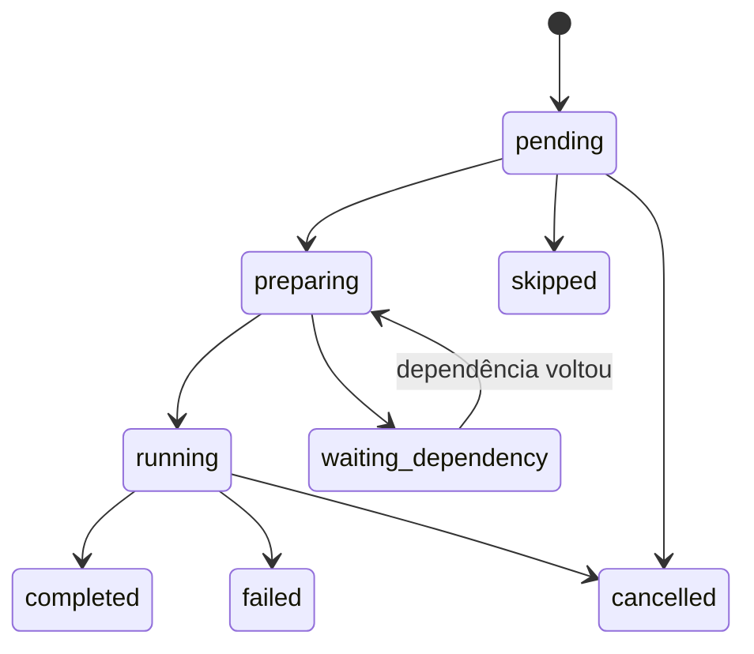

# Automações — runtime de tarefas persistentes

Automações persistentes, autônomas e multiplataforma: o Callidus planeja, grava,
dispara, executa, verifica e recupera tarefas automaticamente.

## 🏗️ As quatro responsabilidades

| Responsabilidade | Onde | O que garante |
|------------------|------|---------------|
| **Definição** | [`store.py`](store.py) + [`contracts.py`](contracts.py) | O contrato aprovado: gatilho, ação, dependências, permissões, política |
| **Disparo** | [`dispatcher.py`](dispatcher.py) | O registro idempotente do disparo e a política de disparos perdidos |
| **Runtime e supervisor** | [`supervisor.py`](supervisor.py) + [`service/`](service/) | O runtime vivo sem a interface e o arranque nativo do sistema |
| **Execução** | [`executor.py`](executor.py) + [`actions/`](actions/) | Dependências → ação → evidência → estado |

## 🏗️ Mapa dos módulos

| Arquivo | Responsabilidade |
|---------|------------------|
| [`enums.py`](enums.py) | Vocabulário: estados, tipos de gatilho, tipos de ação, políticas |
| [`contracts.py`](contracts.py) | Contrato pydantic da definição (versionado) |
| [`timezones.py`](timezones.py) | Fuso, horário de verão, horário local ambíguo ou inexistente |
| [`natural.py`](natural.py) | Interpretação de horário em linguagem natural ("todos os dias às 9h") |
| [`intent.py`](intent.py) | Reconhece quando o pedido da conversa é sobre tarefas agendadas |
| [`chat_service.py`](chat_service.py) | Serviço que o chat usa para criar, consultar e gerenciar automações |
| [`security.py`](security.py) | Permissões decididas antes do disparo (allowlist, escopo de caminhos, segredos) |
| [`dependencies.py`](dependencies.py) | Verificação e inicialização autorizada de dependências |
| [`triggers/`](triggers/) | Gatilhos temporais (`once`, `cron`, `interval`) e de evento interno |
| [`actions/`](actions/) | Ação Callidus (trabalho do agente) e ação de script (determinística) |
| [`dispatcher.py`](dispatcher.py) | Registro do disparo com chave de idempotência |
| [`executor.py`](executor.py) | Execução do disparo e reconciliação com o run real |
| [`supervisor.py`](supervisor.py) | Runtime autônomo (recupera, dispara, executa, reconcilia) |
| [`service/`](service/) | Adaptadores nativos: `launchd`, `systemd`, Agendador de Tarefas do Windows |
| [`cli.py`](cli.py) | `callidus-supervisor`: rodar, instalar, iniciar, parar, diagnosticar |

## 🔄 Máquina de estados do disparo



- `pending` — aguardando o horário (ou uma nova tentativa, com `next_attempt_at`).
- `preparing` — dependências verificadas, ação a caminho.
- `waiting_dependency` — dependência crítica indisponível; reagendado, sem inferência.
- `running` — a ação está em curso (para a ação Callidus, o run entregue ao worker).
- `completed` / `failed` / `blocked` / `skipped` / `cancelled` — estados finais.

**Registrar o disparo não é concluir a automação.** Uma ação Callidus entrega o run
ao worker e o disparo fica `running`; a reconciliação fecha o estado quando o run
chega a um estado terminal.

## 🔄 Idempotência

A chave de idempotência é única no banco (`automation_firings.idempotency_key`):

- temporal — `auto:<id>:<política>:<instante UTC>`
- evento — `auto:<id>:event:<origem>:<id do evento>`
- manual — `auto:<id>:<tag>:<aleatório>`

Reprocessar o mesmo disparo (reinício, tique duplicado, evento repetido) nunca cria
uma segunda execução equivalente.

## 🛠️ Comandos

```bash
callidus-supervisor run                    # primeiro plano (é o que o serviço executa)
callidus-supervisor install                # instala o serviço nativo (usuário, sem privilégio)
callidus-supervisor install --scope system # nível de sistema (exige administrador)
callidus-supervisor status                 # runtime + serviço nativo
callidus-supervisor diagnose               # automações, próximos disparos, pendências
callidus-supervisor uninstall              # remove o serviço nativo
```

## 💬 Automação pela conversa

O usuário não escreve cron: ele pede.

```text
Usuário: «Todos os dias às 9h, verifique os testes e me avise.»
    ↓
intent.py         reconhecem o pedido de automação
    ↓
natural.py        «todos os dias às 9h» → TriggerSpec validado (fuso do usuário)
    ↓
tools/automations.py   o modelo chama automation_create
    ↓
chat_service.py   grava a definição **desabilitada** e devolve a prévia + o token
    ↓
Usuário: «pode ativar» → automation_enable (com o token) → estado `enabled`
    ↓
supervisor.py     o runtime dispara no horário, com a mesma idempotência da API
```

Regras que o serviço garante (não são prompt):

| Regra | Como |
|-------|------|
| A criação não ativa | A automação nasce `disabled`; `automation_enable` exige o `confirmation_token` da prévia |
| Mudança material exige nova confirmação | O token é o hash dos campos que definem a automação; mudar o horário invalida o token antigo |
| Nada é inventado | Horário ambíguo («de manhã») vira pergunta, não escolha |
| O estado relatado é o real | A resposta sai do registro persistido, não do que o modelo disse |
| Testar não é executar | `automation_test` verifica a prontidão; só executa com pedido explícito |
| Permissões não se ampliam | Script exige `allow_scripts` e o executável na allowlist |

## 📚 Ligações

- [Persistência](/src/agent/persistence/README.md) — tabelas `automations`, `automation_firings`, `automation_events`
- [Serviços](/src/agent/services/README.md) — `scheduler.py` (fachada do agendamento)
- [Ferramentas](/src/agent/tools/README.md) — `automations.py` (as ferramentas do chat)
- [Arquitetura](/docs/architecture/automacoes.md) — o desenho completo