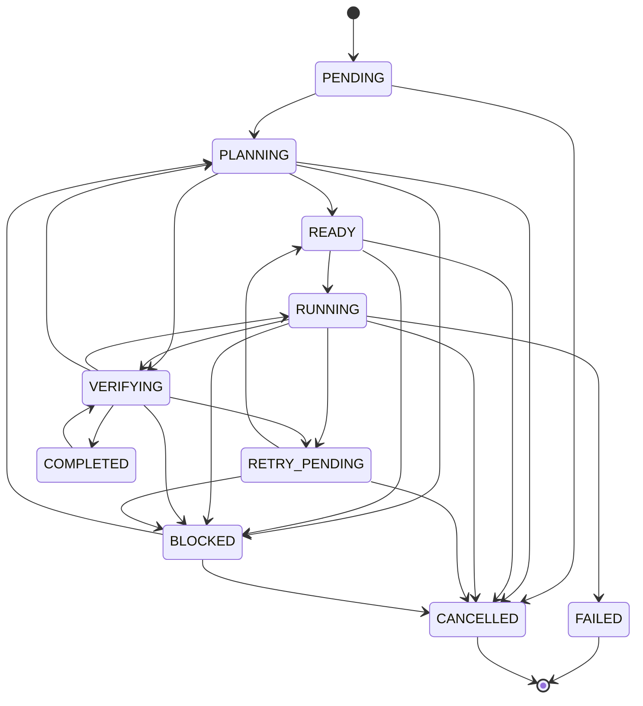

# Domínio (`domain/`) — Contratos, Estados e Falhas

Definições centrais compartilhadas por toda a aplicação: enums, máquina de estados, schemas Pydantic (fronteiras API/DB) e classificação de falhas.

## 📁 Arquivos

| Arquivo | Exporta | Propósito |
|---------|---------|-----------|
| [`enums.py`](enums.py) | `TaskStatus`, `RunStatus`, `TaskKind`, `MemoryKind`, `AttemptKind` | Enums de domínio (StrEnum) |
| [`agent_enums.py`](agent_enums.py) | `AgentStatus`, `ExecutionStatus`, `QueryStatus` | Estados do agente lógico, da execução e da consulta |
| [`agent_lifecycle.py`](agent_lifecycle.py) | `AGENT_TRANSITIONS`, `EXECUTION_TRANSITIONS`, `validate_agent_transition`, `validate_execution_transition`, `InvalidAgentTransition` | **Transições válidas** de agente e execução |
| [`state_machine.py`](state_machine.py) | `ALLOWED_TRANSITIONS`, `TERMINAL_STATUSES`, `can_transition`, `validate_transition`, `transition`, `InvalidTransitionError` | **Transições válidas** de `TaskStatus` — nunca silenciosas |
| [`schemas.py`](schemas.py) | `ProjectCreate/Read/Update`, `ConversationCreate/Read/Update/Fork/Move`, `BranchRead`, `TaskCreate/Read/StatusUpdate/DependencyCreate`, `ExecutionRunCreate/Read`, `EventRead`, `MemoryCreate/Read`, `AgentRead`, `AgentAsk`, `AgentDiscard`, `AgentQueryRead`, `ResumeBody` | **Contratos Pydantic** — validação request/response + `model_config = {"from_attributes": True}` |
| [`failures.py`](failures.py) | `Failure`, `FailureCategory`, `FailureCause`, `classify_context_error`, `classify_model_output`, `classify_provider_error`, `classify_tool_result`, `classify_verification` | **Classificação estruturada** de falhas (categoria + causa + signature + strategy) |

## 🔄 Machine de Estados (`TaskStatus`)



**`TERMINAL_STATUSES`**: `COMPLETED`, `FAILED`, `CANCELLED`

## 🧠 Tipos de Tarefa (`TaskKind`)
| Kind | Significado |
|------|-------------|
| `OBJECTIVE` | Raiz do objetivo (criada pelo usuário) |
| `SUBSYSTEM` | Agrupa operações relacionadas |
| `OPERATION` | Folha atômica (tool, model_operation, verification, final_answer) |

## 🧠 Tipos de Memória (`MemoryKind`)
| Kind | Escopo | Uso |
|------|--------|-----|
| `CANONICAL` | Projeto | Requisitos/decisões imutáveis (objetivo global) |
| `EXECUTION` | Task/Run | Planos, tentativas, bloqueios |
| `CONTEXTUAL` | Conversa | Referências a arquivos/trechos |
| `EVIDENCE` | Task | Testes, logs, comandos |
| `PROCEDURE` | Projeto/Conv | Padrões reutilizáveis |

## 🔄 Status de Run (`RunStatus`)
| Status | Significado |
|--------|-------------|
| `ACTIVE` | Rodando (worker ou steps manuais) |
| `PAUSED` | Limite operacional atingido — retomável |
| `COMPLETED` | Objetivo aceito (evidências + global_verify) |
| `FAILED` | Estagnado sem recuperação automática |
| `CANCELLED` | Interrompido pelo usuário |

## ⚠️ Classificação de Falhas (`FailureCategory` × `FailureCause`)

| Categoria | Causas Principais |
|-----------|-------------------|
| `CHANGE_STRATEGY` | `INVALID_PLAN`, `REPEATED_PROMPT`, `REPEATED_OUTPUT`, `STAGNATION` |
| `OPERATIONAL_LIMIT` | `ATTEMPTS_EXHAUSTED`, `CONTEXT_BUDGET`, `MAX_TASKS`, `MAX_DEPTH` |
| `CONFIGURATION` | `APPROVAL_REQUIRED`, `EXECUTABLE_MISSING`, `INVALID_CONFIG` |
| `EXTERNAL_UNAVAILABLE` | `PROVIDER_DOWN`, `NETWORK_ERROR`, `TOOL_UNAVAILABLE` |
| `BLOCKED_DEPENDENCY` | `DEPENDENCY_FAILED`, `DEPENDENCY_CANCELLED` |

**`Failure`** carrega: `category`, `cause`, `detail` + `as_dict()` → serializado em `OperationAttemptModel.failure_json` e `TaskModel.metadata_json.failures`.

## 🔌 Uso no Código

```python
# Transição de status (services/task_service.py)
from agent.domain.state_machine import validate_transition, InvalidTransitionError
validate_transition(current, target)  # levanta InvalidTransitionError se inválido

# Schemas nas rotas (api/*_routes.py)
from agent.domain.schemas import TaskCreate, TaskRead, ExecutionRunCreate

# Classificação de falha (orchestrator/runner.py)
from agent.domain.failures import classify_model_output, FailureCategory
failure = classify_model_output(content, err, missing)
```

## 🧪 Testes

```bash
pytest tests/test_state_machine.py -v
pytest tests/test_persistence.py -v  # inclui schemas via models
```

---

**Voltar:** [src/agent/README.md](../README.md) · **Raiz:** [README.md](../../../README.md) · **Máquina de estados:** [docs/architecture/maquina-estados.md](../../../docs/architecture/maquina-estados.md)