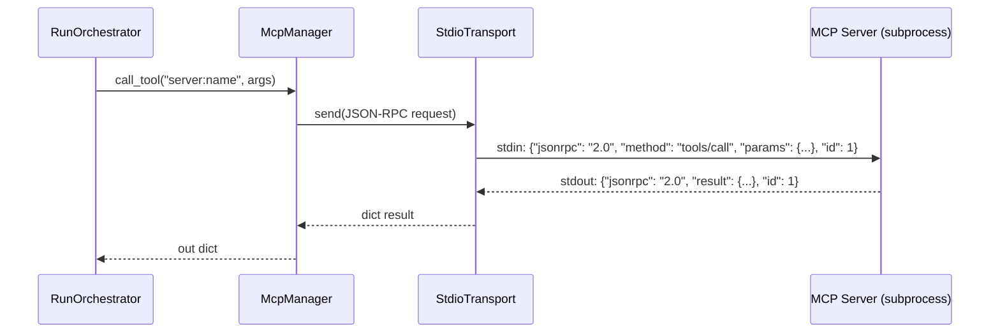

# MCP (`mcp/`) — Integração stdio com SDK `mcp`

Permite ao agente chamar ferramentas de servidores MCP locais via subprocess stdio (JSON-RPC 2.0).

## Módulos

| Arquivo | Exporta | Propósito |
|---------|---------|-----------|
| [`config_models.py`](config_models.py) | `McpConfig`, `McpServerConfig` | **Tipos de config** — Pydantic para `mcp.json` |
| [`manager.py`](manager.py) | `McpManager` | **Gerenciador** — carrega config, `list_servers`, `list_tools`, `discover`, `call_tool` |
| [`stdio_transport.py`](stdio_transport.py) | `StdioTransport` | **Transporte** — `ClientSession` sobre stdio subprocess |

## Configuração (`data/mcp.json`)

```json
{
  "servers": [
    {
      "name": "filesystem",
      "command": "npx",
      "args": ["-y", "@modelcontextprotocol/server-filesystem", "/path/to/allowed"],
      "env": {}
    },
    {
      "name": "github",
      "command": "npx",
      "args": ["-y", "@modelcontextprotocol/server-github"],
      "env": {"GITHUB_PERSONAL_ACCESS_TOKEN": "..."}
    }
  ]
}
```

**Copie o template**: `cp data/mcp.example.json data/mcp.json`

## McpManager (`manager.py`)

```python
mgr = McpManager(config_path=Path("data/mcp.json"))

# Lista servidores configurados
servers = mgr.list_servers()  # [{"name", "command", "args", "env"}]

# Lista todas as ferramentas de todos os servidores
tools = mgr.list_tools()  # [{"server": "filesystem", "name": "read_file", "description": "...", "inputSchema": {...}}]

# Descobre ferramentas (conecta em cada servidor)
discovered = await mgr.discover()  # {"servers": [...], "tools": [...]}

# Chama ferramenta
result = await mgr.call_tool("filesystem:read_file", {"path": "/allowed/file.txt"})
```

## StdioTransport (`stdio_transport.py`)

```python
class StdioTransport:
    def __init__(self, command: str, args: list[str], env: dict[str, str] | None = None):
        self._proc = subprocess.Popen(
            [command, *args],
            stdin=subprocess.PIPE,
            stdout=subprocess.PIPE,
            stderr=subprocess.PIPE,
            env={**os.environ, **(env or {})},
        )
    
    async def send(self, request: dict) -> dict:
        # JSON-RPC 2.0 request → stdin
        # Lê resposta linha a linha do stdout
        # Retorna dict (result ou error)
    
    async def close(self):
        self._proc.terminate()
```

## Integração com Orquestrador

### Tool `mcp_tool` (metadata da task)
```python
# runner.py → _execute_task
if meta.get("mcp_tool"):
    mgr = McpManager(settings.mcp_config_path or settings.data_dir / "mcp.json")
    out = await mgr.call_tool(meta["mcp_tool"], meta.get("mcp_args") or {})
    failure = classify_tool_result(out)
    # registra tentativa, atualiza status, verifica
```

### API Endpoints
| Rota | Descrição |
|------|-----------|
| `GET /mcp/servers` | Lista servidores + ferramentas + config_path |
| `POST /mcp/discover` | Conecta e descobre ferramentas de todos os servidores |
| `POST /mcp/call` | Chama ferramenta: `{"tool_id": "server:name", "arguments": {...}}` |

## Fluxo de Chamada MCP



## Testes

```bash
pytest tests/test_mcp_manager.py -v
```

---

**Voltar:** [src/agent/README.md](../README.md) · **Raiz:** [README.md](../../../README.md) · **Doc:** [docs/architecture/mcp.md](../../../docs/architecture/mcp.md)