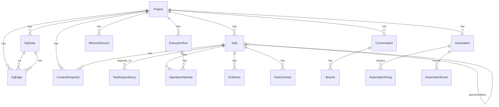

# Persistência (`persistence/`) — SQLAlchemy 2 + SQLite

Camada de dados: modelos ORM, engine, session factory e inicialização do banco.

## Arquivos

| Arquivo | Exporta | Propósito |
|---------|---------|-----------|
| [`models.py`](models.py) | 20 models SQLAlchemy (`ProjectModel`, `TaskModel`, `ConversationModel`, `BranchModel`, `TaskDependencyModel`, `ExecutionRunModel`, `ScheduledRunModel`, `OperationAttemptModel`, `EventLogModel`, `MemoryRecordModel`, `KgNodeModel`, `KgEdgeModel`, `TaskContractModel`, `ContextSnapshotModel`, `EvidenceModel`, `AgentModel`, `AgentExecutionModel`, `AgentQueryModel`, `AutomationModel`, `AutomationFiringModel`, `AutomationEventModel`) | **Tabelas** — UUID PK, FKs, JSON columns, índices, constraints |
| [`database.py`](database.py) | `create_db_engine`, `build_session_factory`, `init_db`, `get_engine` | Engine singleton + sessionmaker + `Base.metadata.create_all` |
| [`__init__.py`](__init__.py) | Re-exporta models + database | Facilita `from agent.persistence import ProjectModel, get_engine` |

## Modelo de Dados (20 Tabelas)

| Tabela | Entidade | Campos-Chave |
|--------|----------|--------------|
| `projects` | `ProjectModel` | `id`, `name`, `root_path`, `description`, `path_origin`, `created_at`, `updated_at` |
| `tasks` | `TaskModel` | `id`, `project_id`, `conversation_id`, `branch_id`, `parent_id`, `title`, `objective`, `scope`, `acceptance_criteria`, `status`, `kind`, `sort_order`, `metadata_json`, `consolidated_result_json`, timestamps |
| `conversations` | `ConversationModel` | `id`, `project_id`, `title`, `locale`, `root_path`, `active_branch_id`, timestamps |
| `branches` | `BranchModel` | `id`, `conversation_id`, `parent_id`, `fork_task_id`, `created_at` |
| `task_dependencies` | `TaskDependencyModel` | `id`, `task_id`, `depends_on_task_id` (unique pair) |
| `execution_runs` | `ExecutionRunModel` | `id`, `project_id`, `root_task_id`, `status`, `config_json`, timestamps |
| `scheduled_runs` | `ScheduledRunModel` | `id`, `project_id`, `cron_expression`, `config_json`, `enabled`, `last_run_at`, `next_run_at` |
| `operation_attempts` | `OperationAttemptModel` | `id`, `run_id`, `task_id`, `kind`, `provider`, `request_json`, `response_json`, `success`, `error_message`, `created_at` |
| `event_logs` | `EventLogModel` | `id`, `project_id`, `run_id`, `task_id`, `event_type`, `payload_json`, `created_at`, `seq`, `parent_task_id`, `agent`, `schema_version` |
| `memory_records` | `MemoryRecordModel` | `id`, `project_id`, `conversation_id`, `branch_id`, `task_id`, `kind`, `title`, `content`, `summary`, `outline_json`, `version`, `source_refs_json`, `created_at` |
| `kg_nodes` | `KgNodeModel` | `id`, `project_id`, `kind`, `ref`, `label`, `meta_json`, `updated_at` (unique: project_id, kind, ref) |
| `kg_edges` | `KgEdgeModel` | `id`, `project_id`, `src_id`, `dst_id`, `rel` (unique: project_id, src_id, dst_id, rel) |
| `task_contracts` | `TaskContractModel` | `id`, `task_id` (unique), `inputs_json`, `outputs_json`, `invariants_json`, `acceptance_json`, `created_at` |
| `context_snapshots` | `ContextSnapshotModel` | `id`, `project_id`, `task_id`, `run_id`, `estimated_tokens`, `components_json`, `strategy_notes_json`, `refs_json`, `created_at` |
| `evidences` | `EvidenceModel` | `id`, `task_id`, `attempt_id`, `verifier`, `passed`, `summary`, `detail_json`, `created_at` |
| `agents` | `AgentModel` | `id`, `project_id`, `parent_id` (agente pai), `task_id`, `role`, `instructions`, `permissions_json`, `status`, `depth`, `metadata_json`, timestamps |
| `agent_executions` | `AgentExecutionModel` | `id`, `agent_id`, `task_id`, `run_id`, `status`, `attempt`, `checkpoint_json`, `context_refs_json`, `last_error`, `started_at`, `finished_at` |
| `automations` | `AutomationModel` | `id`, `project_id`, `name`, `contract_version`, `target_kind`, `trigger_json`, `action_json`, `dependencies_json`, `permissions_json`, `policy_json`, `timezone`, `missed_policy`, `state`, `conversation_id`, `task_id`, `objective_mode`, `objective_json`, `max_attempts`, `timeout_sec`, `next_run_at`, `last_run_at`, timestamps |
| `automation_firings` | `AutomationFiringModel` | `id`, `automation_id`, `project_id`, `idempotency_key` (única), `scheduled_for`, `fired_at`, `state`, `attempt`, `max_attempts`, `run_id`, `task_id`, `next_attempt_at`, `result_json`, `error`, timestamps |
| `automation_events` | `AutomationEventModel` | `id`, `event_type`, `source`, `project_id`, `payload_json`, `dedupe_key` (único), `created_at`, `consumed_at` |
| `agent_queries` | `AgentQueryModel` | `id`, `project_id`, `requester_agent_id`, `target_agent_id`, `answered_by_agent_id`, `task_id`, `correlation_id`, `questions_json`, `status`, `answer`, `answer_json`, `attempts`, `max_attempts`, `created_at`, `answered_at` |

## Engine & Session

```python
# database.py
def create_db_engine(settings: Settings) -> Engine:
    url = settings.resolved_database_url()
    return create_engine(url, pool_pre_ping=True, future=True)

def build_session_factory(engine: Engine) -> sessionmaker:
    return sessionmaker(bind=engine, class_=Session, expire_on_commit=False, future=True)

# Uso típico (services, orchestrator)
from agent.persistence.database import get_engine
engine = get_engine()  # singleton
Session = build_session_factory(engine)
session = Session()
```

## Configuração do Banco

- **Arquivo**: `data/agent.db` (padrão) — configurável via `AGENT_DATA_DIR` ou `DATABASE_URL`
- **Testes**: `Settings.resolved_database_url()` força `data/agent.db` quando `PYTEST_CURRENT_TEST` está setado (não grava no banco real)
- **Migrações**: `create_all` no `init_db` + ajustes incrementais (`_migrate_sqlite`) e a conversão de `scheduled_runs` em automações (`migrate_legacy_schedules`, idempotente — a tabela antiga não é apagada)

## Relacionamentos Principais



## Testes

```bash
pytest tests/test_persistence.py -v
```

---

**Voltar:** [src/agent/README.md](../README.md) · **Raiz:** [README.md](../../../README.md) · **Modelo de dados:** [docs/architecture/modelo-dados.md](../../../docs/architecture/modelo-dados.md)